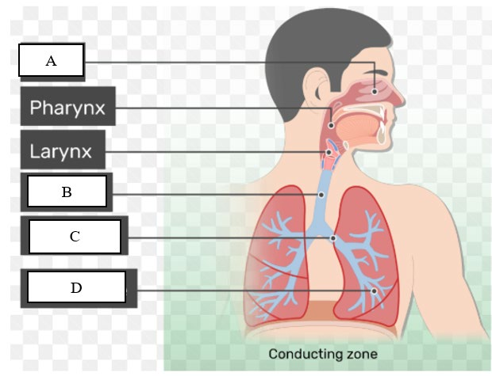
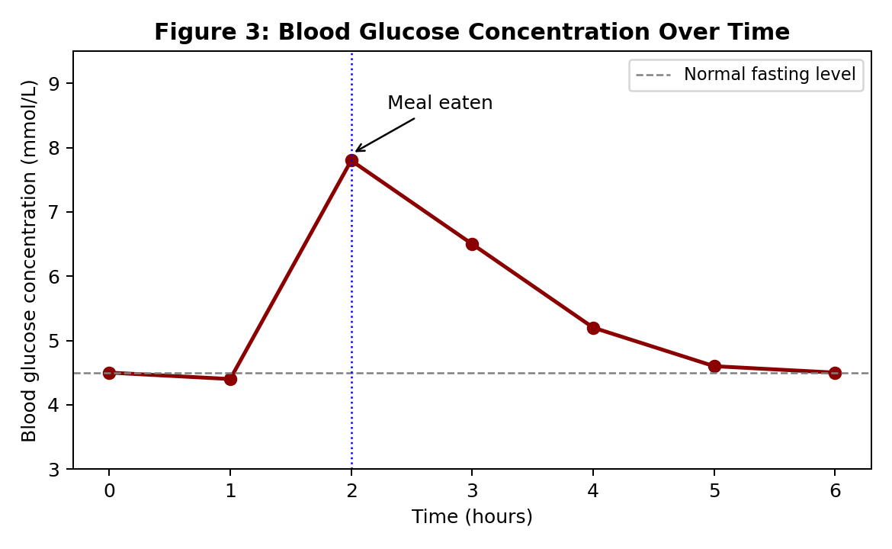
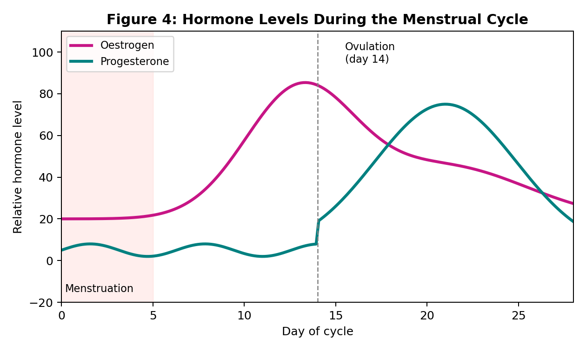

# IGCSE Grade 8 Science (Human Physiology Part 2)
## Complete Course Workbook Exercise Bilingual Reference Answers & Syllabus Mark Scheme
### 《G8科学（人体生理学下册）》课后练习官方中英双语标准答案、教材出处详注与互动练习设计指南

> **Authoritative Reference Standard / 官方权威依据标准**:
> 1. 《G8 Science.pdf》（Cambridge Checkpoint & IGCSE Biology 核心教材，涵盖 Chapters 2, 3, 4, 5，共70页）
> 2. 《G8_Science_Human_Physiology_Part2.pdf》（官方配套讲义、学生练习册与复习题，共149页）
> 3. 《5008_IG Science G8_Science_Autumn (教师版PPT）.pptx》（官方教师授课课件，共236页幻灯片）
>
> **审查执行声明**：本答案库对《G8_Science_Human_Physiology_Part2.pdf》全部149页内的所有课后练习（Lessons 19–32）、阶段总结性测评（Lesson 24 & Lesson 30 Housekeeping Review）以及全书总复习测评（Section A 40道选择题 + Section B 15道综合大题）进行了极其严密、细致、权威的逐题精读与解析。所有答案均严格依据官方教材《G8 Science.pdf》正文、生理图表与数据，完整实现中英双语对齐，逐题标明教材出处（具体到章节、页码、段落及图表编号），并针对未来网页互动练习与游戏化开发配置了标准化交互元数据（Interactive Metadata）。

## 一、教材、讲义与练习精准出处总索引表 (Master Curriculum & Citation Map)

| 单元 / 课时 | 英文标题 | 中文课题 | 核心教材出处 (G8 Science.pdf) | 讲义与练习册出处 |
| :--- | :--- | :--- | :--- | :--- |
| **Lesson 19** | Lesson 19: Functions of Blood | 第19课：血液的功能与循环运输机制 | 《G8 Science.pdf》Chapter 2: B7.04 Blood (pp. 30-33, Table B7.02, Fig B7.11) | 《G8_Science_Human_Physiology_Part2.pdf》Lecture Notes pp. 16-20 (Tasks pp. 21-25) |
| **Lesson 20** | Lesson 20: White Blood Cells & Blood Clotting | 第20课：白细胞免疫防御与血液凝固级联反应 | 《G8 Science.pdf》Chapter 2: B7.04 Blood (pp. 33-34, Fig B7.11, Fig B7.12, Table B7.03) | 《G8_Science_Human_Physiology_Part2.pdf》Lecture Notes pp. 26-30 (Tasks pp. 31-34) |
| **Lesson 21** | Lesson 21: The Respiratory System | 第21课：呼吸系统解剖与肺部通气力学机制 | 《G8 Science.pdf》Chapter 3: B8.02 Gas exchange in humans (pp. 36-39, Fig B8.01, Fig B8.03, Fig B8.04) | 《G8_Science_Human_Physiology_Part2.pdf》Lecture Notes pp. 35-39 (Tasks pp. 40-44) |
| **Lesson 22** | Lesson 22: Alveoli & Gas Exchange | 第22课：肺泡微观结构、气体交换与扩散适应性 | 《G8 Science.pdf》Chapter 3: B8.02 Gas exchange in humans (pp. 38-41, Fig B8.02, Fig B8.05) | 《G8_Science_Human_Physiology_Part2.pdf》Lecture Notes pp. 45-48 (Tasks pp. 49-52) |
| **Lesson 23** | Lesson 23: The Urinary System | 第23课：泌尿排泄系统解剖与排泄生理学辨析 | 《G8 Science.pdf》Chapter 1 p. 12 (Egestion definition) & Chapter 4: B9.06 Homeostasis (pp. 54-56) | 《G8_Science_Human_Physiology_Part2.pdf》Lecture Notes pp. 53-56 (Tasks pp. 57-61) |
| **Lesson 24** | Lesson 24: Review — Housekeeping | 第24课：血液循环、呼吸与泌尿排泄综合复习测试与评分细则 | 《G8 Science.pdf》Chapter 2 (pp. 30-34), Chapter 3 (pp. 36-43), Chapter 4 (pp. 54-56) | 《G8_Science_Human_Physiology_Part2.pdf》Review Exam pp. 62-67 |
| **Lesson 25** | Lesson 25: Urine Formation & Sweat | 第25课：尿液生成微观机制（肾单位滤过与重吸收）及汗液排泄 | 《G8 Science.pdf》Chapter 4: B9.06 Homeostasis (pp. 54-56) & B9.07 Skin (pp. 56-58, Fig B9.18) | 《G8_Science_Human_Physiology_Part2.pdf》Lecture Notes pp. 68-71 (Tasks pp. 72-75) |
| **Lesson 26** | Lesson 26: Nervous & Endocrine Coordination | 第26课：神经调节与内分泌体液调节机制对比与协同 | 《G8 Science.pdf》Chapter 4: B9.01 Coordination, B9.02 Nervous system, B9.04 Hormones (pp. 47-51, 54-55) | 《G8_Science_Human_Physiology_Part2.pdf》Lecture Notes pp. 76-79 (Tasks pp. 80-84) |
| **Lesson 27** | Lesson 27: Endocrine Glands & Adrenaline | 第27课：人体六大内分泌腺体分布与肾上腺素应激反应 | 《G8 Science.pdf》Chapter 4: B9.04 Hormones (pp. 54-55) | 《G8_Science_Human_Physiology_Part2.pdf》Lecture Notes pp. 85-88 (Tasks pp. 89-92) |
| **Lesson 28** | Lesson 28: Controlling Blood Glucose | 第28课：血糖稳态负反馈调节回路（胰岛素、胰高血糖素与糖尿病） | 《G8 Science.pdf》Chapter 4: B9.08 Blood glucose regulation (pp. 59-60, Fig B9.20) | 《G8_Science_Human_Physiology_Part2.pdf》Lecture Notes pp. 93-96 (Tasks pp. 97-101) |
| **Lesson 29** | Lesson 29: Puberty & Adolescence | 第29课：青春期发育、性激素生理作用与第二性征分化 | 《G8 Science.pdf》Chapter 5: B11.01 Human reproductive organs (pp. 61-64, Fig B11.01, Fig B11.02) | 《G8_Science_Human_Physiology_Part2.pdf》Lecture Notes pp. 102-105 (Tasks pp. 106-109) |
| **Lesson 30** | Lesson 30: Review — Housekeeping | 第30课：稳态、泌尿、神经体液调节与青春期综合测试与评分细则 | 《G8 Science.pdf》Chapter 4 (pp. 54-60) & Chapter 5 (pp. 61-64) | 《G8_Science_Human_Physiology_Part2.pdf》Review Exam pp. 110-114 |
| **Lesson 31** | Lesson 31: Health During Adolescence | 第31课：青少年健康四大维度（生理、心理、情绪、社交）与生活方式 | 《G8 Science.pdf》Chapter 5: B11.04 Health & Development (pp. 68-70) | 《G8_Science_Human_Physiology_Part2.pdf》Lecture Notes pp. 115-118 (Tasks pp. 119-122) |
| **Lesson 32** | Lesson 32: The Menstrual Cycle & Pregnancy | 第32课：女性月经周期五阶段、四种激素波动曲线与受孕机制 | 《G8 Science.pdf》Chapter 5: B11.02 Fertilisation & B11.03 The menstrual cycle (pp. 64-68, Fig B11.10) | 《G8_Science_Human_Physiology_Part2.pdf》Lecture Notes pp. 123-126 (Tasks pp. 127-131) |
| **Lesson Exam** | Cumulative Revision Exam: Section A & Section B | 下册全书总复习测评题（Section A 40道选择题 + Section B 15道综合大题） | 《G8 Science.pdf》Chapters 2, 3, 4, 5 (Cumulative Review pp. 21-70) | 《G8_Science_Human_Physiology_Part2.pdf》Revision Questions pp. 132-148 |

---

# PART I: MAMMALIAN TRANSPORT – BLOOD & IMMUNITY
## 第一部分：哺乳动物运输系统 — 血液与免疫（第19至20课）

---

## Lesson 19: Functions of Blood
### 第19课：血液的功能与循环运输机制
- **教材官方出处 (Textbook)**: 《G8 Science.pdf》Chapter 2: B7.04 Blood (pp. 30-33, Table B7.02, Fig B7.11)
- **配套讲义与练习 (Notes & Tasks)**: 《G8_Science_Human_Physiology_Part2.pdf》Lecture Notes pp. 16-20 (Tasks pp. 21-25)

#### ▶ Task 19.1 — Starter – Brainstorm: Substances Transported by Blood
**【中文任务标题】**: 热身任务 — 头脑风暴：血液在体内运输的物质  
**【互动题型 / 游戏化组件】**: `table_fill` (分类卡片 / 联想填空)  
**【标准依据出处】**: 《G8 Science.pdf》Chapter 2: B7.04 Blood (pp. 30-33, Table B7.02) | 《G8_Science_Human_Physiology_Part2.pdf》Lecture Notes pp. 16-17; Task p. 21  

##### 1. 题目内容与要求 (Question Prompt)
**[EN]**:
```text
List all the things you think blood transports around the body (provide at least 6 different substances/factors).
```
**[CN]**:
列举血液在人体全身循环运输的所有物质（至少列出6种不同的物质或生理因素）。

##### 2. 官方参考答案与评分标准 (Official Reference Answer & Mark Scheme)
**[EN]**:
```text
1. Oxygen [O2]
2. Carbon dioxide [CO2]
3. Nutrients (Glucose, Amino acids, Lipids/Fatty acids)
4. Hormones (e.g., Insulin, Adrenaline)
5. Metabolic waste products (Urea)
6. Mineral ions (Sodium, Potassium, Calcium) and Water (Heat / Thermal energy is also distributed).
```
**[CN]**:
1. 氧气 [O2]
2. 二氧化碳 [CO2]
3. 营养素（葡萄糖、氨基酸、脂质/脂肪酸）
4. 激素/荷尔蒙（如胰岛素、肾上腺素）
5. 代谢废物（尿素）
6. 无机盐离子（钠、钾、钙离子）与水（血液还负责在体内分配热量）。

##### 3. 生理机制深度剖析与考点解析 (Scientific Rationale & Exam Marking Insights)
- **[EN Rationale]**: Blood functions as the primary long-distance internal transport medium in mammals. Red blood cells specifically transport oxygen bound to haemoglobin, while blood plasma carries dissolved carbon dioxide, digested soluble nutrients, hormones from endocrine glands, urea from the liver to the kidneys, and distributes metabolic heat from active tissues (such as the liver and muscles) to maintain homeostatic body temperature.
- **[CN 解析]**: 血液是哺乳动物体内最主要的长距离液体运输介质。红细胞特异性地运输与血红蛋白结合的氧气；血浆则作为溶剂溶解并运载二氧化碳、消化吸收的水溶性营养物质、内分泌腺分泌的激素、肝脏产生的代谢废物尿素（运往肾脏排泄），并在体内均匀传递代谢热量，维持恒温动物的体温稳态。

---

#### ▶ Task 19.2 — Keyword Flashcards (Table 19.1)
**【中文任务标题】**: 核心关键词抽认卡连线配对（表19.1）  
**【互动题型 / 游戏化组件】**: `matching` (双栏连线题 / 骨牌配对)  
**【标准依据出处】**: 《G8 Science.pdf》Chapter 2: B7.04 Blood (pp. 31-34, Table B7.02) | 《G8_Science_Human_Physiology_Part2.pdf》Lecture Notes pp. 17-18; Task p. 22  

##### 1. 题目内容与要求 (Question Prompt)
**[EN]**:
```text
Match each keyword to its correct definition in Table 19.1:
Keywords: Haemoglobin, Fibrin, Antibody, Fibrinogen
Definitions:
A. A protein that forms a mesh to trap blood cells during clotting
B. A protein in red blood cells that carries oxygen
C. A soluble protein in plasma that converts to fibrin during clotting
D. A protein produced by lymphocytes that destroys pathogens
```
**[CN]**:
将表19.1中的每个关键词与其准确的生物学定义进行匹配：
关键词：血红蛋白 (Haemoglobin)、纤维蛋白 (Fibrin)、抗体 (Antibody)、纤维蛋白原 (Fibrinogen)
定义选项：
A. 凝血过程中形成网状结构以网罗血细胞的蛋白质
B. 红细胞中负责结合并携带氧气的含铁蛋白质
C. 血浆中的可溶性蛋白质，在凝血级联中被酶催化转化为纤维蛋白
D. 由淋巴细胞产生以特异性结合并消灭病原体的蛋白质

##### 2. 官方参考答案与评分标准 (Official Reference Answer & Mark Scheme)
**[EN]**:
```text
• Haemoglobin -> B: A protein in red blood cells that carries oxygen
• Fibrin -> A: A protein that forms a mesh to trap blood cells during clotting
• Antibody -> D: A protein produced by lymphocytes that destroys pathogens
• Fibrinogen -> C: A soluble protein in plasma that converts to fibrin during clotting
```
**[CN]**:
• 血红蛋白 (Haemoglobin) -> B：红细胞中负责结合并携带氧气的含铁蛋白质
• 纤维蛋白 (Fibrin) -> A：凝血过程中形成网状结构以网罗血细胞的不溶性蛋白质
• 抗体 (Antibody) -> D：由淋巴细胞产生以特异性结合并消灭病原体的免疫球蛋白
• 纤维蛋白原 (Fibrinogen) -> C：血浆中的可溶性前体蛋白质，凝血时被转化为纤维蛋白

##### 3. 生理机制深度剖析与考点解析 (Scientific Rationale & Exam Marking Insights)
- **[EN Rationale]**: Understanding blood proteins is essential: Haemoglobin contains iron prosthetic groups to reversibly bind O2. Fibrinogen is an inactive soluble precursor in plasma that prevents spontaneous clotting. Fibrin is its insoluble polymer form that creates mechanical nets. Antibodies are protective globular proteins synthesized by B-lymphocytes.
- **[CN 解析]**: 准确区分血液蛋白质至关重要：血红蛋白含有亚铁血红素辅基，能可逆性结合氧气；纤维蛋白原是血浆中溶解的非活性前体，保证平时血液不凝固；纤维蛋白则是其不溶性纤维状聚合物，形成机械网罗网络；抗体是B淋巴细胞合成的特异性免疫防御球蛋白。

---

#### ▶ Task 19.3 — Match Transport Function to Substance (Table 19.2)
**【中文任务标题】**: 运输功能与具体物质匹配对应表（表19.2）  
**【互动题型 / 游戏化组件】**: `table_fill` (表格填空 / 拖拽匹配)  
**【标准依据出处】**: 《G8 Science.pdf》Chapter 2: B7.04 Blood (pp. 30-33, Table B7.02) | 《G8_Science_Human_Physiology_Part2.pdf》Lecture Notes pp. 17-19; Task p. 22  

##### 1. 题目内容与要求 (Question Prompt)
**[EN]**:
```text
Match the transport function to the corresponding substance(s) in Table 19.2:
- Oxygen transport
- Carbon dioxide transport
- Nutrient transport
- Hormone transport
- Urea transport
```
**[CN]**:
补全表19.2，将人体的各项循环运输功能与所运载的具体物质及形态对应：
- 氧气运输
- 二氧化碳运输
- 营养物质运输
- 激素运输
- 尿素运输

##### 2. 官方参考答案与评分标准 (Official Reference Answer & Mark Scheme)
**[EN]**:
```text
• Oxygen transport -> Oxygen (O2 bound to haemoglobin as oxyhaemoglobin)
• Carbon dioxide transport -> Carbon dioxide (CO2, mostly as hydrogencarbonate ions HCO3- and dissolved in plasma)
• Nutrient transport -> Glucose, amino acids, fatty acids, glycerol, vitamins, and minerals
• Hormone transport -> Chemical messengers (e.g. insulin, adrenaline, thyroxine, sex hormones)
• Urea transport -> Urea (nitrogenous waste transported from liver to kidneys)
```
**[CN]**:
• 氧气运输 -> 氧气（结合在红细胞血红蛋白上形成氧合血红蛋白）
• 二氧化碳运输 -> 二氧化碳（主要以碳酸氢根离子 HCO3- 及溶解形式存在于血浆中）
• 营养物质运输 -> 葡萄糖、氨基酸、脂肪酸、甘油、维生素和矿物质（溶解于血浆）
• 激素运输 -> 激素/化学信使（如胰岛素、肾上腺素、甲状腺素、性激素，溶解于血浆）
• 尿素运输 -> 尿素（肝脏脱氨基产生的含氮代谢废物，由血浆运送至肾脏）

##### 3. 生理机制深度剖析与考点解析 (Scientific Rationale & Exam Marking Insights)
- **[EN Rationale]**: Substances are partitioned based on their chemical solubility: Oxygen is poorly soluble in aqueous plasma, necessitating a specialized carrier protein (haemoglobin) inside erythrocyte cells. Conversely, polar nutrients, peptide hormones, and urea dissolve directly into the water-rich plasma phase.
- **[CN 解析]**: 物质运输途径由其物理化学性质决定：氧气在水中的溶解度极低，必须依靠红细胞内的载体蛋白（血红蛋白）结合运送；而极性葡萄糖、氨基酸、水溶性激素及尿素则直接溶解在含水率高达90%以上的血浆中进行全身循环流转。

---

#### ▶ Task 19.4 — Clotting Sequencing Activity (Table 19.3)
**【中文任务标题】**: 血液凝固生理级联阶段排序（表19.3）  
**【互动题型 / 游戏化组件】**: `sorting` (事件顺序拖拽排序游戏)  
**【标准依据出处】**: 《G8 Science.pdf》Chapter 2: B7.04 Blood (p. 34, Fig B7.12) | 《G8_Science_Human_Physiology_Part2.pdf》Lecture Notes pp. 19-20; Task p. 23  

##### 1. 题目内容与要求 (Question Prompt)
**[EN]**:
```text
Number the steps from 1 to 5 in the correct chronological order in Table 19.3:
- Fibrin forms a mesh that traps red blood cells and platelets
- Platelets stick to the damaged area and release clotting factors
- A solid clot forms, stopping blood loss
- Clotting factors convert soluble fibrinogen into insoluble fibrin
- Blood vessel is damaged
```
**[CN]**:
按发生的时间先后顺序，在表19.3中将血液凝固的5个步骤标号（1至5）：
- 纤维蛋白形成网状结构，网罗红细胞和血小板
- 血小板黏附在受损区域并释放凝血因子
- 形成坚固血栓/血块，彻底阻止血液流失
- 凝血因子促使可溶性纤维蛋白原转化为不溶性纤维蛋白
- 血管受损破裂

##### 2. 官方参考答案与评分标准 (Official Reference Answer & Mark Scheme)
**[EN]**:
```text
Order 1: Blood vessel is damaged
Order 2: Platelets stick to the damaged area and release clotting factors
Order 3: Clotting factors convert soluble fibrinogen into insoluble fibrin
Order 4: Fibrin forms a mesh that traps red blood cells and platelets
Order 5: A solid clot forms, stopping blood loss
```
**[CN]**:
步骤 1：血管受损破裂 (Blood vessel is damaged)
步骤 2：血小板黏附在受损区域并释放凝血因子 (Platelets stick and release clotting factors)
步骤 3：凝血因子促使可溶性纤维蛋白原转化为不溶性纤维蛋白 (Fibrinogen converted to fibrin)
步骤 4：纤维蛋白形成网状结构，网罗红细胞和血小板 (Fibrin mesh traps cells)
步骤 5：形成坚固血栓/血块，彻底阻止血液流失 (Solid clot forms)

##### 3. 生理机制深度剖析与考点解析 (Scientific Rationale & Exam Marking Insights)
- **[EN Rationale]**: Hemostasis proceeds in an exact biochemical sequence: Endothelial damage exposes subendothelial collagen, triggering platelet adhesion and activation. Platelets release thromboplastin/clotting factors, which activate an enzyme cascade converting soluble fibrinogen into insoluble fibrin polymer strands. These strands entrap flowing erythrocytes and platelets, forming a physical plug that contracts and dries into a protective scab.
- **[CN 解析]**: 止血过程遵循严密的生理级联机制：血管内皮破损暴露出胶原纤维，触发血小板黏附与聚集；血小板活化后释放凝血因子，催化级联酶促反应，将血浆中溶解的纤维蛋白原转化为不溶性的纤维蛋白长丝；纤维蛋白纤维纵横交错编织成网，捕获流经的红细胞与更多血小板，形成机械凝块并干燥为保护性血痂。

---

#### ▶ Task 19.5 — One Sentence Summary – Three Main Functions of Blood
**【中文任务标题】**: 一句话核心提炼 — 血液的三大生理功能  
**【互动题型 / 游戏化组件】**: `cloze` (选词填空 / 核心要点归纳)  
**【标准依据出处】**: 《G8 Science.pdf》Chapter 2: B7.04 Blood (pp. 30-34) | 《G8_Science_Human_Physiology_Part2.pdf》Lecture Notes pp. 16-20; Task p. 23  

##### 1. 题目内容与要求 (Question Prompt)
**[EN]**:
```text
Complete the sentence below detailing the three main functions of blood:
1. Transport of _________________________________________________
2. Defence against _________________________________________________
3. Regulation of _________________________________________________
```
**[CN]**:
补全下列句子，完整总结血液在人体中的三大核心功能：
1. 运输 (Transport of)：_________________________________________________
2. 防御 (Defence against)：_________________________________________________
3. 调节 (Regulation of)：_________________________________________________

##### 2. 官方参考答案与评分标准 (Official Reference Answer & Mark Scheme)
**[EN]**:
```text
1. Transport of essential substances (oxygen, nutrients, carbon dioxide, metabolic wastes like urea, hormones, and heat).
2. Defence against pathogens, disease, and foreign microorganisms (via phagocytosis by phagocytes, antibody production by lymphocytes, and clotting by platelets to seal wounds).
3. Regulation of internal body conditions / homeostasis (including body temperature, fluid balance, and blood pH).
```
**[CN]**:
1. 运输：氧气、营养物质、二氧化碳、代谢废物（尿素）、激素以及体内热量。
2. 防御：抵御外来病原体侵染与疾病（通过吞噬细胞吞噬、淋巴细胞产生特异性抗体，以及血小板凝血封堵创口）。
3. 调节：维持机体内环境稳态（包括恒定体温、体液渗透压平衡以及酸碱度 pH 缓冲）。

##### 3. 生理机制深度剖析与考点解析 (Scientific Rationale & Exam Marking Insights)
- **[EN Rationale]**: Cambridge IGCSE classifies the systemic functions of blood into the 'Triple Pillars': (1) Transport (distributing substrates and eliminating wastes), (2) Defence (innate and adaptive immunity plus wound sealing), and (3) Homeostatic Regulation (temperature dissipation and osmotic stabilization).
- **[CN 解析]**: 剑桥IGCSE生物大纲将血液功能系统概括为三大支柱：(1) 物质运输（输送能量底物与代谢清除），(2) 免疫防御（吞噬与抗体双重免疫加上创口凝血封闭），(3) 稳态调节（热量对流散发、水盐平衡与酸碱缓冲）。

---

#### ▶ Task 19.6 — Match Substance to Transport Method (Table 19.4)
**【中文任务标题】**: 物质与运输载体途径匹配表（表19.4）  
**【互动题型 / 游戏化组件】**: `matching` (多对一匹配题)  
**【标准依据出处】**: 《G8 Science.pdf》Chapter 2: B7.04 Blood (pp. 30-33, Table B7.02) | 《G8_Science_Human_Physiology_Part2.pdf》Lecture Notes pp. 17-19; Task p. 24  

##### 1. 题目内容与要求 (Question Prompt)
**[EN]**:
```text
Match each substance to how it is transported. Write the letter of the Transport method in Table 19.4:
Substances: Oxygen, Carbon dioxide, Glucose, Hormones
Methods:
A. Dissolved in plasma
B. Bound to haemoglobin in red blood cells
C. Carried by plasma as dissolved molecules
D. Carried by plasma as dissolved molecules
```
**[CN]**:
将每种物质与其在血液中的运载方式进行配对，填写选项字母至表19.4：
物质：氧气 (Oxygen)、二氧化碳 (Carbon dioxide)、葡萄糖 (Glucose)、激素 (Hormones)
运载方式：
A. 溶解于血浆中 (Dissolved in plasma)
B. 与红细胞内的血红蛋白结合 (Bound to haemoglobin in red blood cells)
C. 作为溶质分子溶解在血浆中运载
D. 作为溶解的化学信使由血浆运载

##### 2. 官方参考答案与评分标准 (Official Reference Answer & Mark Scheme)
**[EN]**:
```text
• Oxygen -> B: Bound to haemoglobin in red blood cells
• Carbon dioxide -> A: Dissolved in plasma (predominantly as hydrogencarbonate ions)
• Glucose -> C: Carried by plasma as dissolved molecules
• Hormones -> D: Carried by plasma as dissolved molecules
```
**[CN]**:
• 氧气 -> B：与红细胞内的血红蛋白结合成氧合血红蛋白运载
• 二氧化碳 -> A：溶解于血浆中（主要转变为碳酸氢根离子运载）
• 葡萄糖 -> C：作为极性单糖小分子直接溶解在血浆中运载
• 激素 -> D：作为内分泌化学信使由血浆溶解运输至靶器官

##### 3. 生理机制深度剖析与考点解析 (Scientific Rationale & Exam Marking Insights)
- **[EN Rationale]**: Over 98% of oxygen in arterial blood is transported chemically bound to the iron atoms of haemoglobin inside erythrocytes. By contrast, carbon dioxide is converted into hydrogencarbonate ions (HCO3-) dissolved in plasma, and hydrophilic small molecules such as glucose and endocrine hormones circulate freely dissolved in the plasma water.
- **[CN 解析]**: 动脉血中超过98%的氧气是以化学结合方式结合在红细胞血红蛋白的亚铁中心上。相比之下，二氧化碳在红细胞内酶催化后转化为碳酸氢根离子进入血浆运输，亲水性葡萄糖与各类内分泌激素则直接以分子状态自由溶解在血浆液体中流转。

---

#### ▶ Task 19.7 — Fill in the Blanks – Blood Clotting Word Bank
**【中文任务标题】**: 凝血生理机制选词填空  
**【互动题型 / 游戏化组件】**: `cloze` (完形填空 / 词库拖拽)  
**【标准依据出处】**: 《G8 Science.pdf》Chapter 2: B7.04 Blood (pp. 33-34, Fig B7.12) | 《G8_Science_Human_Physiology_Part2.pdf》Lecture Notes pp. 19-20; Task p. 24  

##### 1. 题目内容与要求 (Question Prompt)
**[EN]**:
```text
Fill in the blanks using the word bank: [fibrin, fibrinogen, platelets, mesh, clot]
a) When a blood vessel is damaged, _______________ stick to the area.
b) They release clotting factors that convert soluble _______________ into insoluble _______________.
c) Fibrin forms a _______________ that traps red blood cells.
d) This forms a solid _______________ that stops bleeding.
```
**[CN]**:
使用词库填空：[fibrin (纤维蛋白), fibrinogen (纤维蛋白原), platelets (血小板), mesh (网状结构), clot (血凝块)]
a) 当血管破损时，_______________ 会迅速黏附在该受损区域。
b) 它们释放凝血因子，促使可溶性的 _______________ 转化为不溶性的 _______________。
c) 纤维蛋白聚合成 _______________，网罗过往的红细胞与血细胞。
d) 这便形成了一个固态的 _______________，从而彻底封堵创口止血。

##### 2. 官方参考答案与评分标准 (Official Reference Answer & Mark Scheme)
**[EN]**:
```text
a) platelets
b) fibrinogen, fibrin
c) mesh
d) clot
```
**[CN]**:
a) platelets (血小板)
b) fibrinogen (纤维蛋白原), fibrin (纤维蛋白)
c) mesh (网状结构)
d) clot (血凝块 / 血栓)

##### 3. 生理机制深度剖析与考点解析 (Scientific Rationale & Exam Marking Insights)
- **[EN Rationale]**: The clotting cascade is designed to produce a fast, local physical barrier. Platelets trigger the transformation of soluble fibrinogen into insoluble polymerised strands of fibrin. The resulting mechanical mesh traps blood cells, dehydrating and crosslinking into a firm scab to seal the breach.
- **[CN 解析]**: 凝血级联反应旨在快速形成局部的机械物理屏障。血小板触发可溶性纤维蛋白原酶解聚合为不溶性纤维蛋白长纤维。交织形成的网格拦截捕获红细胞，脱水紧缩后固化为坚硬的血块和痂皮，封闭受损内皮。

---

#### ▶ Task 19.8 — Plasma Transport & Thrombosis Challenge
**【中文任务标题】**: 血浆运输生理重要性与血栓形成挑战题  
**【互动题型 / 游戏化组件】**: `open_ended` (科学论述问答题 / 病理挑战分析)  
**【标准依据出处】**: 《G8 Science.pdf》Chapter 2: B7.04 Blood (pp. 30-34, Table B7.02) | 《G8_Science_Human_Physiology_Part2.pdf》Lecture Notes pp. 17-20; Task p. 25  

##### 1. 题目内容与要求 (Question Prompt)
**[EN]**:
```text
1. Name two substances transported by plasma and explain why each is important.
2. Challenge: Explain why blood clots are beneficial when you cut your finger, but dangerous if they form inside an intact blood vessel (thrombosis).
```
**[CN]**:
1. 列出由血浆运输的两种物质，并分别阐述其对人体生存的重要生理意义。
2. 挑战题：解释为什么手指割伤时形成血块是有益的，但若在完好的血管内部自发形成血凝块（血栓形成的 thrombosis）却是极其危险甚至致命的？

##### 2. 官方参考答案与评分标准 (Official Reference Answer & Mark Scheme)
**[EN]**:
```text
1. Substance 1: Glucose — Essential source of chemical energy; delivered to all respiring body cells to produce ATP.
Substance 2: Urea — Toxic nitrogenous waste product formed in the liver during excess amino acid deamination; must be transported to the kidneys for excretion to prevent severe cell toxicity and uremia.
2. Challenge Response: An external clot seals a wound, preventing catastrophic blood loss (hemorrhage) and preventing the entry of pathogenic bacteria/viruses. However, an internal clot (thrombus) blocks blood flow within a closed vessel. If this occurs in a coronary artery supplying the heart muscle, it causes a myocardial infarction (heart attack); if it blocks an artery in the brain, it cuts off oxygen and glucose delivery to brain cells, causing an ischemic stroke.
```
**[CN]**:
1. 物质1：葡萄糖 (Glucose) — 细胞呼吸作用必不可少的能量底物；血浆将其输送至全身所有活细胞以氧化分解释放 ATP 能量。
物质2：尿素 (Urea) — 肝脏脱氨基作用产生的有毒含氮代谢废物；必须由血浆迅速运往肾脏滤过排泄，防止积聚导致尿毒症与细胞中毒。
2. 挑战题解析：外部伤口处的血凝块能即时止血防止失血过多，并形成机械屏障阻断外界病原微生物侵入体内；然而，如果在血管内部自发形成血凝块（血栓），会完全堵塞管腔，切断下游组织的血液供应。若发生在冠状动脉会导致心肌缺血坏死（心肌梗死）；若发生在脑血管中则会剥夺神经元所需的氧气与葡萄糖，引发缺血性脑中风（脑卒中）。

##### 3. 生理机制深度剖析与考点解析 (Scientific Rationale & Exam Marking Insights)
- **[EN Rationale]**: Plasma serves as both a nutritional lifeline and a metabolic sewage conduit. Internal clotting (thrombosis) is life-threatening because arterial blood delivery is an end-artery system for vital organs like the brain and myocardium, where lack of aerobic respiration leads to permanent necrosis within minutes.
- **[CN 解析]**: 血浆既是全身细胞的生命营养补给线，又是代谢废物的排出通道。血管内血栓（thrombosis）致命的原因在于心脏和大脑等核心器官依靠末梢动脉供血，一旦血流被栓子阻断，组织无法进行有氧呼吸，几分钟内就会造成不可逆的缺血性坏死。

---

## Lesson 20: White Blood Cells & Blood Clotting
### 第20课：白细胞免疫防御与血液凝固级联反应
- **教材官方出处 (Textbook)**: 《G8 Science.pdf》Chapter 2: B7.04 Blood (pp. 33-34, Fig B7.11, Fig B7.12, Table B7.03)
- **配套讲义与练习 (Notes & Tasks)**: 《G8_Science_Human_Physiology_Part2.pdf》Lecture Notes pp. 26-30 (Tasks pp. 31-34)

#### ▶ Task 20.1 — Starter: Recall White Blood Cells & Platelets
**【中文任务标题】**: 热身任务 — 回顾白细胞两大家族与血小板功能  
**【互动题型 / 游戏化组件】**: `short_answer` (核心概念快速填答)  
**【标准依据出处】**: 《G8 Science.pdf》Chapter 2: B7.04 Blood (pp. 33-34, Fig B7.11) | 《G8_Science_Human_Physiology_Part2.pdf》Lecture Notes pp. 26-28; Task p. 31  

##### 1. 题目内容与要求 (Question Prompt)
**[EN]**:
```text
1. What are the two main types of white blood cells?
2. What is the function of platelets?
```
**[CN]**:
1. 白细胞的两大核心类型分别是什么？
2. 血小板的核心生理功能是什么？

##### 2. 官方参考答案与评分标准 (Official Reference Answer & Mark Scheme)
**[EN]**:
```text
1. The two main types of white blood cells are Phagocytes and Lymphocytes.
2. Platelets are cell fragments that initiate blood clotting by releasing clotting factors and clumping together to form a platelet plug at sites of vascular damage.
```
**[CN]**:
1. 白细胞的两大主要类型是：吞噬细胞 (Phagocytes) 和 淋巴细胞 (Lymphocytes)。
2. 血小板是无核细胞碎片，其功能是在血管受损处聚集形成血小板止血栓，并释放凝血因子启动血液凝固级联反应，防止失血和病原体入侵。

##### 3. 生理机制深度剖析与考点解析 (Scientific Rationale & Exam Marking Insights)
- **[EN Rationale]**: Leukocytes (white blood cells) are divided functionally into non-specific cellular defenders (phagocytes) and specific adaptive defenders (lymphocytes). Platelets (thrombocytes) are non-nucleated fragments derived from bone marrow megakaryocytes designed to maintain vascular integrity.
- **[CN 解析]**: 白细胞在免疫学上清晰划分为两大阵营：负责非特异性吞噬防御的吞噬细胞（如巨噬细胞和中性粒细胞）与负责特异性体液/细胞免疫的淋巴细胞（B细胞和T细胞）。血小板则是骨髓巨核细胞脱落的无核胞质碎片，专门维系血管壁完整性与凝血反应。

---

#### ▶ Task 20.2 — Clotting Sequencing Stages (Table 20.1)
**【中文任务标题】**: 凝血生理7阶段精细排序表（表20.1）  
**【互动题型 / 游戏化组件】**: `sorting` (多阶段时间轴拖拽排序)  
**【标准依据出处】**: 《G8 Science.pdf》Chapter 2: B7.04 Blood (pp. 33-34, Fig B7.12) | 《G8_Science_Human_Physiology_Part2.pdf》Lecture Notes pp. 28-30; Task p. 32  

##### 1. 题目内容与要求 (Question Prompt)
**[EN]**:
```text
Arrange the steps of blood clotting in the correct chronological order from 1 to 7 in Table 20.1.
```
**[CN]**:
将血液凝固过程的7个精细生理阶段按正确发生顺序（1至7）填入表20.1中。

##### 2. 官方参考答案与评分标准 (Official Reference Answer & Mark Scheme)
**[EN]**:
```text
Order 1: Blood vessel wall is cut or damaged, exposing collagen fibres.
Order 2: Platelets make contact with the damaged tissue and become activated.
Order 3: Activated platelets adhere to each other and stick to the breach, forming a platelet plug.
Order 4: Platelets and damaged tissue release chemical clotting factors/enzymes (thromboplastin).
Order 5: Soluble plasma protein fibrinogen is catalytically converted into insoluble strands of fibrin.
Order 6: Fibrin fibres precipitate into an insoluble sticky mesh across the wound site.
Order 7: Erythrocytes (red blood cells) and platelets are trapped in the mesh, forming a clot that dries into a scab.
```
**[CN]**:
阶段 1：血管壁受损破裂，露出血管内皮下胶原纤维。
阶段 2：血小板与受损组织接触并被迅速激活。
阶段 3：活化血小板相互黏附并贴合在破损处，形成初步血小板止血栓。
阶段 4：血小板与受损组织释放凝血因子与催化酶系统。
阶段 5：催化酶促使血浆中溶解的纤维蛋白原转化为不溶性纤维蛋白长链。
阶段 6：纤维蛋白在破损区域交织形成致密的不溶性网状结构。
阶段 7：网罗拦截过往的红细胞与血小板，形成紧实血块并干燥硬化为保护性血痂。

##### 3. 生理机制深度剖析与考点解析 (Scientific Rationale & Exam Marking Insights)
- **[EN Rationale]**: This expanded 7-step sequence illustrates the cascade amplification principle: Physical injury triggers platelet activation, chemical release of enzyme factors, enzyme conversion of soluble precursor to insoluble polymer, mechanical entrapment of cells, and final scab maturation.
- **[CN 解析]**: 这一详细的7步凝血级联深刻展现了生理级联放大效应：物理性创伤激发血小板活化并聚集，释放化学凝血因子，酶促催化可溶性前体转变为不溶性聚合物，机械性拦截活细胞，最终脱水硬化固化为封闭屏障。

---

#### ▶ Task 20.3 — Comparison Table 20.2: Phagocytes vs Lymphocytes
**【中文任务标题】**: 白细胞对比表：吞噬细胞 vs 淋巴细胞（表20.2）  
**【互动题型 / 游戏化组件】**: `table_fill` (细胞特征对比矩阵表格)  
**【标准依据出处】**: 《G8 Science.pdf》Chapter 2: B7.04 Blood (pp. 33-34, Fig B7.11, Table B7.03) | 《G8_Science_Human_Physiology_Part2.pdf》Lecture Notes pp. 26-28; Task p. 33  

##### 1. 题目内容与要求 (Question Prompt)
**[EN]**:
```text
Complete Table 20.2 comparing the different biological features of Phagocytes and Lymphocytes:
Features to compare:
- Nucleus shape
- How it destroys pathogens
- Does it produce antibodies? (Yes/No)
- Does it have memory? (Yes/No)
```
**[CN]**:
补全表20.2，从微观形态与免疫机制维度深入对比吞噬细胞与淋巴细胞的差异：
对比维度：
- 细胞核形态特征 (Nucleus shape)
- 摧毁病原体的方式 (How it destroys pathogens)
- 是否产生特异性抗体 (Does it produce antibodies? Yes/No)
- 是否具备免疫记忆功能 (Does it have memory? Yes/No)

##### 2. 官方参考答案与评分标准 (Official Reference Answer & Mark Scheme)
**[EN]**:
```text
Feature | Phagocyte | Lymphocyte
----------------|----------------|----------------
Nucleus shape | Lobed nucleus (often multi-lobed or C-shaped) to allow cell flexibility | Large, round / spherical nucleus occupying almost the entire cell
How it destroys pathogens | Engulfs foreign pathogens by pseudopodia and digests them using digestive enzymes inside phagolysosomes (phagocytosis) | Secretes specific complementary Y-shaped protein antibodies (and antitoxins) that bind to pathogen surface antigens, neutralising or marking them for destruction
Does it produce antibodies? | No | Yes
Does it have memory? | No (non-specific, acts identically every time) | Yes (produces long-lived memory cells that confer long-term immunity)
```
**[CN]**:
对比特征 | 吞噬细胞 (Phagocyte) | 淋巴细胞 (Lymphocyte)
----------------|----------------|----------------
细胞核形态 | 分叶核（呈多叶状或肾形/C形），便于细胞变形挤出毛细血管 | 大而圆的球形细胞核，几乎占据整个细胞体积
摧毁病原体机制 | 伸出伪足吞噬病原体进入胞内吞噬体，利用溶酶体消化酶将其降解分解（吞噬作用 Phagocytosis） | 合成并分泌高度特异性的Y形抗体蛋白分子（及抗毒素），精确结合病原体表面抗原，中和毒素并标记病原体
是否产生抗体？ | 否 (No) | 是 (Yes)
是否具备免疫记忆？ | 否 (No)（非特异性防御，每次遭遇反应相同） | 是 (Yes)（分化形成长寿记忆细胞，提供持久的获得性免疫保护）

##### 3. 生理机制深度剖析与考点解析 (Scientific Rationale & Exam Marking Insights)
- **[EN Rationale]**: Phagocytes are part of innate, non-specific immunity: their lobed nuclei permit high deformability (diapedesis) so they can squeeze through capillary walls. Lymphocytes are the cellular drivers of adaptive immunity, capable of genetic somatic rearrangement to manufacture millions of distinct antigen-binding antibodies and differentiating into clonal memory pools.
- **[CN 解析]**: 吞噬细胞属于先天非特异性免疫：其分叶核赋予细胞极强的变形能力，能够通过游出作用穿过毛细血管内皮到达感染组织进行全吞噬。淋巴细胞则是获得性特异性免疫的核心，具有产生海量特异性互补抗体的合成中枢，并能形成终身记忆B细胞，实现二次免疫的快速爆发应答。

---

#### ▶ Task 20.4 — Fill in the Blanks – WBC Types & Action
**【中文任务标题】**: 白细胞功能与凝血关键句填空  
**【互动题型 / 游戏化组件】**: `cloze` (核心概念采分点填空)  
**【标准依据出处】**: 《G8 Science.pdf》Chapter 2: B7.04 Blood (pp. 33-34) | 《G8_Science_Human_Physiology_Part2.pdf》Lecture Notes pp. 26-30; Task p. 33  

##### 1. 题目内容与要求 (Question Prompt)
**[EN]**:
```text
Fill in the blanks:
- The two types of white blood cells are _______________ and _______________.
- Phagocytes destroy pathogens by _______________.
- Lymphocytes produce _______________ that bind to specific _______________.
- Platelets release _______________ that convert fibrinogen into _______________.
```
**[CN]**:
补全下列句子中的关键生物学概念：
- 人体白细胞的两大主要类型是 _______________ 和 _______________。
- 吞噬细胞通过 _______________ 过程消灭进入人体的病原体。
- 淋巴细胞能够合成并释放 _______________，特异性结合病原体表面的 _______________。
- 血小板释放 _______________，促使血浆中的纤维蛋白原转变为 _______________。

##### 2. 官方参考答案与评分标准 (Official Reference Answer & Mark Scheme)
**[EN]**:
```text
• phagocytes, lymphocytes
• phagocytosis (engulfing and digesting pathogens)
• antibodies, antigens
• clotting factors (enzymes), fibrin
```
**[CN]**:
• 吞噬细胞 (phagocytes), 淋巴细胞 (lymphocytes)
• 吞噬作用 (phagocytosis，即吞入并胞内酶解)
• 抗体 (antibodies), 抗原 (antigens)
• 凝血因子 (clotting factors), 纤维蛋白 (fibrin)

##### 3. 生理机制深度剖析与考点解析 (Scientific Rationale & Exam Marking Insights)
- **[EN Rationale]**: These four statements encapsulate the foundational tenets of blood immunology and clotting required for Cambridge Checkpoint and IGCSE Biology examinations.
- **[CN 解析]**: 这四组核心生理语句构成了剑桥下中阶与IGCSE生物大纲中关于血液免疫学与止血机制的必考标准采分点。

---

#### ▶ Task 20.5 — Match Term to Definition (Table 20.3)
**【中文任务标题】**: 免疫与凝血核心术语配对表（表20.3）  
**【互动题型 / 游戏化组件】**: `matching` (术语定义连线配对)  
**【标准依据出处】**: 《G8 Science.pdf》Chapter 2: B7.04 Blood (pp. 33-34) | 《G8_Science_Human_Physiology_Part2.pdf》Lecture Notes pp. 26-30; Task p. 34  

##### 1. 题目内容与要求 (Question Prompt)
**[EN]**:
```text
Match the term to its definition in Table 20.3:
Terms: Phagocytosis, Antibody, Antigen, Fibrin
Definitions:
A. A protein produced by lymphocytes that destroys pathogens
B. The process of engulfing and digesting a pathogen
C. A molecule on a pathogen that triggers an immune response
D. An insoluble protein that forms a mesh during clotting
```
**[CN]**:
在表20.3中将术语与对应定义匹配：
术语：吞噬作用 (Phagocytosis)、抗体 (Antibody)、抗原 (Antigen)、纤维蛋白 (Fibrin)
定义选项：
A. 淋巴细胞产生的用以摧毁或中和病原体的蛋白质
B. 细胞吞入并消化分解病原体的生理过程
C. 位于病原体表面的大分子物质，能激发宿主特异性免疫应答
D. 凝血过程中聚合形成网状结构的不溶性纤维蛋白质

##### 2. 官方参考答案与评分标准 (Official Reference Answer & Mark Scheme)
**[EN]**:
```text
• Phagocytosis -> B: The process of engulfing and digesting a pathogen
• Antibody -> A: A protein produced by lymphocytes that destroys pathogens
• Antigen -> C: A molecule on a pathogen that triggers an immune response
• Fibrin -> D: An insoluble protein that forms a mesh during clotting
```
**[CN]**:
• 吞噬作用 (Phagocytosis) -> B：细胞吞入并消化分解病原体的生理过程
• 抗体 (Antibody) -> A：淋巴细胞产生的用以摧毁或中和病原体的特异性蛋白质
• 抗原 (Antigen) -> C：位于病原体表面能够被免疫系统识别并触发免疫应答的分子标记
• 纤维蛋白 (Fibrin) -> D：凝血过程中聚合形成网状结构的不溶性纤维蛋白质

##### 3. 生理机制深度剖析与考点解析 (Scientific Rationale & Exam Marking Insights)
- **[EN Rationale]**: Precision between 'antigen' and 'antibody' is crucial: Antigens are molecular surface identifiers on foreign invaders (or non-self cells); antibodies are defensive proteins synthesized by host immune cells with binding sites exactly complementary in shape to that antigen.
- **[CN 解析]**: 考生必须严格区分‘抗原’与‘抗体’：抗原是外来侵入者表面的分子身份证（如糖蛋白或脂多糖）；抗体则是宿主淋巴细胞针对该抗原分子空间构象量身定制合成的互补防御蛋白质。

---

# PART II: GAS EXCHANGE & EXCRETION
## 第二部分：气体交换与排泄系统（第21至25课）

---

## Lesson 21: The Respiratory System
### 第21课：呼吸系统解剖与肺部通气力学机制
- **教材官方出处 (Textbook)**: 《G8 Science.pdf》Chapter 3: B8.02 Gas exchange in humans (pp. 36-39, Fig B8.01, Fig B8.03, Fig B8.04)
- **配套讲义与练习 (Notes & Tasks)**: 《G8_Science_Human_Physiology_Part2.pdf》Lecture Notes pp. 35-39 (Tasks pp. 40-44)

#### ▶ Task 21.1 — Starter: Bell Jar Lung Model Demonstration
**【中文任务标题】**: 热身任务 — 钟罩肺模型演示实验观察与物理机理  
**【互动题型 / 游戏化组件】**: `short_answer` (模型物理机制探究简答)  
**【标准依据出处】**: 《G8 Science.pdf》Chapter 3: B8.02 Gas exchange in humans (pp. 37-38, Fig B8.04) | 《G8_Science_Human_Physiology_Part2.pdf》Lecture Notes pp. 35-37; Task p. 40  

##### 1. 题目内容与要求 (Question Prompt)
**[EN]**:
```text
Observe the bell jar lung model demonstration:
1. What happens when you pull the rubber sheet down?
2. What happens when you release the rubber sheet?
```
**[CN]**:
观察钟罩肺模拟实验演示：
1. 当你向下拉动底部的橡胶膜时，会观察到什么现象？其背后的气压机理是什么？
2. 当你松开橡胶膜（使其向上回弹）时，会观察到什么现象？

##### 2. 官方参考答案与评分标准 (Official Reference Answer & Mark Scheme)
**[EN]**:
```text
1. When the rubber sheet is pulled down: The volume inside the bell jar increases. This causes the air pressure inside the jar to fall below atmospheric pressure outside. Higher-pressure atmospheric air rushes down through the glass tube, inflating the balloons.
2. When the rubber sheet is released (returns upward): The volume inside the bell jar decreases. This increases the internal air pressure above atmospheric pressure, forcing air out of the balloons so they deflate.
```
**[CN]**:
1. 向下拉动橡胶膜时：钟罩内部的容积增大，导致罩内气体压力降低（低于外界大气压）。外界较高气压的空气迅速通过玻璃管被压入气球内部，使气球充气膨胀。
2. 松开橡胶膜（向上回弹）时：钟罩内部容积缩小，内部气压升高（高于外界大气压），将气球内的气体挤压排出，气球随之瘪陷缩小。

##### 3. 生理机制深度剖析与考点解析 (Scientific Rationale & Exam Marking Insights)
- **[EN Rationale]**: This physical demonstration directly models Boyle's Law: As volume increases, gas pressure decreases. Because fluids flow from regions of higher pressure to lower pressure, air enters until pressures equalize. The rubber sheet models the muscular diaphragm, the glass bell jar represents the ribcage/thorax wall, and the inner balloons represent the elastic lungs.
- **[CN 解析]**: 该经典教具完美模拟了气体波义耳定律在通气力学中的应用：密闭容器容积增大导致气压下降，流体必定顺气压梯度从高压区流向低压区。在此模型中，橡胶膜模拟膈肌，玻璃钟罩模拟坚硬胸廓，内部气球模拟具有弹性回缩力的双肺。

---

#### ▶ Task 21.2 — Bell Jar Model Anatomical Mapping (Table 21.1)
**【中文任务标题】**: 钟罩模型组件与人体解剖结构对应映射表（表21.1）  
**【互动题型 / 游戏化组件】**: `table_fill` (模型与实体解剖映射表格)  
**【标准依据出处】**: 《G8 Science.pdf》Chapter 3: B8.02 Gas exchange in humans (p. 38, Fig B8.04) | 《G8_Science_Human_Physiology_Part2.pdf》Lecture Notes pp. 36-37; Task p. 41  

##### 1. 题目内容与要求 (Question Prompt)
**[EN]**:
```text
Complete Table 21.1 below:
Action | What happens to the balloons? | What does this represent in human ventilation?
- Pull rubber sheet down
- Release rubber sheet
```
**[CN]**:
补全表21.1，建立物理模型动作与人体真实呼吸力学过程的对应关系：
动作操作 | 气球发生的现象变化 | 代表人体呼吸通气的哪一真实过程？
- 向下拉动橡胶膜
- 松开橡胶膜

##### 2. 官方参考答案与评分标准 (Official Reference Answer & Mark Scheme)
**[EN]**:
```text
Action | What happens to balloons? | Anatomical representation
----------------|----------------|----------------
Pull rubber sheet down | Balloons inflate (expand with air) | Represents Inhalation (inspiration) where the diaphragm contracts and flattens down, enlarging the chest cavity
Release rubber sheet | Balloons deflate (collapse) | Represents Exhalation (expiration) where the diaphragm relaxes and curves upwards, reducing chest cavity volume
```
**[CN]**:
操作动作 | 气球状态变化 | 人体解剖与生理对应过程
----------------|----------------|----------------
向下拉动橡胶膜 | 气球充气膨胀膨大 | 模拟吸气过程 (Inhalation)：膈肌收缩并向下扁平化，使胸腔纵径及容积扩大，外界空气进入肺部
松开橡胶膜 | 气球排气瘪陷回缩 | 模拟呼气过程 (Exhalation)：膈肌舒张并向上隆起呈穹窿状，胸腔容积缩小，肺内气体被压出体外

##### 3. 生理机制深度剖析与考点解析 (Scientific Rationale & Exam Marking Insights)
- **[EN Rationale]**: Examiners frequently test the limitations of this model: While the rubber sheet accurately models diaphragm movement, the rigid glass jar cannot move up and out like the human ribcage operated by intercostal muscles.
- **[CN 解析]**: 剑桥考官常考察该模型的局限性：橡胶膜虽能高度真实还原膈肌升降，但坚固的玻璃钟罩无法模拟人类胸廓在肋间肌驱动下向上向外扩张运动的弹性动作。

---

#### ▶ Task 21.3 — Label the Respiratory System (Fig 21.4)
**【中文任务标题】**: 人体呼吸系统完整解剖图热点标注（图21.4）  
**【互动题型 / 游戏化组件】**: `diagram_label` (解剖图热点标注 / 结构拖拽)  
**【标准依据出处】**: 《G8 Science.pdf》Chapter 3: B8.02 Gas exchange in humans (p. 36, Fig B8.01) | 《G8_Science_Human_Physiology_Part2.pdf》Lecture Notes pp. 35-36; Task pp. 41-42  

##### 1. 题目内容与要求 (Question Prompt)
**[EN]**:
```text
Using the word bank, label the structures of the respiratory system in Fig 21.4:
Word bank: Nasal Cavity, Mouth, Trachea, Bronchus, Bronchiole, Alveoli, Lung, Diaphragm
```
**[CN]**:
使用词库对图21.4中的呼吸系统解剖结构进行标注：
词库：鼻腔 (Nasal Cavity)、口腔 (Mouth)、气管 (Trachea)、支气管 (Bronchus)、细支气管 (Bronchiole)、肺泡 (Alveoli)、肺脏 (Lung)、膈肌 (Diaphragm)

##### 2. 官方参考答案与评分标准 (Official Reference Answer & Mark Scheme)
**[EN]**:
```text
1. Nasal Cavity (superior chamber warming and filtering air)
2. Mouth (secondary air entry route)
3. Trachea (main windpipe reinforced with C-shaped cartilage rings)
4. Bronchus (two primary branches leading into left and right lungs)
5. Bronchiole (narrow branched airways terminating at air sacs)
6. Alveoli (clusters of microscopic microscopic air sacs where gas exchange occurs)
7. Lung (spongy paired thoracic respiratory organ)
8. Diaphragm (dome-shaped muscular floor of the thoracic cavity)
```
**[CN]**:
1. 鼻腔 (Nasal Cavity) — 具有黏膜与纤毛以温暖、湿润和过滤吸入空气的上方通道
2. 口腔 (Mouth) — 呼吸的次要备用进气通道
3. 气管 (Trachea) — 具有C型软骨环支撑防止塌陷的主风管
4. 支气管 (Bronchus) — 分叉通往左肺和右肺的两大主要分支管道
5. 细支气管 (Bronchiole) — 无软骨的细微分支气道末梢
6. 肺泡 (Alveoli) — 细支气管末端成簇的微小气囊，气体交换的发生场所
7. 肺 (Lung) — 位于胸腔内的海绵状成对呼吸器官
8. 膈肌 (Diaphragm) — 构成胸腔底部的穹顶状呼吸肌板

##### 3. 生理机制深度剖析与考点解析 (Scientific Rationale & Exam Marking Insights)
- **[EN Rationale]**: Air travels through a hierarchically branching conduit: Air enters via nasal cavity, flows through the larynx into the trachea, bifurcates into the left and right primary bronchi, subdivides into millions of terminal bronchioles, and terminates in alveolar sacs.
- **[CN 解析]**: 气体遵循高度严密的解剖树状分叉路径：空气经由鼻腔预热过滤后，经咽喉进入主气管，在胸腔分叉为左、右主支气管，继而多级细分为数以百万计的细支气管，最终抵达密布毛细血管网的肺泡微气囊进行气体交换。

---

#### ▶ Task 21.4 — Inhalation vs Exhalation Mechanics Table (Fig 21.5)
**【中文任务标题】**: 吸气与呼气肌群运动与力学对比表（图21.5与后续表格）  
**【互动题型 / 游戏化组件】**: `table_fill` (呼吸力学对照分类表格)  
**【标准依据出处】**: 《G8 Science.pdf》Chapter 3: B8.02 Gas exchange in humans (pp. 37-38, Fig B8.03) | 《G8_Science_Human_Physiology_Part2.pdf》Lecture Notes pp. 37-39; Task pp. 42-43  

##### 1. 题目内容与要求 (Question Prompt)
**[EN]**:
```text
Complete the table comparing Inhalation (breathing in) and Exhalation (breathing out):
- Diaphragm (contracts/relaxes)
- Intercostal muscles (contract/relax)
- Rib cage (moves up and out / down and in)
- Chest volume (increases/decreases)
- Air flow (into/out of lungs)
```
**[CN]**:
补全表格，对比吸气（Inhalation）与呼气（Exhalation）在各生理参数上的截然相反状态：
- 膈肌状态 (Diaphragm: contracts/relaxes)
- 肋间肌状态 (Intercostal muscles: contract/relax)
- 肋骨与胸廓运动方向 (Rib cage: moves up and out / down and in)
- 胸腔内部容积 (Chest volume: increases/decreases)
- 气流流动方向 (Air flow: into/out of lungs)

##### 2. 官方参考答案与评分标准 (Official Reference Answer & Mark Scheme)
**[EN]**:
```text
Feature | Inhalation (Breathing In) | Exhalation (Breathing Out)
----------------|----------------|----------------
Diaphragm | Contracts and flattens downwards | Relaxes and domes upwards
Intercostal muscles | External intercostals contract | External intercostals relax
Rib cage | Moves upwards and outwards | Moves downwards and inwards
Chest volume | Increases | Decreases
Pressure in thorax | Decreases below atmospheric pressure | Increases above atmospheric pressure
Air flow | Flows into the lungs | Flows out of the lungs
```
**[CN]**:
生理指标 | 吸气 (Inhalation / Breathing in) | 呼气 (Exhalation / Breathing out)
----------------|----------------|----------------
膈肌 | 收缩并向下扁平化 (Contracts and flattens) | 舒张并向上隆起呈穹窿状 (Relaxes and domes upward)
肋间外肌 | 收缩 (Contract) | 舒张 (Relax)
肋骨与胸廓 | 向上向外运动 (Moves up and out) | 向下向内运动 (Moves down and in)
胸腔内部容积 | 增大 (Increases) | 减小 (Decreases)
胸腔内部气压 | 降低（低于外界大气压） | 升高（高于外界大气压）
气体流动方向 | 外界空气涌入肺部 (Flows into lungs) | 肺内气体被压出体外 (Flows out of lungs)

##### 3. 生理机制深度剖析与考点解析 (Scientific Rationale & Exam Marking Insights)
- **[EN Rationale]**: Breathing is negative-pressure ventilation. During inspiration, concurrent diaphragm flattening and ribcage elevation synergistically maximize thoracic volume, reducing intrapulmonary pressure so air enters passively down the pressure gradient. During normal quiet expiration, passive elastic recoil of lung tissue and muscle relaxation reverse the gradient.
- **[CN 解析]**: 人类呼吸采用负压通气原理。吸气时，膈肌收缩下沉与肋骨上提外展产生协同效应，使胸腔三维立体容积最大化，造成肺内压低于外界大气压，气体被动灌入；安静呼气时，肌肉完全舒张并依靠肺组织的弹性回缩力，胸腔容积减小，肺内压升高，将废气排出。

---

#### ▶ Lesson 21 Plenary — Plenary Review Questions Q1 to Q5
**【中文任务标题】**: 课终总结性过关检测题（Q1至Q5）  
**【互动题型 / 游戏化组件】**: `short_answer` (综合过关检测 / 纠错与应用)  
**【标准依据出处】**: 《G8 Science.pdf》Chapter 3: B8.02 Gas exchange in humans (pp. 36-39) | 《G8_Science_Human_Physiology_Part2.pdf》Tasks pp. 43-44  

##### 1. 题目内容与要求 (Question Prompt)
**[EN]**:
```text
Q1 — Sequence it: Number in order air passes through from 1 (first) to 5 (last): [Alveoli, Bronchus, Bronchiole, Trachea, Nasal cavity]
Q2 — Spot the mistake in each sentence and write the correction:
a) 'During inhalation, the diaphragm relaxes and domes upward.'
b) 'During exhalation, the rib cage moves up and out.'
c) 'During inhalation, chest volume decreases.'
Q3 — Quick-fire fill the gap: During inhalation: the diaphragm _______ , the intercostal muscles _______ , the rib cage moves _______ , chest volume _______ , and air flows _______ the lungs.
Q4 — Name the four features of an efficient gas exchange surface.
Q5 — Apply it: 'Why does your breathing rate increase when you exercise?'
```
**[CN]**:
Q1 — 路径排序：按空气进入顺序将结构编号（1至5）：[肺泡、支气管、细支气管、气管、鼻腔]
Q2 — 科学挑错与修正：找出下列每句话中的错误并写出正确表述：
a) '吸气时，膈肌舒张并向上呈穹窿状拱起。'
b) '呼气时，肋骨与胸廓向上向外运动。'
c) '吸气时，胸腔容积缩小。'
Q3 — 极速完形填空：吸气时：膈肌_______，肋间肌_______，肋骨向_______运动，胸腔容积_______，空气流动_______肺部。
Q4 — 20秒速答：列出高效气体交换表面的四大核心结构特征。
Q5 — 深度应用思考题：'为什么你在剧烈运动时呼吸频率会显著加快？'（请在作答中包含通气、氧气需求与二氧化碳排出等考点采分词）。

##### 2. 官方参考答案与评分标准 (Official Reference Answer & Mark Scheme)
**[EN]**:
```text
Q1: 1. Nasal cavity -> 2. Trachea -> 3. Bronchus -> 4. Bronchiole -> 5. Alveoli.
Q2 Corrections:
a) Error: 'relaxes and domes upward' -> Correction: 'contracts and flattens downward'.
b) Error: 'moves up and out' -> Correction: 'moves down and in'.
c) Error: 'decreases' -> Correction: 'increases'.
Q3: contracts, contract, up and out, increases, into.
Q4: 1. Large surface area; 2. Thin wall (one cell thick / short diffusion path); 3. Moist surface; 4. Good blood supply / ventilation (maintaining steep concentration gradient).
Q5: During exercise, contracting skeletal muscle cells require more ATP energy, which increases the rate of cellular respiration. This consumes more oxygen and produces more waste carbon dioxide. To meet this oxygen demand and rapidly clear acidic carbon dioxide from the blood to prevent acidosis, the nervous system signals the diaphragm and intercostal muscles to contract faster and more deeply, increasing both breathing rate and tidal volume.
```
**[CN]**:
Q1 路径排序：1. 鼻腔 (Nasal cavity) -> 2. 气管 (Trachea) -> 3. 支气管 (Bronchus) -> 4. 细支气管 (Bronchiole) -> 5. 肺泡 (Alveoli)。
Q2 纠错改错：
a) 错误处：'舒张并向上拱起' -> 正确更正为：'收缩并向下扁平化 (contracts and flattens)'。
b) 错误处：'向上向外运动' -> 正确更正为：'向下向内回缩 (moves down and in)'。
c) 错误处：'胸腔容积缩小' -> 正确更正为：'胸腔容积显著增大 (chest volume increases)'。
Q3 极速填空：收缩 (contracts), 收缩 (contract), 上向外 (up and out), 增大 (increases), 进入 (into)。
Q4 四大特征：1. 巨大的表面积 (Large surface area)；2. 极薄的扩散距离（仅一层上皮细胞厚）；3. 湿润的内壁表面（便于气体溶解）；4. 丰富的毛细血管网络与通气（维持陡峭的浓度梯度）。
Q5 剧烈运动呼吸加快机理：运动中骨骼肌剧烈收缩消耗大量ATP，细胞有氧呼吸速率大幅飙升，这急剧增加了对氧气的消耗，并产生了大量酸性代谢副产物二氧化碳。二氧化碳浓度升高刺激脑干呼吸中枢，经神经传导加速驱动膈肌和肋间肌收缩，从而显著提高呼吸频率和呼吸深度，以摄取更多氧气并迅速排出二氧化碳维持内环境稳态。

##### 3. 生理机制深度剖析与考点解析 (Scientific Rationale & Exam Marking Insights)
- **[EN Rationale]**: This plenary rigorously tests structural sequencing, common misconceptions regarding mechanical action, and physiological regulation during exercise mediated by blood CO2/pH triggers.
- **[CN 解析]**: 该小结全面覆盖了剑桥大纲中对解剖路径顺序、呼吸肌机械运动方向的易混淆点纠错，以及由血液中二氧化碳浓度升高驱动的神经体液反馈调节生理模型。

---

## Lesson 22: Alveoli & Gas Exchange
### 第22课：肺泡微观结构、气体交换与扩散适应性
- **教材官方出处 (Textbook)**: 《G8 Science.pdf》Chapter 3: B8.02 Gas exchange in humans (pp. 38-41, Fig B8.02, Fig B8.05)
- **配套讲义与练习 (Notes & Tasks)**: 《G8_Science_Human_Physiology_Part2.pdf》Lecture Notes pp. 45-48 (Tasks pp. 49-52)

#### ▶ Task 22.1 — Starter: Alveoli Function & 4 Gas Exchange Features
**【中文任务标题】**: 热身任务 — 肺泡功能与气体交换表面四大特征  
**【互动题型 / 游戏化组件】**: `short_answer` (基础概念回顾问答)  
**【标准依据出处】**: 《G8 Science.pdf》Chapter 3: B8.02 Gas exchange in humans (pp. 38-41, Fig B8.02, Fig B8.05) | 《G8_Science_Human_Physiology_Part2.pdf》Lecture Notes pp. 45-46; Task p. 49  

##### 1. 题目内容与要求 (Question Prompt)
**[EN]**:
```text
1. What is the function of the alveoli?
2. What are the four features of an efficient gas exchange surface?
```
**[CN]**:
1. 肺泡的核心生理功能是什么？
2. 高效气体交换表面的四大基本适应性特征是什么？

##### 2. 官方参考答案与评分标准 (Official Reference Answer & Mark Scheme)
**[EN]**:
```text
1. The function of the alveoli is to serve as the microscopic site of gas exchange, allowing oxygen to diffuse from inhaled air into the bloodstream and carbon dioxide to diffuse from the blood into the lungs to be exhaled.
2. The four features are:
   (1) Large surface area
   (2) Thin surface / short diffusion distance (walls are only one cell thick)
   (3) Moist lining (allowing gases to dissolve)
   (4) Rich blood supply / extensive capillary network (maintaining a steep concentration gradient)
```
**[CN]**:
1. 肺泡的功能是作为微观气体交换的终极场所：使吸入空气中的氧气通过扩散进入血液毛细血管，同时使血液中的二氧化碳代谢废物反向扩散进入肺泡腔随呼气排出体外。
2. 四大特征是：
   (1) 极大的总表面积 (Large surface area)
   (2) 极薄的扩散屏障（肺泡壁与毛细血管壁均仅由单层细胞构成，扩散距离极短）
   (3) 湿润的内壁黏液层（使气体分子先溶解后扩散）
   (4) 极其丰富的毛细血管网与持续血流（维持陡峭的气体浓度梯度）

##### 3. 生理机制深度剖析与考点解析 (Scientific Rationale & Exam Marking Insights)
- **[EN Rationale]**: Alveolar architecture is evolutionary optimization for Fick's First Law of Diffusion: Rate of diffusion is directly proportional to Surface Area x Concentration Gradient, and inversely proportional to Diffusion Distance.
- **[CN 解析]**: 肺泡微观解剖结构在进化上完美契合了菲克第一扩散定律（Fick's Law）：扩散速率与表面积和浓度梯度成正比，与扩散膜厚度（扩散距离）成反比。

---

#### ▶ Task 22.2 — Limewater Test Demonstration (Exhaled vs Fresh Air)
**【中文任务标题】**: 澄清石灰水对比检测实验（呼出气体 vs 新鲜空气）  
**【互动题型 / 游戏化组件】**: `short_answer` (实验观察分析与化学推导)  
**【标准依据出处】**: 《G8 Science.pdf》Chapter 3: B8.02 Gas exchange in humans (p. 37, Activity B8.02) | 《G8_Science_Human_Physiology_Part2.pdf》Lecture Notes pp. 46-47; Task p. 50  

##### 1. 题目内容与要求 (Question Prompt)
**[EN]**:
```text
Observe the limewater demonstration:
- Test tube A: Fresh atmospheric air bubbled through limewater
- Test tube B: Exhaled air bubbled through limewater
1. State the observation for each tube.
2. What gas caused the limewater to turn cloudy?
3. Which test tube contained more of this gas?
4. What does this tell you about exhaled air compared to fresh air?
```
**[CN]**:
记录澄清石灰水检测演示实验的观察结果与结论：
- 试管A：通入新鲜环境空气
- 试管B：用吸管向内吹入人体呼出的气体
1. 记录两支试管中的具体实验现象。
2. 促使澄清石灰水变浑浊的气体是什么？
3. 哪支试管中含有的该气体浓度更高？
4. 与新鲜空气相比，这证明了呼出气体的成分具有怎样的显著特征？

##### 2. 官方参考答案与评分标准 (Official Reference Answer & Mark Scheme)
**[EN]**:
```text
1. Observation Tube A: Limewater remains clear (or takes a very long time to show minimal cloudiness).
Observation Tube B: Limewater turns cloudy / milky white very rapidly.
2. Gas responsible: Carbon dioxide (CO2).
3. Test tube B contained significantly more carbon dioxide.
4. Conclusion: Exhaled air contains a substantially higher concentration of carbon dioxide (~4%) compared to fresh atmospheric air (~0.04%), proving that carbon dioxide is produced by cellular respiration in body tissues and excreted by the lungs.
```
**[CN]**:
1. 实验现象：试管A中的石灰水保持清澈无明显变化；试管B中的石灰水迅速变浑浊，产生白色沉淀（碳酸钙）。
2. 导致浑浊的气体：二氧化碳 (Carbon dioxide, CO2)。
3. 试管B（呼出气体）中该气体的浓度显著更高。
4. 结论与推论：人体呼出的气体中二氧化碳体积分数（约4%）远高于新鲜环境空气中的体积分数（约0.04%），充分证实人体组织细胞在进行呼吸作用时消耗氧气并持续释放二氧化碳，通过肺部循环排入大气。

##### 3. 生理机制深度剖析与考点解析 (Scientific Rationale & Exam Marking Insights)
- **[EN Rationale]**: The chemical reaction Ca(OH)2 + CO2 -> CaCO3 (insoluble white precipitate) + H2O provides a specific biochemical diagnostic test for carbon dioxide. The hundred-fold concentration difference (0.04% vs 4%) explains why exhaled air precipitates calcium carbonate within seconds.
- **[CN 解析]**: 澄清石灰水的主要成分为氢氧化钙溶液，遇二氧化碳生成不溶于水的白色碳酸钙微晶沉淀：Ca(OH)2 + CO2 -> CaCO3↓ + H2O。呼出气中近百倍浓度的二氧化碳（4%对比0.04%）使得化学沉淀在数秒内肉眼可见。

---

#### ▶ Task 22.3 — Frayer Model for 'Diffusion' (Table 22.1)
**【中文任务标题】**: 核心概念弗雷尔模型：'扩散作用'（表22.1）  
**【互动题型 / 游戏化组件】**: `table_fill` (概念定义四象限模型填空)  
**【标准依据出处】**: 《G8 Science.pdf》Chapter 3: B8.02 Gas exchange in humans (pp. 38-39) | 《G8_Science_Human_Physiology_Part2.pdf》Lecture Notes pp. 45-47; Task p. 51  

##### 1. 题目内容与要求 (Question Prompt)
**[EN]**:
```text
Complete the Frayer model for 'Diffusion' in Table 22.1 with four quadrants:
- Definition (in your own scientific words)
- Factors that affect it
- Examples (in human biology)
- Non-examples (processes that are NOT diffusion)
```
**[CN]**:
完成表22.1中关于'扩散 (Diffusion)'的弗雷尔概念模型（Frayer Model），涵盖四个象限：
- 科学严谨的生物学定义 (Definition)
- 影响扩散速率的核心环境/物理因素 (Factors that affect it)
- 人体生理学中的经典实例 (Examples)
- 非扩散现象反例 (Non-examples)

##### 2. 官方参考答案与评分标准 (Official Reference Answer & Mark Scheme)
**[EN]**:
```text
Quadrant 1: Definition -> The net movement of particles from a region of their higher concentration to a region of their lower concentration down a concentration gradient, as a result of their random thermal movement.
Quadrant 2: Factors affecting rate -> Concentration gradient steepness, temperature (kinetic energy), available surface area, diffusion distance (membrane thickness).
Quadrant 3: Biological Examples -> Oxygen moving from alveolar air into blood; Carbon dioxide moving from blood plasma into alveoli; Glucose diffusing from small intestinal lumen into epithelial cells.
Quadrant 4: Non-examples -> Active transport of minerals against concentration gradients using ATP; Pumping of blood by the heart through arteries; Peristaltic muscular contraction of the esophagus.
```
**[CN]**:
第一象限【科学定义】：粒子由于自身的随机热运动，顺着浓度梯度从高浓度区域向低浓度区域发生的净移动现象（净定向位移）。
第二象限【影响因素】：浓度梯度陡峭程度（浓度差越大扩散越快）、温度（温度越高粒子动能越大）、接触表面积（面积越大越快）、扩散距离/介质厚度（距离越短越快）。
第三象限【经典实例】：氧气从肺泡腔顺浓度梯度扩散入毛细血管红细胞；二氧化碳从血液扩散进入肺泡腔；葡萄糖从小肠绒毛上皮扩散进入毛细血管。
第四象限【反例辨析】：消耗ATP能量逆浓度梯度的主动运输；心脏搏动将血液泵送入动脉的流体压力输送；食道与肠道的平滑肌蠕动推动食团（属于机械力推进而非自由扩散）。

##### 3. 生理机制深度剖析与考点解析 (Scientific Rationale & Exam Marking Insights)
- **[EN Rationale]**: The Frayer Model builds deep conceptual mastery: It distinguishes passive passive thermodynamic mass transport (diffusion) from energy-consuming cellular pumps (active transport) and macro-fluid mechanical bulk flow (cardiovascular pumping).
- **[CN 解析]**: 弗雷尔模型通过四象限对比，从本质上界定了被动热力学分子运动（扩散）与消耗代谢能的跨膜泵送（主动运输）及宏观机械流体力学（心血管循环泵血与肌肉蠕动）的本质差异。

---

#### ▶ Task 22.4 — Label Direction of Diffusion (Figure 22.4)
**【中文任务标题】**: 肺泡微循环气体扩散方向标注（图22.4）  
**【互动题型 / 游戏化组件】**: `diagram_label` (示意图矢量箭头交互标注)  
**【标准依据出处】**: 《G8 Science.pdf》Chapter 3: B8.02 Gas exchange in humans (p. 39, Fig B8.02) | 《G8_Science_Human_Physiology_Part2.pdf》Lecture Notes pp. 46-48; Task p. 51  

##### 1. 题目内容与要求 (Question Prompt)
**[EN]**:
```text
On the diagram in Figure 22.4, add directional arrows showing:
1. Oxygen (O2) diffusion direction
2. Carbon dioxide (CO2) diffusion direction
```
**[CN]**:
在图22.4所示的肺泡与毛细血管截面图中，标注气体分子的扩散矢量箭头：
1. 氧气 (O2) 的跨膜净扩散方向
2. 二氧化碳 (CO2) 的跨膜净扩散方向

##### 2. 官方参考答案与评分标准 (Official Reference Answer & Mark Scheme)
**[EN]**:
```text
1. Oxygen (O2) diffusion direction: Arrow points FROM the alveolar air space -> ACROSS the single-cell alveolar wall and single-cell capillary wall -> INTO the blood plasma and INTO red blood cells (binding to haemoglobin).
2. Carbon dioxide (CO2) diffusion direction: Arrow points FROM the deoxygenated blood plasma arriving from pulmonary artery -> ACROSS capillary and alveolar walls -> INTO the alveolar air space to be exhaled.
```
**[CN]**:
1. 氧气 (O2) 扩散方向：箭头从【肺泡气腔】出发 -> 穿过单层肺泡上皮细胞与单层毛细血管内皮细胞 -> 进入【毛细血管血液】，最终进入红细胞与血红蛋白结合。
2. 二氧化碳 (CO2) 扩散方向：箭头从肺动脉输送来的【毛细血管静脉血浆】出发 -> 穿过毛细血管壁和肺泡壁 -> 扩散进入【肺泡气腔】，准备呼出体外。

##### 3. 生理机制深度剖析与考点解析 (Scientific Rationale & Exam Marking Insights)
- **[EN Rationale]**: Gas exchange occurs simultaneously in opposite directions because each gas moves down its OWN partial pressure (concentration) gradient independently: Inhaled air has high pO2 and low pCO2, whereas incoming pulmonary capillary blood has low pO2 and high pCO2.
- **[CN 解析]**: 两种气体的跨膜迁移在同一微观界面反向独立进行，因为每种气体均严格遵循其自身的分压（浓度）梯度：吸入的新鲜空气具有高氧分压、低二氧化碳分压；而来自全身组织回流的静脉血则具有高二氧化碳分压、低氧分压。

---

#### ▶ Task 22.5 — Sentence Completion using Word Bank (Alveoli)
**【中文任务标题】**: 肺泡微观气体交换机制选词填空  
**【互动题型 / 游戏化组件】**: `cloze` (完形填空 / 概念拖拽)  
**【标准依据出处】**: 《G8 Science.pdf》Chapter 3: B8.02 Gas exchange in humans (pp. 38-41) | 《G8_Science_Human_Physiology_Part2.pdf》Lecture Notes pp. 45-48; Task p. 52  

##### 1. 题目内容与要求 (Question Prompt)
**[EN]**:
```text
Complete the sentences using the word bank: [oxygen, carbon dioxide, alveoli, capillaries, diffusion, concentration gradient]
a) Gas exchange happens in the _______________.
b) _______________ diffuses from the alveoli into the blood.
c) _______________ diffuses from the blood into the alveoli.
d) Gases move by a process called _______________.
e) Gases move down a _______________ from high to low concentration.
f) Each alveolus is surrounded by _______________ to carry blood away.
```
**[CN]**:
使用词库补全句子：[oxygen (氧气), carbon dioxide (二氧化碳), alveoli (肺泡), capillaries (毛细血管), diffusion (扩散作用), concentration gradient (浓度梯度)]
a) 人体内的气体交换微观上发生在 _______________ 中。
b) _______________ 从肺泡扩散进入血液中。
c) _______________ 从血液扩散进入肺泡腔中。
d) 气体分子依靠名为 _______________ 的物理过程跨膜迁移。
e) 气体分子顺着 _______________ 从高浓度区域向低浓度区域净移动。
f) 每个肺泡外周都紧密缠绕包围着大量的 _______________，以及时运走氧合并带走废气。

##### 2. 官方参考答案与评分标准 (Official Reference Answer & Mark Scheme)
**[EN]**:
```text
a) alveoli
b) Oxygen
c) Carbon dioxide
d) diffusion
e) concentration gradient
f) capillaries
```
**[CN]**:
a) alveoli (肺泡)
b) Oxygen (氧气)
c) Carbon dioxide (二氧化碳)
d) diffusion (扩散作用)
e) concentration gradient (浓度梯度)
f) capillaries (毛细血管)

##### 3. 生理机制深度剖析与考点解析 (Scientific Rationale & Exam Marking Insights)
- **[EN Rationale]**: These six statements reinforce the physiological mechanics of the alveolar-capillary respiratory membrane.
- **[CN 解析]**: 这六个核心知识点将肺泡-毛细血管呼吸膜的解剖形态学与物理化学扩散原理紧密结合。

---

#### ▶ Task 22.6 — Five Features of Alveoli for Gas Exchange Efficiency
**【中文任务标题】**: 肺泡高效气体交换的五大核心适应性特征  
**【互动题型 / 游戏化组件】**: `short_answer` (解剖与生理适应性要点归纳)  
**【标准依据出处】**: 《G8 Science.pdf》Chapter 3: B8.02 Gas exchange in humans (pp. 38-41, Fig B8.05) | 《G8_Science_Human_Physiology_Part2.pdf》Lecture Notes pp. 45-48; Task p. 52  

##### 1. 题目内容与要求 (Question Prompt)
**[EN]**:
```text
List the five features of alveoli that make them efficient for gas exchange.
```
**[CN]**:
列出使肺泡能够极其高效地进行气体交换的五大生理结构特征（采分点）。

##### 2. 官方参考答案与评分标准 (Official Reference Answer & Mark Scheme)
**[EN]**:
```text
1. Extremely large total surface area (hundreds of millions of alveoli giving a total surface area of ~70-100 m²).
2. Extremely thin diffusion pathway (alveolar wall is one squamous epithelial cell thick and capillary wall is one endothelial cell thick, total barrier < 1 µm).
3. Moist internal epithelial lining (allows oxygen gas to dissolve into liquid film before diffusing across cell membranes).
4. Dense network of blood capillaries wrapping each alveolus (ensures continuous blood flow to maintain a steep concentration gradient for O2 and CO2).
5. Good ventilation of lungs (continuous breathing cycles replenish oxygen and remove carbon dioxide, keeping alveolar oxygen partial pressure permanently high).
```
**[CN]**:
1. 极其巨大的总吸收表面积（数以亿计的微小肺泡提供了高达70至100平方米的交换表面，相当于一个网球场）。
2. 极短的扩散距离（肺泡壁由单层极薄的鳞状上皮构成，毛细血管壁仅由单层内皮构成，总厚度不足1微米）。
3. 湿润的内壁液体薄层（气体必须先溶解于液体薄膜中，才能快速穿透细胞质膜进行跨膜扩散）。
4. 密布缠绕的毛细血管网络与持续血流（流经的血液不断带走吸入的氧气并带来二氧化碳，始终维持陡峭的浓度差）。
5. 持续高效的肺部通气对流（有节律的吸气和呼气不断补充新鲜高氧气体，及时排空二氧化碳，维持肺泡腔内的气体分压稳态）。

##### 3. 生理机制深度剖析与考点解析 (Scientific Rationale & Exam Marking Insights)
- **[EN Rationale]**: This is a cornerstone 5-mark extended question in IGCSE Biology exams. Students must master all five distinct anatomical/physiological features alongside their direct causal mechanism for maximizing mass transfer rate.
- **[CN 解析]**: 这是剑桥生物统考中标准的5分大题。学生必须完整掌握肺泡在宏观面积、微观距离、微环境相态（湿润溶解）、循环流速配合以及通气对流这五个维度的全部适应性机制。

---

## Lesson 23: The Urinary System
### 第23课：泌尿排泄系统解剖与排泄生理学辨析
- **教材官方出处 (Textbook)**: 《G8 Science.pdf》Chapter 1 p. 12 (Egestion definition) & Chapter 4: B9.06 Homeostasis (pp. 54-56)
- **配套讲义与练习 (Notes & Tasks)**: 《G8_Science_Human_Physiology_Part2.pdf》Lecture Notes pp. 53-56 (Tasks pp. 57-61)

#### ▶ Task 23.1 — Starter: Brainstorm Body Wastes & Routes
**【中文任务标题】**: 热身任务 — 头脑风暴：人体排泄废物与排出途径  
**【互动题型 / 游戏化组件】**: `table_fill` (代谢废物与器官途径匹配表)  
**【标准依据出处】**: 《G8 Science.pdf》Chapter 1 p. 12 & Chapter 4: B9.06 Homeostasis (pp. 54-56) | 《G8_Science_Human_Physiology_Part2.pdf》Lecture Notes pp. 53-54; Task p. 57  

##### 1. 题目内容与要求 (Question Prompt)
**[EN]**:
```text
List all the waste products your body produces and how they leave the body (Waste product -> How it leaves the body).
```
**[CN]**:
列举人体产生的各项代谢废物，并写明其排出体外的具体器官与生理途径（代谢废物 -> 排出方式与器官）。

##### 2. 官方参考答案与评分标准 (Official Reference Answer & Mark Scheme)
**[EN]**:
```text
1. Urea -> Excreted in urine produced by the kidneys (a small amount is also in sweat via skin).
2. Carbon dioxide (CO2) -> Excreted in exhaled air via the lungs.
3. Excess water -> Excreted in urine via kidneys, evaporated in sweat via skin, and exhaled as water vapour via lungs.
4. Excess mineral salts (ions) -> Excreted in urine via kidneys and in sweat via skin sweat glands.
5. Bile pigments (breakdown of haemoglobin) -> Secreted into bile by liver and eliminated in faeces via digestive tract.
```
**[CN]**:
1. 尿素 (Urea) -> 主要溶解在肾脏生成的尿液中排出（少量随皮肤汗液排出）。
2. 二氧化碳 (CO2) -> 由肺部在呼气过程中随气体排出体外。
3. 多余水分 (Water) -> 主要由肾脏生成尿液排出，部分随皮肤汗液蒸发，部分随肺部呼出水蒸气散失。
4. 多余无机盐 (Mineral salts) -> 随肾脏尿液滤过排出，以及随皮肤汗腺分泌的汗液排出。
5. 胆色素 (Bile pigments) -> 肝脏分解衰老红细胞血红蛋白产生，随胆汁排入肠道，最终随粪便排出。

##### 3. 生理机制深度剖析与考点解析 (Scientific Rationale & Exam Marking Insights)
- **[EN Rationale]**: Metabolism unavoidably produces biochemical by-products: Deamination of excess amino acids produces toxic ammonia, rapidly converted to urea; cellular respiration yields CO2 and metabolic water; cellular electrolyte homeostasis requires excretion of excess Na+, K+, Cl- ions.
- **[CN 解析]**: 细胞代谢必然产生化学副产物：多余氨基酸脱氨基产生具有强神经毒性的氨，在肝脏迅速转化为尿素；有氧呼吸释放二氧化碳与水；维持细胞渗透压平衡必须经由肾脏精密滤过多余的电解质离子。

---

#### ▶ Task 23.2 — Label the Urinary System (Fig 23.2)
**【中文任务标题】**: 人体泌尿系统解剖图标注（图23.2）  
**【互动题型 / 游戏化组件】**: `diagram_label` (器官结构热点标注)  
**【标准依据出处】**: 《G8 Science.pdf》Chapter 4: B9.06 Homeostasis (pp. 54-56) | 《G8_Science_Human_Physiology_Part2.pdf》Lecture Notes pp. 54-55; Task p. 58  

##### 1. 题目内容与要求 (Question Prompt)
**[EN]**:
```text
Using the word bank, label the diagram of the urinary system:
Word bank: Kidney, Ureter, Bladder, Urethra
```
**[CN]**:
使用词库标注人体泌尿系统解剖示意图（图23.2）：
词库：肾脏 (Kidney)、输尿管 (Ureter)、膀胱 (Bladder)、尿道 (Urethra)

##### 2. 官方参考答案与评分标准 (Official Reference Answer & Mark Scheme)
**[EN]**:
```text
1. Kidney (paired bean-shaped organs in upper abdominal cavity that filter blood and produce urine)
2. Ureter (narrow muscular tubes that transport urine downwards from each kidney to the bladder by peristalsis)
3. Bladder (expandable muscular sac that temporarily stores urine)
4. Urethra (single exit tube through which urine passes from the bladder out of the body)
```
**[CN]**:
1. 肾脏 (Kidney) — 位于后腹壁上部脊柱两侧的成对蚕豆状器官，负责血液滤过并生成尿液
2. 输尿管 (Ureter) — 连接左右肾脏与膀胱的成对细长肌肉管道，通过平滑肌蠕动将尿液推入膀胱
3. 膀胱 (Bladder) — 具有伸缩性的肌肉壁空腔囊状器官，用于临时储存尿液
4. 尿道 (Urethra) — 从膀胱底部通向体外的单一排出管道，控制尿液最终排出

##### 3. 生理机制深度剖析与考点解析 (Scientific Rationale & Exam Marking Insights)
- **[EN Rationale]**: Students must never confuse 'ureter' (tube from kidney to bladder) with 'urethra' (tube from bladder to outside). In humans, there are two ureters but only one urethra.
- **[CN 解析]**: 解剖学记忆要点：必须严格区分‘输尿管 (Ureter)’与‘尿道 (Urethra)’。输尿管成对存在（两根，连接两肾至膀胱），尿道仅有一条（连接膀胱至体外出口）。

---

#### ▶ Task 23.3 — Kidney Dissection Demo & Table 23.1: Excretion vs Egestion
**【中文任务标题】**: 肾脏剖面解剖观察与排泄 vs 排遗深度对比表（表23.1）  
**【互动题型 / 游戏化组件】**: `table_fill` (解剖观察与排泄排遗概念矩阵)  
**【标准依据出处】**: 《G8 Science.pdf》Chapter 1 p. 12 & Chapter 4: B9.06 Homeostasis (pp. 54-56) | 《G8_Science_Human_Physiology_Part2.pdf》Lecture Notes pp. 55-56; Task pp. 58-59  

##### 1. 题目内容与要求 (Question Prompt)
**[EN]**:
```text
1. Record dissection observations:
- Colour of cortex: _______________
- Colour of medulla: _______________
- What does the ureter look like? _______________
- What is the function of the renal pelvis? _______________
2. Complete Table 23.1 comparing Excretion and Egestion:
- What is removed?
- Where does the waste come from?
- Which organ system is involved?
- Example
```
**[CN]**:
1. 记录哺乳动物肾脏解剖观察指标：
- 肾皮质颜色 (Colour of cortex)
- 肾髓质颜色 (Colour of medulla)
- 输尿管外观形态 (Ureter appearance)
- 肾盂的核心生理功能 (Function of renal pelvis)
2. 补全表23.1，全面对比排泄 (Excretion) 与排遗 (Egestion) 的本质区别：
- 排出的物质属性是什么？
- 废物的产生源头在哪里？
- 涉及的人体系统是哪一个？
- 具体典型实例

##### 2. 官方参考答案与评分标准 (Official Reference Answer & Mark Scheme)
**[EN]**:
```text
1. Dissection Observations:
- Colour of cortex: Dark reddish-brown (dense with blood capillaries and glomeruli).
- Colour of medulla: Paler reddish-pink, with distinct triangular striated pyramids.
- Ureter: Whitish, flexible, tough muscular tube extending from the medial indent (hilum).
- Renal pelvis: Funnel-shaped central collecting basin that receives urine draining from medullary collecting ducts and channels it into the ureter.

2. Table 23.1 Excretion vs Egestion:
Feature | Excretion | Egestion
----------------|----------------|----------------
What is removed? | Metabolic waste products produced by chemical reactions inside living cells, toxic substances, and substances in excess of requirements | Undigested and unabsorbed food material that was never assimilated or taken into body cells (mainly dietary fibre/cellulose, dead bacteria, water)
Where waste comes from? | Inside body cells / cellular metabolism (e.g., protein deamination in liver, cellular respiration in mitochondria) | Alimentary canal / gut lumen (food passed straight through digestive tube without entering cells)
Organ system involved | Excretory / Urinary system (kidneys, lungs, skin) | Digestive system (alimentary canal: colon, rectum, anus)
Example | Urea in urine; Carbon dioxide exhaled from lungs; Water/salts in sweat | Faeces eliminated through the anus
```
**[CN]**:
1. 解剖观察记录：
- 肾皮质颜色：深红褐色（富含微血管网与肾小球球囊）。
- 肾髓质颜色：较浅的淡粉红色，具有放射状条纹的肾锥体结构。
- 输尿管外观：白色、具有弹性和韧性的中空肌性管状结构，从肾门内凹处引出。
- 肾盂功能：漏斗状中央集尿池，汇聚肾髓质集合管流出的全部尿液，并将其导入输尿管。

2. 表23.1 排泄 (Excretion) 与 排遗 (Egestion) 核心对比：
对比维度 | 排泄 (Excretion) | 排遗 (Egestion)
----------------|----------------|----------------
排出的物质 | 活细胞内生化代谢反应产生的代谢废物、有毒副产物以及体内过剩物质 | 未被消化和吸收的食物残渣，从未真正进入过人体体细胞（主要是膳食纤维、脱落肠道上皮、死细菌）
废物产生源头 | 细胞代谢内部（如肝脏细胞内氨基酸脱氨基生成尿素、线粒体有氧呼吸生成二氧化碳） | 消化道管腔内（食物从口腔进入并穿过肠道，始终留在体外管腔内，未穿过肠上皮吸收）
涉及的器官系统 | 泌尿排泄系统、呼吸系统、皮肤外皮系统 | 消化系统（结肠、直肠、肛门）
典型代表实例 | 肾脏排出的尿液中的尿素；肺部呼出的二氧化碳；汗腺排出的汗液 | 经肛门排出的粪便 (Faeces)

##### 3. 生理机制深度剖析与考点解析 (Scientific Rationale & Exam Marking Insights)
- **[EN Rationale]**: The distinction between 'excretion' and 'egestion' is one of the most heavily examined semantic traps in Cambridge secondary biology. Excretion is cellular metabolic clearance; egestion is the mechanical defecation of unabsorbed dietary transit bulk.
- **[CN 解析]**: ‘排泄’与‘排遗’的生物学界定是剑桥初高中大纲中区分度极高的高频经典考点。排泄是细胞代谢废物的清除；排遗则是未穿透肠壁细胞吸收的膳食残渣经肛门的物理排出。

---

#### ▶ Task 23.4 — Fill in the Blanks – Excretion & Urinary Organs
**【中文任务标题】**: 排泄与泌尿系统结构填空  
**【互动题型 / 游戏化组件】**: `cloze` (概念定义采分点填空)  
**【标准依据出处】**: 《G8 Science.pdf》Chapter 1 p. 12 & Chapter 4: B9.06 (pp. 54-56) | 《G8_Science_Human_Physiology_Part2.pdf》Lecture Notes pp. 53-56; Task p. 59  

##### 1. 题目内容与要求 (Question Prompt)
**[EN]**:
```text
Fill in the blanks:
- Excretion is the removal of _______________ waste from the body.
- Egestion is the removal of _______________ food from the body.
- The excretory system includes the _______________, _______________, _______________, and _______________.
```
**[CN]**:
补全句子：
- 排泄 (Excretion) 是指将人体细胞内的 _______________ 废物清除出体外的生理过程。
- 排遗 (Egestion) 是指将未被消化吸收的 _______________ 残渣排出体外的生理过程。
- 人体泌尿排泄系统的四大核心器官包括 _______________、_______________、_______________ 和 _______________。

##### 2. 官方参考答案与评分标准 (Official Reference Answer & Mark Scheme)
**[EN]**:
```text
• metabolic (toxic cellular)
• undigested
• kidneys, ureters, bladder, urethra
```
**[CN]**:
• 代谢 (metabolic)
• 未消化 (undigested)
• 肾脏 (kidneys), 输尿管 (ureters), 膀胱 (bladder), 尿道 (urethra)

##### 3. 生理机制深度剖析与考点解析 (Scientific Rationale & Exam Marking Insights)
- **[EN Rationale]**: Metabolic wastes originate from internal cellular biochemistry; undigested food passes through without ever participating in intracellular metabolism.
- **[CN 解析]**: 代谢废物来源于细胞内部的生物化学反应；未消化残渣仅仅通过消化管腔，未曾参与细胞内生化代谢。

---

#### ▶ Task 23.5 — Excretion vs Egestion Classification (Table 23.2)
**【中文任务标题】**: 排泄 (E) 与排遗 (G) 实例二分类判断（表23.2）  
**【互动题型 / 游戏化组件】**: `sorting` (二分类卡片分拣归类)  
**【标准依据出处】**: 《G8 Science.pdf》Chapter 1 p. 12 & Chapter 4: B9.06 (pp. 54-56) | 《G8_Science_Human_Physiology_Part2.pdf》Lecture Notes pp. 53-56; Task p. 60  

##### 1. 题目内容与要求 (Question Prompt)
**[EN]**:
```text
Write E for excretion or G for egestion next to each example in Table 23.2:
- Removing urea in urine
- Removing faeces from the anus
- Removing carbon dioxide through the lungs
- Removing water in sweat
```
**[CN]**:
在表23.2的每个生理现象旁标注字母：属于排泄写 'E' (Excretion)，属于排遗写 'G' (Egestion)：
- 经尿液排出尿素
- 经肛门排出粪便
- 经肺部呼出二氧化碳
- 经皮肤汗液排出水分

##### 2. 官方参考答案与评分标准 (Official Reference Answer & Mark Scheme)
**[EN]**:
```text
• Removing urea in urine -> E (Excretion)
• Removing faeces from the anus -> G (Egestion)
• Removing carbon dioxide through the lungs -> E (Excretion)
• Removing water in sweat -> E (Excretion)
```
**[CN]**:
• 经尿液排出尿素 -> E (排泄 Excretion)
• 经肛门排出粪便 -> G (排遗 Egestion)
• 经肺部呼出二氧化碳 -> E (排泄 Excretion)
• 经皮肤汗液排出水分 -> E (排泄 Excretion)

##### 3. 生理机制深度剖析与考点解析 (Scientific Rationale & Exam Marking Insights)
- **[EN Rationale]**: Urea, CO2, and sweat water are all products of cellular metabolism (protein deamination, aerobic respiration, osmotic regulation) hence E. Faeces consists of plant roughage and gut bacteria that were never absorbed across cell membranes, hence G.
- **[CN 解析]**: 尿素、二氧化碳和汗水均为细胞内生化反应（脱氨、氧化还原呼吸、渗透平衡）的代谢产物，属于排泄 (E)；粪便则由未吸收的纤维素与细菌构成，属于排遗 (G)。

---

#### ▶ Task 23.6 — Fill in the Blanks – Word Bank (Urinary Flow)
**【中文任务标题】**: 尿液流动通路选词填空  
**【互动题型 / 游戏化组件】**: `cloze` (解剖通路顺序完形填空)  
**【标准依据出处】**: 《G8 Science.pdf》Chapter 4: B9.06 Homeostasis (pp. 54-56) | 《G8_Science_Human_Physiology_Part2.pdf》Lecture Notes pp. 54-55; Task p. 60  

##### 1. 题目内容与要求 (Question Prompt)
**[EN]**:
```text
Fill in the blanks using the word bank: [kidneys, ureters, bladder, urethra, urine]
a) The _______________ filter blood to produce _______________.
b) Urine travels from the kidneys to the bladder through the _______________.
c) Urine is stored in the _______________.
d) Urine leaves the body through the _______________.
```
**[CN]**:
使用词库填空：[kidneys (肾脏), ureters (输尿管), bladder (膀胱), urethra (尿道), urine (尿液)]
a) _______________ 负责滤过血液以生成 _______________。
b) 尿液通过 _______________ 从肾脏被运送到膀胱中。
c) 尿液临时储存在具有弹性的 _______________ 中。
d) 尿液最终通过 _______________ 离开身体排出。

##### 2. 官方参考答案与评分标准 (Official Reference Answer & Mark Scheme)
**[EN]**:
```text
a) kidneys, urine
b) ureters
c) bladder
d) urethra
```
**[CN]**:
a) kidneys (肾脏), urine (尿液)
b) ureters (输尿管)
c) bladder (膀胱)
d) urethra (尿道)

##### 3. 生理机制深度剖析与考点解析 (Scientific Rationale & Exam Marking Insights)
- **[EN Rationale]**: Reiterates the unidirectional conveyor of liquid waste: Blood enters via renal artery -> filtration in kidneys -> urine flows down ureters -> temporary storage in bladder -> excretion via urethra.
- **[CN 解析]**: 固化尿液排出的单向流体解剖路径：肾动脉供血 -> 肾脏超微滤过 -> 输尿管蠕动引流 -> 膀胱储尿 -> 尿道排出。

---

#### ▶ Task 23.7 — Three Metabolic Wastes & Kidney Failure Challenge
**【中文任务标题】**: 三大代谢废物归纳与肾衰竭临床挑战分析题  
**【互动题型 / 游戏化组件】**: `open_ended` (综合主观论述 / 临床病例诊断分析)  
**【标准依据出处】**: 《G8 Science.pdf》Chapter 4: B9.06 Homeostasis (pp. 54-56) | 《G8_Science_Human_Physiology_Part2.pdf》Lecture Notes pp. 53-56; Task p. 61  

##### 1. 题目内容与要求 (Question Prompt)
**[EN]**:
```text
1. Name three metabolic wastes and state which organ removes each one:
- Waste 1 & Organ
- Waste 2 & Organ
- Waste 3 & Organ
2. Challenge: A patient has kidney failure and cannot produce urine. Urea builds up in their blood. Why is this dangerous? What medical treatments can help save their life?
```
**[CN]**:
1. 列出人体的三种主要代谢废物，并分别指出负责清除该废物的器官：
- 废物1及清除器官
- 废物2及清除器官
- 废物3及清除器官
2. 挑战题：一名患者发生肾功能衰竭，无法自主生成尿液。尿素在其血液中大量蓄积。为什么这种情况是致命的？现代医学有哪些核心治疗手段能够挽救其生命？

##### 2. 官方参考答案与评分标准 (Official Reference Answer & Mark Scheme)
**[EN]**:
```text
1. Three metabolic wastes:
- Waste 1: Urea — Removed by the Kidneys (filtered into urine).
- Waste 2: Carbon dioxide — Removed by the Lungs (exhaled).
- Waste 3: Excess mineral salts and water — Removed by the Kidneys (in urine) and Skin (in sweat).

2. Challenge Response:
Why urea buildup is dangerous: Urea is a toxic nitrogenous waste. If kidneys fail, urea accumulates in the bloodstream, leading to clinical uremia. High concentrations disrupt cellular osmolarity, denature enzymes, cause severe metabolic acidosis, and poison brain tissues, leading to nausea, seizures, coma, and fatal organ failure.
Medical Treatments:
(a) Haemodialysis (Dialysis machine): The patient's blood is passed through an artificial kidney machine containing a partially permeable membrane bathed in dialysis fluid. Urea and excess ions diffuse down their concentration gradients out of the blood into the fluid, cleaning the blood before it is returned to the patient (typically required 2-3 times per week).
(b) Kidney Transplantation: Surgically implanting a healthy donor kidney to permanently restore natural physiological filtration, requiring long-term immunosuppressive medication to prevent organ rejection.
```
**[CN]**:
1. 三大代谢废物与对应清除器官：
- 废物1：尿素 (Urea) — 由【肾脏】滤过随尿液排出。
- 废物2：二氧化碳 (Carbon dioxide) — 由【肺脏】随呼气排出。
- 废物3：过量的水与无机盐 (Excess water and salts) — 主要由【肾脏】（尿液）排出，部分由【皮肤汗腺】（汗液）排出。

2. 挑战题深度解答：
尿素蓄积的危险性：尿素是含氮有毒小分子。肾功能衰竭时，尿素无法排出而在血液中不断累积，引发严重的尿毒症（Uremia）。高浓度尿素会严重破坏细胞内外渗透压平衡，抑制关键代谢酶的活性，引发代谢性酸中毒，并具有严重的神经毒性，毒害脑部神经元，导致剧烈恶心、抽搐、深度昏迷并最终导致全身器官衰竭死亡。
救治医学手段：
(a) 血液透析 (Haemodialysis / 透析机)：将患者的血液引流至体外人工肾透析机中，血液流经由半透膜构成的管道，管外包裹着透析液。血液中的尿素与多余无机盐顺浓度梯度扩散穿过半透膜进入透析液被清除，净化后的血液重新回输体内（通常每周需进行2至3次）。
(b) 肾脏移植 (Kidney Transplantation)：通过外科手术为患者移植一颗健康的供体肾脏，彻底恢复自主的生理滤过与内环境稳态调节能力（患者术后需终身服用免疫抑制剂以防止同种异体免疫排斥反应）。

##### 3. 生理机制深度剖析与考点解析 (Scientific Rationale & Exam Marking Insights)
- **[EN Rationale]**: Connects foundational physiological concepts to clinical pathology. Hemodialysis relies directly on the principle of diffusion across a selectively permeable membrane down concentration gradients, while transplantation represents organ-level replacement.
- **[CN 解析]**: 将基础生理学理论与现代临床医学紧密结合。血液透析的本质是人工利用半透膜两侧浓度差进行自由扩散清除溶质；肾移植则是系统性器官替代治疗的典范。

---

## Lesson 24: Review — Housekeeping
### 第24课：血液循环、呼吸与泌尿排泄综合复习测试与评分细则
- **教材官方出处 (Textbook)**: 《G8 Science.pdf》Chapter 2 (pp. 30-34), Chapter 3 (pp. 36-43), Chapter 4 (pp. 54-56)
- **配套讲义与练习 (Notes & Tasks)**: 《G8_Science_Human_Physiology_Part2.pdf》Review Exam pp. 62-67

#### ▶ Lesson 24 Part 1 Q1 — MCQ 1: Primary Transport Role of Red Blood Cells
**【中文任务标题】**: 选择题1：红细胞的主要生理运输功能  
**【互动题型 / 游戏化组件】**: `mcq` (单项选择闯关题)  
**【标准依据出处】**: 《G8 Science.pdf》Chapter 2: B7.04 Blood (pp. 30-33, Table B7.02) | 《G8_Science_Human_Physiology_Part2.pdf》Review Exam p. 62  

##### 1. 题目内容与要求 (Question Prompt)
**[EN]**:
```text
1. What is the primary transport role of red blood cells in the human body?
A) Transporting dissolved urea to the kidneys
B) Transporting oxygen from the lungs to the body tissues
C) Creating a fibrin mesh for blood clotting
D) Engulfing and fighting invading pathogens
```
**[CN]**:
1. 红细胞在人体内的主要运输功能是什么？
A) 将溶解的尿素运往肾脏
B) 将氧气从肺部运送到全身各处身体组织
C) 产生纤维蛋白网用于血液凝固
D) 吞噬并消灭入侵的病原体

##### 2. 官方参考答案与评分标准 (Official Reference Answer & Mark Scheme)
**[EN]**:
```text
B) Transporting oxygen from the lungs to the body tissues
```
**[CN]**:
B) 将氧气从肺部运送到全身各处身体组织

##### 3. 生理机制深度剖析与考点解析 (Scientific Rationale & Exam Marking Insights)
- **[EN Rationale]**: Red blood cells are packed with haemoglobin, which binds reversibly with oxygen in the lungs to form oxyhaemoglobin and releases it to respiring tissues.
- **[CN 解析]**: 红细胞内充满血红蛋白，能在肺部高氧分压环境下结合氧气形成氧合血红蛋白，并运送至全身低氧分压组织释放氧气供细胞呼吸。

##### 4. 选项逐项深度辨析与考点诊断 (Option-by-Option Distractor Analysis)
| 选项 | 判定 | 知识点与考点生理学深度辨析 (Bilingual Distractor Rationale) |
| :---: | :---: | :--- |
| **A** | ❌ 错误 (Incorrect) | **[EN]**: [Concept]: Plasma is the liquid extracellular matrix (>90% water) transporting polar, water-soluble molecules. [Comparison]: Urea dissolves freely in aqueous plasma, whereas oxygen is virtually insoluble in water (<1.5% dissolved). Oxygen requires red blood cells packed with haemoglobin. [Confusion Trap]: Students often attribute all transport duties to plasma, forgetting that poorly soluble gases require dedicated intracellular carriers.<br>**[CN]**: 【涉及知识点】血浆（Plasma）是占血液约55%的液体基质（90%以上为水），专职运输极性、高水溶性小分子。【异同辨析】尿素极易溶于水，作为溶解溶质在血浆中运至肾脏；而氧气在水中溶解度极低（<1.5%在血浆中物理溶解），必须依靠红细胞内的血红蛋白结合运输。二者运输介质与生化机制截然不同。【混淆陷阱】容易将“血液整体运输”与“血浆液体基质”混为一谈，误以为血浆运输一切体内物质。 |
| **B** | ✔️ 正确 (Correct) | **[EN]**: [Concept]: Red blood cells (erythrocytes) are biconcave, anucleate discs packed with haemoglobin for respiratory gas transport. [Comparison]: Haemoglobin binds reversibly with oxygen in high-PO2 pulmonary alveoli (forming oxyhaemoglobin) and releases it in respiring tissues. [Key Criteria]: Perfect match with Cambridge syllabus definition for oxygen transport.<br>**[CN]**: 【涉及知识点】红细胞（Red blood cells）呈双凹圆盘状、成熟后无核，胞内充满高浓度的含铁血红蛋白（Haemoglobin）。【异同辨析】在肺泡高氧分压环境下，血红蛋白与氧气结合为氧合血红蛋白；在全身组织低氧分压处解离释放氧气，是全身氧气运输的绝对主体（>98.5%）。【核心考点】完全符合剑桥教学大纲中红细胞作为专职运氧细胞的核心定义。 |
| **C** | ❌ 错误 (Incorrect) | **[EN]**: [Concept]: Blood clotting involves platelet activation and the conversion of soluble fibrinogen into an insoluble fibrin mesh. [Comparison]: Forming a fibrin net is a local haemostatic seal, not gas transport. Red blood cells only get passively trapped in the net to strengthen the plug. [Confusion Trap]: Conflating the components of a finished clot (which traps red cells) with the cells responsible for oxygen transport.<br>**[CN]**: 【涉及知识点】血液凝固（Clotting）是由血小板激活引发的酶级联反应，将血浆纤维蛋白原转变为不溶性纤维蛋白网。【异同辨析】构建纤维蛋白网是为了封堵创口止血，与氧气运输毫无关联；红细胞只是被动被纤维网截留以加固血栓，不负责催化或主动生成纤维。【混淆陷阱】容易把血栓结构中“含有被捕获的红细胞”误解为“红细胞的功能是构建纤维网”。 |
| **D** | ❌ 错误 (Incorrect) | **[EN]**: [Concept]: Engulfing and digesting invading microbes is phagocytosis, carried out by specialized white blood cells (phagocytes). [Comparison]: Phagocytosis is an active, ATP-consuming endocytic immune defence. Red blood cells lack organelles, lysosomes, and motility, dedicating 100% of internal volume to haemoglobin. [Confusion Trap]: Confusing the distinct roles of the two main cellular lineages in blood (erythrocytes vs leucocytes).<br>**[CN]**: 【涉及知识点】吞噬并消化病原体属于非特异性免疫吞噬作用（Phagocytosis），是由白细胞中的吞噬细胞（Phagocytes）执行的。【异同辨析】吞噬作用依赖伪足伸缩与溶酶体酶消化，属于耗能免疫防线；红细胞无细胞核、无溶酶体，无法执行吞噬，全胞空间专用于容纳血红蛋白运氧。【混淆陷阱】将血液两大主要细胞系的功能张冠李戴，混淆了红细胞（运氧）与白细胞（免疫）。 |

---

#### ▶ Lesson 24 Part 1 Q2 — MCQ 2: Component Initiating Blood Clotting
**【中文任务标题】**: 选择题2：直接负责启动凝血反应的血液成分  
**【互动题型 / 游戏化组件】**: `mcq` (单项选择闯关题)  
**【标准依据出处】**: 《G8 Science.pdf》Chapter 2: B7.04 Blood (pp. 33-34, Fig B7.12) | 《G8_Science_Human_Physiology_Part2.pdf》Review Exam p. 62  

##### 1. 题目内容与要求 (Question Prompt)
**[EN]**:
```text
2. Which component of the blood is directly responsible for initiating the clotting process?
A) Blood Plasma
B) White blood cells (Phagocytes)
C) Red blood cells
D) Platelets
```
**[CN]**:
2. 血液中哪种成分直接负责启动血液凝固过程？
A) 血浆
B) 白细胞（吞噬细胞）
C) 红细胞
D) 血小板

##### 2. 官方参考答案与评分标准 (Official Reference Answer & Mark Scheme)
**[EN]**:
```text
D) Platelets
```
**[CN]**:
D) 血小板

##### 3. 生理机制深度剖析与考点解析 (Scientific Rationale & Exam Marking Insights)
- **[EN Rationale]**: Platelets adhere to damaged collagen fibres in wound sites and secrete clotting factors to trigger the enzymatic clotting cascade.
- **[CN 解析]**: 血小板黏附在受损血管暴露的胶原纤维上，发生形变聚集并释放凝血因子，启动凝血酶级联催化反应。

##### 4. 选项逐项深度辨析与考点诊断 (Option-by-Option Distractor Analysis)
| 选项 | 判定 | 知识点与考点生理学深度辨析 (Bilingual Distractor Rationale) |
| :---: | :---: | :--- |
| **A** | ❌ 错误 (Incorrect) | **[EN]**: [Concept]: Plasma provides the fluid suspension and circulates inactive soluble fibrinogen, but cannot initiate clotting. [Comparison]: Plasma cannot adhere to damaged collagen or secrete clotting factor cascades. Clotting initiation requires platelet receptor adhesion to exposed vessel collagen. [Confusion Trap]: Students confuse the raw substrate (plasma fibrinogen) with the initiating trigger (platelet activation).<br>**[CN]**: 【涉及知识点】血浆（Plasma）提供液体介质并运输可溶性的非活性纤维蛋白原前体，但不具备创伤感知能力。【异同辨析】血浆自身无法特异性识别破损血管壁暴露的胶原纤维，不能主动释放启动因子；血小板才是感知损伤并分泌凝血激酶的触发者。【混淆陷阱】容易把凝血的“原料来源”（血浆中的纤维蛋白原）与凝血的“触发开关”（血小板激活）混淆。 |
| **B** | ❌ 错误 (Incorrect) | **[EN]**: [Concept]: White blood cells (neutrophils, lymphocytes) defend against microbial infection via phagocytosis and antibody production. [Comparison]: Leucocytes fight pathogens in tissues; they do not trigger the coagulation cascade upon physical vessel cuts. [Confusion Trap]: Assuming that because white blood cells are part of the 'protective' system, they must also protect against blood loss.<br>**[CN]**: 【涉及知识点】白细胞（White blood cells）是机体免疫卫士，通过吞噬作用或抗体中和作用杀灭侵入的微生物。【异同辨析】白细胞应对的是生物病原体入侵，不负责物理性血管破裂后的止血凝栓。启动止血级联的是血小板而非白细胞。【混淆陷阱】误以为白细胞作为“防御细胞”也承担防止血液流失的止血任务，混淆了免疫防御与机械止血。 |
| **C** | ❌ 错误 (Incorrect) | **[EN]**: [Concept]: Red blood cells transport respiratory gases (O2 and CO2) and lack granules or clotting enzymes. [Comparison]: In a clot, red blood cells are passive bystanders trapped in the fibrin mesh, providing bulk to the plug rather than biochemical initiation. [Confusion Trap]: Observing red color in a scab and incorrectly inferring that red blood cells created the clot.<br>**[CN]**: 【涉及知识点】红细胞（Red blood cells）专职运送呼吸气体，胞内不含有任何凝血酶原激活物或分泌颗粒。【异同辨析】在形成的血栓中，红细胞只是被纤维网网罗拦截的被动填充物（增加血栓体积与密闭性），绝不释放凝血因子启动凝血。【混淆陷阱】直观看到血痂是红色的，便误以为是红细胞“启动”了血液凝固。 |
| **D** | ✔️ 正确 (Correct) | **[EN]**: [Concept]: Platelets (thrombocytes) are specialized cell fragments containing dense alpha-granules and clotting factors. [Comparison]: Upon vessel injury, platelets adhere to subendothelial collagen, change shape, aggregate into a platelet plug, and release clotting factors that activate prothrombin into thrombin. [Key Criteria]: Flawless alignment with the syllabus description of clotting initiation.<br>**[CN]**: 【涉及知识点】血小板（Platelets）是骨髓成熟巨核细胞裂解产生的无核胞质碎片，胞内储有丰富的凝血活性物质。【异同辨析】当血管内皮破损暴露出底层胶原纤维时，血小板迅速黏附变性，聚集形成血小板止血栓，并释放凝血因子激活凝血酶级联，使可溶纤维蛋白原变成不溶纤维网。【核心考点】准确契合剑桥大纲中血小板启动止血与凝血的核心生理机制。 |

---

#### ▶ Lesson 24 Part 1 Q3 — MCQ 3: Substances Transported by Blood Plasma
**【中文任务标题】**: 选择题3：由血浆运输的溶质物质  
**【互动题型 / 游戏化组件】**: `mcq` (单项选择闯关题)  
**【标准依据出处】**: 《G8 Science.pdf》Chapter 2: B7.04 Blood (pp. 30-33, Table B7.02) | 《G8_Science_Human_Physiology_Part2.pdf》Review Exam p. 62  

##### 1. 题目内容与要求 (Question Prompt)
**[EN]**:
```text
3. Blood plasma is a yellowish liquid. Which of the following is transported by plasma?
A) Dissolved hormones and carbon dioxide
B) Oxygen gas
C) Fibrin mesh networks
D) Hemoglobin molecules
```
**[CN]**:
3. 血浆是一种淡黄色液体。下列哪组物质是由血浆溶解运输的？
A) 溶解的激素和二氧化碳
B) 氧气气体分子（主成分）
C) 纤维蛋白网状网络
D) 血红蛋白分子

##### 2. 官方参考答案与评分标准 (Official Reference Answer & Mark Scheme)
**[EN]**:
```text
A) Dissolved hormones and carbon dioxide
```
**[CN]**:
A) 溶解的激素和二氧化碳

##### 3. 生理机制深度剖析与考点解析 (Scientific Rationale & Exam Marking Insights)
- **[EN Rationale]**: Plasma is >90% water and transports dissolved substances such as CO2 (as HCO3-), hormones, urea, glucose, and amino acids. Haemoglobin is contained within erythrocytes.
- **[CN 解析]**: 血浆主要由水组成，作为溶剂运载二氧化碳（碳酸氢根）、内分泌激素、尿素、葡萄糖及氨基酸。血红蛋白被紧密包裹在红细胞内部，不游离于血浆中。

##### 4. 选项逐项深度辨析与考点诊断 (Option-by-Option Distractor Analysis)
| 选项 | 判定 | 知识点与考点生理学深度辨析 (Bilingual Distractor Rationale) |
| :---: | :---: | :--- |
| **A** | ✔️ 正确 (Correct) | **[EN]**: [Concept]: Blood plasma is an aqueous transport solution containing dissolved nutrients (glucose, amino acids), excretory wastes (urea), dissolved gases (HCO3-), and endocrine hormones. [Comparison]: Plasma transports all water-soluble metabolic products throughout the body. [Key Criteria]: Fully matches Cambridge textbook Table B7.02.<br>**[CN]**: 【涉及知识点】血浆（Plasma）是含水率高达90%以上的循环介质，是全身水溶性营养素、代谢废物及化学信使的主要运输载体。【异同辨析】血浆通过水分子溶剂化作用稳定溶解葡萄糖、氨基酸、尿素、碳酸氢根离子及激素分子，运送至各组织或排泄器官。【核心考点】完美契合剑桥教材对血浆运输可溶性物质（尿素、激素、二氧化碳等）的官方考点要求。 |
| **B** | ❌ 错误 (Incorrect) | **[EN]**: [Concept]: Oxygen is a non-polar gas with extremely poor solubility in water (Henry's law constant limits physical solution to <0.3 mL O2 / 100 mL blood). [Comparison]: Plasma carries <1.5% of total blood oxygen; >98.5% is chemically bound inside red blood cells to haemoglobin. [Confusion Trap]: Confusing the carrier of carbon dioxide (mostly in plasma as HCO3-) with the carrier of oxygen (strictly in red blood cells).<br>**[CN]**: 【涉及知识点】氧气（Oxygen）是非极性双原子气体，在水中的物理溶解度极低（100毫升血浆常温常压仅溶解约0.3毫升氧）。【异同辨析】血浆仅能以游离分子形式运载不到1.5%的氧，绝大多数（>98.5%）的氧气依靠红细胞内的血红蛋白结合运输。相反，二氧化碳主要在血浆中以碳酸氢根形式运送。【混淆陷阱】容易把二氧化碳的运输方式（大部分在血浆中）与氧气的运输方式（绝大部分在红细胞内）相互混淆。 |
| **C** | ❌ 错误 (Incorrect) | **[EN]**: [Concept]: Fibrin is an insoluble filamentous protein polymer formed only at localized sites of vascular injury. [Comparison]: Soluble fibrinogen circulates in plasma, but insoluble fibrin threads do not circulate freely; systemic circulating fibrin would cause fatal thrombosis (stroke/infarction). [Confusion Trap]: Confusing the soluble precursor (fibrinogen) with the insoluble active mesh (fibrin).<br>**[CN]**: 【涉及知识点】纤维蛋白（Fibrin）是不溶性的固态蛋白质纤维网，仅在局部血管损伤破裂处临时聚合并沉积。【异同辨析】血浆正常循环运输的是可溶性前体纤维蛋白原（Fibrinogen），不溶性的纤维蛋白网绝不作为循环溶质在血液中流转，否则将引发致命的广泛血栓与血管栓塞。【混淆陷阱】混淆了可溶性的循环前体蛋白（纤维蛋白原）与不溶性的局部终产物（纤维蛋白网）。 |
| **D** | ❌ 错误 (Incorrect) | **[EN]**: [Concept]: Haemoglobin is an intracellular tetrameric protein strictly compartmentalized inside red blood cells. [Comparison]: Free haemoglobin does not circulate in normal plasma; if released (haemolysis), it precipitates, blocks renal tubules, and causes acute kidney injury. [Confusion Trap]: Students know haemoglobin is in blood, but mistakenly assume it floats freely in plasma liquid.<br>**[CN]**: 【涉及知识点】血红蛋白（Haemoglobin）是专职包裹在红细胞细胞质内部的四聚体呼吸色素蛋白。【异同辨析】正常生理状态下，血浆中几乎没有游离血红蛋白；游离血红蛋白属于血管内溶血的病理表现，会阻塞肾小球滤过孔并造成严重肾毒性损伤。【混淆陷阱】考生知道血液中富含血红蛋白，但容易错误假设血红蛋白是“直接游离溶解在血浆液体中”。 |

---

#### ▶ Lesson 24 Part 1 Q4 — MCQ 4: White Blood Cell Engulfment of Pathogens
**【中文任务标题】**: 选择题4：白细胞吞噬并消化病原体的生理过程名称  
**【互动题型 / 游戏化组件】**: `mcq` (单项选择闯关题)  
**【标准依据出处】**: 《G8 Science.pdf》Chapter 2: B7.04 Blood (p. 33, Table B7.03) | 《G8_Science_Human_Physiology_Part2.pdf》Review Exam p. 63  

##### 1. 题目内容与要求 (Question Prompt)
**[EN]**:
```text
4. What is the biological process called where white blood cells engulf and digest dangerous pathogens?
A) Egestion
B) Excretion
C) Phagocytosis
D) Assimilation
```
**[CN]**:
4. 白细胞伸出伪足包裹吞入并胞内消化危险病原体的生物学过程称为什么？
A) 排遗 (Egestion)
B) 排泄 (Excretion)
C) 吞噬作用 (Phagocytosis)
D) 同化作用 (Assimilation)

##### 2. 官方参考答案与评分标准 (Official Reference Answer & Mark Scheme)
**[EN]**:
```text
C) Phagocytosis
```
**[CN]**:
C) 吞噬作用 (Phagocytosis)

##### 3. 生理机制深度剖析与考点解析 (Scientific Rationale & Exam Marking Insights)
- **[EN Rationale]**: Phagocytosis is the endocytic process by which phagocytes engulf pathogens into phagosomes and fuse them with lysosomes containing hydrolytic enzymes.
- **[CN 解析]**: 吞噬作用（Phagocytosis）是指吞噬细胞通过细胞膜内陷或伸出伪足将病原体包裹进入吞噬泡，并与溶酶体融合利用酸性水解酶将其彻底消化的过程。

##### 4. 选项逐项深度辨析与考点诊断 (Option-by-Option Distractor Analysis)
| 选项 | 判定 | 知识点与考点生理学深度辨析 (Bilingual Distractor Rationale) |
| :---: | :---: | :--- |
| **A** | ❌ 错误 (Incorrect) | **[EN]**: [Concept]: Egestion is the expulsion of undigested, unabsorbed food residue through the anus as faeces in the digestive system. [Comparison]: Egestion involves materials that never entered body cells or crossed epithelial membranes. Phagocytosis is an intracellular immune mechanism engulfing living pathogens inside tissues. [Confusion Trap]: Both involve passing or moving bulk matter, but egestion is an alimentary disposal, not cellular engulfment.<br>**[CN]**: 【涉及知识点】排遗（Egestion）指消化系统末端将未被消化或吸收的食物残渣（粪便）经肛门排出体外的过程。【异同辨析】排遗物实质上从未穿透上皮细胞进入人体内环境；而吞噬作用是体内的免疫细胞（如吞噬细胞）通过变形运动主动摄取并消灭组织中的活体病原微生物。【混淆陷阱】两个词都有“排除/排出”的宏观印象，但排遗是消化道残渣排出，吞噬是白细胞内部杀菌。 |
| **B** | ❌ 错误 (Incorrect) | **[EN]**: [Concept]: Excretion is the removal of toxic metabolic waste products produced by intracellular chemical reactions (e.g. urea, CO2, sweat). [Comparison]: Excretion removes chemical by-products of metabolism out of the organism. Phagocytosis is an internal cellular defence destroying invading microbes. [Confusion Trap]: Conflating cellular destruction of foreign invaders with metabolic waste removal.<br>**[CN]**: 【涉及知识点】排泄（Excretion）特指机体将细胞内部新陈代谢过程中产生的化学毒性终产物（如尿素、二氧化碳等）排出体外的生理过程。【异同辨析】排泄清除的是自身细胞代谢产生的“小分子分子垃圾”；而吞噬作用是免疫防卫，消灭的是外源入侵的“外来活体病原细胞”。【混淆陷阱】混淆了“细胞生物防卫（吞噬）”与“代谢化学废物清除（排泄）”的本质界限。 |
| **C** | ✔️ 正确 (Correct) | **[EN]**: [Concept]: Phagocytosis is a specialized form of endocytosis by phagocytic white blood cells (macrophages, neutrophils). [Comparison]: The phagocyte extends pseudopodia around the pathogen, encloses it in a phagosome vesicle, and fuses it with lysosomes containing hydrolytic lysozymes to digest it completely. [Key Criteria]: Exact syllabus definition for pathogen engulfment by white blood cells.<br>**[CN]**: 【涉及知识点】吞噬作用（Phagocytosis）是吞噬细胞（如巨噬细胞、中性粒细胞）特有的内吞性免疫防卫机制。【异同辨析】吞噬细胞伸出伪足将病原体完全包裹，形成吞噬体并与胞内溶酶体融合，利用水解酶将其彻底消化分解为无害小分子。【核心考点】完全对应剑桥教材中白细胞包围、摄入并胞内酶解病原体的权威标准术语。 |
| **D** | ❌ 错误 (Incorrect) | **[EN]**: [Concept]: Assimilation is the uptake and chemical incorporation of absorbed nutrient molecules (e.g. amino acids, glucose) into cell structures. [Comparison]: Assimilation uses digested nutrients to build cellular components (e.g. protein synthesis). Phagocytosis captures foreign invaders to destroy them. [Confusion Trap]: Confusing the cellular uptake of nutrients for growth with cellular engulfment of pathogens for defence.<br>**[CN]**: 【涉及知识点】同化作用（Assimilation）指细胞吸收血液运送来的小分子可溶性养分，并将其转化为自身原生质结构或储能分子的过程。【异同辨析】同化作用是“利用营养建设自身细胞”，属于营养代谢过程；吞噬作用是“吞入外来病原体并将其摧毁”，属于免疫防御动作。【混淆陷阱】两者都包含“物质进入细胞内部”，但同化作用是吸收养料自用，吞噬作用是捕获杀灭敌对病原体。 |

---

#### ▶ Lesson 24 Part 1 Q5 — MCQ 5: Soluble Fibrinogen Conversion Product
**【中文任务标题】**: 选择题5：可溶性纤维蛋白原转化生成的不溶性物质  
**【互动题型 / 游戏化组件】**: `mcq` (单项选择闯关题)  
**【标准依据出处】**: 《G8 Science.pdf》Chapter 2: B7.04 Blood (p. 34, Fig B7.12) | 《G8_Science_Human_Physiology_Part2.pdf》Review Exam p. 63  

##### 1. 题目内容与要求 (Question Prompt)
**[EN]**:
```text
5. During the final stages of blood clotting, soluble fibrinogen is converted into what insoluble, net-like substance?
A) Urea
B) Fibrin
C) Hemoglobin
D) Plasma
```
**[CN]**:
5. 在血液凝固的最后阶段，可溶性纤维蛋白原被转化为何种不溶性网状物质？
A) 尿素 (Urea)
B) 纤维蛋白 (Fibrin)
C) 血红蛋白 (Hemoglobin)
D) 血浆 (Plasma)

##### 2. 官方参考答案与评分标准 (Official Reference Answer & Mark Scheme)
**[EN]**:
```text
B) Fibrin
```
**[CN]**:
B) 纤维蛋白 (Fibrin)

##### 3. 生理机制深度剖析与考点解析 (Scientific Rationale & Exam Marking Insights)
- **[EN Rationale]**: Thrombin cleaves fibrinogen into insoluble fibrin monomers that polymerise into long threads, forming a mechanical meshwork across the wound.
- **[CN 解析]**: 凝血酶催化水解纤维蛋白原，生成不溶性的纤维蛋白单体，迅速聚合成坚韧的长纤维网络封堵伤口。

##### 4. 选项逐项深度辨析与考点诊断 (Option-by-Option Distractor Analysis)
| 选项 | 判定 | 知识点与考点生理学深度辨析 (Bilingual Distractor Rationale) |
| :---: | :---: | :--- |
| **A** | ❌ 错误 (Incorrect) | **[EN]**: [Concept]: Urea is a small, highly water-soluble nitrogenous metabolic waste product synthesized by the liver during amino acid deamination. [Comparison]: Urea is excreted dissolved in urine and sweat; it has zero structural or clotting properties. Fibrin is an insoluble fibrous protein net. [Confusion Trap]: Random chemical substance confusion; urea is a waste solute, not a structural blood mesh.<br>**[CN]**: 【涉及知识点】尿素（Urea）是肝脏对多余氨基酸脱氨基产生的低分子量含氮代谢终产物，具有极高的水溶性。【异同辨析】尿素随血液运送至肾脏溶解排泄，不具备任何机械交联或结构成网特性；而构成血栓骨架的是长链纤维状不溶性蛋白质（纤维蛋白）。【混淆陷阱】名词辨识模糊，将水溶性的排泄废物（尿素）与伤口处不溶性的机械网状蛋白（纤维蛋白）混淆。 |
| **B** | ✔️ 正确 (Correct) | **[EN]**: [Concept]: Fibrin is an insoluble, fibrous structural protein polymer. [Comparison]: During coagulation, the active enzyme thrombin cleaves soluble fibrinogen, polymerization forms long insoluble fibrin strands that weave a sticky 3D mesh across the wound, trapping blood cells and platelets to form a stable red clot. [Key Criteria]: Direct match for the insoluble mesh trapping blood cells.<br>**[CN]**: 【涉及知识点】纤维蛋白（Fibrin）是由血浆可溶性纤维蛋白原在凝血酶催化下裂解聚合而成的不溶性纤维状大分子蛋白质。【异同辨析】纤维蛋白单体相互交织聚合成坚韧的三维立体纤维网，机械性地截留红细胞与血小板，形成不可溶的凝块封死伤口并防止进一步失血与病原体入侵。【核心考点】精准对应教材中“网罗血细胞形成血栓的不溶性纤维网”的考点定义。 |
| **C** | ❌ 错误 (Incorrect) | **[EN]**: [Concept]: Haemoglobin is an intracellular globular transport protein containing four haem iron groups packaged inside red blood cells. [Comparison]: Haemoglobin carries oxygen in solution inside cells; it is a soluble globular protein, not an insoluble fibrous structural mesh. [Confusion Trap]: Confusing the red pigment found inside trapped cells with the structural mesh that traps them.<br>**[CN]**: 【涉及知识点】血红蛋白（Haemoglobin）是严格储存在红细胞内部的含铁四聚体球状运输蛋白。【异同辨析】血红蛋白是球状水溶性蛋白，专职可逆结合氧气，不能在创口交联成结构纤维网；纤维蛋白则是不溶性的纤维状硬蛋白。【混淆陷阱】因为血栓是红色的，学生容易把被捕获细胞内部的红色色素（血红蛋白）与网罗细胞的支架蛋白（纤维蛋白）搞混。 |
| **D** | ❌ 错误 (Incorrect) | **[EN]**: [Concept]: Blood plasma is the liquid extracellular fluid matrix of blood, consisting of water and suspended proteins. [Comparison]: Plasma is the liquid carrier medium, not an insoluble solid mesh. Fibrin precipitates *out of* plasma during clotting. [Confusion Trap]: Confusing the surrounding fluid with the solid mesh that forms within it.<br>**[CN]**: 【涉及知识点】血浆（Plasma）是占全血体积55%的流动性液体基质，本身绝非固体网络。【异同辨析】血浆为血细胞与凝血因子提供流动的液体悬浮环境；纤维蛋白网是在凝血酶催化下从血浆中析出并交联的不溶性固态网状纤维。【混淆陷阱】容易把宏观的液体环境（血浆）与在其中析出交联的微观固体网状物（纤维蛋白）混淆。 |

---

#### ▶ Lesson 24 Part 1 Q6 — MCQ 6: Tube Connecting Larynx to Bronchi
**【中文任务标题】**: 选择题6：连接喉部与支气管的主风管结构  
**【互动题型 / 游戏化组件】**: `mcq` (单项选择闯关题)  
**【标准依据出处】**: 《G8 Science.pdf》Chapter 3: B8.02 Gas exchange in humans (p. 36, Fig B8.01) | 《G8_Science_Human_Physiology_Part2.pdf》Review Exam p. 63  

##### 1. 题目内容与要求 (Question Prompt)
**[EN]**:
```text
6. In the human respiratory system, which tube connects the larynx directly to the bronchi?
A) The Trachea (Windpipe)
B) The Ureter
C) The Esophagus
D) The Urethra
```
**[CN]**:
6. 在人体呼吸系统中，哪根管腔结构直接将喉部与支气管连通？
A) 气管 (The Trachea / Windpipe)
B) 输尿管 (The Ureter)
C) 食道 (The Esophagus)
D) 尿道 (The Urethra)

##### 2. 官方参考答案与评分标准 (Official Reference Answer & Mark Scheme)
**[EN]**:
```text
A) The Trachea (Windpipe)
```
**[CN]**:
A) 气管 (The Trachea / Windpipe)

##### 3. 生理机制深度剖析与考点解析 (Scientific Rationale & Exam Marking Insights)
- **[EN Rationale]**: The trachea (windpipe) descends from the larynx in the neck into the mediastinum where it bifurcates into the left and right primary bronchi.
- **[CN 解析]**: 气管（Trachea）自颈部喉底向下延伸入纵隔，于隆突处分叉形成左右主支气管进入两肺。

##### 4. 选项逐项深度辨析与考点诊断 (Option-by-Option Distractor Analysis)
| 选项 | 判定 | 知识点与考点生理学深度辨析 (Bilingual Distractor Rationale) |
| :---: | :---: | :--- |
| **A** | ✔️ 正确 (Correct) | **[EN]**: [Concept]: The trachea (windpipe) is the primary cartilaginous airway running from the larynx down the midline of the thorax. [Comparison]: At its inferior end (carina), the trachea bifurcates into the left and right primary bronchi. It is reinforced with C-shaped hyaline cartilage rings to keep the airway permanently open. [Key Criteria]: Matches anatomical pathway connecting throat/larynx to bronchi.<br>**[CN]**: 【涉及知识点】气管（Trachea/Windpipe）是位于颈部正中及胸腔上部、由16-20个C形透明软骨环支撑的气道主干。【异同辨析】气管向上通过喉部（Larynx）连接咽喉，向下在胸骨角水平分为左、右主支气管（Bronchi），是气体出入肺部的唯一必经主通道。【核心考点】完美对应教材中“连接咽喉部与左右支气管的主气道”的解剖学位置与结构特性。 |
| **B** | ❌ 错误 (Incorrect) | **[EN]**: [Concept]: The ureter is a muscular excretory duct connecting the renal pelvis of each kidney to the urinary bladder. [Comparison]: The ureter transports urine in the excretory system, located retroperitoneally in the abdomen and pelvis, completely unrelated to the respiratory trachea. [Confusion Trap]: Morphological confusion between two Latin-derived tubular terms starting with 'U' vs respiratory airways.<br>**[CN]**: 【涉及知识点】输尿管（Ureter）是属于泌尿排泄系统的成对肌性细长管道，起于肾盂，止于膀胱。【异同辨析】输尿管位于腹膜后间隙及盆腔内，专职依靠蠕动波将尿液从肾脏泵入膀胱，与呼吸道气管（Trachea）属于完全不同的器官系统。【混淆陷阱】解剖学名词混淆，将泌尿系统的输尿管（Ureter）误记为呼吸系统的管道。 |
| **C** | ❌ 错误 (Incorrect) | **[EN]**: [Concept]: The oesophagus (gullet) is a collapsible muscular tube connecting the pharynx to the stomach in the digestive system. [Comparison]: The oesophagus lies posterior to the trachea and conducts food boluses by peristalsis. It contains no cartilage rings and does not connect to bronchi. [Confusion Trap]: The trachea and oesophagus run parallel in the neck; students mix up the airway (trachea) with the food pipe (oesophagus).<br>**[CN]**: 【涉及知识点】食道（Oesophagus/Gullet）属于消化系统，是连接咽部与胃底的平滑肌肌性消化管道。【异同辨析】食道紧贴气管后方下行，管壁无软骨环支撑，平时呈塌陷状态，依靠蠕动波向胃输送食团；而气管位于食道前方，由软骨支撑永不闭合，通向支气管。【混淆陷阱】两者在颈部前后平行排列，学生最常把“气管（Trachea）”与“食管（Oesophagus）”的解剖位置与连通目标混淆。 |
| **D** | ❌ 错误 (Incorrect) | **[EN]**: [Concept]: The urethra is the terminal excretory duct running from the urinary bladder to the exterior of the body. [Comparison]: The urethra drains finished urine during micturition (and semen in males), situated at the base of the pelvis, completely distinct from thoracic airways. [Confusion Trap]: Phonic and spelling confusion between 'urethra', 'ureter', and 'trachea'.<br>**[CN]**: 【涉及知识点】尿道（Urethra）是泌尿系统的最末端排泄通道，起自膀胱底部的内口，开口于体表。【异同辨析】尿道位于盆腔最下方，负责将膀胱中暂存的尿液排出体外（男性还兼任排精），与胸腔内的呼吸主干气道毫无关联。【混淆陷阱】容易把英文形似的三大管道名词 Urethra（尿道）、Ureter（输尿管）和 Trachea（气管）在拼写和功能上混淆。 |

---

#### ▶ Lesson 24 Part 1 Q7 — MCQ 7: Adaptation Making Alveoli Efficient for Gas Exchange
**【中文任务标题】**: 选择题7：使肺泡极高效进行气体交换的结构适应性  
**【互动题型 / 游戏化组件】**: `mcq` (单项选择闯关题)  
**【标准依据出处】**: 《G8 Science.pdf》Chapter 3: B8.02 Gas exchange in humans (pp. 38-41, Fig B8.05) | 《G8_Science_Human_Physiology_Part2.pdf》Review Exam p. 63  

##### 1. 题目内容与要求 (Question Prompt)
**[EN]**:
```text
7. Which structural adaptation makes the alveoli highly efficient for gas exchange in the lungs?
A) Extremely thick, muscular walls
B) A very small total surface area
C) Walls that are only one cell thick with an extensive capillary network
D) A complete lack of moisture inside the air sacs
```
**[CN]**:
7. 下列哪项结构特征使肺泡能够极其高效地完成肺部气体交换？
A) 极其厚实且充满肌肉的壁层
B) 极小的总表面积
C) 壁层仅由单层细胞构成，并配有极丰富的微血管网
D) 气囊内部完全干燥无水分

##### 2. 官方参考答案与评分标准 (Official Reference Answer & Mark Scheme)
**[EN]**:
```text
C) Walls that are only one cell thick with an extensive capillary network
```
**[CN]**:
C) 壁层仅由单层细胞构成，并配有极丰富的微血管网

##### 3. 生理机制深度剖析与考点解析 (Scientific Rationale & Exam Marking Insights)
- **[EN Rationale]**: Single-cell-thick alveolar and capillary walls minimize diffusion distance, while the extensive capillary bed maintains a continuous steep concentration gradient.
- **[CN 解析]**: 单层细胞厚度的壁极大缩短了气体分子的跨膜扩散距离，同时紧贴的微血管网提供了充足的血流与浓度差保障。

##### 4. 选项逐项深度辨析与考点诊断 (Option-by-Option Distractor Analysis)
| 选项 | 判定 | 知识点与考点生理学深度辨析 (Bilingual Distractor Rationale) |
| :---: | :---: | :--- |
| **A** | ❌ 错误 (Incorrect) | **[EN]**: [Concept]: Fick's Law of Diffusion dictates that rate of gas diffusion is inversely proportional to membrane thickness (Diffusion distance). [Comparison]: Thick muscular walls would drastically lengthen diffusion distance, creating an insurmountable diffusion barrier that would suffocate the organism. Alveolar walls are extremely thin (one cell thick, ~0.1-0.5 µm). [Confusion Trap]: Assuming that a 'robust' or 'muscular' organ design is always better, ignoring the physics of gas diffusion.<br>**[CN]**: 【涉及知识点】菲克扩散定律（Fick's Law）表明：气体分子扩散速率与扩散距离（膜厚度）成严格反比。【异同辨析】厚实多肌的管壁会极大增加氧气穿透的阻力与时间延迟，彻底扼杀气体的迅速扩散；肺泡壁特化为单层扁平上皮细胞（厚度仅0.1微米级），旨在最大化缩短弥散距离。【混淆陷阱】直觉上误以为器官“壁厚结实、有肌肉”就更好，忽略了气体交换器官的首要适应性必须是“极度菲薄”。 |
| **B** | ❌ 错误 (Incorrect) | **[EN]**: [Concept]: Alveoli provide an immense exchange surface area (~70-100 m² in an adult, equivalent to half a tennis court) packed into ~300-500 million microscopic sacs. [Comparison]: A small surface area would severely throttle the volume of oxygen entering blood per second. High surface area is essential to meet human metabolic demands. [Confusion Trap]: Confusing the tiny microscopic size of an individual alveolus with the collective total surface area of all alveoli combined.<br>**[CN]**: 【涉及知识点】人体双肺约有3亿至5亿个肺泡，其总内表面积高达70-100平方米（相当于半个网球场大小）。【异同辨析】表面积越广阔，每秒能同时扩散透过的氧气分子总数就越多；狭小的表面积根本无法满足温血恒温动物庞大的耗氧代谢。【混淆陷阱】学生把单个肺泡微观尺寸的“微小（Small）”错误等同于全部肺泡集合后的“总表面积狭小（Small surface area）”。 |
| **C** | ✔️ 正确 (Correct) | **[EN]**: [Concept]: Alveoli are evolutionarily optimized for rapid passive diffusion: their walls are one single squamous epithelial cell thick, lined with a thin moisture film, and surrounded by dense capillary networks. [Comparison]: Single-cell walls minimize diffusion distance (<1 µm), while continuous blood flow maintains a steep partial pressure gradient (high PO2 in alveoli, low PO2 in deoxygenated capillary blood). [Key Criteria]: Exact match for Cambridge syllabus gas exchange adaptations.<br>**[CN]**: 【涉及知识点】肺泡是气体交换的终极微观功能单位，其结构适应性表现为：壁薄（仅一层扁平上皮细胞）、面大（总面积近百平米）、湿润（利于气体溶解）、血流密集。【异同辨析】单层细胞使氧气与二氧化碳的扩散距离缩短至1微米以内；密布的毛细血管网不断运来低氧缺氧血并带走氧合血，时刻维持陡峭的气体浓度梯度差。【核心考点】教科书关于肺泡适应气体交换特征（薄壁、大面积、密布毛细血管）的标准满分答案。 |
| **D** | ❌ 错误 (Incorrect) | **[EN]**: [Concept]: Oxygen gas cannot diffuse across dry cellular membranes; it must first dissolve into an aqueous phase before crossing lipid bilayers. [Comparison]: Alveoli are lined with a microscopic film of aqueous pulmonary fluid containing surfactant. Completely dry alveoli would prevent oxygen dissolution and cause membrane desiccation and collapse. [Confusion Trap]: Students mistakenly think 'dry' avoids drowning, not realizing that gases must dissolve in fluid to cross cell membranes.<br>**[CN]**: 【涉及知识点】气体分子无法直接穿透干燥的固态蛋白质脂质膜，必须先在液相中物理溶解，才能顺浓度梯度穿透细胞膜。【异同辨析】肺泡内壁覆盖着极薄的液体水分薄膜（含肺表面活性物质），使吸入的氧气先在此溶解再穿膜扩散；完全干燥的表面会导致气体无法溶解穿透，且上皮细胞会脱水坏死。【混淆陷阱】常识性误以为肺里“越干燥越好”，不知道生物体所有气体交换界面（肺泡、鳃、皮肤）都必须保持湿润。 |

---

#### ▶ Lesson 24 Part 1 Q8 — MCQ 8: Physical Principle Moving Oxygen into Blood
**【中文任务标题】**: 选择题8：驱动氧气进入血液的物理扩散原理  
**【互动题型 / 游戏化组件】**: `mcq` (单项选择闯关题)  
**【标准依据出处】**: 《G8 Science.pdf》Chapter 3: B8.02 Gas exchange in humans (pp. 38-39) | 《G8_Science_Human_Physiology_Part2.pdf》Review Exam pp. 63-64  

##### 1. 题目内容与要求 (Question Prompt)
**[EN]**:
```text
8. Gas exchange in the lungs relies on which physical principle to move oxygen into the blood?
A) Emulsification
B) Diffusion down a concentration gradient
C) Active Ingestion
D) Egestion
```
**[CN]**:
8. 肺部的气体交换依赖于下列哪项物理学原理将氧气驱动转运进入血液中？
A) 乳化作用 (Emulsification)
B) 顺浓度梯度的扩散作用 (Diffusion down a concentration gradient)
C) 主动吞食摄入 (Active Ingestion)
D) 排遗作用 (Egestion)

##### 2. 官方参考答案与评分标准 (Official Reference Answer & Mark Scheme)
**[EN]**:
```text
B) Diffusion down a concentration gradient
```
**[CN]**:
B) 顺浓度梯度的扩散作用 (Diffusion down a concentration gradient)

##### 3. 生理机制深度剖析与考点解析 (Scientific Rationale & Exam Marking Insights)
- **[EN Rationale]**: Oxygen moves passively by net diffusion from an area of higher partial pressure/concentration in alveolar air to lower concentration in deoxygenated blood.
- **[CN 解析]**: 氧气完全依靠被动的物理扩散：顺着从肺泡腔内较高分压向静脉血中较低分压的浓度差发生净跨膜位移。

##### 4. 选项逐项深度辨析与考点诊断 (Option-by-Option Distractor Analysis)
| 选项 | 判定 | 知识点与考点生理学深度辨析 (Bilingual Distractor Rationale) |
| :---: | :---: | :--- |
| **A** | ❌ 错误 (Incorrect) | **[EN]**: [Concept]: Emulsification is the physical breakdown of large lipid droplets into tiny emulsion droplets by bile salts in the duodenum. [Comparison]: Emulsification occurs in the digestive tract to increase surface area for lipase; it involves mechanical detergent action on fats, not gas movement across alveolar membranes. [Confusion Trap]: Category error mixing up chemical digestion of dietary lipids with alveolar respiration.<br>**[CN]**: 【涉及知识点】乳化作用（Emulsification）指十二指肠内胆汁酸盐将大脂肪颗粒物理分散为微小乳滴的过程。【异同辨析】乳化作用发生在消化道腔内，目的是为胰脂肪酶提供更大的作用表面积，属于物理性消化；与肺泡膜两侧氧气和二氧化碳的跨膜交换毫无关联。【混淆陷阱】概念范畴混淆，将消化系统对脂肪的机械分散（乳化）错误挪用到呼吸系统气体交换上。 |
| **B** | ✔️ 正确 (Correct) | **[EN]**: [Concept]: Gas exchange in the lungs is governed strictly by passive physical diffusion down partial pressure concentration gradients. [Comparison]: Alveolar air has high PO2 (~104 mmHg) and low PCO2 (~40 mmHg), whereas deoxygenated capillary blood has low PO2 (~40 mmHg) and high PCO2 (~45 mmHg). Oxygen spontaneously diffuses from alveoli into blood without cellular energy expenditure. [Key Criteria]: Textbook mechanism for all biological gas exchange.<br>**[CN]**: 【涉及知识点】扩散作用（Diffusion）是指粒子顺浓度梯度（或气体分压差）从高浓度区域向低浓度区域进行的净随机物理移动。【异同辨析】吸入的肺泡气中氧气分压显著高于进入肺毛细血管的脱氧静脉血，氧气分子顺分压梯度自发穿过肺泡壁和毛细血管壁弥散进入血液，全程不消耗细胞ATP。【核心考点】完全契合教材考点：人体肺部所有的气体交换机制纯粹依赖被动物理扩散（Diffusion）。 |
| **C** | ❌ 错误 (Incorrect) | **[EN]**: [Concept]: Ingestion is the mechanical act of taking food and drink into the body through the oral cavity (mouth). [Comparison]: Ingestion is the entry phase of the digestive system. Gas exchange in the lungs moves respiratory molecules into the blood across internal epithelia. [Confusion Trap]: Confusing the entry of food through the mouth with the microscopic diffusion of oxygen in the lungs.<br>**[CN]**: 【涉及知识点】摄食（Ingestion）特指动物通过口腔将食物与液体送入体内消化道的行为动作。【异同辨析】摄食是消化系统的第一步（进食），发生在口腔；而肺泡中的气体交换发生在深部呼吸道末端的微观细胞界面，通过扩散使气体进入循环系统。【混淆陷阱】字面混淆，误以为氧气“进入人体”都可以泛称为摄食（Ingestion）。 |
| **D** | ❌ 错误 (Incorrect) | **[EN]**: [Concept]: Egestion is the discharge of undigested, unabsorbed solid food residue from the alimentary canal via the anus as faeces. [Comparison]: Egestion removes bulk digestive waste from the bowel. Pulmonary gas exchange moves oxygen into blood and carbon dioxide out of blood. [Confusion Trap]: Random process confusion between lower bowel defaecation and respiratory alveolar gas exchange.<br>**[CN]**: 【涉及知识点】排遗（Egestion）指未被消化的植物纤维及食物残渣以粪便形式从直肠和肛门排出体外。【异同辨析】排遗是肠道固体废弃物的机械排出；而肺部气体交换是呼吸系统通过极薄细胞层进行的分子级气体吸收与交换。【混淆陷阱】消化道末端排便（排遗）与肺部吸收氧气（扩散）风马牛不相及，属于纯粹的干扰项辨识错误。 |

---

#### ▶ Lesson 24 Part 1 Q9 — MCQ 9: Organs Filtering Metabolic Waste in Excretory System
**【中文任务标题】**: 选择题9：排泄系统中负责滤过血液代谢废物的成对器官  
**【互动题型 / 游戏化组件】**: `mcq` (单项选择闯关题)  
**【标准依据出处】**: 《G8 Science.pdf》Chapter 4: B9.06 Homeostasis (pp. 54-56) | 《G8_Science_Human_Physiology_Part2.pdf》Review Exam p. 64  

##### 1. 题目内容与要求 (Question Prompt)
**[EN]**:
```text
9. Which pair of organs is responsible for filtering metabolic waste from the blood in the excretory system?
A) The Liver and Gallbladder
B) The Kidneys
C) The Bladder and Urethra
D) The Pancreas and Spleen
```
**[CN]**:
9. 人体排泄系统中哪对器官负责滤过血液中的代谢废物以生成尿液？
A) 肝脏与胆囊
B) 肾脏 (The Kidneys)
C) 膀胱与尿道
D) 胰腺与脾脏

##### 2. 官方参考答案与评分标准 (Official Reference Answer & Mark Scheme)
**[EN]**:
```text
B) The Kidneys
```
**[CN]**:
B) 肾脏 (The Kidneys)

##### 3. 生理机制深度剖析与考点解析 (Scientific Rationale & Exam Marking Insights)
- **[EN Rationale]**: The kidneys contain millions of nephrons that perform ultrafiltration and selective reabsorption to remove urea and excess salts from the blood.
- **[CN 解析]**: 肾脏包含数以百万计的肾单位，通过超微滤过与重吸收作用精确清除血液中的尿素与多余离子。

##### 4. 选项逐项深度辨析与考点诊断 (Option-by-Option Distractor Analysis)
| 选项 | 判定 | 知识点与考点生理学深度辨析 (Bilingual Distractor Rationale) |
| :---: | :---: | :--- |
| **A** | ❌ 错误 (Incorrect) | **[EN]**: [Concept]: The liver synthesizes urea (from toxic ammonia via deamination) and secretes bile into the gall bladder for lipid emulsification. [Comparison]: While the liver *creates* urea, it cannot filter blood to form urine; it dumps urea into blood circulation. The kidneys must physically filter that blood to excrete the urea as urine. [Confusion Trap]: Conflating the chemical factory that synthesizes urea (liver) with the mechanical filter that excretes it (kidneys).<br>**[CN]**: 【涉及知识点】肝脏（Liver）是人体化工厂，负责将多余氨基酸脱氨基转化为无毒的尿素，并分泌胆汁储存在胆囊中。【异同辨析】肝脏仅仅是尿素的“制造者”，制造后直接释放入血液循环，本身不具备过滤血液制造尿液的能力；肾脏才是将血液中尿素滤出并生成尿液的“排泄过滤器”。【混淆陷阱】最经典的考点陷阱！学生极易混淆：合成尿素的是肝脏（Liver），而滤过血液生成尿液的是肾脏（Kidneys）。 |
| **B** | ✔️ 正确 (Correct) | **[EN]**: [Concept]: The paired kidneys are the primary organs of the urinary excretory system, containing ~1 million nephrons each. [Comparison]: Renal arteries branch directly from the aorta, delivering high-pressure blood to glomeruli where ultrafiltration forces water, urea, and small solutes into Bowman's capsule, forming urine after selective tubular reabsorption. [Key Criteria]: Exact syllabus definition of the blood-filtering, urine-producing organ.<br>**[CN]**: 【涉及知识点】肾脏（Kidneys）是泌尿系统的核心排泄器官，每侧肾脏包含约100万个微观功能单位——肾单位（Nephrons）。【异同辨析】肾动脉引入全身五分之一的高压心输出血流，在肾小球处进行超滤过，将代谢废物（尿素、尿酸、多余无机盐）及水分滤入肾小管，经选择性重吸收后形成终尿。【核心考点】完美契合剑桥大纲中专职“滤过血液代谢废物并生成尿液”的器官定义。 |
| **C** | ❌ 错误 (Incorrect) | **[EN]**: [Concept]: The urinary bladder is a distensible muscular storage reservoir, and the urethra is the exit conduit to the outside. [Comparison]: Neither the bladder nor the urethra contains nephrons or blood-filtering capillary beds. They merely store and evacuate urine already produced upstream by the kidneys. [Confusion Trap]: Confusing the collection/evacuation plumbing (bladder/urethra) with the active filtration organ (kidneys).<br>**[CN]**: 【涉及知识点】膀胱（Urinary bladder）是平滑肌构成的可膨胀储尿囊袋，尿道（Urethra）是引流终尿排出体外的管道。【异同辨析】膀胱与尿道完全没有肾单位或滤过毛细血管球，不具备任何血液净化与尿液生成功能，它们仅作为下游管道负责尿液的“暂存”与“排放”。【混淆陷阱】容易把泌尿系统的下游储尿排尿管道（膀胱与尿道）误当成生成尿液的源头滤过器官（肾脏）。 |
| **D** | ❌ 错误 (Incorrect) | **[EN]**: [Concept]: The pancreas secretes digestive enzymes (pancreatic juice) and endocrine hormones (insulin, glucagon). The spleen filters aging erythrocytes and coordinates immune surveillance. [Comparison]: Neither organ connects to the urinary tract or produces urine. [Confusion Trap]: Miscellaneous abdominal organ confusion.<br>**[CN]**: 【涉及知识点】胰腺（Pancreas）兼具外分泌（胰消化酶）与内分泌（胰岛素调血糖）功能；脾脏（Spleen）是淋巴免疫器官，负责破坏老化红细胞。【异同辨析】胰腺和脾脏均不属于泌尿系统，完全不参与尿素排泄和尿液生成。【混淆陷阱】同属腹腔内脏器官，但在生理功能上与排泄系统互不重叠，属于干扰项辨析。 |

---

#### ▶ Lesson 24 Part 1 Q10 — MCQ 10: Biological Definition of Feces Removal
**【中文任务标题】**: 选择题10：未消化食物残渣（粪便）排出的严格生物学定义  
**【互动题型 / 游戏化组件】**: `mcq` (单项选择闯关题)  
**【标准依据出处】**: 《G8 Science.pdf》Chapter 1 p. 12 (Egestion definition) | 《G8_Science_Human_Physiology_Part2.pdf》Review Exam p. 64  

##### 1. 题目内容与要求 (Question Prompt)
**[EN]**:
```text
10. The removal of undigested food (feces) from the body is strictly defined in biology as:
A) Excretion
B) Digestion
C) Egestion
D) Cellular Respiration
```
**[CN]**:
10. 将未消化的食物残渣（粪便）排出体外在生物学上被严格界定为：
A) 排泄 (Excretion)
B) 消化 (Digestion)
C) 排遗 (Egestion)
D) 细胞呼吸 (Cellular Respiration)

##### 2. 官方参考答案与评分标准 (Official Reference Answer & Mark Scheme)
**[EN]**:
```text
C) Egestion
```
**[CN]**:
C) 排遗 (Egestion)

##### 3. 生理机制深度剖析与考点解析 (Scientific Rationale & Exam Marking Insights)
- **[EN Rationale]**: Egestion is the passing out of food that has not been digested or absorbed, as faeces, through the anus. It is distinct from metabolic excretion.
- **[CN 解析]**: 排遗是指未被消化吸收的食物残渣作为粪便经肛门排出体外的过程，绝不可混同为细胞代谢排泄。

##### 4. 选项逐项深度辨析与考点诊断 (Option-by-Option Distractor Analysis)
| 选项 | 判定 | 知识点与考点生理学深度辨析 (Bilingual Distractor Rationale) |
| :---: | :---: | :--- |
| **A** | ❌ 错误 (Incorrect) | **[EN]**: [Concept]: Excretion is the removal of toxic waste substances produced by metabolic chemical reactions inside body cells (e.g. urea, CO2, sweat). [Comparison]: Excretion removes molecules created inside cells that crossed cell membranes. Egestion expels food materials that remained inside the gut cavity and were never absorbed. [Confusion Trap]: The classic Cambridge distinction between excretion (metabolic waste) and egestion (undigested food).<br>**[CN]**: 【涉及知识点】排泄（Excretion）特指清除机体细胞内部生化新陈代谢反应所产生的毒性化学废物（如尿素、二氧化碳等）。【异同辨析】排泄物来源于细胞内部代谢产物，必须跨膜进入血液循环再排出；而排遗物（粪便）本质上从未穿透肠壁上皮细胞进入人体内环境，只是沿着消化管道直通排出。【混淆陷阱】剑桥IGCSE最经典的混淆考点！很多学生常把“排便（排遗 Egestion）”错误归为“排泄（Excretion）”。 |
| **B** | ❌ 错误 (Incorrect) | **[EN]**: [Concept]: Digestion is the chemical and mechanical breakdown of large insoluble food polymers into small soluble monomer molecules for absorption. [Comparison]: Digestion breaks food down inside the stomach/intestine; egestion is the subsequent voiding of the leftovers that could not be digested. [Confusion Trap]: Conflating the breakdown process (digestion) with the expulsion of unabsorbed remnants (egestion).<br>**[CN]**: 【涉及知识点】消化（Digestion）指机体通过机械研磨与消化酶水解，将大分子不溶性食物分解为可吸收的小分子可溶性养分的过程。【异同辨析】消化是食物在胃肠道内的分解利用过程；而排遗是消化管将“无法被消化分解”的残渣废弃物（如植物纤维素）排出体外。【混淆陷阱】混淆了对食物的分解利用过程（消化）与对不可消化残渣的排出过程（排遗）。 |
| **C** | ✔️ 正确 (Correct) | **[EN]**: [Concept]: Egestion is the passing out of dietary material that has not been digested or absorbed through the digestive tract, as faeces via the anus. [Comparison]: Cellulose fibres, dead intestinal bacteria, and bile pigments pass straight through the alimentary canal lumen without entering metabolic pathways. [Key Criteria]: Exact verbatim syllabus definition for egestion.<br>**[CN]**: 【涉及知识点】排遗（Egestion）在剑桥教学大纲中被严格且专一定义为：未被消化或吸收的食物残渣（如粗纤维）以粪便形式通过肛门排出体外。【异同辨析】这些物质从口腔进入，沿消化道腔一路通过，从未穿透细胞膜参与细胞内的生化代谢反应，故绝对属于排遗而非排泄。【核心考点】完美契合剑桥大纲中对排遗（Egestion）的精准官方定义。 |
| **D** | ❌ 错误 (Incorrect) | **[EN]**: [Concept]: Cellular respiration is the chemical oxidation of glucose inside mitochondria to generate ATP energy, producing CO2 and H2O. [Comparison]: Respiration is an energy-releasing metabolic reaction occurring in every living cell. Egestion is a gross physical bowel evacuation. [Confusion Trap]: Confusing cellular respiration with digestive waste elimination.<br>**[CN]**: 【涉及知识点】细胞呼吸（Cellular respiration）是细胞在线粒体中氧化分解葡萄糖等有机物，释放能量合成ATP的生物化学过程。【异同辨析】呼吸作用是微观细胞内部的能量释放代谢；而排遗是宏观消化道末端排出固体残渣的物理排便动作，两者分属完全不同的生理学维度。【混淆陷阱】术语辨识混淆，将细胞供能的生化反应（呼吸作用）与消化道排废（排遗）搞混。 |

---

#### ▶ Lesson 24 Part 2 Q1 — Short Answer 1: Four Main Components of Blood and Functions
**【中文任务标题】**: 简答题1：人体血液的四大核心组成成分及其生理功能  
**【互动题型 / 游戏化组件】**: `short_answer` (血液组成与功能简答)  
**【标准依据出处】**: 《G8 Science.pdf》Chapter 2: B7.04 Blood (pp. 30-34, Table B7.02) | 《G8_Science_Human_Physiology_Part2.pdf》Review Exam p. 65  

##### 1. 题目内容与要求 (Question Prompt)
**[EN]**:
```text
List the four main components of human blood and give a brief one-sentence summary of each component's function.
```
**[CN]**:
列出人体血液的四大主要组成成分，并用一句话简要概括每种成分的核心生理功能。

##### 2. 官方参考答案与评分标准 (Official Reference Answer & Mark Scheme)
**[EN]**:
```text
1. Red blood cells (Erythrocytes): Transport oxygen from the lungs to respiring body tissues bound to haemoglobin.
2. White blood cells (Leukocytes): Defend the body against infection and pathogenic microorganisms by phagocytosis and producing antibodies.
3. Platelets (Thrombocytes): Cell fragments that initiate blood clotting to seal broken blood vessels and prevent blood loss.
4. Blood plasma: Pale yellow liquid medium that transports dissolved nutrients, carbon dioxide, urea, hormones, and mineral ions.
```
**[CN]**:
1. 红细胞 (Red blood cells)：利用内部血红蛋白结合氧气，将其自肺部运送至全身进行呼吸作用的组织细胞。
2. 白细胞 (White blood cells)：通过吞噬作用吞食病原体及合成分泌特异性抗体，保护机体免受感染。
3. 血小板 (Platelets)：无核细胞碎片，在血管破损处聚集并释放凝血因子启动凝血，封闭创口防止失血。
4. 血浆 (Plasma)：淡黄色液体介质，负责溶解并运输葡萄糖、氨基酸、二氧化碳、尿素、激素及热量。

##### 3. 生理机制深度剖析与考点解析 (Scientific Rationale & Exam Marking Insights)
- **[EN Rationale]**: Comprehensive recapitulation of blood histology and physiology according to Cambridge IGCSE standards.
- **[CN 解析]**: 全面概括剑桥IGCSE关于血液四大人体组织学组分与生理功能的标准采分规范。

---

#### ▶ Lesson 24 Part 2 Q2 — Short Answer 2: Biconcave Shape & Adaptations of RBC
**【中文任务标题】**: 简答题2：红细胞双凹圆盘形态与内部特征的适应性  
**【互动题型 / 游戏化组件】**: `short_answer` (红细胞特化适应机制分析)  
**【标准依据出处】**: 《G8 Science.pdf》Chapter 2: B7.04 Blood (p. 31, Fig B7.11) | 《G8_Science_Human_Physiology_Part2.pdf》Review Exam p. 65  

##### 1. 题目内容与要求 (Question Prompt)
**[EN]**:
```text
Explain how the specific biconcave shape and contents of a red blood cell make it perfectly adapted to its job.
```
**[CN]**:
详细解释红细胞特异的双凹圆盘形态及其内部结构特征是如何完美适应其氧气运输功能的。

##### 2. 官方参考答案与评分标准 (Official Reference Answer & Mark Scheme)
**[EN]**:
```text
1. Biconcave disc shape: Increases the surface-area-to-volume (SA:V) ratio, drastically speeding up the diffusion of oxygen into and out of the cell.
2. Lack of a nucleus and organelles: Maximises internal cytoplasmic space to pack more haemoglobin molecules, increasing total oxygen-carrying capacity.
3. High flexibility: Allows red blood cells to bend and squeeze single-file through narrow capillaries (<7 µm diameter), ensuring intimate proximity to tissue cells.
```
**[CN]**:
1. 双凹圆盘形态 (Biconcave disc)：大幅提高了细胞的表面积与体积比（SA:V 比），使得氧气能够以最快速率跨膜扩散进出细胞。
2. 无细胞核与细胞器：成熟红细胞无核，腾出了几乎全部内部胞质空间，用于装载最大剂量的血红蛋白分子，成倍提升载氧量。
3. 极强的变形弹性：红细胞柔软且富有弹性，能够挤压成单行通过内径甚至小于自身直径的狭窄微血管（<7微米），保证与组织细胞的紧密贴合扩散。

##### 3. 生理机制深度剖析与考点解析 (Scientific Rationale & Exam Marking Insights)
- **[EN Rationale]**: Structural adaptation is a central theme in biology: RBC morphology maximizes Fickian diffusion rate and mass storage capacity.
- **[CN 解析]**: 结构与功能相适应是生物学核心主线：红细胞的形态学特化兼顾了最大化的扩散交换速率与最大化的生化载氧容积。

---

#### ▶ Lesson 24 Part 2 Q3 — Short Answer 3: Dual Roles of Blood Clotting
**【中文任务标题】**: 简答题3：血液凝固的双重保护生理角色  
**【互动题型 / 游戏化组件】**: `short_answer` (凝血生理价值简答)  
**【标准依据出处】**: 《G8 Science.pdf》Chapter 2: B7.04 Blood (pp. 33-34, Fig B7.12) | 《G8_Science_Human_Physiology_Part2.pdf》Review Exam p. 65  

##### 1. 题目内容与要求 (Question Prompt)
**[EN]**:
```text
Describe the dual roles of blood clotting. (What two major problems does a blood clot prevent?)
```
**[CN]**:
阐述血液凝固的双重生理作用。（血凝块主要防止哪两大严重问题的发生？）

##### 2. 官方参考答案与评分标准 (Official Reference Answer & Mark Scheme)
**[EN]**:
```text
1. Prevents excessive and catastrophic blood loss (hemorrhage) from damaged blood vessels, thereby maintaining blood volume and blood pressure.
2. Forms a physical barrier (seal) over the wound that prevents the entry of pathogenic microorganisms (bacteria, viruses) into the body, preventing infection.
```
**[CN]**:
1. 防止严重且致命的失血 (Hemorrhage)：迅速封闭受损血管缺口，维持体内血容量与正常循环血压稳态。
2. 形成物理密封屏障防止病原体入侵：结痂封堵皮肤及黏膜创口，阻绝外界细菌和病毒等致病微生物进入血液引发全身感染。

##### 3. 生理机制深度剖析与考点解析 (Scientific Rationale & Exam Marking Insights)
- **[EN Rationale]**: Clotting solves two existential threats simultaneously: hemodynamic collapse (shock from blood loss) and microbial sepsis.
- **[CN 解析]**: 血液凝固同时化解了两大生存威胁：血流动力学休克（失血过多引发血压归零）以及致病微生物引发的败血症感染。

---

#### ▶ Lesson 24 Part 2 Q4 — Short Answer 4: Anatomical Pathway of an Oxygen Molecule
**【中文任务标题】**: 简答题4：氧气分子从口鼻到肺泡的完整解剖路径  
**【互动题型 / 游戏化组件】**: `sorting` (呼吸解剖气道顺序追踪)  
**【标准依据出处】**: 《G8 Science.pdf》Chapter 3: B8.02 Gas exchange in humans (p. 36, Fig B8.01) | 《G8_Science_Human_Physiology_Part2.pdf》Review Exam p. 66  

##### 1. 题目内容与要求 (Question Prompt)
**[EN]**:
```text
Map the complete anatomical pathway of an oxygen molecule, starting from the mouth/nose and ending inside the alveoli.
```
**[CN]**:
绘制并列出氧气分子从进入口腔/鼻腔开始，直至抵达肺泡内部的完整解剖通路顺序。

##### 2. 官方参考答案与评分标准 (Official Reference Answer & Mark Scheme)
**[EN]**:
```text
Nasal cavity / Mouth -> Pharynx (throat) -> Larynx (voice box) -> Trachea (windpipe) -> Bronchus (primary bronchus) -> Bronchioles -> Alveoli (alveolar sac) -> Crosses alveolar and capillary membranes into red blood cells.
```
**[CN]**:
鼻腔 / 口腔 (Nasal cavity / Mouth) -> 咽部 (Pharynx) -> 喉 (Larynx) -> 气管 (Trachea) -> 支气管 (Bronchus) -> 细支气管 (Bronchioles) -> 肺泡气囊 (Alveoli) -> 穿过呼吸膜进入毛细血管结合红细胞。

##### 3. 生理机制深度剖析与考点解析 (Scientific Rationale & Exam Marking Insights)
- **[EN Rationale]**: Tests exact hierarchical comprehension of the human airway conduction zone leading to the respiratory zone.
- **[CN 解析]**: 精准考核人体呼吸道导气部各级解剖管道至呼吸部肺泡微气囊的拓扑流向层级。

---

#### ▶ Lesson 24 Part 2 Q5 — Short Answer 5: Three Structural Features of Alveoli Speeding Diffusion
**【中文任务标题】**: 简答题5：肺泡加速气体扩散速率的三大核心结构特征  
**【互动题型 / 游戏化组件】**: `short_answer` (气体交换适应性特征归纳)  
**【标准依据出处】**: 《G8 Science.pdf》Chapter 3: B8.02 Gas exchange in humans (pp. 38-41, Fig B8.05) | 《G8_Science_Human_Physiology_Part2.pdf》Review Exam p. 66  

##### 1. 题目内容与要求 (Question Prompt)
**[EN]**:
```text
List three essential structural features of human gas exchange surfaces (alveoli) that speed up the rate of diffusion.
```
**[CN]**:
列出人体气体交换表面（肺泡）加速扩散速率的三大核心解剖结构特征。

##### 2. 官方参考答案与评分标准 (Official Reference Answer & Mark Scheme)
**[EN]**:
```text
1. Extremely thin walls: One epithelial cell thick (providing an ultra-short diffusion distance).
2. Enormous total surface area: Hundreds of millions of spherical alveoli maximize contact area for gas exchange.
3. Extensive blood capillary network: Continuous blood circulation rapidly carries oxygen away and brings carbon dioxide, maintaining a steep concentration gradient (Moist lining is also acceptable).
```
**[CN]**:
1. 极薄的单层细胞壁：肺泡壁与毛细血管壁均仅由一层上皮细胞构成（扩散距离极短，不足1微米）。
2. 庞大的总交换表面积：数亿个微小球状肺泡聚集，提供了数十平米的宏大接触面积。
3. 密布的毛细血管网与持续血流：流经的血液持续带走氧气并送来二氧化碳，始终维持陡峭的浓度梯度（内壁湿润液体层亦为标准采分点）。

##### 3. 生理机制深度剖析与考点解析 (Scientific Rationale & Exam Marking Insights)
- **[EN Rationale]**: Direct application of Fick's Law factors: surface area, membrane thickness, and concentration gradient.
- **[CN 解析]**: 直接印证菲克扩散定律的三要素：接触表面积、介质扩散膜厚度以及双侧浓度差。

---

#### ▶ Lesson 24 Part 2 Q6 — Short Answer 6: Diffusion Definition & Maintaining Gradient in Lungs
**【中文任务标题】**: 简答题6：扩散定义与肺部陡峭浓度梯度的维持机制  
**【互动题型 / 游戏化组件】**: `open_ended` (物理原理与生理协同论述)  
**【标准依据出处】**: 《G8 Science.pdf》Chapter 3: B8.02 Gas exchange in humans (pp. 38-39) | 《G8_Science_Human_Physiology_Part2.pdf》Review Exam p. 66  

##### 1. 题目内容与要求 (Question Prompt)
**[EN]**:
```text
Define the term 'diffusion' and explain how a steep concentration gradient is maintained in the lungs.
```
**[CN]**:
给出'扩散 (Diffusion)'的生物学标准定义，并解释肺部是如何维持陡峭的气体浓度梯度的。

##### 2. 官方参考答案与评分标准 (Official Reference Answer & Mark Scheme)
**[EN]**:
```text
Definition: Diffusion is the net movement of particles from a region of their higher concentration to a region of their lower concentration down a concentration gradient as a result of their random movement.
How steep gradient is maintained in lungs:
1. Continuous lung ventilation (breathing) replenishes oxygen-rich air and expels carbon dioxide-rich air from the alveoli, keeping alveolar O2 concentration high and CO2 low.
2. Continuous pulmonary blood flow constantly brings deoxygenated blood (low O2, high CO2) from the body and whisks away newly oxygenated blood, keeping blood O2 low as it arrives at the alveoli.
```
**[CN]**:
扩散的标准定义：微观粒子由于自身的随机热运动，顺着浓度梯度从高浓度区域向低浓度区域发生的净移动现象。
肺部维持陡峭浓度梯度的双重机制：
1. 持续的肺部通气换气（呼吸运动）：有节律的吸气不断补给高浓度新鲜氧气，呼气排出二氧化碳，使肺泡腔内的氧气浓度始终维持在较高水平。
2. 持续的微循环血液流动：肺动脉不断运送低氧、高二氧化碳的静脉血流经肺泡，并将已结合氧气的高氧血液迅速冲刷带走，确保毛细血管入口侧的氧浓度始终显著低于肺泡腔。

##### 3. 生理机制深度剖析与考点解析 (Scientific Rationale & Exam Marking Insights)
- **[EN Rationale]**: Without coupled ventilation and perfusion, gases would reach equilibrium and net diffusion would cease immediately.
- **[CN 解析]**: 若无通气对流与血液灌注的精密协同，肺泡与毛细血管两侧的气体分压将在瞬间达到热力学平衡，净扩散将彻底停止。

---

#### ▶ Lesson 24 Part 2 Q7 — Short Answer 7: Four Main Excretory Organs in Passage Order
**【中文任务标题】**: 简答题7：人体泌尿排泄系统四大器官按排泄物通过顺序排列  
**【互动题型 / 游戏化组件】**: `sorting` (泌尿器官顺序排列)  
**【标准依据出处】**: 《G8 Science.pdf》Chapter 4: B9.06 Homeostasis (pp. 54-56) | 《G8_Science_Human_Physiology_Part2.pdf》Review Exam p. 66  

##### 1. 题目内容与要求 (Question Prompt)
**[EN]**:
```text
List the four main organs of the human excretory (urinary) system in the order that waste passes through them.
```
**[CN]**:
按代谢废物（尿液）流经的先后顺序，依次列出人体泌尿排泄系统的四大核心器官。

##### 2. 官方参考答案与评分标准 (Official Reference Answer & Mark Scheme)
**[EN]**:
```text
1. Kidneys (filter blood and form urine)
2. Ureters (transport urine down to bladder)
3. Bladder (stores urine)
4. Urethra (conveys urine out of the body)
```
**[CN]**:
1. 肾脏 (Kidneys) — 滤过血液并生成尿液
2. 输尿管 (Ureters) — 蠕动引流尿液进入膀胱
3. 膀胱 (Bladder) — 储存尿液
4. 尿道 (Urethra) — 将尿液排出体外

##### 3. 生理机制深度剖析与考点解析 (Scientific Rationale & Exam Marking Insights)
- **[EN Rationale]**: Tests basic gross anatomical literacy of the human urinary tract.
- **[CN 解析]**: 考察考生对人体泌尿道大体解剖通路的基础认知与流向排序。

---

#### ▶ Lesson 24 Part 2 Q8 — Short Answer 8: Difference between Excretion and Egestion
**【中文任务标题】**: 简答题8：排泄与排遗的本质生物学区别及实例  
**【互动题型 / 游戏化组件】**: `short_answer` (概念界定与辨析论述)  
**【标准依据出处】**: 《G8 Science.pdf》Chapter 1 p. 12 & Chapter 4: B9.06 (pp. 54-56) | 《G8_Science_Human_Physiology_Part2.pdf》Review Exam p. 67  

##### 1. 题目内容与要求 (Question Prompt)
**[EN]**:
```text
Clearly explain the biological difference between 'excretion' and 'egestion', providing one example of what is removed for each.
```
**[CN]**:
清晰阐明'排泄 (Excretion)'与'排遗 (Egestion)'之间的本质生物学区别，并分别为二者提供一个具体的排出物实例。

##### 2. 官方参考答案与评分标准 (Official Reference Answer & Mark Scheme)
**[EN]**:
```text
1. Excretion is the removal from an organism of toxic metabolic waste substances that were produced by chemical reactions inside cells (e.g. urea in urine produced from liver deamination, or carbon dioxide from cellular respiration).
2. Egestion is the passing out of undigested, unabsorbed food material that was never taken into or metabolized by body cells, exiting as faeces through the anus (e.g. dietary plant cellulose / roughage).
```
**[CN]**:
1. 排泄 (Excretion)：是指生物体将细胞内部生化代谢反应产生的有毒副产物或过剩物质清除出体外的过程（例如：肝脏脱氨基生成的尿素随尿液排出，或线粒体呼吸作用生成的二氧化碳由肺呼出）。
2. 排遗 (Egestion)：是指未被消化酶分解、未被肠道细胞吸收的食物残渣，从未进入体细胞代谢，最终以粪便形式通过肛门排出体外的过程（例如：不能消化的膳食植物纤维素）。

##### 3. 生理机制深度剖析与考点解析 (Scientific Rationale & Exam Marking Insights)
- **[EN Rationale]**: Distinguishing intracellular metabolic elimination from extracellular alimentary canal defecation is a mandatory marking distinction.
- **[CN 解析]**: 严格区分细胞内生化副产物的代谢性清除与未吸收肠腔残渣的消化道排空是剑桥体系的绝对高频采分点。

---

#### ▶ Lesson 24 Part 2 Q9 — Short Answer 9: Dangers of Urea Buildup in Blood
**【中文任务标题】**: 简答题9：肾衰竭导致血液尿素蓄积的生理危险性  
**【互动题型 / 游戏化组件】**: `short_answer` (病理毒性与内环境稳态分析)  
**【标准依据出处】**: 《G8 Science.pdf》Chapter 4: B9.06 Homeostasis (pp. 54-56) | 《G8_Science_Human_Physiology_Part2.pdf》Review Exam p. 67  

##### 1. 题目内容与要求 (Question Prompt)
**[EN]**:
```text
Why is it dangerous for the human body if the kidneys fail and urea builds up in the blood?
```
**[CN]**:
如果肾脏功能衰竭导致尿素在血液中大量蓄积，为什么会对人体造成致命危害？

##### 2. 官方参考答案与评分标准 (Official Reference Answer & Mark Scheme)
**[EN]**:
```text
Urea is a toxic nitrogenous waste molecule. If it accumulates in high concentrations in the blood (uremia), it alters osmotic balance, damages cell membranes, denatures vital enzymes, causes severe metabolic acidosis, and poisons brain cells, leading to nausea, fatigue, convulsions, coma, and death if untreated.
```
**[CN]**:
尿素是一种具有细胞毒性的含氮代谢小分子。如果肾功能丧失导致其在血液中高浓度蓄积（尿毒症），会破坏体液渗透压平衡，损伤细胞质膜，导致体内关键代谢酶发生变性失活，引发重度代谢性酸中毒，并毒害神经系统，引发剧烈恶心、抽搐、意识障碍、不可逆昏迷并最终致死。

##### 3. 生理机制深度剖析与考点解析 (Scientific Rationale & Exam Marking Insights)
- **[EN Rationale]**: Homeostasis requires nitrogenous waste elimination to maintain systemic physiological compatibility.
- **[CN 解析]**: 内环境稳态调节必须依赖含氮废物的实时清除，以维系生化酶系催化环境与中枢神经系统正常运转。

---

#### ▶ Lesson 24 Part 2 Q10 — Short Answer 10: Three Dissolved Substances Transported by Plasma
**【中文任务标题】**: 简答题10：由血浆溶解运输的三种具体物质  
**【互动题型 / 游戏化组件】**: `short_answer` (血浆化学组分简答)  
**【标准依据出处】**: 《G8 Science.pdf》Chapter 2: B7.04 Blood (pp. 30-33, Table B7.02) | 《G8_Science_Human_Physiology_Part2.pdf》Review Exam p. 67  

##### 1. 题目内容与要求 (Question Prompt)
**[EN]**:
```text
Name three specific dissolved substances that blood plasma transports around the body.
```
**[CN]**:
列举三种由血浆溶解并运输至全身各处的具体生化物种（名称）。

##### 2. 官方参考答案与评分标准 (Official Reference Answer & Mark Scheme)
**[EN]**:
```text
Any three of the following:
1. Glucose
2. Amino acids
3. Urea
4. Carbon dioxide (as hydrogencarbonate ions)
5. Hormones (e.g., insulin, adrenaline)
6. Mineral ions (sodium, chloride, potassium, calcium)
```
**[CN]**:
从下列物质中任选三种列出即可：
1. 葡萄糖 (Glucose)
2. 氨基酸 (Amino acids)
3. 尿素 (Urea)
4. 二氧化碳（主要以碳酸氢根离子形式溶解）
5. 激素（如胰岛素、肾上腺素等）
6. 无机盐离子（钠离子、氯离子、钾离子、钙离子）

##### 3. 生理机制深度剖析与考点解析 (Scientific Rationale & Exam Marking Insights)
- **[EN Rationale]**: Reinforces knowledge of plasma's role as the universal aqueous circulatory solvent of mammals.
- **[CN 解析]**: 巩固血浆作为哺乳动物体内通用含水循环溶剂的运载功能与化学组分知识。

---

## Lesson 25: Urine Formation & Sweat
### 第25课：尿液生成微观机制（肾单位滤过与重吸收）及汗液排泄
- **教材官方出处 (Textbook)**: 《G8 Science.pdf》Chapter 4: B9.06 Homeostasis (pp. 54-56) & B9.07 Skin (pp. 56-58, Fig B9.18)
- **配套讲义与练习 (Notes & Tasks)**: 《G8_Science_Human_Physiology_Part2.pdf》Lecture Notes pp. 68-71 (Tasks pp. 72-75)

#### ▶ Task 25.1 — Starter: Recall from Lesson 23 – Kidney Wastes
**【中文任务标题】**: 热身任务 — 回顾第23课：肾脏排出的三大主要废物  
**【互动题型 / 游戏化组件】**: `short_answer` (基础概念快速提取)  
**【标准依据出处】**: 《G8 Science.pdf》Chapter 4: B9.06 Homeostasis (pp. 54-56) | 《G8_Science_Human_Physiology_Part2.pdf》Lecture Notes pp. 68-69; Task p. 72  

##### 1. 题目内容与要求 (Question Prompt)
**[EN]**:
```text
What are the three main waste products removed by the kidneys?
```
**[CN]**:
肾脏清除排出的人体三大主要代谢废物/过剩物质分别是什么？

##### 2. 官方参考答案与评分标准 (Official Reference Answer & Mark Scheme)
**[EN]**:
```text
1. Urea (toxic nitrogenous waste from amino acid breakdown)
2. Excess water (osmoregulation)
3. Excess mineral salts / ions (e.g. sodium and chloride ions)
```
**[CN]**:
1. 尿素 (Urea，多余氨基酸脱氨基产生的含氮废物)
2. 过量的水 (Excess water，维持渗透压平衡)
3. 过量的无机盐/离子 (Excess mineral salts/ions，如钠离子、氯离子等)

##### 3. 生理机制深度剖析与考点解析 (Scientific Rationale & Exam Marking Insights)
- **[EN Rationale]**: Kidneys perform both metabolic waste excretion (clearing urea) and homeostatic osmoregulation (balancing water and electrolyte volumes).
- **[CN 解析]**: 肾脏具有双重核心功能：代谢废物排泄（清除有毒尿素）以及体液渗透压稳态调节（调节体液中水和电解质盐类的绝对平衡）。

---

#### ▶ Task 25.2 — Label the Nephron Diagram
**【中文任务标题】**: 肾单位显微微观解剖图标注  
**【互动题型 / 游戏化组件】**: `diagram_label` (解剖图热点标注 / 拖拽匹配)  
**【标准依据出处】**: 《G8 Science.pdf》Chapter 4: B9.06 Homeostasis (pp. 54-56) | 《G8_Science_Human_Physiology_Part2.pdf》Lecture Notes pp. 68-70; Task p. 72  

##### 1. 题目内容与要求 (Question Prompt)
**[EN]**:
```text
Using the word bank below, label the diagram of a nephron:
Word bank: Glomerulus, Bowman's capsule, Nephron Loop (Loop of Henle), Collecting duct
```
**[CN]**:
使用词库标注肾单位的微观解剖结构图：
词库：肾小球 (Glomerulus)、肾小囊 (Bowman's capsule)、亨利氏髓袢 (Nephron Loop / Loop of Henle)、集合管 (Collecting duct)

##### 2. 官方参考答案与评分标准 (Official Reference Answer & Mark Scheme)
**[EN]**:
```text
1. Glomerulus: Tightly coiled knot/ball of high-pressure capillaries branching from renal arteriole where ultrafiltration occurs.
2. Bowman's capsule: Cup-like sac enclosing the glomerulus that captures the glomerular filtrate.
3. Nephron Loop (Loop of Henle): Hairpin-shaped tubular loop extending into the renal medulla, responsible for concentrating salts and water.
4. Collecting duct: Terminal collecting tube that receives processed urine from multiple nephrons and drains into the renal pelvis.
```
**[CN]**:
1. 肾小球 (Glomerulus)：由入球小动脉分出的高压毛细血管球，血液在此处进行超微滤过。
2. 肾小囊 (Bowman's capsule)：杯状双层囊结构，紧密包绕肾小球，收集滤出的原尿滤液。
3. 亨利氏髓袢 (Nephron Loop / Loop of Henle)：深入肾髓质的发卡状U型小管结构，负责水和盐的深度重吸收与浓度梯度的建立。
4. 集合管 (Collecting duct)：汇集多个肾小管加工后的终尿，向内穿过髓质最终排入肾盂。

##### 3. 生理机制深度剖析与考点解析 (Scientific Rationale & Exam Marking Insights)
- **[EN Rationale]**: The nephron is the microscopic functional unit of the kidney (~1 million per kidney). Understanding its microanatomy is key to grasping filtration and selective reabsorption.
- **[CN 解析]**: 肾单位是肾脏执行生理功能的微观结构单元（每侧肾脏约含有100万个）。掌握其微观管道布局是理解超滤与选择性重吸收物理化学过程的前提。

---

#### ▶ Task 25.3 — Match Term to Definition (Table 25.1)
**【中文任务标题】**: 尿液生成核心术语与定义配对表（表25.1）  
**【互动题型 / 游戏化组件】**: `matching` (术语定义双栏连线)  
**【标准依据出处】**: 《G8 Science.pdf》Chapter 4: B9.06 Homeostasis (pp. 54-56) | 《G8_Science_Human_Physiology_Part2.pdf》Lecture Notes pp. 69-70; Task pp. 73-74  

##### 1. 题目内容与要求 (Question Prompt)
**[EN]**:
```text
Match each term to its definition in Table 25.1:
Terms: Filtration, Reabsorption, Nephron, Urea
Definitions:
A. Useful substances are taken back into the blood
B. Blood pressure forces substances out of blood into Bowman's capsule
C. The functional unit of the kidney
D. A waste product from protein breakdown
```
**[CN]**:
在表25.1中将术语与对应定义进行连线配对：
术语：滤过作用 (Filtration)、重吸收作用 (Reabsorption)、肾单位 (Nephron)、尿素 (Urea)
定义选项：
A. 有用物质被主动或被动重新吸收回血液循环中
B. 动脉血压驱动小分子物质滤出毛细血管进入肾小囊
C. 肾脏的基本微观生理功能单元
D. 蛋白质与氨基酸代谢分解产生的含氮废物

##### 2. 官方参考答案与评分标准 (Official Reference Answer & Mark Scheme)
**[EN]**:
```text
• Filtration -> B: Blood pressure forces substances out of blood into Bowman's capsule
• Reabsorption -> A: Useful substances are taken back into the blood
• Nephron -> C: The functional unit of the kidney
• Urea -> D: A waste product from protein breakdown
```
**[CN]**:
• 滤过作用 (Filtration) -> B：血压将水与溶质小分子挤出毛细血管滤入肾小囊腔
• 重吸收作用 (Reabsorption) -> A：滤液中的有用物质被肾小管上皮重新吸收回毛细血管网
• 肾单位 (Nephron) -> C：肾脏的基本微观功能与结构单元
• 尿素 (Urea) -> D：蛋白质/氨基酸脱氨基分解产生的有毒含氮代谢废物

##### 3. 生理机制深度剖析与考点解析 (Scientific Rationale & Exam Marking Insights)
- **[EN Rationale]**: Filtration is non-selective for small molecules (driven by hydrostatics), whereas reabsorption is highly selective and energy-dependent (active transport of glucose/amino acids).
- **[CN 解析]**: 滤过作用对于小分子物质是非特异性的（纯水静压驱动）；而重吸收作用则是高度特异、耗能的主动生理过程（如葡萄糖和氨基酸的百分之百逆浓度转运）。

---

#### ▶ Task 25.4 — Fill in the Blanks – Stages of Urine Formation
**【中文任务标题】**: 尿液生成三阶段与滤过重吸收填空  
**【互动题型 / 游戏化组件】**: `cloze` (生理过程完形填空)  
**【标准依据出处】**: 《G8 Science.pdf》Chapter 4: B9.06 Homeostasis (pp. 54-56) | 《G8_Science_Human_Physiology_Part2.pdf》Lecture Notes pp. 69-71; Task p. 74  

##### 1. 题目内容与要求 (Question Prompt)
**[EN]**:
```text
Fill in the blanks using words: [filtration, excretion, Reabsorption, reabsorption, Filtration]
- The three stages of urine formation are _______________, _______________, and _______________.
- _______________ is the process of forcing water, urea, glucose, and salts out of the blood.
- _______________ is the process of taking useful substances back into the blood.
```
**[CN]**:
使用词汇填空：
- 尿液生成的三个连续生理阶段是 _______________、_______________ 和 _______________。
- _______________ 是指在高压下将水、尿素、葡萄糖和无机盐挤出血液进入肾小囊的过程。
- _______________ 是指将原尿中的全部有用物质重新摄取回收至血液中的过程。

##### 2. 官方参考答案与评分标准 (Official Reference Answer & Mark Scheme)
**[EN]**:
```text
• filtration, reabsorption, excretion
• Filtration
• Reabsorption
```
**[CN]**:
• filtration (滤过), reabsorption (重吸收), excretion (排泄)
• Filtration (滤过作用)
• Reabsorption (重吸收作用)

##### 3. 生理机制深度剖析与考点解析 (Scientific Rationale & Exam Marking Insights)
- **[EN Rationale]**: Summarizes the three-step sequence: Ultrafiltration -> Selective Reabsorption -> Excretion of final concentrated urine.
- **[CN 解析]**: 全面概括剑桥生理大纲要求的标准三步循环：超微滤过 -> 选择性重吸收 -> 终尿排泄。

---

#### ▶ Task 25.5 — Ultrafiltration Permeability Table (Table 25.2)
**【中文任务标题】**: 超微滤过分子筛透过性勾选表（表25.2）  
**【互动题型 / 游戏化组件】**: `table_fill` (分子筛滤过特征打勾表)  
**【标准依据出处】**: 《G8 Science.pdf》Chapter 4: B9.06 Homeostasis (pp. 54-56) | 《G8_Science_Human_Physiology_Part2.pdf》Lecture Notes pp. 69-70; Task p. 75  

##### 1. 题目内容与要求 (Question Prompt)
**[EN]**:
```text
Complete Table 25.2. Put a tick (✓) if the substance passes into Bowman's capsule during filtration, or a cross (✗) if it remains in the blood capillaries:
- Water
- Glucose
- Urea
- Salts
- Red blood cells
- Proteins
```
**[CN]**:
补全表25.2。如果该物质在肾小球滤过时能够穿透进入肾小囊原尿中，打勾 (✓)；如果分子过大无法透过而留在毛细血管血液中，打叉 (✗)：
- 水 (Water)
- 葡萄糖 (Glucose)
- 尿素 (Urea)
- 无机盐 (Salts)
- 红细胞 (Red blood cells)
- 大分子蛋白质 (Proteins)

##### 2. 官方参考答案与评分标准 (Official Reference Answer & Mark Scheme)
**[EN]**:
```text
Substance | Passes into Bowman's capsule? (✓ or ✗)
----------------|----------------
Water | ✓ (Yes, small molecule)
Glucose | ✓ (Yes, small soluble monomer)
Urea | ✓ (Yes, small soluble waste)
Salts | ✓ (Yes, small dissolved ions)
Red blood cells | ✗ (No, too large to pass through basement membrane pores)
Proteins | ✗ (No, large macromolecules cannot pass through)
```
**[CN]**:
物质名称 | 能否滤入肾小囊原尿？ (✓ 或 ✗)
----------------|----------------
水 (Water) | ✓ (能，微小溶剂分子)
葡萄糖 (Glucose) | ✓ (能，可溶性小分子单糖)
尿素 (Urea) | ✓ (能，可溶性小分子代谢废物)
无机盐 (Salts) | ✓ (能，溶解的无机电解质小离子)
红细胞 (Red blood cells) | ✗ (不能，细胞直径达7微米，远超滤过孔隙)
血浆大分子蛋白 (Proteins) | ✗ (不能，生物大分子无法穿透基底膜孔)

##### 3. 生理机制深度剖析与考点解析 (Scientific Rationale & Exam Marking Insights)
- **[EN Rationale]**: Ultrafiltration functions as a mechanical size-exclusion sieve (molecular weight cutoff ~68 kDa). Cells and large plasma albumins/globulins are retained, while small solutes pass freely into the filtrate.
- **[CN 解析]**: 超微滤过在物理上是一个精密的分子筛孔径阻截过程（截留相对分子质量约68 kDa）。血细胞与大分子血浆蛋白被截留在血管内，而水、葡萄糖、离子及尿素等小分子全部自由滤出进入原尿。

---

#### ▶ Task 25.6 — Fill in the Blanks – Reabsorption Percentages
**【中文任务标题】**: 选择性重吸收比例与去向填空  
**【互动题型 / 游戏化组件】**: `cloze` (定性与定量重吸收填空)  
**【标准依据出处】**: 《G8 Science.pdf》Chapter 4: B9.06 Homeostasis (pp. 54-56) | 《G8_Science_Human_Physiology_Part2.pdf》Lecture Notes pp. 70-71; Task p. 75  

##### 1. 题目内容与要求 (Question Prompt)
**[EN]**:
```text
Fill in the blanks using the word bank: [urea, water, salts, glucose, reabsorbed, excreted]
a) During reabsorption, 100% of _______________ is taken back into the blood.
b) Most _______________ is reabsorbed (about 99%).
c) _______________ is a waste product and is not reabsorbed.
d) Excess _______________ and excess _______________ are not reabsorbed and are excreted in urine.
```
**[CN]**:
使用词库填空：[urea (尿素), water (水), salts (无机盐), glucose (葡萄糖), reabsorbed (重吸收), excreted (排泄)]
a) 在重吸收阶段，原尿中 100% 的 _______________ 会被全部主动重吸收回血液中。
b) 绝大部分的 _______________ 会被重吸收（重吸收率高达约99%）。
c) _______________ 是代谢废物，基本不被重吸收。
d) 体内多余的 _______________ 和多余的 _______________ 不被重吸收，随尿液排出体外。

##### 2. 官方参考答案与评分标准 (Official Reference Answer & Mark Scheme)
**[EN]**:
```text
a) glucose
b) water
c) Urea
d) water, salts (or salts, water)
```
**[CN]**:
a) glucose (葡萄糖)
b) water (水)
c) Urea (尿素)
d) water (水), salts (无机盐)

##### 3. 生理机制深度剖析与考点解析 (Scientific Rationale & Exam Marking Insights)
- **[EN Rationale]**: Demonstrates why glucose in the urine is abnormal (clinical indicator of diabetes mellitus where renal threshold is exceeded). The healthy kidney reclaims 100% of valuable glucose and ~99% of filtered water.
- **[CN 解析]**: 揭示了正常人尿液中绝不含葡萄糖的生理机制（若尿中有糖则是肾小管吸收达到饱和阀值的糖尿病指征）。健康的肾单位会将100%的营养性葡萄糖和约99%的水分精准回收。

---

#### ▶ Task 25.7 — Water Intake Physiological Challenge
**【中文任务标题】**: 大量饮水生理应对分析与渗透压调节挑战题  
**【互动题型 / 游戏化组件】**: `open_ended` (渗透调节生理推导分析)  
**【标准依据出处】**: 《G8 Science.pdf》Chapter 4: B9.06 Homeostasis (pp. 54-56) | 《G8_Science_Human_Physiology_Part2.pdf》Lecture Notes pp. 70-71; Task p. 75  

##### 1. 题目内容与要求 (Question Prompt)
**[EN]**:
```text
A person drinks 2 litres of water in one hour. How will their kidneys respond? What will happen to the volume and concentration of their urine and why?
```
**[CN]**:
一个人在1小时内快速喝下了2升纯水。其肾脏将做出怎样的生理响应？其生成的尿液在【体积/排尿量】和【溶质浓度】上会发生什么显著变化？其背后的渗透压调节机理是什么？

##### 2. 官方参考答案与评分标准 (Official Reference Answer & Mark Scheme)
**[EN]**:
```text
Physiological Response & Urine Characteristics:
1. Urine Volume: Greatly increases (large volume of urine produced).
2. Urine Concentration: Becomes very dilute (pale / almost clear in colour, low concentration of urea and salts).

Scientific Mechanism (Osmoregulation & Negative Feedback):
- Drinking 2 litres of water rapidly dilutes blood plasma, causing blood osmolarity to fall and blood volume to increase.
- The hypothalamus detects the dilute blood and signals the posterior pituitary gland to release LESS Antidiuretic Hormone (ADH) (or stop ADH secretion).
- Lower levels of ADH make the walls of the kidney collecting ducts and tubules much less permeable to water.
- As a result, less water is reabsorbed back into the bloodstream from the filtrate; the excess water passes straight down into the bladder, producing a large volume of dilute urine to restore normal blood concentration.
```
**[CN]**:
生理响应与终尿特征：
1. 尿液体积/排尿量：急剧增加（产生大量尿液）。
2. 尿液浓度：变得极其稀薄（颜色变淡甚至接近无色透明，尿素及无机盐浓度极低）。

深层生理调控机制（负反馈与水盐稳态调节）：
- 短时间内大量摄入纯水会稀释血浆，导致血液渗透压显著下降，血容量扩张。
- 下丘脑渗透压感受器感知到血液过稀的信号，促使垂体后叶减少（或抑制）抗利尿激素（ADH）的合成与释放。
- 血液中 ADH 浓度骤降，导致肾单位远曲小管和集合管管壁对水的通透性大幅降低（水通道蛋白关闭）。
- 导致原尿中绝大部分水分不再被重吸收回毛细血管，直接汇入肾盂排出体外，从而在短时间内排出大量稀释尿液，使机体血液渗透压迅速回调至恒定正常水平。

##### 3. 生理机制深度剖析与考点解析 (Scientific Rationale & Exam Marking Insights)
- **[EN Rationale]**: Exemplary negative feedback loop in osmoregulation: Stimulus (high water potential) -> Hypothalamus detector -> Reduced ADH effector -> Decreased collecting duct permeability -> Large dilute urine response.
- **[CN 解析]**: 渗透压稳态调节的经典负反馈范例：刺激（体液水势过高/血液稀释） -> 下丘脑感受器 -> 效应器减少释放抗利尿激素 -> 集合管重吸收减少 -> 产生大量低渗尿恢复常态。

---

# PART III: COORDINATION, HOMEOSTASIS & REPRODUCTION
## 第三部分：生命活动的调节、稳态与生殖发育（第26至32课）

---

## Lesson 26: Nervous & Endocrine Coordination
### 第26课：神经调节与内分泌体液调节机制对比与协同
- **教材官方出处 (Textbook)**: 《G8 Science.pdf》Chapter 4: B9.01 Coordination, B9.02 Nervous system, B9.04 Hormones (pp. 47-51, 54-55)
- **配套讲义与练习 (Notes & Tasks)**: 《G8_Science_Human_Physiology_Part2.pdf》Lecture Notes pp. 76-79 (Tasks pp. 80-84)

#### ▶ Task 26.1 — Starter: Brainstorm – Touching a Hot Object Sequence
**【中文任务标题】**: 热身任务 — 头脑风暴：触碰烫手物体反射时序步骤  
**【互动题型 / 游戏化组件】**: `sorting` (反射弧顺序时间线排列)  
**【标准依据出处】**: 《G8 Science.pdf》Chapter 4: B9.02 The nervous system (pp. 47-51, Fig B9.03) | 《G8_Science_Human_Physiology_Part2.pdf》Lecture Notes pp. 76-78; Task p. 80  

##### 1. 题目内容与要求 (Question Prompt)
**[EN]**:
```text
What happens when you touch a hot object? List the sequence of events from 1 to 4.
```
**[CN]**:
当你无意中触碰到一个滚烫的物体时，身体会发生什么？请按生理发生的先后顺序写出1至4步核心事件。

##### 2. 官方参考答案与评分标准 (Official Reference Answer & Mark Scheme)
**[EN]**:
```text
1. Stimulus: High heat / pain is detected by temperature and pain receptors in the skin of the fingertip.
2. Electrical Transmission: Receptors generate electrical impulses that travel rapidly along a sensory neurone to the spinal cord (CNS).
3. Relay & Decision: Impulses pass across a synapse to a relay neurone in the spinal cord, which immediately passes the impulse to a motor neurone (bypassing conscious brain processing).
4. Effector Response: Motor neurone transmits impulse to effector muscle (biceps), which contracts rapidly to withdraw the hand from danger.
```
**[CN]**:
1. 刺激被感知：手指皮肤中的热敏与痛觉感受器 (Receptor) 感知到高温剧烈刺激。
2. 传入电脉冲：感受器产生电神经冲动，经感觉神经元 (Sensory neurone) 极速传导至脊髓中枢 (CNS)。
3. 中继中枢传递：冲动在脊髓内经突触传递至中间神经元 (Relay neurone)，无需大脑意识参与即刻转交至运动神经元 (Motor neurone)。
4. 效应器动作：运动神经元将冲动送达效应器肌肉（肱二头肌），肌肉剧烈收缩迅速将手抽离烫手物体（反射保护动作）。

##### 3. 生理机制深度剖析与考点解析 (Scientific Rationale & Exam Marking Insights)
- **[EN Rationale]**: This is the classic reflex arc: Stimulus -> Receptor -> Sensory neurone -> Relay neurone (CNS) -> Motor neurone -> Effector -> Response. It protects tissue from severe burn damage through non-conscious, rapid transmission.
- **[CN 解析]**: 经典的保护性躯体反射弧五部曲：刺激 -> 感受器 -> 传入神经 -> 神经中枢 -> 传出神经 -> 效应器 -> 避险动作。其进化价值在于无需经过耗时的大脑意识分析，极速缩短反应时间，将组织灼伤破坏降至最低。

---

#### ▶ Task 26.2 — Comparison Table 26.1: Nervous vs Endocrine System
**【中文任务标题】**: 神经调节 vs 内分泌调节全方位对比表（表26.1）  
**【互动题型 / 游戏化组件】**: `table_fill` (两大调节系统特征对比表格)  
**【标准依据出处】**: 《G8 Science.pdf》Chapter 4: B9.01 Coordination & B9.04 Hormones (pp. 47, 54-55) | 《G8_Science_Human_Physiology_Part2.pdf》Lecture Notes pp. 76-79; Task p. 81  

##### 1. 题目内容与要求 (Question Prompt)
**[EN]**:
```text
Complete Table 26.1 comparing the nervous system and endocrine system across 5 key features:
- Type of signal
- Speed of transmission
- Duration of effect
- How signal travels
- Example of response
```
**[CN]**:
补全表26.1，从五大维度全面对比神经系统与内分泌系统的生理机制差异：
- 信号物理化学性质 (Type of signal)
- 传导速率 (Speed of transmission)
- 效应持续时间 (Duration of effect)
- 信号传播通路 (How signal travels)
- 典型生理反应实例 (Example of response)

##### 2. 官方参考答案与评分标准 (Official Reference Answer & Mark Scheme)
**[EN]**:
```text
Feature | Nervous system | Endocrine system
----------------|----------------|----------------
Type of signal | Electrical impulses (and neurotransmitters at synapses) | Chemical messengers (hormones)
Speed of transmission | Extremely fast (milliseconds, up to 100 m/s) | Slower (takes seconds to minutes to circulate)
Duration of effect | Short-lived / temporary (stops when impulses stop) | Long-lasting / sustained (effects can last hours, days, or years)
How signal travels | Along specialised nerve cells (neurones) | Dissolved in the blood circulation / plasma
Example of response | Blinking reflex, pulling hand from a hot flame | Insulin regulating blood glucose, growth during puberty, menstrual cycle
```
**[CN]**:
对比特征 | 神经系统 (Nervous system) | 内分泌系统 (Endocrine system)
----------------|----------------|----------------
信号性质 | 电脉冲 (Electrical impulses)（及突触间的化学递质） | 化学信使分子 / 激素 (Hormones)
传播与反应速度 | 极快（毫秒级别，冲动速度可达数十米/秒） | 相对较慢（需数秒、数分钟或更久随血流循环到达）
效应持续时间 | 短暂（刺激停止后反应瞬间终止） | 持久广泛（效应可维系数小时、数天甚至数年）
传播途径/媒介 | 沿专门的神经纤维网络（神经元）定向定向传导 | 溶解于全身血液循环（血浆）中广泛播散
典型生理实例 | 眨眼反射、手触高温瞬间缩回 | 胰岛素平稳调节血糖、青春期骨骼生长、月经周期调控

##### 3. 生理机制深度剖析与考点解析 (Scientific Rationale & Exam Marking Insights)
- **[EN Rationale]**: The two systems complement each other: The nervous system provides localized, rapid, transient control, while the endocrine system controls widespread, continuous, metabolic adjustments and developmental changes.
- **[CN 解析]**: 人体两大调节中枢各展所长、协同互补：神经系统负责高度定向、雷厉风行、短暂精准的避险与运动操控；内分泌系统则负责全身播散、深远恒久、平稳细腻的代谢维持与生长发育调控。

---

#### ▶ Task 26.3 — Coordination Concept Map
**【中文任务标题】**: 生命活动调节双系统概念图与连接路径  
**【互动题型 / 游戏化组件】**: `diagram_label` (概念关系图解标注 / 流程连接)  
**【标准依据出处】**: 《G8 Science.pdf》Chapter 4: B9.01, B9.02, B9.04 (pp. 47-55) | 《G8_Science_Human_Physiology_Part2.pdf》Lecture Notes pp. 76-79; Task p. 82  

##### 1. 题目内容与要求 (Question Prompt)
**[EN]**:
```text
Using the keywords below, create a concept map showing how the nervous and endocrine systems work:
Keywords: Stimulus, Receptor, Neuron, Central nervous system, Effector, Response, Gland, Hormone, Blood, Target organ
```
**[CN]**:
使用下列核心关键词绘制概念联系图，展示神经系统与内分泌系统如何对环境刺激做出响应：
关键词：刺激 (Stimulus)、感受器 (Receptor)、神经元 (Neuron)、中枢神经系统 (CNS)、效应器 (Effector)、反应 (Response)、内分泌腺 (Gland)、激素 (Hormone)、血液 (Blood)、靶器官 (Target organ)

##### 2. 官方参考答案与评分标准 (Official Reference Answer & Mark Scheme)
**[EN]**:
```text
Nervous Pathway:
[Stimulus] -> detected by [Receptor] -> [Sensory Neuron] -> [Central Nervous System (Brain/Spinal Cord)] -> [Motor Neuron] -> [Effector (Muscle/Gland)] -> [Response]

Endocrine Pathway:
[Stimulus / Internal Change] -> sensed by [Endocrine Gland] -> secretes [Hormone] -> travels via [Blood circulation] -> binds to specific receptors on [Target Organ] -> [Response]

Interface / Integration Link:
Hypothalamus in the CNS directly controls the master pituitary Gland, linking both systems together.
```
**[CN]**:
神经调节通路闭环：
【刺激 Stimulus】 -> 被【感受器 Receptor】捕获 -> 激发【感觉神经元 Sensory Neuron】 -> 传入【中枢神经系统 CNS】整合决策 -> 激发【运动神经元 Motor Neuron】 -> 驱动【效应器 Effector（肌肉或腺体）】 -> 产生【反应 Response】

内分泌调节通路闭环：
【刺激/体内稳态偏离】 -> 刺激【内分泌腺 Gland】细胞 -> 合成并释放【激素 Hormone】 -> 经【血液循环 Blood】播散全身 -> 结合【靶器官 Target organ】特异受体 -> 引发机体【生理反应 Response】

双系统枢纽纽带：
中枢神经系统中的下丘脑 (Hypothalamus) 直接调控内分泌主腺体垂体 (Pituitary gland)，实现神经-体液一体化协同。

##### 3. 生理机制深度剖析与考点解析 (Scientific Rationale & Exam Marking Insights)
- **[EN Rationale]**: Illustrates the dual control architecture of human physiology and highlights the neuroendocrine interface centered on the hypothalamic-pituitary axis.
- **[CN 解析]**: 生动刻画了人类生理学的双轨控制架构，并凸显了以下丘脑-垂体轴为枢纽的神经-体液调节融合机制。

---

#### ▶ Task 26.4 — Fill in the Blanks – Nervous vs Endocrine Speed & Duration
**【中文任务标题】**: 神经与内分泌系统速度及持续时间填空  
**【互动题型 / 游戏化组件】**: `cloze` (核心对比概念快速填空)  
**【标准依据出处】**: 《G8 Science.pdf》Chapter 4: B9.01, B9.04 (pp. 47, 54-55) | 《G8_Science_Human_Physiology_Part2.pdf》Lecture Notes pp. 76-79; Task p. 82  

##### 1. 题目内容与要求 (Question Prompt)
**[EN]**:
```text
Fill in the blanks:
- The nervous system uses _______________ signals. The endocrine system uses _______________ signals.
- Nervous responses are _______________ (fast/slow) and _______________ (short/long) lasting.
- Endocrine responses are _______________ (fast/slow) and _______________ (short/long) lasting.
```
**[CN]**:
补全句子：
- 神经系统利用 _______________ 信号进行传导；内分泌系统则利用 _______________ 信号进行通信。
- 神经系统的调节反应通常十分 _______________ (快速/缓慢)，且效应较为 _______________ (短暂/持久)。
- 内分泌系统的调节反应启动相对 _______________ (快速/缓慢)，但效应更加 _______________ (短暂/持久)。

##### 2. 官方参考答案与评分标准 (Official Reference Answer & Mark Scheme)
**[EN]**:
```text
• electrical, chemical
• fast, short
• slow, long
```
**[CN]**:
• 电 (electrical), 化学 (chemical)
• 快速 (fast), 短暂 (short)
• 缓慢 (slow), 持久 (long)

##### 3. 生理机制深度剖析与考点解析 (Scientific Rationale & Exam Marking Insights)
- **[EN Rationale]**: Core summary of comparative physiology.
- **[CN 解析]**: 比较生理学中关于调节机制双轨特征的高度提炼与标准采分基石。

---

#### ▶ Task 26.5 — Match Term to Definition (Table 26.2)
**【中文任务标题】**: 调节系统核心术语定义配对表（表26.2）  
**【互动题型 / 游戏化组件】**: `matching` (双栏连线配对)  
**【标准依据出处】**: 《G8 Science.pdf》Chapter 4: B9.01, B9.02, B9.04 (pp. 47-55) | 《G8_Science_Human_Physiology_Part2.pdf》Lecture Notes pp. 76-79; Task pp. 82-83  

##### 1. 题目内容与要求 (Question Prompt)
**[EN]**:
```text
Match each term to its definition in Table 26.2:
Terms: Stimulus, Hormone, Target organ, Neuron
Definitions:
A. A chemical messenger carried in the blood
B. A change in the environment that triggers a response
C. The organ that responds to a specific hormone
D. A nerve cell that transmits electrical impulses
```
**[CN]**:
在表26.2中将术语与对应定义匹配：
术语：刺激 (Stimulus)、激素 (Hormone)、靶器官 (Target organ)、神经元 (Neuron)
定义选项：
A. 由血液运载的特异性化学信使分子
B. 能够引发机体产生反应的内外环境变化
C. 具有特异性受体并对特定激素产生响应的器官
D. 传导电神经冲动的神经特化细胞

##### 2. 官方参考答案与评分标准 (Official Reference Answer & Mark Scheme)
**[EN]**:
```text
• Stimulus -> B: A change in the environment that triggers a response
• Hormone -> A: A chemical messenger carried in the blood
• Target organ -> C: The organ that responds to a specific hormone
• Neuron -> D: A nerve cell that transmits electrical impulses
```
**[CN]**:
• 刺激 (Stimulus) -> B：能够引发机体感知并做出反应的内外环境物理/化学变化
• 激素 (Hormone) -> A：由内分泌腺分泌并由血液运输的特异性化学信使分子
• 靶器官 (Target organ) -> C：细胞膜或胞内具有特异互补受体、能对特定激素产生响应的器官
• 神经元 (Neuron) -> D：具有轴突与树突、专门负责传导电脉冲的神经特化细胞

##### 3. 生理机制深度剖析与考点解析 (Scientific Rationale & Exam Marking Insights)
- **[EN Rationale]**: Clarifies terminology distinguishing electrical vs hormonal coordination elements.
- **[CN 解析]**: 明确界定神经回路与内分泌通信系统中的关键专有名词概念。

---

#### ▶ Task 26.6 — Classify Responses: Nervous (N) vs Endocrine (E) (Table 26.3)
**【中文任务标题】**: 反应类型归类：属于神经调节 (N) 还是内分泌调节 (E)（表26.3）  
**【互动题型 / 游戏化组件】**: `sorting` (双系统归类投掷卡片)  
**【标准依据出处】**: 《G8 Science.pdf》Chapter 4: B9.01, B9.02, B9.04 (pp. 47-55) | 《G8_Science_Human_Physiology_Part2.pdf》Lecture Notes pp. 76-79; Task p. 83  

##### 1. 题目内容与要求 (Question Prompt)
**[EN]**:
```text
Write N for nervous system or E for endocrine system next to each example in Table 26.3:
- Pulling your hand away from a hot stove
- Adrenaline increasing heart rate
- Insulin lowering blood glucose
- Blinking when something flies toward your eye
- Growth during puberty
```
**[CN]**:
在表26.3中，若属于神经系统主导的反应写 'N'，属于内分泌系统主导的反应写 'E'：
- 触碰到滚烫火炉瞬间把手缩回
- 肾上腺素促使心跳剧烈加速
- 胰岛素平稳降低餐后血糖
- 异物飞向眼部时瞬间眨眼反射
- 青春期的身体长高与骨骼生长

##### 2. 官方参考答案与评分标准 (Official Reference Answer & Mark Scheme)
**[EN]**:
```text
• Pulling your hand away from a hot stove -> N (Nervous reflex)
• Adrenaline increasing heart rate -> E (Endocrine hormone response)
• Insulin lowering blood glucose -> E (Endocrine hormone response)
• Blinking when something flies toward your eye -> N (Nervous reflex)
• Growth during puberty -> E (Endocrine hormone response)
```
**[CN]**:
• 触碰到滚烫火炉瞬间把手缩回 -> N (神经调节反射)
• 肾上腺素促使心跳剧烈加速 -> E (内分泌激素调节)
• 胰岛素平稳降低餐后血糖 -> E (内分泌激素调节)
• 异物飞向眼部时瞬间眨眼反射 -> N (神经调节反射)
• 青春期的身体长高与骨骼生长 -> E (内分泌激素调节)

##### 3. 生理机制深度剖析与考点解析 (Scientific Rationale & Exam Marking Insights)
- **[EN Rationale]**: Differentiates rapid, involuntary muscular reflexes (protective somatic nerves) from systemic chemical endocrine controls.
- **[CN 解析]**: 帮助学生区分极速无意识的肌肉避险反射（躯体神经）与系统性的全身化学体液调控（内分泌激素）。

---

#### ▶ Task 26.7 — Sentence Completion & The Bear Encounter Challenge
**【中文任务标题】**: 完形填空与徒步遇熊双系统协同应激挑战题  
**【互动题型 / 游戏化组件】**: `open_ended` (生活情境综合生理学推导分析)  
**【标准依据出处】**: 《G8 Science.pdf》Chapter 4: B9.01, B9.02, B9.04 (pp. 47-55) | 《G8_Science_Human_Physiology_Part2.pdf》Lecture Notes pp. 76-79; Task p. 84  

##### 1. 题目内容与要求 (Question Prompt)
**[EN]**:
```text
1. Complete sentences using: [electrical, chemical, hormone, neuron, blood, fast, slow]
a) The nervous system uses _______________ signals.
b) The endocrine system uses _______________ signals (_______________).
c) A _______________ transmits electrical impulses.
d) Hormones travel through the _______________.
e) Nervous responses are _______________.
f) Endocrine responses are _______________.
2. Challenge: A person sees a bear while hiking. Describe how both the nervous system and endocrine system work together to help the person respond to this danger.
```
**[CN]**:
1. 使用词库补全句子：[electrical, chemical, hormone, neuron, blood, fast, slow]
a) 神经系统采用 _______________ 信号。
b) 内分泌系统采用 _______________ 信号（即 _______________）。
c) _______________ 负责传导电脉冲。
d) 激素溶解于 _______________ 中流动。
e) 神经反应通常非常 _______________。
f) 内分泌反应相对较为 _______________。
2. 挑战应用题：一个人在山野徒步时突然近距离遭遇猛熊！详细描述神经系统与内分泌系统是如何步调一致、分工合作，共同驱动身体应对这一致命危机的？

##### 2. 官方参考答案与评分标准 (Official Reference Answer & Mark Scheme)
**[EN]**:
```text
1. Fill-in-the-blanks: (a) electrical; (b) chemical, hormone; (c) neuron; (d) blood; (e) fast; (f) slow.

2. Challenge Response (Integration of Nervous & Endocrine Systems):
- Immediate Nervous Response: Photons from the bear hit the retina, sending rapid electrical impulses via the optic nerve to the visual cortex and amygdala in the brain within milliseconds. The brain assesses immediate danger and immediately sends motor impulses down sympathetic nerves to dilate pupils, tense muscles, and directly stimulate the adrenal medulla.
- Endocrine Surge & Sustained Response: The nervous system triggers the adrenal glands to flood the bloodstream with adrenaline. As adrenaline circulates, it binds to target receptors:
  * Heart: Increases cardiac output and heart rate (pumping oxygen and glucose to muscles).
  * Lungs: Relaxes smooth muscles to dilate bronchioles (increasing oxygen uptake).
  * Liver: Triggers breakdown of glycogen into glucose (providing immediate fuel for respiration).
  * Blood vessels: Constricts arterioles to gut/skin and dilates arterioles to active skeletal muscles (diverting maximum blood flow to legs and arms).
- Synergy: The nervous system provides instantaneous instant alertness and motor reflex, while the endocrine adrenaline provides sustained metabolic power and cardiovascular endurance for 'fight or flight' (fighting or running away).
```
**[CN]**:
1. 填空答案：(a) electrical (电); (b) chemical (化学), hormone (激素); (c) neuron (神经元); (d) blood (血液); (e) fast (快); (f) slow (慢)。

2. 挑战题解析（神经与内分泌双系统协同应激机制）：
- 瞬间神经应答（毫秒级感知）：视网膜光感受器捕获熊的视觉信号，电脉冲经视神经在数十毫秒内直达大脑视觉中枢与杏仁核（恐惧中枢）。大脑瞬间做出危险评估，交感神经电信号瞬间下达：瞳孔急剧放大（获取最大进光量），骨骼肌瞬间紧绷，同时直接通过交感神经纤维电信号刺激肾上腺髓质。
- 持续内分泌洪流（体液接力放大）：在神经信号激发下，肾上腺迅速向血液中泵入大量肾上腺素 (Adrenaline)。随血液循环流经全身各个靶器官产生协同效应：
  * 心脏靶器官：心跳剧烈加快，心肌收缩力增强，大幅提升每分泵血量。
  * 呼吸靶器官：细支气管平滑肌舒张，气道显著扩张，吸入更多氧气。
  * 肝脏靶器官：促使肝糖原迅速酶解转化为葡萄糖释放入血，飙升血糖水平供肌细胞有氧呼吸供能。
  * 循环血管系统：皮肤与肠胃等次要器官微血管强烈收缩，骨骼肌与大脑血管极度舒张，将高氧、高糖血液最大限度导向四肢骨骼肌。
- 双轨协同总结：神经系统负责‘毫秒级闪电报警与即刻肌肉避险’，内分泌系统负责‘持续提供超强代谢能量与充沛心肺动力’，二者天衣无缝地支持身体进行‘战斗或逃跑 (Fight or Flight)’，极大提升生存概率。

##### 3. 生理机制深度剖析与考点解析 (Scientific Rationale & Exam Marking Insights)
- **[EN Rationale]**: The classic 'Fight-or-Flight' response is biology's premier example of neuroendocrine integration.
- **[CN 解析]**: ‘战斗或逃跑’应激反应是生命科学中神经系统与内分泌系统无缝整合、相互赋能的终极经典范例。

---

## Lesson 27: Endocrine Glands & Adrenaline
### 第27课：人体六大内分泌腺体分布与肾上腺素应激反应
- **教材官方出处 (Textbook)**: 《G8 Science.pdf》Chapter 4: B9.04 Hormones (pp. 54-55)
- **配套讲义与练习 (Notes & Tasks)**: 《G8_Science_Human_Physiology_Part2.pdf》Lecture Notes pp. 85-88 (Tasks pp. 89-92)

#### ▶ Task 27.1 — Starter: Recall – Hormone Definition & Examples
**【中文任务标题】**: 热身任务 — 回顾：激素定义、实例与功能  
**【互动题型 / 游戏化组件】**: `short_answer` (核心概念提取)  
**【标准依据出处】**: 《G8 Science.pdf》Chapter 4: B9.04 Hormones (pp. 54-55) | 《G8_Science_Human_Physiology_Part2.pdf》Lecture Notes pp. 85-86; Task p. 89  

##### 1. 题目内容与要求 (Question Prompt)
**[EN]**:
```text
1. What is a hormone?
2. Name one hormone you already know.
3. What does it do?
```
**[CN]**:
1. 什么是激素 (Hormone)？
2. 列举一种你已熟知的激素名称。
3. 该激素在人体内发挥什么核心生理作用？

##### 2. 官方参考答案与评分标准 (Official Reference Answer & Mark Scheme)
**[EN]**:
```text
1. A hormone is a chemical substance, produced by an endocrine gland and carried by the blood, which alters the activity of one or more specific target organs.
2. Example: Insulin (or Adrenaline).
3. Function: Insulin lowers blood glucose concentration by stimulating the liver and muscle cells to take up glucose and convert it into stored glycogen.
```
**[CN]**:
1. 激素是内分泌腺分泌并由血液运输的特异性化学物质，能够改变一个或多个特定靶器官的生理活动与代谢状态。
2. 实例：胰岛素 (Insulin)（或肾上腺素 Adrenaline）。
3. 功能：胰岛素促使肝脏与骨骼肌细胞加速摄取血液中的葡萄糖并将其合成糖原储存起来，从而有效降低餐后血糖浓度。

##### 3. 生理机制深度剖析与考点解析 (Scientific Rationale & Exam Marking Insights)
- **[EN Rationale]**: Strict adherence to the official Cambridge textbook definition of a hormone.
- **[CN 解析]**: 严格契合剑桥教材中关于激素的官方标准规范定义。

---

#### ▶ Task 27.2 — Label the Endocrine Glands
**【中文任务标题】**: 人体六大核心内分泌腺体解剖图标注  
**【互动题型 / 游戏化组件】**: `diagram_label` (内分泌腺热点标注)  
**【标准依据出处】**: 《G8 Science.pdf》Chapter 4: B9.04 Hormones (pp. 54-55) | 《G8_Science_Human_Physiology_Part2.pdf》Lecture Notes pp. 85-87; Task p. 90  

##### 1. 题目内容与要求 (Question Prompt)
**[EN]**:
```text
Using the word bank, label the diagram of the endocrine system:
Word bank: Pituitary gland, Thyroid gland, Adrenal glands, Pancreas, Ovaries (female), Testes (male)
```
**[CN]**:
使用词库标注人体内分泌腺解剖分布示意图：
词库：垂体 (Pituitary gland)、甲状腺 (Thyroid gland)、肾上腺 (Adrenal glands)、胰腺 (Pancreas)、卵巢 (Ovaries)、睾丸 (Testes)

##### 2. 官方参考答案与评分标准 (Official Reference Answer & Mark Scheme)
**[EN]**:
```text
1. Pituitary gland (located at the base of the brain; 'master gland')
2. Thyroid gland (located in the neck around the trachea; produces thyroxine)
3. Adrenal glands (located on top of each kidney; produces adrenaline)
4. Pancreas (located in the abdominal cavity below the stomach; produces insulin and glucagon)
5. Ovaries (female pelvic cavity; produce oestrogen and progesterone)
6. Testes (male scrotum outside pelvic cavity; produce testosterone)
```
**[CN]**:
1. 垂体 (Pituitary gland) — 位于大脑底部蝶鞍中，被称为内分泌系统的'司令部/主腺体'
2. 甲状腺 (Thyroid gland) — 位于颈部气管前方喉结下方，分泌甲状腺素调节基础代谢率
3. 肾上腺 (Adrenal glands) — 位于双侧肾脏上方顶端，分泌肾上腺素等应激激素
4. 胰腺 (Pancreas) — 位于腹腔胃的后下方，胰岛细胞分泌胰岛素与胰高血糖素
5. 卵巢 (Ovaries) — 位于女性盆腔内子宫两侧，产生卵子并分泌雌激素与孕激素
6. 睾丸 (Testes) — 位于男性阴囊内，产生精子并分泌雄激素（睾酮）

##### 3. 生理机制深度剖析与考点解析 (Scientific Rationale & Exam Marking Insights)
- **[EN Rationale]**: Anatomical mapping of the six major endocrine glands required by IGCSE curriculum.
- **[CN 解析]**: 精准掌握剑桥考纲要求的全部六大内分泌腺体的立体解剖位置及其分泌靶标。

---

#### ▶ Task 27.3 — Fill in the Blanks – Pituitary & Adrenaline
**【中文任务标题】**: 脑垂体主腺与肾上腺素应激填空  
**【互动题型 / 游戏化组件】**: `cloze` (内分泌关键概念填空)  
**【标准依据出处】**: 《G8 Science.pdf》Chapter 4: B9.04 Hormones (pp. 54-55) | 《G8_Science_Human_Physiology_Part2.pdf》Lecture Notes pp. 85-88; Task p. 90  

##### 1. 题目内容与要求 (Question Prompt)
**[EN]**:
```text
Fill in the blanks:
- The 'master gland' is the _______________ gland.
- Adrenaline is produced by the _______________ glands.
- Adrenaline prepares the body for _______________ or _______________.
```
**[CN]**:
补全句子：
- 人体协调控制其他内分泌腺的'主控腺体'是 _______________。
- 肾上腺素由位于肾脏上方的 _______________ 分泌。
- 肾上腺素能够激发机体迅速进入以应对危机的状态是 _______________ 或 _______________。

##### 2. 官方参考答案与评分标准 (Official Reference Answer & Mark Scheme)
**[EN]**:
```text
• pituitary
• adrenal
• fight, flight (or fight or flight)
```
**[CN]**:
• 垂体 (pituitary)
• 肾上腺 (adrenal)
• 战斗 (fight), 逃跑 (flight)（即战斗或逃跑应激反应）

##### 3. 生理机制深度剖析与考点解析 (Scientific Rationale & Exam Marking Insights)
- **[EN Rationale]**: Identifies the master neuroendocrine conductor and the primary acute survival hormone.
- **[CN 解析]**: 考核内分泌调控的总指挥官（垂体）与急性急性应激核心激素（肾上腺素）。

---

#### ▶ Task 27.5 — Match Gland to Hormone (Table 27.2)
**【中文任务标题】**: 腺体与所分泌激素连线配对表（表27.2）  
**【互动题型 / 游戏化组件】**: `matching` (腺体-激素双栏匹配)  
**【标准依据出处】**: 《G8 Science.pdf》Chapter 4: B9.04 Hormones (pp. 54-55) | 《G8_Science_Human_Physiology_Part2.pdf》Lecture Notes pp. 85-88; Task p. 91  

##### 1. 题目内容与要求 (Question Prompt)
**[EN]**:
```text
Match the gland to its hormone in Table 27.2:
Glands: Adrenal glands, Pancreas, Pituitary gland, Thyroid gland, Ovaries, Testes
Hormones:
A. Insulin and glucagon
B. Adrenaline
C. Thyroxine
D. Many (master gland)
E. Testosterone
F. Oestrogen
```
**[CN]**:
在表27.2中将六大内分泌腺体与其分泌的对应激素进行连线：
腺体：肾上腺、胰腺、垂体、甲状腺、卵巢、睾丸
激素选项：
A. 胰岛素与胰高血糖素 (Insulin and glucagon)
B. 肾上腺素 (Adrenaline)
C. 甲状腺素 (Thyroxine)
D. 多种促激素（主控腺体 Master gland）
E. 睾酮/雄性激素 (Testosterone)
F. 雌激素 (Oestrogen)

##### 2. 官方参考答案与评分标准 (Official Reference Answer & Mark Scheme)
**[EN]**:
```text
• Adrenal glands -> B: Adrenaline
• Pancreas -> A: Insulin and glucagon
• Pituitary gland -> D: Many (master gland)
• Thyroid gland -> C: Thyroxine
• Ovaries -> F: Oestrogen (and progesterone)
• Testes -> E: Testosterone
```
**[CN]**:
• 肾上腺 (Adrenal glands) -> B：肾上腺素 (Adrenaline)
• 胰腺 (Pancreas) -> A：胰岛素与胰高血糖素 (Insulin and glucagon)
• 垂体 (Pituitary gland) -> D：多种促激素（主调控腺体 Many hormones）
• 甲状腺 (Thyroid gland) -> C：甲状腺素 (Thyroxine)
• 卵巢 (Ovaries) -> F：雌激素 (Oestrogen)（及孕激素）
• 睾丸 (Testes) -> E：睾酮 (Testosterone)

##### 3. 生理机制深度剖析与考点解析 (Scientific Rationale & Exam Marking Insights)
- **[EN Rationale]**: Standard curriculum pairing of the primary endocrine glands and their secretagogues.
- **[CN 解析]**: 大纲要求的人体主要腺体与其特异性内分泌产物的标准对应关系。

---

#### ▶ Task 27.6 — Five Physiological Effects of Adrenaline
**【中文任务标题】**: 肾上腺素对人体的五大生理效应  
**【互动题型 / 游戏化组件】**: `short_answer` (生理应激效应归纳)  
**【标准依据出处】**: 《G8 Science.pdf》Chapter 4: B9.04 Hormones (pp. 54-55) | 《G8_Science_Human_Physiology_Part2.pdf》Lecture Notes pp. 87-88; Task p. 91  

##### 1. 题目内容与要求 (Question Prompt)
**[EN]**:
```text
List five effects of adrenaline on the body.
```
**[CN]**:
列出肾上腺素释放后对人体产生的五大核心生理效应。

##### 2. 官方参考答案与评分标准 (Official Reference Answer & Mark Scheme)
**[EN]**:
```text
1. Increases heart rate and cardiac pulse (delivers blood faster to muscles).
2. Dilates bronchioles / increases breathing depth and rate (takes in more oxygen).
3. Stimulates liver to break down glycogen into glucose, raising blood sugar levels.
4. Dilates pupils (improves vision and field of awareness in danger).
5. Diverts blood flow by vasoconstriction to non-essential organs (gut, skin) and vasodilation to skeletal muscles.
```
**[CN]**:
1. 心跳显著加快，心搏力量增强（大幅加速血液向骨骼肌的运送）。
2. 气道细支气管舒张，呼吸加深加快（摄取更多氧气并排出CO2）。
3. 刺激肝脏将储存的糖原水解为葡萄糖释放入血，迅速抬升血糖水平。
4. 瞳孔放大（扩大视野与进光量，提升对危险的敏锐视觉）。
5. 全身血流重新分配：消化道与皮肤微血管收缩，骨骼肌血管扩张，全力向四肢肌肉供血供能。

##### 3. 生理机制深度剖析与考点解析 (Scientific Rationale & Exam Marking Insights)
- **[EN Rationale]**: Adrenaline prepares every organ system for immediate physical exertion to survive threats.
- **[CN 解析]**: 肾上腺素的作用机理是通过调动全身各个系统，让机体处于爆发性体力消耗的终极备战状态。

---

#### ▶ Task 27.7 — Sentence Completion using Word Bank (Glands & Hormones)
**【中文任务标题】**: 内分泌腺体功能选词填空  
**【互动题型 / 游戏化组件】**: `cloze` (内分泌系统完形填空)  
**【标准依据出处】**: 《G8 Science.pdf》Chapter 4: B9.04 Hormones (pp. 54-55) | 《G8_Science_Human_Physiology_Part2.pdf》Lecture Notes pp. 85-88; Task p. 92  

##### 1. 题目内容与要求 (Question Prompt)
**[EN]**:
```text
Complete sentences using word bank: [pituitary, master gland, thyroid, metabolic rate, ovaries, testes, oestrogen, testosterone]
a) The _______________ gland is called the '_______________' because it controls other endocrine glands.
b) The _______________ gland produces thyroxine, which controls _______________.
c) The _______________ produce eggs and the hormone _______________.
d) The _______________ produce sperm and the hormone _______________.
```
**[CN]**:
使用词库填空：[pituitary, master gland, thyroid, metabolic rate, ovaries, testes, oestrogen, testosterone]
a) _______________ 腺被称为'_______________'，因为它能分泌促激素协调控制其他内分泌腺。
b) _______________ 腺分泌甲状腺素，负责调控人体的基础 _______________。
c) _______________ 产生卵子并分泌 _______________。
d) _______________ 产生精子并分泌 _______________。

##### 2. 官方参考答案与评分标准 (Official Reference Answer & Mark Scheme)
**[EN]**:
```text
a) pituitary, master gland
b) thyroid, metabolic rate
c) ovaries, oestrogen
d) testes, testosterone
```
**[CN]**:
a) pituitary (垂体), master gland (主控腺体)
b) thyroid (甲状腺), metabolic rate (代谢率)
c) ovaries (卵巢), oestrogen (雌激素)
d) testes (睾丸), testosterone (睾酮)

##### 3. 生理机制深度剖析与考点解析 (Scientific Rationale & Exam Marking Insights)
- **[EN Rationale]**: Tests basic hormonal axis fluency.
- **[CN 解析]**: 考察主要内分泌腺、生理激素及其代谢效应的标准语意填空。

---

#### ▶ Task 27.8 — Evolutionary Challenge: Fight or Flight in Early Humans
**【中文任务标题】**: 进化生物学挑战题：原始人类遇猛兽时的应激生存优势  
**【互动题型 / 游戏化组件】**: `open_ended` (进化论与生理适应深度论述)  
**【标准依据出处】**: 《G8 Science.pdf》Chapter 4: B9.04 Hormones (pp. 54-55) | 《G8_Science_Human_Physiology_Part2.pdf》Lecture Notes pp. 87-88; Task p. 92  

##### 1. 题目内容与要求 (Question Prompt)
**[EN]**:
```text
Challenge: Explain why the fight or flight response would have helped an early human who encountered a wild animal. How would adrenaline have improved their chances of survival?
```
**[CN]**:
挑战题：从进化生物学角度解释，为什么'战斗或逃跑 (fight or flight)'反应对遭遇凶猛野兽的早期人类生存至关重要？肾上腺素的具体生理效应是如何成倍提高其生存几率的？

##### 2. 官方参考答案与评分标准 (Official Reference Answer & Mark Scheme)
**[EN]**:
```text
When an early human encountered a predatory wild animal (e.g. a sabre-toothed cat), immediate physical survival required either defeating the beast (fight) or rapidly outrunning it (flight). Adrenaline provided immediate physiological advantages:
1. Instant metabolic energy: Surging blood glucose from liver glycogen and increased cellular oxygen from dilated bronchioles provided skeletal muscle fibres with maximum substrates for aerobic respiration to generate high levels of ATP.
2. Enhanced circulatory delivery: Elevated heart rate and blood diversion to leg/arm muscles ensured maximal muscle contraction power and endurance without premature fatigue.
3. Sensory sharpness: Dilated pupils allowed better tracking of predator movements and rapid escape routes.
4. Pain suppression & vascular preservation: Vasoconstriction in the skin minimized potential blood loss if bitten or clawed.
Without adrenaline, an early human would respond too sluggishly and be caught and killed. Natural selection favored individuals with rapid, powerful adrenaline surges.
```
**[CN]**:
在原始远古时代，早期人类如果遭遇剑齿虎等肉食凶禽猛兽，生存选择只有两个：要么拼死将其击毙（战斗 Fight），要么以最快速度逃脱追捕（逃跑 Flight）。肾上腺素的爆发提供了无与伦比的生存进化优势：
1. 极速能量供给：促使肝糖原分解使血糖飙升，细支气管舒张保证高通气摄氧，为四肢骨骼肌进行高强度细胞呼吸产生巨量 ATP 提供源源不断的燃料。
2. 循环动力强化：心率与血压大幅上升，外周血管选择性舒缩将大部分富氧血液直接灌注给腿部和臂部肌肉，极大增强肌肉收缩力量与耐力，防止乳酸过早堆积。
3. 视觉敏感度飙升：瞳孔极度散大，提升了暗处及复杂野外环境中的视野开阔度，能瞬间发现逃跑路线或野兽扑击死角。
4. 凝血预备与止血防御：皮肤微血管收缩不仅将血液借给肌肉，还能在被野兽抓伤或咬伤时最大限度减少致命失血。
那些无法产生迅速强效肾上腺素应激反应的个体大多沦为捕食者的腹中餐；而具备完善应激机制的个体生存并繁衍，使得这一强大的神经-内分泌反射作为核心进化遗传被完好保留至今。

##### 3. 生理机制深度剖析与考点解析 (Scientific Rationale & Exam Marking Insights)
- **[EN Rationale]**: Evolutionary framing of modern physiology demonstrates how ancestral selective pressures shaped our endocrine response systems.
- **[CN 解析]**: 通过自然选择学说与适应性进化框架，深刻阐明古老生存选择压力是如何雕琢和塑造了人类精密的现代内分泌应激系统。

---

## Lesson 28: Controlling Blood Glucose
### 第28课：血糖稳态负反馈调节回路（胰岛素、胰高血糖素与糖尿病）
- **教材官方出处 (Textbook)**: 《G8 Science.pdf》Chapter 4: B9.08 Blood glucose regulation (pp. 59-60, Fig B9.20)
- **配套讲义与练习 (Notes & Tasks)**: 《G8_Science_Human_Physiology_Part2.pdf》Lecture Notes pp. 93-96 (Tasks pp. 97-101)

#### ▶ Task 28.1 — Starter: Brainstorm – Eating a Sugary Snack
**【中文任务标题】**: 热身任务 — 头脑风暴：摄入含糖零食后的身体变化与感受  
**【互动题型 / 游戏化组件】**: `short_answer` (生理常识与生活经验联想)  
**【标准依据出处】**: 《G8 Science.pdf》Chapter 4: B9.08 Blood glucose regulation (pp. 59-60, Fig B9.20) | 《G8_Science_Human_Physiology_Part2.pdf》Lecture Notes pp. 93-94; Task p. 97  

##### 1. 题目内容与要求 (Question Prompt)
**[EN]**:
```text
What happens to your body after you eat a sugary snack? How do you feel?
```
**[CN]**:
当你吃下高糖零食或含糖饮料后，你的身体内部会发生什么？你会有怎样的生理感受？

##### 2. 官方参考答案与评分标准 (Official Reference Answer & Mark Scheme)
**[EN]**:
```text
1. Body changes: Sugars are rapidly digested and absorbed across the small intestine into the bloodstream, causing blood glucose concentration to rise sharply above the normal set-point.
2. How you feel: You may initially feel a burst of energy ('sugar rush'), followed shortly after by fatigue or hunger ('sugar crash') as insulin causes glucose to be rapidly removed from the blood and stored.
```
**[CN]**:
1. 体内生理变化：单糖或双糖在小肠内迅速水解吸收进入毛细血管，导致血液中的葡萄糖浓度急剧上升，大幅偏离正常稳态基准线。
2. 感受变化：初期可能会感到充满能量与兴奋（即‘糖兴奋’现象）；随后由于胰腺大量分泌胰岛素将血糖快速压入细胞转化为糖原储存，短时间内可能出现血糖陡降后的轻微疲倦或再次饥饿感（‘糖骤降’现象）。

##### 3. 生理机制深度剖析与考点解析 (Scientific Rationale & Exam Marking Insights)
- **[EN Rationale]**: Introduces the need for precise homeostatic regulation to keep blood glucose within safe narrow boundaries.
- **[CN 解析]**: 由生活日常体验引出内环境必须将血糖精确锁定在安全稳态窄幅区间（约4-7 mmol/L）的生理必要性。

---

#### ▶ Task 28.2 — Blood Glucose Regulation Flowchart
**【中文任务标题】**: 血糖稳态负反馈双向调节流程图  
**【互动题型 / 游戏化组件】**: `table_fill` (双向调节流程图填空)  
**【标准依据出处】**: 《G8 Science.pdf》Chapter 4: B9.08 Blood glucose regulation (pp. 59-60, Fig B9.20) | 《G8_Science_Human_Physiology_Part2.pdf》Lecture Notes pp. 94-95; Task p. 98  

##### 1. 题目内容与要求 (Question Prompt)
**[EN]**:
```text
Complete the flowcharts for both high and low blood glucose:
1. High blood glucose (after meal):
Blood glucose rises -> Pancreas detects _______________ -> Pancreas releases _______________ -> Causes Liver: _______________ -> _______________; Body cells: Take up more _______________ -> Blood glucose _______________ back to normal.
2. Low blood glucose (fasting/exercise):
Blood glucose falls -> Pancreas detects _______________ -> Pancreas releases _______________ -> Causes Liver: _______________ -> _______________ -> Blood glucose _______________ back to normal.
```
**[CN]**:
补全血糖过高与过低时的负反馈调节流程图：
1. 血糖升高时（餐后）：
血糖浓度上升 -> 胰腺感知到 _______________ -> 胰腺释放 _______________ -> 促使肝脏将 _______________ 转变为 _______________；体细胞摄取更多 _______________ -> 血糖浓度 _______________ 回归正常。
2. 血糖降低时（两餐之间或运动中）：
血糖浓度下降 -> 胰腺感知到 _______________ -> 胰腺释放 _______________ -> 促使肝脏将 _______________ 转变为 _______________ -> 血糖浓度 _______________ 回升至正常。

##### 2. 官方参考答案与评分标准 (Official Reference Answer & Mark Scheme)
**[EN]**:
```text
1. High Blood Glucose:
- Pancreas detects [high blood glucose]
- Pancreas releases [insulin]
- Liver: [glucose] -> [glycogen] (insoluble storage carbohydrate)
- Body cells: Take up more [glucose]
- Blood glucose [falls / decreases] back to normal.

2. Low Blood Glucose:
- Pancreas detects [low blood glucose]
- Pancreas releases [glucagon]
- Liver: [glycogen] -> [glucose]
- Blood glucose [rises / increases] back to normal.
```
**[CN]**:
1. 血糖过高调节回路（餐后）：
- 胰腺感知到【高血糖刺激】
- 胰腺β细胞释放【胰岛素 (Insulin)】
- 促使肝脏将【葡萄糖 (glucose)】转变为【糖原 (glycogen)】储存
- 刺激全身活细胞摄取更多【葡萄糖】用于氧化分解
- 血糖浓度【下降】回调至正常基准线。

2. 血糖过低调节回路（空腹/运动）：
- 胰腺感知到【低血糖刺激】
- 胰腺α细胞释放【胰高血糖素 (Glucagon)】
- 促使肝脏将储存的【糖原 (glycogen)】水解为【葡萄糖 (glucose)】释放入血
- 血糖浓度【回升】回归正常基准线。

##### 3. 生理机制深度剖析与考点解析 (Scientific Rationale & Exam Marking Insights)
- **[EN Rationale]**: This reciprocal negative feedback loop is the quintessential biological control system in secondary biology. Remember: Insulin converts GLUCOSE -> GLYCOGEN; Glucagon converts GLYCOGEN -> GLUCOSE.
- **[CN 解析]**: 这是中学生物学中最具代表性的拮抗性负反馈调节闭环。口诀牢记：胰岛素促使葡萄糖合成糖原；胰高血糖素促使糖原分解为葡萄糖。

---

#### ▶ Task 28.3 — Graph Analysis – Blood Glucose Tolerance Curves (Graph 28.1)
**【中文任务标题】**: 坐标曲线图精细读图分析：糖耐量曲线（图28.1）  
**【互动题型 / 游戏化组件】**: `short_answer` (曲线图读数与临床推导)  
**【标准依据出处】**: 《G8 Science.pdf》Chapter 4: B9.08 Blood glucose regulation (pp. 59-60) | 《G8_Science_Human_Physiology_Part2.pdf》Lecture Notes pp. 95-96; Task p. 99  

##### 1. 题目内容与要求 (Question Prompt)
**[EN]**:
```text
Analyze Graph 28.1 comparing a healthy person and a diabetic person after a carbohydrate meal:
a) Approximately what was the blood glucose of the healthy person before eating? _________ mmol/L
b) What was the blood glucose of the diabetic person before eating? _________ mmol/L
c) Which person had a higher peak blood glucose? _________
d) How long did it take for the healthy person to return to normal? _________ hours
e) How long did it take for the diabetic person to return to normal? _________ hours
```
**[CN]**:
读图分析图28.1中健康人与糖尿病患者进食含糖餐后的血糖耐量曲线：
a) 健康人在进食前的空腹血糖浓度约为多少？_________ mmol/L
b) 糖尿病患者在进食前的空腹血糖浓度约为多少？_________ mmol/L
c) 谁的血糖峰值浓度更高且持续时间更长？_________
d) 健康人进食后需要多长时间血糖完全恢复到基准正常水平？_________ 小时
e) 糖尿病患者需要多长时间血糖才缓慢回落（甚至数小时内仍无法回落至正常）？_________ 小时

##### 2. 官方参考答案与评分标准 (Official Reference Answer & Mark Scheme)
**[EN]**:
```text
a) Approximately 4.0 – 5.0 mmol/L (normal fasting baseline)
b) Approximately 7.0 – 9.0 mmol/L (elevated baseline due to lack of basal insulin regulation)
c) The diabetic person (peaks much higher, typically > 12-14 mmol/L)
d) Approximately 1.5 to 2.0 hours (insulin efficiently clears glucose)
e) Over 3.5 to 4.0+ hours (clearance is severely delayed or fails to return to baseline)
```
**[CN]**:
a) 约 4.0 至 5.0 mmol/L（健康人空腹正常稳态区间）
b) 约 7.0 至 9.0 mmol/L（由于缺乏胰岛素调控，基础空腹血糖显著偏高）
c) 糖尿病患者（峰值显著更高，往往飙升至 12-14 mmol/L 以上）
d) 约 1.5 至 2.0 小时（胰岛素迅速分泌，高效将多余葡萄糖转移为糖原）
e) 需 3.5 至 4.0 小时以上（甚至在测试期间持续居高不下，无法恢复至正常基准线）

##### 3. 生理机制深度剖析与考点解析 (Scientific Rationale & Exam Marking Insights)
- **[EN Rationale]**: Interpreting glucose tolerance test (OGTT) curves is a high-frequency exam skill. Hallmarks of diabetes: higher fasting level, higher peak amplitude, and prolonged clearance duration.
- **[CN 解析]**: 口服糖耐量曲线（OGTT）读图是高频考点。糖尿病的三大典型曲线指征：空腹基线高、餐后峰值超高、回落极度迟缓甚至无法复位。

---

#### ▶ Task 28.4 — Fill in the Blanks – Negative Feedback
**【中文任务标题】**: 胰岛素与胰高血糖素负反馈填空  
**【互动题型 / 游戏化组件】**: `cloze` (调节方向与负反馈定性填空)  
**【标准依据出处】**: 《G8 Science.pdf》Chapter 4: B9.08 (pp. 59-60) | 《G8_Science_Human_Physiology_Part2.pdf》Lecture Notes pp. 94-96; Task p. 100  

##### 1. 题目内容与要求 (Question Prompt)
**[EN]**:
```text
Fill in the blanks:
- Insulin _______________ (lowers/raises) blood glucose.
- Glucagon _______________ (lowers/raises) blood glucose.
- This is an example of _______________ feedback.
```
**[CN]**:
补全句子：
- 胰岛素起到 _______________ (降低/升高) 血糖浓度的作用。
- 胰高血糖素起到 _______________ (降低/升高) 血糖浓度的作用。
- 这属于生物体内维持稳态的经典 _______________ 反馈机制。

##### 2. 官方参考答案与评分标准 (Official Reference Answer & Mark Scheme)
**[EN]**:
```text
• lowers
• raises
• negative
```
**[CN]**:
• 降低 (lowers)
• 升高 (raises)
• 负 (negative，即负反馈)

##### 3. 生理机制深度剖析与考点解析 (Scientific Rationale & Exam Marking Insights)
- **[EN Rationale]**: Negative feedback detects deviations from a set-point and initiates mechanisms to reverse the change back towards the set-point.
- **[CN 解析]**: 负反馈的本质是：系统检测到状态偏离设定基准点时，启动反向效应器使状态回调逆转，重新归于基准稳态。

---

#### ▶ Task 28.5 — Match Term to Definition (Table 28.1)
**【中文任务标题】**: 血糖稳态核心术语与定义配对表（表28.1）  
**【互动题型 / 游戏化组件】**: `matching` (血糖调控双栏匹配)  
**【标准依据出处】**: 《G8 Science.pdf》Chapter 4: B9.08 (pp. 59-60) | 《G8_Science_Human_Physiology_Part2.pdf》Lecture Notes pp. 93-96; Task p. 100  

##### 1. 题目内容与要求 (Question Prompt)
**[EN]**:
```text
Match each term to its definition in Table 28.1:
Terms: Insulin, Glucagon, Glycogen, Homeostasis
Definitions:
A. Raises blood glucose by converting glycogen to glucose
B. Lowers blood glucose by promoting glucose uptake
C. The storage form of glucose in the liver
D. Maintaining a stable internal environment
```
**[CN]**:
在表28.1中将术语与对应定义进行配对：
术语：胰岛素 (Insulin)、胰高血糖素 (Glucagon)、糖原 (Glycogen)、内环境稳态 (Homeostasis)
定义选项：
A. 通过促使糖原分解为葡萄糖以升高血糖浓度
B. 通过促进体细胞摄取和利用葡萄糖以降低血糖浓度
C. 储存在肝脏和肌肉中的不溶性葡萄糖聚合大分子
D. 维持生物体内恒定稳定的内环境状态

##### 2. 官方参考答案与评分标准 (Official Reference Answer & Mark Scheme)
**[EN]**:
```text
• Insulin -> B: Lowers blood glucose by promoting glucose uptake
• Glucagon -> A: Raises blood glucose by converting glycogen to glucose
• Glycogen -> C: The storage form of glucose in the liver
• Homeostasis -> D: Maintaining a stable internal environment
```
**[CN]**:
• 胰岛素 (Insulin) -> B：通过促进体细胞摄取与糖原合成以降低血糖浓度
• 胰高血糖素 (Glucagon) -> A：通过促使肝糖原分解为葡萄糖以升高血糖浓度
• 糖原 (Glycogen) -> C：葡萄糖在肝脏与骨骼肌中的多糖储存形式
• 内环境稳态 (Homeostasis) -> D：机体维持恒定稳定的相对动态内部生理环境

##### 3. 生理机制深度剖析与考点解析 (Scientific Rationale & Exam Marking Insights)
- **[EN Rationale]**: Never confuse the hormone 'glucagon' with the storage polysaccharide 'glycogen' or the monomer 'glucose'.
- **[CN 解析]**: 务必彻底分清三个极其易混的英文术语：激素‘glucagon (胰高血糖素)’、多糖‘glycogen (糖原)’与单糖‘glucose (葡萄糖)’。

---

#### ▶ Task 28.6 — Fill in the Blanks – Word Bank (Cellular Secretion)
**【中文任务标题】**: 胰腺内分泌与转化反应选词填空  
**【互动题型 / 游戏化组件】**: `cloze` (生化机制完形填空)  
**【标准依据出处】**: 《G8 Science.pdf》Chapter 4: B9.08 (pp. 59-60) | 《G8_Science_Human_Physiology_Part2.pdf》Lecture Notes pp. 93-96; Task pp. 100-101  

##### 1. 题目内容与要求 (Question Prompt)
**[EN]**:
```text
Fill in the blanks using word bank: [insulin, glucagon, glycogen, pancreas, beta cells, glucose]
a) After a meal, blood _______________ rises.
b) The _______________ detects this change.
c) _______________ release insulin.
d) _______________ causes the liver to convert _______________ into _______________.
e) Between meals, blood glucose falls and the pancreas releases _______________.
```
**[CN]**:
使用词库填空：[insulin, glucagon, glycogen, pancreas, beta cells, glucose]
a) 进餐后，血液中的 _______________ 浓度显著升高。
b) _______________ 负责精确感知这一浓度偏离。
c) 胰腺中的 _______________ 负责分泌释放胰岛素。
d) _______________ 促使肝脏将 _______________ 转变为 _______________。
e) 在两餐之间或剧烈运动中，血糖下降，胰腺会分泌释放 _______________。

##### 2. 官方参考答案与评分标准 (Official Reference Answer & Mark Scheme)
**[EN]**:
```text
a) glucose
b) pancreas
c) Beta cells
d) Insulin, glucose, glycogen
e) glucagon
```
**[CN]**:
a) glucose (葡萄糖)
b) pancreas (胰腺)
c) Beta cells (β细胞)
d) Insulin (胰岛素), glucose (葡萄糖), glycogen (糖原)
e) glucagon (胰高血糖素)

##### 3. 生理机制深度剖析与考点解析 (Scientific Rationale & Exam Marking Insights)
- **[EN Rationale]**: Step-by-step molecular mechanics of pancreatic endocrine feedback.
- **[CN 解析]**: 细致考察胰岛微观细胞亚群分泌与大分子糖代谢转化的标准生化逻辑。

---

#### ▶ Task 28.7 — Stretch Table 28.2: Type 1 vs Type 2 Diabetes & Insulin Overdose Challenge
**【中文任务标题】**: 拓展对比表：1型 vs 2型糖尿病病理及胰岛素过量致命挑战题（表28.2）  
**【互动题型 / 游戏化组件】**: `open_ended` (临床病理对比表格与病例深度分析)  
**【标准依据出处】**: 《G8 Science.pdf》Chapter 4: B9.08 (pp. 59-60) | 《G8_Science_Human_Physiology_Part2.pdf》Lecture Notes pp. 95-96; Task p. 101  

##### 1. 题目内容与要求 (Question Prompt)
**[EN]**:
```text
1. Complete Table 28.2 comparing Type 1 and Type 2 diabetes:
- Cause
- Typical age of onset
- Treatment
2. Challenge: A person with type 1 diabetes accidentally injects too much insulin. What happens to their blood glucose? Why is this dangerous?
```
**[CN]**:
1. 补全表28.2，系统对比1型糖尿病与2型糖尿病的病理异同：
- 发病根本原因 (Cause)
- 典型发病年龄特征 (Typical age of onset)
- 核心治疗与管理手段 (Treatment)
2. 挑战应用题：一名1型糖尿病患者不慎注射了过量剂量的胰岛素。其血液中的葡萄糖浓度会发生什么剧烈变化？为什么这种情况会在短时间内危及生命（低血糖休克）？

##### 2. 官方参考答案与评分标准 (Official Reference Answer & Mark Scheme)
**[EN]**:
```text
1. Table 28.2 Diabetes Comparison:
Feature | Type 1 Diabetes | Type 2 Diabetes
----------------|----------------|----------------
Cause | Autoimmune destruction of pancreatic beta cells; the pancreas produces NO insulin (absolute deficiency) | Target cells (liver, muscle) become resistant / unresponsive to insulin, often coupled with insufficient insulin production
Typical age of onset | Childhood or young adolescence (juvenile onset) | Adulthood / older age (strongly linked to obesity, sedentary lifestyle, and high-sugar diets)
Treatment | Daily subcutaneous insulin injections and continuous blood glucose monitoring | Controlled low-sugar / low-glycemic diet, regular physical exercise, weight management, and oral hypoglycaemic medications (some advanced cases require insulin)

2. Challenge Response (Severe Hypoglycaemia):
- What happens: An overdose of insulin causes cells to excessively take up glucose and the liver to convert virtually all circulating glucose into glycogen. Blood glucose concentration plummets to dangerously low levels (<2.5 mmol/L), causing severe hypoglycaemia.
- Why it is dangerous: Brain neurones rely almost exclusively on continuous delivery of dissolved blood glucose for aerobic cellular respiration (brain cannot store glycogen or metabolize fatty acids). Deprived of glucose, brain cells cannot synthesize ATP, leading to rapid neuroglycopenia: symptoms include trembling, confusion, dizziness, loss of consciousness (diabetic coma), irreversible brain damage, and death if fast-acting oral glucose (or intravenous glucagon) is not administered immediately.
```
**[CN]**:
1. 表28.2 1型 vs 2型糖尿病病理对比：
对比维度 | 1型糖尿病 (Type 1 Diabetes) | 2型糖尿病 (Type 2 Diabetes)
----------------|----------------|----------------
发病根本原因 | 自身免疫系统错误攻击并破坏胰岛β细胞；胰腺彻底丧失合成与分泌胰岛素的能力（绝对缺乏） | 靶器官细胞膜上的胰岛素受体不敏感，产生‘胰岛素抵抗 (Insulin resistance)’，伴随胰岛代偿性分泌不足
典型发病年龄 | 儿童期、青少年期或青年早期（早发型） | 成年期、中老年期（与长期高糖高脂饮食、肥胖及缺乏运动高度相关）
核心治疗手段 | 每日皮下定时注射外源性胰岛素，配合严密血糖动态监测 | 严格健康饮食管理、减重、规律有氧运动、口服降糖药物（晚期视情况辅以胰岛素注射）

2. 挑战题深度剖析（低血糖昏迷与致命机理）：
- 血糖变化：注射过量胰岛素会导致外周体细胞疯狂摄取葡萄糖，肝脏几乎将循环中的所有葡萄糖全部合成为糖原。血液中游离葡萄糖浓度发生断崖式暴跌，引发致命的‘重度低血糖 (Severe Hypoglycaemia)’（<2.5 mmol/L）。
- 致命危害：人体大脑神经元具有极其特殊的代谢特性——脑细胞几乎100%完全依赖血液中源源不断供应的游离葡萄糖作为唯一的呼吸能量底物（脑组织无法储存糖原，也无法直接氧化脂肪酸供能）。一旦血糖暴跌，脑神经元瞬间陷入‘断粮’绝境，无法合成维持膜电位所需的 ATP，导致神经中枢功能瘫痪：患者迅速出现冷汗、四肢颤抖、视力模糊、意识混乱、癫痫样抽搐、深度昏迷（低血糖休克），若未在数分钟内紧急静脉注射高渗葡萄糖或胰高血糖素，将导致大面积脑细胞不可逆坏死并迅速致死。

##### 3. 生理机制深度剖析与考点解析 (Scientific Rationale & Exam Marking Insights)
- **[EN Rationale]**: Essential clinical knowledge distinguishing absolute endocrine deficiency (Type 1) from peripheral target receptor resistance (Type 2), while emphasizing brain metabolism's obligate glucose dependency.
- **[CN 解析]**: 清晰辨析内分泌合成源头枯竭（1型）与外周受体抵抗（2型）的病理分野，并强化大脑神经元能量代谢对血糖的极端刚性依赖。

---

## Lesson 29: Puberty & Adolescence
### 第29课：青春期发育、性激素生理作用与第二性征分化
- **教材官方出处 (Textbook)**: 《G8 Science.pdf》Chapter 5: B11.01 Human reproductive organs (pp. 61-64, Fig B11.01, Fig B11.02)
- **配套讲义与练习 (Notes & Tasks)**: 《G8_Science_Human_Physiology_Part2.pdf》Lecture Notes pp. 102-105 (Tasks pp. 106-109)

#### ▶ Task 29.1 — Starter: Brainstorm – Physical Changes in Puberty
**【中文任务标题】**: 热身任务 — 头脑风暴：青春期男女人体外形与生理变化  
**【互动题型 / 游戏化组件】**: `table_fill` (三栏生理特征头脑风暴分类)  
**【标准依据出处】**: 《G8 Science.pdf》Chapter 5: B11.01 Human reproductive organs (pp. 61-64) | 《G8_Science_Human_Physiology_Part2.pdf》Lecture Notes pp. 102-104; Task p. 106  

##### 1. 题目内容与要求 (Question Prompt)
**[EN]**:
```text
List physical changes that happen during puberty in three categories: Changes in females, Changes in males, Changes in both.
```
**[CN]**:
将青春期发生的生理外形与发育变化分入三栏：女性独有变化、男性独有变化、男女两性共有变化。

##### 2. 官方参考答案与评分标准 (Official Reference Answer & Mark Scheme)
**[EN]**:
```text
• Females: Breast development; Hips widen and fat deposits on thighs/buttocks; Menstrual cycle begins (menarche); Ovaries begin releasing mature ova.
• Males: Voice breaks and deepens (larynx enlarges); Growth of facial and chest hair; Shoulders broaden and muscle mass increases; Testes and penis enlarge; Production of sperm begins.
• Both: Rapid growth spurt in height and bones; Growth of pubic and underarm hair; Increased sebaceous gland activity (oily skin and acne); Sexual maturation of reproductive organs.
```
**[CN]**:
• 女性独有变化：乳房发育膨大；骨盆与臀部增宽，皮下脂肪在腹股沟和大腿沉积；月经初潮与周期开始；卵巢开始周期性排出成熟卵子。
• 男性独有变化：喉结突出，声带增厚变长，声音变粗变低沉；面部胡须与胸毛生长；肩膀变宽，骨骼肌质量显著增长；睾丸与阴茎显著增大；睾丸开始源源不断产生精子与遗精。
• 男女共有变化：身高与长骨快速生长突增（Growth spurt）；腋毛和阴毛萌出；皮脂腺与汗腺分泌旺盛，容易产生青春痘/痤疮；生殖系统整体发育成熟。

##### 3. 生理机制深度剖析与考点解析 (Scientific Rationale & Exam Marking Insights)
- **[EN Rationale]**: Puberty is driven by gonadal sex steroids under pituitary gonadotropin stimulation.
- **[CN 解析]**: 青春期是由脑垂体促性腺激素唤醒性腺（睾丸与卵巢），大量释放性类固醇激素所驱动的全身多器官重塑过程。

---

#### ▶ Task 29.2 — Sorting Activity – Secondary Sexual Characteristics
**【中文任务标题】**: 第二性征卡片分类分拣活动（女性 / 男性 / 共有）  
**【互动题型 / 游戏化组件】**: `sorting` (三分类卡片分拣归类)  
**【标准依据出处】**: 《G8 Science.pdf》Chapter 5: B11.01 Human reproductive organs (pp. 61-64) | 《G8_Science_Human_Physiology_Part2.pdf》Lecture Notes pp. 102-105; Task p. 107  

##### 1. 题目内容与要求 (Question Prompt)
**[EN]**:
```text
Sort secondary sexual characteristics into three groups: Female only (oestrogen), Male only (testosterone), Both.
```
**[CN]**:
将下列第二性征卡片分拣归入三组：女性特有（雌激素驱动）、男性特有（睾酮驱动）、男女两性共有：

##### 2. 官方参考答案与评分标准 (Official Reference Answer & Mark Scheme)
**[EN]**:
```text
• Female only: Breasts develop, Hips widen, Menstruation starts.
• Male only: Voice deepens, Facial hair grows, Testes/penis enlarge, Broad shoulders develop.
• Both: Growth spurt in height, Pubic and axillary (armpit) hair grows, Body odor and oily skin/acne develop.
```
**[CN]**:
• 女性特有：乳房发育、骨盆髋部增宽、月经周期建立。
• 男性特有：嗓音变沉变粗、胡须生长、睾丸与阴茎增大、肩部变宽与肌肉发达。
• 男女共有：身高突增、阴毛与腋毛萌出、体味与皮脂腺痤疮形成。

##### 3. 生理机制深度剖析与考点解析 (Scientific Rationale & Exam Marking Insights)
- **[EN Rationale]**: Reinforces hormonal attribution: Oestrogen governs female morphogenesis, testosterone drives male androgenisation, and adrenal androgens stimulate pubic/underarm hair in both sexes.
- **[CN 解析]**: 明确激素作用专属性：雌激素主导女性形态发育，睾酮主导男性特征塑形，而肾上腺雄激素刺激两性共有阴毛/腋毛生长。

---

#### ▶ Task 29.3 & 29.4 — List Three Secondary Sexual Characteristics (Females & Males)
**【中文任务标题】**: 分别列出男女三大主要第二性征（Task 29.3 与 29.4）  
**【互动题型 / 游戏化组件】**: `short_answer` (第二性征精简列举)  
**【标准依据出处】**: 《G8 Science.pdf》Chapter 5: B11.01 (pp. 61-64) | 《G8_Science_Human_Physiology_Part2.pdf》Lecture Notes pp. 103-104; Task p. 107  

##### 1. 题目内容与要求 (Question Prompt)
**[EN]**:
```text
Task 29.3: List three secondary sexual characteristics that develop in females during puberty.
Task 29.4: List three secondary sexual characteristics that develop in males during puberty.
```
**[CN]**:
Task 29.3：列出女性在青春期发育出现的三个典型第二性征。
Task 29.4：列出男性在青春期发育出现的三个典型第二性征。

##### 2. 官方参考答案与评分标准 (Official Reference Answer & Mark Scheme)
**[EN]**:
```text
Females (Task 29.3):
1. Breast development
2. Widening of the hips
3. Start of menstruation (menarche)

Males (Task 29.4):
1. Growth of facial and body hair
2. Deepening of the voice (voice breaks)
3. Enlargement of the testes and penis (with increased muscle mass and broader shoulders)
```
**[CN]**:
女性（Task 29.3）：
1. 乳房发育隆起
2. 骨盆与臀部显著增宽
3. 月经初潮与周期建立

男性（Task 29.4）：
1. 面部胡须与体毛生长
2. 喉结突出，声音变粗变低沉
3. 睾丸与阴茎显著增大（伴随肩宽与肌肉发达）

##### 3. 生理机制深度剖析与考点解析 (Scientific Rationale & Exam Marking Insights)
- **[EN Rationale]**: Direct mark-scheme compliance for Cambridge exams.
- **[CN 解析]**: 完全符合剑桥统考阅卷评分细则的标准采分点表达。

---

#### ▶ Task 29.5 — Complete the Puberty Characteristics Grid
**【中文任务标题】**: 青春期发育特征归属打勾矩阵表  
**【互动题型 / 游戏化组件】**: `table_fill` (特征属性矩阵勾选)  
**【标准依据出处】**: 《G8 Science.pdf》Chapter 5: B11.01 (pp. 61-64) | 《G8_Science_Human_Physiology_Part2.pdf》Lecture Notes pp. 102-105; Task p. 108  

##### 1. 题目内容与要求 (Question Prompt)
**[EN]**:
```text
Complete the table by ticking whether each feature applies to Female, Male, or Both:
- Growth spurt
- Voice deepens
- Breasts develop
- Facial hair grows
- Pubic hair grows
- Menstrual cycle begins
- Testes enlarge
- Hips widen
```
**[CN]**:
在表格中勾选各项发育特征属于女性、男性还是两者共有：
- 身高突增 (Growth spurt)
- 嗓音变低沉 (Voice deepens)
- 乳房发育 (Breasts develop)
- 胡须生长 (Facial hair grows)
- 阴毛萌出 (Pubic hair grows)
- 月经周期开始 (Menstrual cycle begins)
- 睾丸增大 (Testes enlarge)
- 骨盆臀部增宽 (Hips widen)

##### 2. 官方参考答案与评分标准 (Official Reference Answer & Mark Scheme)
**[EN]**:
```text
Feature | Female | Male | Both
----------------|:---:|:---:|:---:
Growth spurt | | | ✓
Voice deepens | | ✓ |
Breasts develop | ✓ | |
Facial hair grows | | ✓ |
Pubic hair grows | | | ✓
Menstrual cycle begins | ✓ | |
Testes enlarge | | ✓ |
Hips widen | ✓ | |
```
**[CN]**:
发育特征 | 女性 (Female) | 男性 (Male) | 共有 (Both)
----------------|:---:|:---:|:---:
身高突增 (Growth spurt) | | | ✓
嗓音变低沉 (Voice deepens) | | ✓ |
乳房发育 (Breasts develop) | ✓ | |
胡须生长 (Facial hair grows) | | ✓ |
阴毛萌出 (Pubic hair grows) | | | ✓
月经周期开始 (Menstrual cycle begins) | ✓ | |
睾丸增大 (Testes enlarge) | | ✓ |
骨盆臀部增宽 (Hips widen) | ✓ | |

##### 3. 生理机制深度剖析与考点解析 (Scientific Rationale & Exam Marking Insights)
- **[EN Rationale]**: Quick consolidation matrix for classroom evaluation.
- **[CN 解析]**: 便于课堂互动与自测的高效对比矩阵。

---

#### ▶ Task 29.6 — Sentence Completion using Word Bank (Puberty)
**【中文任务标题】**: 青春期激素驱动完形填空  
**【互动题型 / 游戏化组件】**: `cloze` (青春期概念完形填空)  
**【标准依据出处】**: 《G8 Science.pdf》Chapter 5: B11.01 (pp. 61-64) | 《G8_Science_Human_Physiology_Part2.pdf》Lecture Notes pp. 102-105; Task pp. 108-109  

##### 1. 题目内容与要求 (Question Prompt)
**[EN]**:
```text
Complete sentences using word bank: [puberty, adolescence, hormones, pituitary, oestrogen, testosterone]
a) The period when a child's body becomes capable of reproduction is called _______________.
b) The broader period of life between childhood and adulthood is called _______________.
c) Puberty is triggered by _______________ released from the _______________ gland.
d) _______________ causes female puberty changes.
e) _______________ causes male puberty changes.
```
**[CN]**:
使用词库补全句子：[puberty, adolescence, hormones, pituitary, oestrogen, testosterone]
a) 儿童身体发育成熟并获得生殖能力的生理阶段称作 _______________。
b) 介于童年期与成年期之间的广泛过渡人生阶段被称为 _______________。
c) 青春期是由 _______________ 腺分泌的 _______________ 启动触发的。
d) _______________ 驱动女性青春期的各项身心变化。
e) _______________ 驱动男性青春期的各项身心变化。

##### 2. 官方参考答案与评分标准 (Official Reference Answer & Mark Scheme)
**[EN]**:
```text
a) puberty
b) adolescence
c) hormones, pituitary
d) Oestrogen
e) Testosterone
```
**[CN]**:
a) puberty (青春期)
b) adolescence (青少年过渡期)
c) hormones (激素), pituitary (脑垂体)
d) Oestrogen (雌激素)
e) Testosterone (睾酮)

##### 3. 生理机制深度剖析与考点解析 (Scientific Rationale & Exam Marking Insights)
- **[EN Rationale]**: Distinguishes biological 'puberty' (physical sexual maturation) from psychological/social 'adolescence' (broader transitional phase).
- **[CN 解析]**: 严格区分纯生物生理学的‘青春期 (Puberty，性成熟)’与心理社会学层面的‘青少年期 (Adolescence，整体过渡期)’。

---

#### ▶ Task 29.7 — Challenge: Variation in Puberty Onset
**【中文任务标题】**: 青春期启动时间个体差异与影响因素深度挑战题  
**【互动题型 / 游戏化组件】**: `open_ended` (发育生物学与多因素综合分析)  
**【标准依据出处】**: 《G8 Science.pdf》Chapter 5: B11.01 (pp. 61-64) | 《G8_Science_Human_Physiology_Part2.pdf》Lecture Notes pp. 103-105; Task p. 109  

##### 1. 题目内容与要求 (Question Prompt)
**[EN]**:
```text
Challenge: Why does the onset of puberty vary between individuals (some start earlier, some later)? What biological, genetic, and environmental factors might influence when puberty begins?
```
**[CN]**:
挑战题：为什么每个人进入青春期的早晚存在巨大的个体差异（有的人很早，有的人较晚）？有哪些生物学、遗传基因和后天环境因素在共同影响青春期启动的时钟？

##### 2. 官方参考答案与评分标准 (Official Reference Answer & Mark Scheme)
**[EN]**:
```text
The onset of puberty varies widely (typically anywhere between ages 8 to 14 in girls and 9 to 15 in boys) because the activation of the hypothalamic-pituitary-gonadal (HPG) axis is regulated by a complex interplay of factors:
1. Genetics and Heredity: Family history strongly dictates timing; genes influence when the brain's 'puberty clock' triggers GnRH release (often correlating closely with parents' pubertal timing).
2. Biological Sex: On average, females enter puberty 1 to 2 years earlier than males due to differing evolutionary developmental programs.
3. Nutritional Status & Body Weight (Leptin hormone): Adequate body fat is essential; adipose cells produce the hormone leptin, which signals the hypothalamus that sufficient energy reserves exist to support reproductive maturity. Chronic malnutrition delays puberty, whereas higher childhood adiposity can accelerate onset.
4. General Health & Chronic Illness: Long-term diseases (e.g. chronic kidney failure, severe asthma, coeliac disease) can delay pubertal initiation.
5. Environmental & Psychosocial Stress: Severe chronic psychological stress or intense athletic overtraining can suppress pituitary signals, delaying onset.
Normal variation is completely natural and does not indicate poor health.
```
**[CN]**:
青春期的启动时间具有很大的个体跨度（女孩通常在8-14岁之间，男孩在9-15岁之间），这是因为‘下丘脑-垂体-性腺轴 (HPG轴)’的激活受到先天与后天多维因素的精密调控：
1. 遗传基因控制：家族遗传起决定性作用；特定的基因组调控着大脑下丘脑脉冲释放 GnRH 的生物钟（子女的青春期启动时间往往与父母高度吻合）。
2. 生理性别差异：平均而言，女孩比男孩早启动1至2年，这由两性不同的神经内分泌发育节律所决定。
3. 营养状况与体脂率（瘦素信号）：机体需要足够的营养储备；脂肪细胞分泌的‘瘦素 (Leptin)’是向大脑传递机体能量充足可以支持生殖成熟的关键信号。严重营养不良或消瘦会导致青春期延迟，而营养过剩体脂偏高可能促发提早启动。
4. 整体健康与慢性疾病：长期患有慢性消耗性疾病（如未治疗的乳糜泻、慢性肾病等）会延迟青春期的自然发生。
5. 心理压力与过度运动：长期的极端心理应激或职业级别的超负荷竞技体育训练（如高强度芭蕾舞、体操）会抑制垂体激素释放，推迟青春期到来。
这种个体差异在生物学上完全属于健康正常的生理波动，绝大多数人最终都能达到完全正常的生理发育终点。

##### 3. 生理机制深度剖析与考点解析 (Scientific Rationale & Exam Marking Insights)
- **[EN Rationale]**: Provides adolescents with reassuring scientific literacy regarding diverse developmental timelines while illustrating multifactorial gene-environment interactions.
- **[CN 解析]**: 在传递科学发育生物学知识的同时，给予青少年关于生长节律多样性的科学心理安抚，生动展现基因与环境交互作用。

---

## Lesson 30: Review — Housekeeping
### 第30课：稳态、泌尿、神经体液调节与青春期综合测试与评分细则
- **教材官方出处 (Textbook)**: 《G8 Science.pdf》Chapter 4 (pp. 54-60) & Chapter 5 (pp. 61-64)
- **配套讲义与练习 (Notes & Tasks)**: 《G8_Science_Human_Physiology_Part2.pdf》Review Exam pp. 110-114

#### ▶ Lesson 30 Part 1 Q1 — MCQ 1: Three Substances Excreted through Sweat Glands
**【中文任务标题】**: 选择题1：人体汗腺排出的三种具体物质  
**【互动题型 / 游戏化组件】**: `mcq` (单项选择闯关题)  
**【标准依据出处】**: 《G8 Science.pdf》Chapter 4: B9.06 (p. 56) & B9.07 Skin (pp. 56-58, Fig B9.18) | 《G8_Science_Human_Physiology_Part2.pdf》Review Exam p. 110  

##### 1. 题目内容与要求 (Question Prompt)
**[EN]**:
```text
1. What three specific substances can the human body excrete through sweat glands?
A) Water, urea, and dissolved salts
B) Oxygen, water, and salts
C) Urea, glucose, and fat
D) Carbon dioxide, water, and urea
```
**[CN]**:
1. 人体能够通过汗腺排泄出哪三种具体物质？
A) 水、尿素与溶解的无机盐
B) 氧气、水与无机盐
C) 尿素、葡萄糖与脂肪
D) 二氧化碳、水与尿素

##### 2. 官方参考答案与评分标准 (Official Reference Answer & Mark Scheme)
**[EN]**:
```text
A) Water, urea, and dissolved salts
```
**[CN]**:
A) 水、尿素与溶解的无机盐

##### 3. 生理机制深度剖析与考点解析 (Scientific Rationale & Exam Marking Insights)
- **[EN Rationale]**: Sweat contains predominantly water, with trace quantities of metabolic urea and dissolved sodium chloride salts.
- **[CN 解析]**: 汗液绝大部分为水分，溶解有少量代谢废物尿素以及氯化钠等无机盐电解质。

##### 4. 选项逐项深度辨析与考点诊断 (Option-by-Option Distractor Analysis)
| 选项 | 判定 | 知识点与考点生理学深度辨析 (Bilingual Distractor Rationale) |
| :---: | :---: | :--- |
| **A** | ✔️ 正确 (Correct) | **[EN]**: [Concept]: Sweat is an aqueous secretory excretion produced by eccrine sweat glands in the dermis of the skin. [Comparison]: Sweat consists predominantly of water (>99% for evaporative heat loss during thermoregulation) along with dissolved sodium chloride (mineral salt) and trace metabolic urea. [Key Criteria]: Matches Cambridge syllabus description of skin excretory output.<br>**[CN]**: 【涉及知识点】汗液（Sweat）由真皮层中的外泌汗腺分泌，是人体兼顾体温调节与辅助排泄的液体分泌物。【异同辨析】汗液主要成分是水（>99%，通过皮肤表面蒸发带走潜热以实现降温），并伴随排出过量的无机盐（氯化钠）以及微量的细胞代谢废物尿素。【核心考点】完全符合剑桥教材中皮肤作为排泄器官所排出的三大成分：水、无机盐、尿素。 |
| **B** | ❌ 错误 (Incorrect) | **[EN]**: [Concept]: Oxygen is a vital respiratory substrate actively delivered to cells by blood for aerobic respiration in mitochondria. [Comparison]: Oxygen is never excreted as waste; cells constantly consume it to produce ATP. Carbon dioxide is the metabolic gas excreted, and it is eliminated by the lungs, not the skin. [Confusion Trap]: Confusing a consumed metabolic input (oxygen) with an excreted waste product.<br>**[CN]**: 【涉及知识点】氧气（Oxygen）是细胞进行有氧呼吸不可或缺的能量代谢底物与电子受体。【异同辨析】人体对氧气唯恐不足，细胞无时无刻不在消耗氧气，绝不可能把氧气当作代谢废物随汗腺排出；汗液排泄的是代谢终产物与水盐。【混淆陷阱】把细胞呼吸必需的消耗性原料（氧气）与机体需要清除的废物相混淆。 |
| **C** | ❌ 错误 (Incorrect) | **[EN]**: [Concept]: Glucose and lipids (fats) are high-energy macronutrients vital for cellular fuel and membrane integrity. [Comparison]: The body strictly conserves glucose and lipids through renal tubular reabsorption. Excreting glucose or fats in sweat would cause severe nutrient wasting and indicates pathology. [Confusion Trap]: Confusing valuable retained nutrients with excreted metabolic wastes.<br>**[CN]**: 【涉及知识点】葡萄糖和脂肪是机体极为宝贵的储能物质和结构原料，肾脏与消化道会全力进行重吸收与储存。【异同辨析】人体具有极其严密的营养物质回收机制，正常情况下汗液中绝对不含有葡萄糖与脂肪；排汗排泄的是无机物和有害小分子废物。【混淆陷阱】把机体精心保留的高能量养分（糖类、脂类）与主动排泄的水盐废物混淆。 |
| **D** | ❌ 错误 (Incorrect) | **[EN]**: [Concept]: Carbon dioxide is a volatile respiratory gas excreted almost entirely (>99%) via pulmonary alveolar exhalation in the lungs. [Comparison]: Sweat is an aqueous fluid and does not serve as a gaseous route for carbon dioxide excretion. [Confusion Trap]: Knowing carbon dioxide is a waste product, but confusing the excretory organ responsible (lungs vs skin).<br>**[CN]**: 【涉及知识点】二氧化碳（Carbon dioxide）是有氧呼吸脱羧反应产生的挥发性气体代谢产物。【异同辨析】人体99%以上的二氧化碳都是通过肺部呼吸运动呼出体外；汗腺排出的是液态水相中的溶质（尿素与无机盐），不承担二氧化碳排泄。【混淆陷阱】知道二氧化碳是代谢废物，但搞错了排泄器官的分工（二氧化碳归肺管，尿素水盐归肾脏与汗腺管）。 |

---

#### ▶ Lesson 30 Part 1 Q2 — MCQ 2: Site of Initial High-Pressure Filtration in Kidneys
**【中文任务标题】**: 选择题2：肾脏内发生高压超微滤过的具体部位  
**【互动题型 / 游戏化组件】**: `mcq` (单项选择闯关题)  
**【标准依据出处】**: 《G8 Science.pdf》Chapter 4: B9.06 Homeostasis (pp. 54-56) | 《G8_Science_Human_Physiology_Part2.pdf》Review Exam p. 110  

##### 1. 题目内容与要求 (Question Prompt)
**[EN]**:
```text
2. Where does the initial, high-pressure filtration of blood actually occur inside the kidneys?
A) The Ureter
B) The Bladder
C) The Glomeruli
D) The Renal Tubules
```
**[CN]**:
2. 肾脏内部最初的高压血液滤过（超微滤过）具体发生在什么微观结构部位？
A) 输尿管
B) 膀胱
C) 肾小球 (The Glomeruli)
D) 肾小管

##### 2. 官方参考答案与评分标准 (Official Reference Answer & Mark Scheme)
**[EN]**:
```text
C) The Glomeruli
```
**[CN]**:
C) 肾小球 (The Glomeruli)

##### 3. 生理机制深度剖析与考点解析 (Scientific Rationale & Exam Marking Insights)
- **[EN Rationale]**: High hydrostatic pressure in the glomerulus forces fluid and small solutes through the fenestrated capillary walls into Bowman's capsule.
- **[CN 解析]**: 肾小球毛细血管球内的高流体静压将水和小分子溶质滤过推入肾小囊腔。

##### 4. 选项逐项深度辨析与考点诊断 (Option-by-Option Distractor Analysis)
| 选项 | 判定 | 知识点与考点生理学深度辨析 (Bilingual Distractor Rationale) |
| :---: | :---: | :--- |
| **A** | ❌ 错误 (Incorrect) | **[EN]**: [Concept]: The ureter is a macro-anatomical muscular tube conducting finished urine from the renal pelvis to the urinary bladder. [Comparison]: The ureter is merely a passive transit conduit with thick smooth muscle walls; it contains no filtration barrier or capillary glomeruli. Ultrafiltration occurs inside microscopic nephrons in the renal cortex. [Confusion Trap]: Confusing gross anatomical conduits with microscopic nephron filtration structures.<br>**[CN]**: 【涉及知识点】输尿管（Ureter）是连接肾盂与膀胱的宏观肌性输送管道，管壁由平滑肌构成。【异同辨析】输尿管仅依靠蠕动节律单向输送已经形成的终尿，管壁极厚且没有毛细血管滤过膜，不具备超滤过功能；超滤过发生在肾皮质内的微观肾单位深处。【混淆陷阱】把输送终尿的宏观管道（输尿管）与肾脏微观功能滤过结构（肾小球）相混淆。 |
| **B** | ❌ 错误 (Incorrect) | **[EN]**: [Concept]: The urinary bladder is a hollow muscular organ lined with transitional epithelium designed to temporarily store urine. [Comparison]: The bladder has no nephrons, no filtration membranes, and no blood-filtering capabilities. It simply holds urine until micturition. [Confusion Trap]: Assuming that because urine collects in the bladder, the bladder must be where urine is filtered from blood.<br>**[CN]**: 【涉及知识点】膀胱（Urinary bladder）是由逼尿肌和平滑肌构成的具有弹性的肌性储尿器官。【异同辨析】膀胱的主要功能是安全暂存由输尿管注入的尿液，其内膜不与血液发生滤过交换，完全不具备从血液中滤过杂质的能力。【混淆陷阱】因为尿液在膀胱中聚集，学生常常凭生活直觉误以为“尿液是在膀胱中滤出形成的”。 |
| **C** | ✔️ 正确 (Correct) | **[EN]**: [Concept]: The glomerulus is a specialized knot of high-pressure fenestrated capillaries nestled inside Bowman's capsule in the renal cortex. [Comparison]: The afferent arteriole is wider than the efferent arteriole, generating high hydrostatic pressure (~50 mmHg) that forces water, glucose, urea, and ions across the basement membrane into Bowman's capsule (ultrafiltration), retaining blood cells and large proteins. [Key Criteria]: Exact syllabus definition of the ultrafiltration site in the nephron.<br>**[CN]**: 【涉及知识点】肾小球（Glomerulus）是位于肾小囊（Bowman's capsule）凹腔内的微动脉分支形成的毛细血管球。【异同辨析】入球微动脉管径粗于出球微动脉，从而在肾小球内形成极高的流体静水压，迫使水、葡萄糖、氨基酸、尿素及无机盐滤过基底膜进入肾小囊腔（称为超滤作用），而血细胞和大分子蛋白质被阻截在血管内。【核心考点】教科书中关于肾单位内发生超滤过（Ultrafiltration）专属部位的标准答案。 |
| **D** | ❌ 错误 (Incorrect) | **[EN]**: [Concept]: The renal tubule (proximal tubule, loop of Henle, distal tubule) is the coiled tubular segment downstream of Bowman's capsule. [Comparison]: The renal tubule carries out selective reabsorption (pumping 100% of glucose and ~99% of water back into blood) and tubular secretion, occurring AFTER ultrafiltration has already happened in the glomerulus. [Confusion Trap]: Confusing the first stage of urine formation (filtration in glomerulus) with the second stage (reabsorption in tubules).<br>**[CN]**: 【涉及知识点】肾小管（Renal tubule，包括近曲小管、髓袢和远曲小管）是紧接肾小囊之后的盘曲细管。【异同辨析】肾小管专职执行选择性重吸收（Selective reabsorption，将原尿中100%的葡萄糖及绝大部分水盐主动拉回血液）和分泌，这发生在超滤过完成“之后”的下游环节，其本身不执行初级超滤过。【混淆陷阱】混淆了尿液生成的两大先后阶段：第一步超滤过（肾小球）与第二步选择性重吸收（肾小管）。 |

---

#### ▶ Lesson 30 Part 1 Q3 — MCQ 3: Biological Definition of a Hormone
**【中文任务标题】**: 选择题3：激素的标准生物学规范定义  
**【互动题型 / 游戏化组件】**: `mcq` (单项选择闯关题)  
**【标准依据出处】**: 《G8 Science.pdf》Chapter 4: B9.04 Hormones (pp. 54-55) | 《G8_Science_Human_Physiology_Part2.pdf》Review Exam p. 110  

##### 1. 题目内容与要求 (Question Prompt)
**[EN]**:
```text
3. Which of the following descriptions best defines a hormone biologically?
A) A rapid electrical impulse traveling down a nerve
B) A chemical substance produced by a gland that alters target organs
C) A specialized type of white blood cell
D) A digestive enzyme released in the stomach
```
**[CN]**:
3. 下列哪项描述最准确地表达了'激素'在生物学上的权威定义？
A) 沿神经传导的快速电神经冲动
B) 由腺体产生并改变靶器官生理活动的化学物质
C) 一种特化型的白细胞
D) 胃部释放的水解消化酶

##### 2. 官方参考答案与评分标准 (Official Reference Answer & Mark Scheme)
**[EN]**:
```text
B) A chemical substance produced by a gland that alters target organs
```
**[CN]**:
B) 由腺体产生并改变靶器官生理活动的化学物质

##### 3. 生理机制深度剖析与考点解析 (Scientific Rationale & Exam Marking Insights)
- **[EN Rationale]**: Official syllabus definition: A chemical substance produced by a gland and carried by blood that alters target organ activity.
- **[CN 解析]**: 大纲权威定义：由内分泌腺产生、随血液运输并改变靶器官生理活动的化学物质。

##### 4. 选项逐项深度辨析与考点诊断 (Option-by-Option Distractor Analysis)
| 选项 | 判定 | 知识点与考点生理学深度辨析 (Bilingual Distractor Rationale) |
| :---: | :---: | :--- |
| **A** | ❌ 错误 (Incorrect) | **[EN]**: [Concept]: An electrical impulse traveling along a neurone is an action potential, belonging to the nervous system. [Comparison]: Nerve impulses are electrical ion fluxes across axonal membranes acting in milliseconds along hard-wired nerves. Hormones are blood-borne chemical molecules secreted by endocrine glands with slower, broader, longer-lasting effects. [Confusion Trap]: Confusing the two communication systems of the human body (electrical nervous vs chemical endocrine).<br>**[CN]**: 【涉及知识点】沿神经纤维传导的电信号是动作电位或神经冲动（Nerve impulse），属于神经系统调节。【异同辨析】神经冲动依赖膜电位离子流动，传导速度极快（毫秒级），通过专用神经线路点对点传导；而激素是内分泌腺分泌的纯化学物质，随血液漫游，起效慢但作用范围广、持续持久。【混淆陷阱】将人体两大信息调控系统（电信号传导的神经系统 vs 化学分子运输的内分泌系统）混同。 |
| **B** | ✔️ 正确 (Correct) | **[EN]**: [Concept]: A hormone is a chemical messenger produced by an endocrine gland, secreted directly into blood, and transported to alter the metabolic activity of specific target organs/cells possessing complementary receptors. [Comparison]: Chemical nature, gland origin, blood transport, and target organ receptor action form the complete definition. [Key Criteria]: Verbatim Cambridge textbook definition.<br>**[CN]**: 【涉及知识点】激素（Hormone）是由无导管的内分泌腺体（Endocrine glands）合成并直接分泌入血液的化学信使（Chemical messenger）。【异同辨析】激素借由血液循环流经全身，但仅与表面带有特异性受体的靶器官（Target organs）结合，精准诱发细胞代谢、生长或分化状态的改变。【核心考点】完全符合剑桥教学大纲中对激素（化学物质、腺体产生、血液运输、改变靶器官）的标准定义。 |
| **C** | ❌ 错误 (Incorrect) | **[EN]**: [Concept]: White blood cells (leucocytes) are living, motile cellular units of the immune system that engulf pathogens or synthesize antibodies. [Comparison]: White blood cells are living complete cells with nuclei, organelles, and amoeboid movement. Hormones are non-living chemical molecules (peptides, steroids, amines) secreted by cells. [Confusion Trap]: Confusing cellular immune components with molecular endocrine messengers.<br>**[CN]**: 【涉及知识点】白细胞（White blood cells）是血液中有核的活性免疫防卫细胞（如淋巴细胞、单核细胞等）。【异同辨析】白细胞是具有完整细胞核与细胞器、能自主变形运动的活体细胞；而激素是内分泌细胞制造并释放的化学分子（蛋白质类或类固醇类），并非活体细胞本身。【混淆陷阱】把活的免疫防御细胞（白细胞）与细胞分泌的无生命化学调节分子（激素）搞混。 |
| **D** | ❌ 错误 (Incorrect) | **[EN]**: [Concept]: Digestive enzymes are biological protein catalysts produced by exocrine glands (salivary, gastric, pancreatic) and secreted via ducts into the gut lumen. [Comparison]: Digestive enzymes break chemical bonds of food locally in the digestive cavity and are never transported in blood to control target organs. Hormones are endocrine messengers circulating systemically. [Confusion Trap]: Confusing exocrine secretions into body cavities with endocrine secretions into the bloodstream.<br>**[CN]**: 【涉及知识点】消化酶（Digestive enzymes）是外分泌腺（唾液腺、胃腺、胰腺外分泌部）合成并经导管排入消化管腔的生物催化剂。【异同辨析】消化酶的作用场所是消化道腔内（属于体外环境延伸），功能是催化水解食物大分子，绝不经血液循环传递信息；激素则是无导管内分泌，进入血液循环调节靶器官代谢。【混淆陷阱】混淆了外分泌产物（催化食物水解的消化酶）与内分泌产物（全身信息调控的激素）。 |

---

#### ▶ Lesson 30 Part 1 Q4 — MCQ 4: Transport Medium for Ductless Gland Hormones
**【中文任务标题】**: 选择题4：无导管内分泌腺激素的运输介质  
**【互动题型 / 游戏化组件】**: `mcq` (单项选择闯关题)  
**【标准依据出处】**: 《G8 Science.pdf》Chapter 4: B9.04 Hormones (pp. 54-55) | 《G8_Science_Human_Physiology_Part2.pdf》Review Exam pp. 110-111  

##### 1. 题目内容与要求 (Question Prompt)
**[EN]**:
```text
4. Because endocrine glands are ductless, how are hormones transported to their target organs?
A) Through the nervous system
B) Through the digestive tract
C) By the bloodstream
D) By the lymphatic system
```
**[CN]**:
4. 由于内分泌腺是没有导管的腺体，激素是如何被转运到全身各处靶器官的？
A) 通过神经系统传导
B) 通过消化道蠕动运输
C) 由血液循环系统（血浆）运送
D) 由淋巴管道单向运输

##### 2. 官方参考答案与评分标准 (Official Reference Answer & Mark Scheme)
**[EN]**:
```text
C) By the bloodstream
```
**[CN]**:
C) 由血液循环系统（血浆）运送

##### 3. 生理机制深度剖析与考点解析 (Scientific Rationale & Exam Marking Insights)
- **[EN Rationale]**: Endocrine glands secrete directly into interstitial fluid where hormones diffuse into blood capillaries.
- **[CN 解析]**: 内分泌腺直接将产物分泌入组织液，随之自由扩散进入毛细血管，由血液循环播散全身。

##### 4. 选项逐项深度辨析与考点诊断 (Option-by-Option Distractor Analysis)
| 选项 | 判定 | 知识点与考点生理学深度辨析 (Bilingual Distractor Rationale) |
| :---: | :---: | :--- |
| **A** | ❌ 错误 (Incorrect) | **[EN]**: [Concept]: The nervous system consists of the brain, spinal cord, and peripheral nerves transmitting bioelectrical action potentials along axons. [Comparison]: Nerves do not contain fluid flow channels to transport hormones; hormones are chemical solutes carried in bulk fluid flow inside cardiovascular blood vessels. [Confusion Trap]: Assuming that regulatory signals (hormones) travel through the 'signal network' of nerves.<br>**[CN]**: 【涉及知识点】神经系统由脑、脊髓和周围神经构成，专门利用轴突细胞膜上的离子流动传递生物电信号。【异同辨析】神经纤维是实体的神经元轴突束，内部不存在流体管道以输送化学溶液；激素是溶解在血浆液体中的化学分子，必须依靠循环系统的血液宏观流动运输。【混淆陷阱】学生潜意识中认为“所有调控信号都由神经线路传输”，误以为激素也是沿着神经走的。 |
| **B** | ❌ 错误 (Incorrect) | **[EN]**: [Concept]: The digestive tract (alimentary canal) is a hollow tube for ingesting, digesting, and absorbing nutrients. [Comparison]: The gut lumen contains food chyme, digestive enzymes, and acid/bile that would rapidly destroy peptide hormones (e.g. insulin). Hormones are strictly excluded from the gut lumen and circulate internally in blood. [Confusion Trap]: Confusing the internal circulatory system with the external hollow digestive canal.<br>**[CN]**: 【涉及知识点】消化道（Digestive tract）是消化吸收食物的连续肌肉管道，腔内含有高浓度的蛋白水解酶与强酸强碱。【异同辨析】蛋白质类激素（如胰岛素）若进入消化道腔内，会被胃蛋白酶与胰蛋白酶瞬间水解破坏失效；内分泌腺分泌的激素直接进入组织间隙并渗入毛细血管，由血液运送。【混淆陷阱】混淆了体内真正的内环境（循环系统）与贯通体外的内腔道（消化道）。 |
| **C** | ✔️ 正确 (Correct) | **[EN]**: [Concept]: Endocrine glands are ductless glands embedded within extensive capillary networks. [Comparison]: Hormones diffuse directly across the thin endothelial walls of surrounding capillaries into blood plasma. Bulk blood flow rapidly distributes them systemically throughout the cardiovascular network to reach distant target tissues. [Key Criteria]: Perfect match with textbook description of hormone transport.<br>**[CN]**: 【涉及知识点】内分泌腺（Endocrine glands）结构上无排泄导管（Ductless），腺实质细胞周围交织着极其密集的毛细血管网。【异同辨析】合成的激素分子直接穿透毛细血管内皮细胞进入血浆，搭乘心血管系统的血液循环快车迅速扩散并流经全身，与远端靶器官受体特异性结合。【核心考点】教科书关于激素长距离运输载体（血液循环系统 Bloodstream）的标准答案。 |
| **D** | ❌ 错误 (Incorrect) | **[EN]**: [Concept]: Lymphatic lacteals are specialized lymphatic capillaries inside intestinal villi dedicated to absorbing dietary fats (chylomicrons). [Comparison]: Lacteals drain dietary lipids into the thoracic duct. Endocrine glands secrete directly into surrounding blood capillaries, not lymphatic lacteals. [Confusion Trap]: Confusing the absorption pathway for dietary lipids (lacteals) with the transport pathway for systemic hormones (blood).<br>**[CN]**: 【涉及知识点】淋巴乳糜管（Lacteals）是专职分布在小肠绒毛中央的盲端毛细淋巴管，负责吸收消化后的长链脂肪。【异同辨析】乳糜管专职引流乳糜微粒（脂肪），最后汇入胸导管；全身各处的内分泌腺体内富含的是微血管网，激素直接分泌入血液，不通过淋巴乳糜管运输。【混淆陷阱】把吸收脂肪的微观淋巴管道（乳糜管）与运输全身内分泌激素的血液循环系统相混淆。 |

---

#### ▶ Lesson 30 Part 1 Q5 — MCQ 5: Gland Sitting on Top of Kidneys
**【中文任务标题】**: 选择题5：位于肾脏顶端并分泌肾上腺素的腺体  
**【互动题型 / 游戏化组件】**: `mcq` (单项选择闯关题)  
**【标准依据出处】**: 《G8 Science.pdf》Chapter 4: B9.04 Hormones (pp. 54-55) | 《G8_Science_Human_Physiology_Part2.pdf》Review Exam p. 111  

##### 1. 题目内容与要求 (Question Prompt)
**[EN]**:
```text
5. Which endocrine gland sits like a hat on top of the kidneys and secretes adrenaline?
A) The Pancreas
B) The Ovaries
C) The Testes
D) The Adrenal glands
```
**[CN]**:
5. 哪对内分泌腺像小帽子一样位于双侧肾脏顶端并负责分泌肾上腺素？
A) 胰腺
B) 卵巢
C) 睾丸
D) 肾上腺 (The Adrenal glands)

##### 2. 官方参考答案与评分标准 (Official Reference Answer & Mark Scheme)
**[EN]**:
```text
D) The Adrenal glands
```
**[CN]**:
D) 肾上腺 (The Adrenal glands)

##### 3. 生理机制深度剖析与考点解析 (Scientific Rationale & Exam Marking Insights)
- **[EN Rationale]**: The adrenal glands (suprarenal glands) are located on top of each kidney.
- **[CN 解析]**: 肾上腺（Adrenal glands）成对贴合于左右肾脏的上极。

##### 4. 选项逐项深度辨析与考点诊断 (Option-by-Option Distractor Analysis)
| 选项 | 判定 | 知识点与考点生理学深度辨析 (Bilingual Distractor Rationale) |
| :---: | :---: | :--- |
| **A** | ❌ 错误 (Incorrect) | **[EN]**: [Concept]: The pancreas is an elongated retroperitoneal glandular organ located in the epigastric region below and behind the stomach. [Comparison]: The pancreas secretes insulin and glucagon and is positioned transversely across the posterior abdominal wall, not capping the kidneys. [Confusion Trap]: Knowing the pancreas is an endocrine organ in the abdomen, but mixing up its anatomical coordinates with the adrenal glands.<br>**[CN]**: 【涉及知识点】胰腺（Pancreas）是位于腹上区及左季肋区、紧贴胃后下方的狭长横卧实质性腺体。【异同辨析】胰腺头部被十二指肠环抱，尾部达脾门，负责分泌胰岛素和胰液；而位于两侧肾脏上方的腺体是成对的肾上腺。【混淆陷阱】知道胰腺是腹腔内的内分泌器官，但把胰腺的横卧解剖位置与附着在肾顶部的肾上腺相混淆。 |
| **B** | ❌ 错误 (Incorrect) | **[EN]**: [Concept]: The ovaries are paired female gonads situated in the ovarian fossa on the lateral pelvic wall, connected to the uterus by ovarian ligaments. [Comparison]: The ovaries are deep in the pelvic cavity, producing oestrogen and ova, completely separated from the high retroperitoneal abdominal kidneys. [Confusion Trap]: Conflating pelvic female reproductive glands with abdominal stress glands.<br>**[CN]**: 【涉及知识点】卵巢（Ovaries）是女性盆腔内的成对生殖腺，位于子宫两侧输卵管下方。【异同辨析】卵巢处于盆腔腹膜皱襞内，负责排卵和产生雌孕激素；肾脏及附着其上的肾上腺位于背部腹膜后间隙，相隔甚远。【混淆陷阱】解剖区域混同，把盆腔深部的生殖腺（卵巢）与上腹部腹膜后的肾上腺搞混。 |
| **C** | ❌ 错误 (Incorrect) | **[EN]**: [Concept]: The testes are paired male reproductive gonads suspended outside the abdominopelvic cavity within the scrotum for temperature regulation. [Comparison]: The testes produce sperm and testosterone at ~34-35°C outside the body wall, geographically distant from the abdominal kidneys. [Confusion Trap]: Gross anatomical confusion between male external gonads and internal abdominal endocrine glands.<br>**[CN]**: 【涉及知识点】睾丸（Testes）是男性外生殖腺，悬垂于体腔外部的阴囊内以维持低于体温约2-3℃的精子发生环境。【异同辨析】睾丸处于体表阴囊，分泌睾酮和精子；而肾上腺深埋于腹膜后腹腔最顶端，二者解剖空间相差极大。【混淆陷阱】解剖学常识混淆，将体外的男性生殖腺（睾丸）与体内深部的肾上腺相混同。 |
| **D** | ✔️ 正确 (Correct) | **[EN]**: [Concept]: The adrenal glands (suprarenal glands) are paired triangular/crescent-shaped endocrine organs perched like caps atop the superior poles of both kidneys. [Comparison]: Derived from Latin *ad* (near) + *renes* (kidneys), the adrenal cortex and medulla produce corticosteroid hormones and adrenaline. [Key Criteria]: Anatomical definition of the endocrine glands sitting on top of the kidneys.<br>**[CN]**: 【涉及知识点】肾上腺（Adrenal glands/Suprarenal glands）是位于左右两侧肾脏顶端上方的成对扁平三角形/月牙形内分泌器官。【异同辨析】其拉丁文词根 Ad-（附着、邻近）+ Renal（肾脏）直观标明了其依附在肾脏顶极的解剖关系；由外层的皮质和内层的髓质（分泌肾上腺素）构成。【核心考点】准确契合剑桥教材中关于“坐落于双肾顶部的内分泌腺（肾上腺）”的解剖学考点。 |

---

#### ▶ Lesson 30 Part 1 Q6 — MCQ 6: Primary Physiological Effect of Adrenaline
**【中文任务标题】**: 选择题6：肾上腺素对机体的核心原发生理效应  
**【互动题型 / 游戏化组件】**: `mcq` (单项选择闯关题)  
**【标准依据出处】**: 《G8 Science.pdf》Chapter 4: B9.04 Hormones (pp. 54-55) | 《G8_Science_Human_Physiology_Part2.pdf》Review Exam p. 111  

##### 1. 题目内容与要求 (Question Prompt)
**[EN]**:
```text
6. What is the primary physiological effect of adrenaline on the body?
A) Drastically decreasing heart rate
B) Lowering blood sugar levels to normal
C) Triggering the instant 'fight or flight' response
D) Initiating the sleep cycle
```
**[CN]**:
6. 肾上腺素在人体中的主要生理功能是什么？
A) 急剧减慢心跳频率
B) 将过高的血糖平稳降低到正常
C) 瞬间激发机体启动'战斗或逃跑 (fight or flight)'应激反应
D) 启动睡眠周期

##### 2. 官方参考答案与评分标准 (Official Reference Answer & Mark Scheme)
**[EN]**:
```text
C) Triggering the instant 'fight or flight' response
```
**[CN]**:
C) 瞬间激发机体启动'战斗或逃跑 (fight or flight)'应激反应

##### 3. 生理机制深度剖析与考点解析 (Scientific Rationale & Exam Marking Insights)
- **[EN Rationale]**: Adrenaline prepares the entire body for immediate emergency action against physical stressors.
- **[CN 解析]**: 肾上腺素的进化核心使命是在危机时刻全面动员机体心肺代谢，驱动战斗或逃避危机。

##### 4. 选项逐项深度辨析与考点诊断 (Option-by-Option Distractor Analysis)
| 选项 | 判定 | 知识点与考点生理学深度辨析 (Bilingual Distractor Rationale) |
| :---: | :---: | :--- |
| **A** | ❌ 错误 (Incorrect) | **[EN]**: [Concept]: Adrenaline is the primary emergency hormone of the sympathetic nervous system, accelerating cardiac nodal pacing and inotropy. [Comparison]: Decreasing heart rate would reduce tissue perfusion, starving skeletal muscles of oxygen and causing collapse during an attack. Adrenaline drastically *increases* heart rate and cardiac output. [Confusion Trap]: Inversion trap; attributing an inhibitory/calming parasympathetic effect to an excitatory emergency hormone.<br>**[CN]**: 【涉及知识点】肾上腺素（Adrenaline）是交感神经系统主导的急性应激激素，直接激动心脏窦房结β1受体。【异同辨析】若减慢心率会直接导致心输出量暴跌，使奔跑逃命的骨骼肌缺血缺氧瘫痪；肾上腺素的作用恰恰是强烈且迅速地“加快心率”并增强心肌收缩力。【混淆陷阱】生理方向完全倒置的送分陷阱！把应激兴奋作用错误反转为抑制减慢效应。 |
| **B** | ❌ 错误 (Incorrect) | **[EN]**: [Concept]: Adrenaline triggers hepatic and muscle glycogenolysis, breaking stored glycogen into free glucose. [Comparison]: Reducing blood glucose would cause hypoglycaemic muscle weakness and syncope during a crisis. Adrenaline surges blood glucose to guarantee continuous fuel for brain and muscles. [Confusion Trap]: Reversing the metabolic energy-mobilizing effect of adrenaline.<br>**[CN]**: 【涉及知识点】肾上腺素激活肝脏与骨骼肌中的糖原磷酸化酶，迅速将储存的肝糖原分解为游离葡萄糖释放入血。【异同辨析】危机时刻若降低血糖会导致骨骼肌与大脑能量耗竭而昏厥；肾上腺素与胰岛素对抗，其核心效应是显著“升高血糖”以提供随时可用的燃料。【混淆陷阱】将应激供能（升高血糖）与降糖稳态混为一谈，因果倒置。 |
| **C** | ✔️ 正确 (Correct) | **[EN]**: [Concept]: Adrenaline orchestrates the classic 'fight or flight' response evolved for acute survival in response to danger or stress. [Comparison]: It increases heart rate and stroke volume, dilates bronchioles (increasing alveolar ventilation), mobilizes blood glucose, and diverts blood flow away from the gut towards skeletal muscles. [Key Criteria]: Perfect match with Cambridge syllabus description of adrenaline action.<br>**[CN]**: 【涉及知识点】肾上腺素是机体应对生死危机演化出的核心激素，全权启动急性“战斗或逃跑”（Fight or flight）应激反应。【异同辨析】通过加速心跳、扩张支气管平滑肌（增加通气量）、分解糖原升高血糖，并收缩内脏血管将大量血液优先分流至骨骼肌，为战斗或逃命做好最大体能储备。【核心考点】完美契合教材中关于肾上腺素激发战斗或逃跑反应、加快心率、扩张气道的核心考点描述。 |
| **D** | ❌ 错误 (Incorrect) | **[EN]**: [Concept]: Adrenaline stimulates reticular activating systems in the brainstem, driving intense cortical arousal, vigilance, and pupillary dilation. [Comparison]: Inducing sleep would result in immediate death if attacked by a predator. Adrenaline actively suppresses sedation and ensures maximal vigilance. [Confusion Trap]: Complete biological contradiction; adrenaline stimulates wakefulness, never sleep.<br>**[CN]**: 【涉及知识点】肾上腺素激动中枢脑干网状上行激动系统，使大脑皮层进入高度觉醒与极度警觉状态，并散大瞳孔。【异同辨析】在面对天敌或危机时若诱导睡眠将瞬间致命；肾上腺素绝对是消除困倦、强力兴奋神经中枢的觉醒激素，绝非催眠剂。【混淆陷阱】荒谬的生理功能反向干扰项，把高度觉醒状态与抑制催眠状态相对立。 |

---

#### ▶ Lesson 30 Part 1 Q7 — MCQ 7: Hormone Decreasing Blood Glucose after Meals
**【中文任务标题】**: 选择题7：负责在饱餐后降低血糖浓度的关键激素  
**【互动题型 / 游戏化组件】**: `mcq` (单项选择闯关题)  
**【标准依据出处】**: 《G8 Science.pdf》Chapter 4: B9.08 (pp. 59-60, Fig B9.20) | 《G8_Science_Human_Physiology_Part2.pdf》Review Exam p. 111  

##### 1. 题目内容与要求 (Question Prompt)
**[EN]**:
```text
7. Which critical hormone is responsible for decreasing blood glucose levels after a carbohydrate-rich meal?
A) Testosterone
B) Oestrogen
C) Adrenaline
D) Insulin
```
**[CN]**:
7. 在进食富含碳水化合物的美餐后，哪种关键激素负责促使血糖浓度平稳回落？
A) 睾酮
B) 雌激素
C) 肾上腺素
D) 胰岛素 (Insulin)

##### 2. 官方参考答案与评分标准 (Official Reference Answer & Mark Scheme)
**[EN]**:
```text
D) Insulin
```
**[CN]**:
D) 胰岛素 (Insulin)

##### 3. 生理机制深度剖析与考点解析 (Scientific Rationale & Exam Marking Insights)
- **[EN Rationale]**: Insulin promotes glucose uptake into tissue cells and hepatic glycogen synthesis.
- **[CN 解析]**: 胰岛素促使组织细胞加速摄取葡萄糖并在肝脏中合成糖原储存，从而降低循环血糖。

##### 4. 选项逐项深度辨析与考点诊断 (Option-by-Option Distractor Analysis)
| 选项 | 判定 | 知识点与考点生理学深度辨析 (Bilingual Distractor Rationale) |
| :---: | :---: | :--- |
| **A** | ❌ 错误 (Incorrect) | **[EN]**: [Concept]: Testosterone is the principal androgen steroid hormone secreted by testicular Leydig cells. [Comparison]: Testosterone coordinates spermatogenesis, voice deepening, and anabolic protein synthesis in muscles; it has zero direct acute role in lowering postprandial blood glucose. [Confusion Trap]: Confusing reproductive developmental steroid hormones with pancreatic metabolic peptide hormones.<br>**[CN]**: 【涉及知识点】睾酮（Testosterone）是由男性睾丸间质细胞大量合成并分泌的类固醇雄性激素。【异同辨析】睾酮负责驱动男性第二性征成熟、促进骨骼肌蛋白同化生长及维持精子发生，与餐后急性降低血糖的代谢机制毫无直接关联。【混淆陷阱】把长期的生殖发育类固醇激素（睾酮）与餐后短期的糖代谢调节多肽激素（胰岛素）相混淆。 |
| **B** | ❌ 错误 (Incorrect) | **[EN]**: [Concept]: Oestrogen is the primary female ovarian steroid hormone governing the follicular phase of the menstrual cycle and secondary sex traits. [Comparison]: Oestrogen repairs and thickens the endometrium; it does not control acute postprandial glucose uptake into liver and muscle cells. [Confusion Trap]: Conflating female reproductive cycle hormones with pancreatic glucose regulators.<br>**[CN]**: 【涉及知识点】雌激素（Oestrogen）是由卵巢卵泡分泌的类固醇性激素，主导女性第二性征发育及月经周期。【异同辨析】雌激素的作用靶器官主要是子宫内膜（刺激细胞分裂修复增厚）及乳腺，完全不具备降低饱餐后血液中葡萄糖浓度的能力。【混淆陷阱】将女性生殖内分泌周期激素（雌激素）与普遍存在的血糖调节激素相混同。 |
| **C** | ❌ 错误 (Incorrect) | **[EN]**: [Concept]: Adrenaline is the emergency hormone produced by the adrenal medulla during stress, exercise, or hypoglycemia. [Comparison]: Adrenaline *elevates* blood glucose by stimulating glycogenolysis (breaking glycogen into glucose) to fuel muscles; it acts in direct opposition to insulin and does not lower glucose after a meal. [Confusion Trap]: Directional inversion trap; adrenaline raises blood glucose during fight-or-flight, whereas insulin lowers it after feeding.<br>**[CN]**: 【涉及知识点】肾上腺素（Adrenaline）是肾上腺髓质在应激、恐慌或剧烈运动时释放的升糖激素。【异同辨析】肾上腺素的作用是刺激肝脏分解糖原以“升高血糖”，为机体应急供能，其作用与胰岛素完全相反；在饱餐后血糖本就偏高时，绝不需要肾上腺素来降糖。【混淆陷阱】生理调控方向彻底混淆，将应激升糖激素（肾上腺素）误当成餐后降糖激素（胰岛素）。 |
| **D** | ✔️ 正确 (Correct) | **[EN]**: [Concept]: Insulin is a peptide hormone synthesized and secreted by the beta cells of the Islets of Langerhans in the pancreas. [Comparison]: Following a carbohydrate-rich meal, rising blood glucose triggers insulin release. Insulin stimulates liver and skeletal muscle cells to take up glucose and polymerize it into storage glycogen (glycogenesis), restoring normal blood glucose levels (~5 mmol/L). [Key Criteria]: Verbatim match for Cambridge textbook negative feedback blood glucose regulation.<br>**[CN]**: 【涉及知识点】胰岛素（Insulin）是由胰腺内部的胰岛β细胞直接合成并释放入血的降血糖多肽激素。【异同辨析】饱餐后消化吸收的葡萄糖使血糖浓度迅速攀升，胰岛β细胞受刺激分泌胰岛素；胰岛素促使全身组织摄取葡萄糖，并激活肝脏与骨骼肌合成不溶性糖原储存，使血糖回落至正常稳态范围。【核心考点】完全符合剑桥教材中关于胰岛素负反馈调节降低血糖的权威核心定义。 |

---

#### ▶ Lesson 30 Part 1 Q8 — MCQ 8: Gland Monitoring Glucose and Secreting Insulin
**【中文任务标题】**: 选择题8：监测血糖并分泌胰岛素的腺体器官  
**【互动题型 / 游戏化组件】**: `mcq` (单项选择闯关题)  
**【标准依据出处】**: 《G8 Science.pdf》Chapter 4: B9.08 (pp. 59-60) | 《G8_Science_Human_Physiology_Part2.pdf》Review Exam p. 111  

##### 1. 题目内容与要求 (Question Prompt)
**[EN]**:
```text
8. Which specific gland is responsible for monitoring blood sugar and secreting insulin?
A) The Adrenal gland
B) The Pancreas
C) The Thyroid gland
D) The Pituitary gland
```
**[CN]**:
8. 哪一具体器官腺体负责实时监测血糖水平并分泌胰岛素？
A) 肾上腺
B) 胰腺 (The Pancreas)
C) 甲状腺
D) 脑垂体

##### 2. 官方参考答案与评分标准 (Official Reference Answer & Mark Scheme)
**[EN]**:
```text
B) The Pancreas
```
**[CN]**:
B) 胰腺 (The Pancreas)

##### 3. 生理机制深度剖析与考点解析 (Scientific Rationale & Exam Marking Insights)
- **[EN Rationale]**: Islets of Langerhans within the pancreas act as both glucose sensors and endocrine secretors.
- **[CN 解析]**: 胰腺内的胰岛细胞兼具血糖浓度感受器与内分泌效应器的双重中枢功能。

##### 4. 选项逐项深度辨析与考点诊断 (Option-by-Option Distractor Analysis)
| 选项 | 判定 | 知识点与考点生理学深度辨析 (Bilingual Distractor Rationale) |
| :---: | :---: | :--- |
| **A** | ❌ 错误 (Incorrect) | **[EN]**: [Concept]: The adrenal glands consist of an outer cortex (corticosteroids) and an inner medulla (adrenaline and noradrenaline). [Comparison]: Adrenal medulla produces adrenaline which raises blood glucose. Adrenal cells do not synthesize insulin; insulin is manufactured exclusively by pancreatic beta cells. [Confusion Trap]: Conflating the stress glands (adrenals) with the digestive/metabolic gland (pancreas).<br>**[CN]**: 【涉及知识点】肾上腺（Adrenal glands）由外层的皮质（分泌皮质醇与醛固酮）和内层的髓质（分泌肾上腺素）构成。【异同辨析】肾上腺分泌的肾上腺素功能是升高血糖；肾上腺内根本不含有胰岛β细胞，绝不合成或分泌胰岛素。【混淆陷阱】把肾上腺（应激与水盐调节）与胰腺（血糖稳态调节）两处完全不同的内分泌腺体相混淆。 |
| **B** | ✔️ 正确 (Correct) | **[EN]**: [Concept]: The pancreas contains microscopic endocrine clusters called the Islets of Langerhans scattered throughout its exocrine acinar tissue. [Comparison]: Beta cells within the islets synthesize, package, and secrete insulin into pancreatic venules whenever blood glucose rises above baseline. [Key Criteria]: Flawless match for the gland producing insulin.<br>**[CN]**: 【涉及知识点】胰腺（Pancreas）是兼具外分泌与内分泌功能的复合腺体，其内分泌部分由散布在腺泡间的数十万个胰岛（Islets of Langerhans）构成。【异同辨析】胰岛中的β细胞具有精密的葡萄糖感受器，能根据血糖浓度高低动态合成并释放胰岛素直接入血，是体内唯一能够分泌胰岛素的专属组织。【核心考点】教科书中关于分泌胰岛素的腺体（胰腺 Pancreas）的标准考点答案。 |
| **C** | ❌ 错误 (Incorrect) | **[EN]**: [Concept]: The thyroid gland is a butterfly-shaped endocrine organ located in the anterior neck overlying the trachea. [Comparison]: The thyroid synthesizes iodinated thyroxine (T4/T3) which governs basal metabolic rate and cellular oxygen consumption throughout the body; it does not produce insulin. [Confusion Trap]: Confusing the metabolic rate regulator (thyroid) with the glucose storage regulator (pancreas).<br>**[CN]**: 【涉及知识点】甲状腺（Thyroid gland）是位于颈前部、喉和气管两侧的蝴蝶状内分泌腺体。【异同辨析】甲状腺利用碘合成甲状腺激素（Thyroxine），作用是调节全身细胞的基础代谢率、耗氧量和骨骼智力发育，绝不生产胰岛素。【混淆陷阱】只模糊记得甲状腺与“代谢”有关，误把基础能量代谢调节腺（甲状腺）当成了降血糖腺（胰腺）。 |
| **D** | ❌ 错误 (Incorrect) | **[EN]**: [Concept]: The pituitary gland (hypophysis) is a pea-sized master endocrine gland situated at the base of the brain in the sella turcica. [Comparison]: The pituitary secretes trophic hormones (growth hormone, TSH, ACTH, FSH, LH, and ADH), controlling other glands. It does not synthesize insulin; blood glucose regulation bypasses the pituitary and acts directly on the pancreas. [Confusion Trap]: Over-applying the 'master gland' concept, incorrectly assuming the pituitary produces every single hormone in the body.<br>**[CN]**: 【涉及知识点】脑垂体（Pituitary gland）位于颅底蝶鞍内，是人体内分泌系统的“总指挥部”。【异同辨析】脑垂体分泌生长激素、抗利尿激素以及调控下游甲状腺、性腺的促激素，但它绝对不生产胰岛素；血糖稳态的调控是血液中葡萄糖直接刺激胰岛β细胞，不经过垂体中转。【混淆陷阱】过度迷信垂体是“主腺（Master gland）”，便误以为体内所有重要激素（包括胰岛素）都是脑垂体生产的。 |

---

#### ▶ Lesson 30 Part 1 Q9 — MCQ 9: Hormone for Male Secondary Sexual Characteristics
**【中文任务标题】**: 选择题9：主要负责促进男性第二性征发育的激素  
**【互动题型 / 游戏化组件】**: `mcq` (单项选择闯关题)  
**【标准依据出处】**: 《G8 Science.pdf》Chapter 5: B11.01 (pp. 61-64) | 《G8_Science_Human_Physiology_Part2.pdf》Review Exam p. 112  

##### 1. 题目内容与要求 (Question Prompt)
**[EN]**:
```text
9. Which hormone is primarily responsible for the development of male secondary sexual characteristics?
A) Oestrogen
B) Insulin
C) Testosterone
D) Adrenaline
```
**[CN]**:
9. 哪种激素主要负责激发男性第二性征的发育成熟？
A) 雌激素
B) 胰岛素
C) 睾酮 (Testosterone)
D) 肾上腺素

##### 2. 官方参考答案与评分标准 (Official Reference Answer & Mark Scheme)
**[EN]**:
```text
C) Testosterone
```
**[CN]**:
C) 睾酮 (Testosterone)

##### 3. 生理机制深度剖析与考点解析 (Scientific Rationale & Exam Marking Insights)
- **[EN Rationale]**: Testosterone, secreted by testicular Leydig cells, drives male pubertal development.
- **[CN 解析]**: 睾丸分泌的睾酮直接刺激男性骨骼肌肉发育、胡须生长与生殖器官成熟。

##### 4. 选项逐项深度辨析与考点诊断 (Option-by-Option Distractor Analysis)
| 选项 | 判定 | 知识点与考点生理学深度辨析 (Bilingual Distractor Rationale) |
| :---: | :---: | :--- |
| **A** | ❌ 错误 (Incorrect) | **[EN]**: [Concept]: Oestrogen is the primary female ovarian steroid hormone. [Comparison]: Oestrogen stimulates female secondary sexual traits during puberty (e.g. breast development, widening of the pelvis, deposition of subcutaneous adipose tissue). Testosterone drives male traits. [Confusion Trap]: Gender hormone reversal; assigning the female sex hormone to male developmental changes.<br>**[CN]**: 【涉及知识点】雌激素（Oestrogen）是主要由女性卵巢发育卵泡合成分泌的类固醇激素。【异同辨析】雌激素专职促进女孩在青春期的第二性征发育（如乳房增大、骨盆增宽、皮下脂肪沉积及初潮来潮）；驱动男孩出现男性特征的则是睾酮。【混淆陷阱】性别主导激素完全颠倒，把女性特征主导激素（雌激素）张冠李戴到男性特征发育上。 |
| **B** | ❌ 错误 (Incorrect) | **[EN]**: [Concept]: Insulin is a peptide metabolic hormone produced by pancreatic beta cells. [Comparison]: Insulin controls cellular glucose uptake and blood sugar levels; it has zero direct morphogenic action on pubertal sex differentiation or secondary sexual traits. [Confusion Trap]: Category error confusing non-sexual metabolic hormones with pubertal steroid androgens.<br>**[CN]**: 【涉及知识点】胰岛素（Insulin）是由胰腺内分泌部胰岛β细胞分泌的调节糖代谢的多肽激素。【异同辨析】胰岛素全身细胞都需要，专职维持餐后血糖平衡，与青春期男性喉结突出、变声、长胡须等性别体态分化发育毫无关系。【混淆陷阱】概念范畴脱节，将普遍的非性别糖代谢激素（胰岛素）与青春期雄性激素搞混。 |
| **C** | ✔️ 正确 (Correct) | **[EN]**: [Concept]: Testosterone is the potent androgenic steroid hormone secreted in massive quantities by the interstitial Leydig cells of the testes during puberty. [Comparison]: It binds intracellular androgen receptors, stimulating facial/body hair growth, larynx enlargement and vocal cord thickening (voice deepening), and rapid acceleration of skeletal muscle protein synthesis. [Key Criteria]: Verbatim match for male secondary sexual characteristic regulation.<br>**[CN]**: 【涉及知识点】睾酮（Testosterone）是主要由男性睾丸间质细胞合成并大量释放入血的雄性类固醇激素。【异同辨析】进入青春期后在垂体促性腺激素刺激下，睾酮水平成倍激增，特异性刺激男性喉头软骨增大、声带变宽增厚（声调低沉变声）、长出胡须及体毛、加速骨骼肌蛋白质合成使体格强健。【核心考点】教科书中关于驱动男性第二性征发育的主导激素（睾酮 Testosterone）的标准答案。 |
| **D** | ❌ 错误 (Incorrect) | **[EN]**: [Concept]: Adrenaline is an amino acid-derived hormone secreted by the adrenal medulla during acute fight-or-flight emergencies. [Comparison]: Adrenaline operates on a timescale of seconds to minutes to survive acute danger (increasing heart rate and ventilation); it has no developmental role in pubertal secondary sex traits. [Confusion Trap]: Confusing acute emergency survival hormones with chronic pubertal developmental hormones.<br>**[CN]**: 【涉及知识点】肾上腺素（Adrenaline）是由肾上腺髓质在遭遇突发危险或剧烈应激时瞬间激增分泌的激素。【异同辨析】肾上腺素的作用时间在数秒到数分钟之间，负责应急战斗逃跑（加快心率、扩张支气管）；它绝不参与长达数年的青春期身体形态学渐进发育。【混淆陷阱】将面对危机时的急性应急激素（肾上腺素）与调控长达数年发育周期的性激素（睾酮）相混淆。 |

---

#### ▶ Lesson 30 Part 1 Q10 — MCQ 10: Biological Term for Adolescent Transition
**【中文任务标题】**: 选择题10：由儿童向成年过渡的生理与身体急剧变化阶段术语  
**【互动题型 / 游戏化组件】**: `mcq` (单项选择闯关题)  
**【标准依据出处】**: 《G8 Science.pdf》Chapter 5: B11.01 (pp. 61-64) | 《G8_Science_Human_Physiology_Part2.pdf》Review Exam p. 112  

##### 1. 题目内容与要求 (Question Prompt)
**[EN]**:
```text
10. What is the biological term for the rapid transition period involving significant physiological and physical changes into adulthood?
A) Adolescence (Puberty)
B) Assimilation
C) Homeostasis
D) Egestion
```
**[CN]**:
10. 指称人体经历显著生理与形态重塑步入成年发育阶段的生物学专有名词是：
A) 青春期/青少年过渡期 (Adolescence / Puberty)
B) 同化作用 (Assimilation)
C) 内环境稳态 (Homeostasis)
D) 排遗作用 (Egestion)

##### 2. 官方参考答案与评分标准 (Official Reference Answer & Mark Scheme)
**[EN]**:
```text
A) Adolescence (Puberty)
```
**[CN]**:
A) 青春期/青少年过渡期 (Adolescence / Puberty)

##### 3. 生理机制深度剖析与考点解析 (Scientific Rationale & Exam Marking Insights)
- **[EN Rationale]**: Puberty/Adolescence marks sexual and morphological maturation into an adult organism.
- **[CN 解析]**: 青春期（Puberty/Adolescence）代表个体获得完全生殖能力与成年体态的生理转变。

##### 4. 选项逐项深度辨析与考点诊断 (Option-by-Option Distractor Analysis)
| 选项 | 判定 | 知识点与考点生理学深度辨析 (Bilingual Distractor Rationale) |
| :---: | :---: | :--- |
| **A** | ✔️ 正确 (Correct) | **[EN]**: [Concept]: Adolescence (encompassing puberty) is the defined developmental transitional stage between childhood and adulthood. [Comparison]: Characterized by rapid physical growth, maturation of the gonads (gametogenesis), emergence of secondary sexual traits, and psychological/emotional maturation leading to reproductive maturity. [Key Criteria]: Perfect match with Cambridge textbook Chapter 5 definition.<br>**[CN]**: 【涉及知识点】青春期（Adolescence / Puberty）是人体由儿童向成年过渡的特有生命发育黄金阶段。【异同辨析】此阶段伴随下丘脑-垂体-性腺轴的觉醒，生殖器官快速成熟具备生殖能力，出现男女第二性征，体格经历生长突增，并伴随神经心理的深刻成熟。【核心考点】完全符合剑桥教材第5章中关于青春期“由儿童向成年人过渡、达到生殖成熟的发展时期”的权威定义。 |
| **B** | ❌ 错误 (Incorrect) | **[EN]**: [Concept]: Assimilation is the biochemical uptake and incorporation of digested nutrient molecules (glucose, amino acids) into cell structures. [Comparison]: Assimilation is a metabolic process occurring inside individual cells at all ages throughout life; it is not a human developmental life-stage. [Confusion Trap]: Category error confusing cellular nutrient incorporation with organismal pubertal maturation.<br>**[CN]**: 【涉及知识点】同化作用（Assimilation）指细胞吸收血液运送来的小分子营养物并将其合成构建自身细胞结构物质的生化代谢过程。【异同辨析】同化作用是人在一生中任何年龄阶段无时无刻不在进行的微观细胞级生化反应；而青春期是一个宏观的人体生理与形态学发育生命阶段。【混淆陷阱】概念范畴错误，把细胞吸收营养合成自身的代谢名词（同化作用）错误当成了人体的发育阶段。 |
| **C** | ❌ 错误 (Incorrect) | **[EN]**: [Concept]: Homeostasis is the physiological maintenance of a relatively constant internal environment (e.g. constant core body temperature, blood pH, blood glucose, water potential). [Comparison]: Homeostasis operates continuously across all life stages to preserve cellular stability, not a specific developmental transition period. [Confusion Trap]: Confusing a continuous regulatory physiological state (homeostasis) with a transitional developmental stage (adolescence).<br>**[CN]**: 【涉及知识点】稳态（Homeostasis）指机体神经-体液调节网络维持内环境理化特性（如体温37℃、血浆pH 7.4、血糖稳态）动态平衡的机制。【异同辨析】稳态是维持生命存在不可或缺的稳恒状态调节，存在于人生的每一秒钟；它绝对不是指代从儿童到成人的转变发育阶段。【混淆陷阱】把维持体内理化环境稳定的生理学机制名词（稳态）与人生的特定发育时期（青春期）相混同。 |
| **D** | ❌ 错误 (Incorrect) | **[EN]**: [Concept]: Egestion is the voiding of undigested and unabsorbed food residues through the anus as faeces in the digestive system. [Comparison]: Egestion is a gastrointestinal disposal function, bearing zero relationship to pubertal reproductive maturation or human life stages. [Confusion Trap]: Completely arbitrary anatomical distraction; bowel defaecation has nothing to do with pubertal adolescence.<br>**[CN]**: 【涉及知识点】排遗（Egestion）是消化系统的最末端生理过程，指不可消化的食物残渣以粪便形式排出体外。【异同辨析】排遗是肠道排便功能；而青春期是全身生殖系统与第二性征成熟的黄金过渡时期，二者毫无共同点。【混淆陷阱】最基本的生理学术语辨识错误，将排便动作（排遗）与青春发育期混为一谈。 |

---

#### ▶ Lesson 30 Part 2 Q1 — Short Answer 1: Dual Purpose of Sweating
**【中文任务标题】**: 简答题1：出汗的双重生理意义（排泄与体温调节）  
**【互动题型 / 游戏化组件】**: `short_answer` (双重生理功能简答)  
**【标准依据出处】**: 《G8 Science.pdf》Chapter 4: B9.06 (p. 56) & B9.07 Skin (pp. 56-58, Fig B9.18) | 《G8_Science_Human_Physiology_Part2.pdf》Review Exam p. 112  

##### 1. 题目内容与要求 (Question Prompt)
**[EN]**:
```text
Explain the dual purpose of sweating. (Mention both excretion and thermoregulation).
```
**[CN]**:
阐明人体出汗（排汗）的双重生理目的。（必须明确阐述【排泄】与【体温调节】两方面）。

##### 2. 官方参考答案与评分标准 (Official Reference Answer & Mark Scheme)
**[EN]**:
```text
1. Thermoregulation (primary purpose): Sweat glands secrete sweat (mostly water) onto the skin surface. As this water evaporates, it absorbs latent heat of vaporisation from the skin, cooling the body down to maintain homeostatic core body temperature (37°C).
2. Excretion (secondary purpose): Sweat acts as an excretory fluid that clears small amounts of metabolic waste products, specifically urea and excess mineral salts (sodium and chloride ions), from the body.
```
**[CN]**:
1. 体温调节（核心主要功能）：汗腺将主要由水构成的汗液分泌至皮肤表面。汗水蒸发时吸收大量的汽化潜热，带走皮肤表面多余热量，从而为机体降温，将核心体温稳定在37℃稳态水平。
2. 排泄功能（兼顾次要功能）：汗液同时也是排泄介质，能辅助将微量代谢废物尿素以及体内多余的矿物盐离子（钠离子和氯离子）排出体外。

##### 3. 生理机制深度剖析与考点解析 (Scientific Rationale & Exam Marking Insights)
- **[EN Rationale]**: Students must articulate both cooling physics (latent heat of evaporation) and metabolic excretion of urea/salts.
- **[CN 解析]**: 必须准确掌握出汗在物理热力学蒸发散热与生理排泄尿素/离子两方面的协同价值。

---

#### ▶ Lesson 30 Part 2 Q2 — Short Answer 2: Glomerular Filtration & Retention of RBCs
**【中文任务标题】**: 简答题2：肾小球超滤过程及红细胞不被滤出的原因  
**【互动题型 / 游戏化组件】**: `short_answer` (肾小球滤过机制分析)  
**【标准依据出处】**: 《G8 Science.pdf》Chapter 4: B9.06 Homeostasis (pp. 54-56) | 《G8_Science_Human_Physiology_Part2.pdf》Review Exam pp. 112-113  

##### 1. 题目内容与要求 (Question Prompt)
**[EN]**:
```text
Describe what happens to blood inside the glomerulus, and explain why red blood cells are not filtered out.
```
**[CN]**:
描述血液流经肾小球时发生的生理过程，并阐明为什么红细胞绝对不能被滤过进原尿中。

##### 2. 官方参考答案与评分标准 (Official Reference Answer & Mark Scheme)
**[EN]**:
```text
1. What happens: Blood enters the glomerulus under high hydrostatic pressure via the afferent arteriole. This pressure forces water and small dissolved solutes (glucose, amino acids, urea, and mineral salts) through the capillary walls and basement membrane into Bowman's capsule, forming glomerular filtrate.
2. Why RBCs are not filtered: Red blood cells (and large plasma proteins) are far too large to pass through the microscopic pores of the capillary endothelium and the basement membrane filtration barrier; hence they remain inside the blood circulation.
```
**[CN]**:
1. 肾小球内发生的过程：血液经入球小动脉在高流体静压下进入肾小球毛细血管。高压将水以及溶解的小分子溶质（葡萄糖、氨基酸、尿素和无机盐离子）挤压穿透毛细血管壁和基底膜，滤入肾小囊腔中形成原尿。
2. 红细胞不被滤出的原因：红细胞（以及大分子血浆蛋白）体积过大（细胞直径约7微米），根本无法穿过毛细血管内皮微孔与基底膜的微观孔径筛网，因此完全被截留在血液循环中。

##### 3. 生理机制深度剖析与考点解析 (Scientific Rationale & Exam Marking Insights)
- **[EN Rationale]**: Ultrafiltration is governed by hydrostatic force and pore size exclusion.
- **[CN 解析]**: 超微滤过是由高流体压差驱动、并严格受限于基底膜物理筛孔孔径的分子筛过滤过程。

---

#### ▶ Lesson 30 Part 2 Q3 — Short Answer 3: Selective Reabsorption & Vital Importance
**【中文任务标题】**: 简答题3：肾脏选择性重吸收的内涵及其生存必要性  
**【互动题型 / 游戏化组件】**: `short_answer` (重吸收概念与稳态意义)  
**【标准依据出处】**: 《G8 Science.pdf》Chapter 4: B9.06 Homeostasis (pp. 54-56) | 《G8_Science_Human_Physiology_Part2.pdf》Review Exam p. 113  

##### 1. 题目内容与要求 (Question Prompt)
**[EN]**:
```text
What does 'selective reabsorption' mean in the kidney, and why is it vital for our survival?
```
**[CN]**:
肾脏中的'选择性重吸收 (selective reabsorption)'是什么含义？为什么这一过程对人类生存是必不可少的？

##### 2. 官方参考答案与评分标准 (Official Reference Answer & Mark Scheme)
**[EN]**:
```text
1. Definition: 'Selective reabsorption' is the process in the renal tubules where useful substances filtered into Bowman's capsule are specifically transported back into the surrounding blood capillaries, while waste products (urea) are left behind in the tubule.
2. Why vital for survival: During filtration, large amounts of essential nutrients (100% of glucose and amino acids) and vast volumes of water (~99%) enter the filtrate. Without selective reabsorption, the body would lose all its vital cellular fuel (causing starvation/hypoglycaemia) and lose tens of litres of water per day, resulting in fatal dehydration within hours.
```
**[CN]**:
1. 科学定义：'选择性重吸收'是指肾小管和集合管上皮细胞将原尿中的有用物质（葡萄糖、水、必要无机盐）特异性地重新转运吸收回周围毛细血管血液中，而将代谢废物（尿素）留在管腔中形成终尿的精密生理过程。
2. 生存必要性：在初级超滤时，大量宝贵的能量物质（100%的葡萄糖与氨基酸）和高达99%的水分被挤出血管。若没有重吸收，机体会在极短时间内丧失全部能量底物（严重低血糖），并因每天丧失数十升水分而陷入致命性脱水休克，数小时内即可危及生命。

##### 3. 生理机制深度剖析与考点解析 (Scientific Rationale & Exam Marking Insights)
- **[EN Rationale]**: Emphasizes the non-negotiable role of tubular transport proteins in preserving systemic volume and substrate homeostasis.
- **[CN 解析]**: 强调肾小管载体蛋白在维持体液循环血容量与代谢底物稳态中不可替代的生存基石地位。

---

#### ▶ Lesson 30 Part 2 Q4 — Short Answer 4: Target Organ & Hormone Receptor Recognition
**【中文任务标题】**: 简答题4：靶器官定义与激素分子精准受体识别机制  
**【互动题型 / 游戏化组件】**: `short_answer` (受体互补特异性简答)  
**【标准依据出处】**: 《G8 Science.pdf》Chapter 4: B9.04 Hormones (pp. 54-55) | 《G8_Science_Human_Physiology_Part2.pdf》Review Exam p. 113  

##### 1. 题目内容与要求 (Question Prompt)
**[EN]**:
```text
Define the term 'target organ' and explain how a hormone knows which cells to attach to.
```
**[CN]**:
解释'靶器官 (target organ)'的生物学定义，并说明在全身流动的激素分子是如何识别并附着于特定细胞上的？

##### 2. 官方参考答案与评分标准 (Official Reference Answer & Mark Scheme)
**[EN]**:
```text
1. Definition: A 'target organ' is an organ or tissue whose cells possess specific protein receptors that respond to a particular circulating hormone, altering their metabolic activity.
2. Recognition mechanism: Although hormones travel everywhere throughout the bloodstream, only target cells have complementary receptor proteins on their cell membranes (or inside their cytoplasm) with a matching 3D shape that precisely fits the hormone molecule ('lock-and-key' fit). Non-target cells lack these receptors and are completely unaffected.
```
**[CN]**:
1. 靶器官定义：靶器官是指其细胞表面或内部具有特定受体蛋白、能对血液中循环的特定激素发生特异性结合并产生相应生理反应的器官或组织。
2. 受体识别机制：尽管激素随血液播散到全身每一个角落，但只有靶细胞的质膜（或胞质）上镶嵌着与该激素分子三维空间构象严格互补配对的受体蛋白质（‘锁钥配对’机制）。非靶器官细胞由于缺乏相应受体，激素流经时无法结合，对其完全不产生任何影响。

##### 3. 生理机制深度剖析与考点解析 (Scientific Rationale & Exam Marking Insights)
- **[EN Rationale]**: Molecular basis of endocrine specificity via receptor-ligand complementary stereochemistry.
- **[CN 解析]**: 通过配体-受体空间构象互补原理阐明内分泌靶向调节的分子生物学机制。

---

#### ▶ Lesson 30 Part 2 Q5 — Short Answer 5: Compare Nervous & Endocrine Speed and Duration
**【中文任务标题】**: 简答题5：比较神经系统与内分泌系统的反应速率及持续时间  
**【互动题型 / 游戏化组件】**: `short_answer` (调节速度与持久性对比)  
**【标准依据出处】**: 《G8 Science.pdf》Chapter 4: B9.01, B9.04 (pp. 47, 54-55) | 《G8_Science_Human_Physiology_Part2.pdf》Review Exam p. 113  

##### 1. 题目内容与要求 (Question Prompt)
**[EN]**:
```text
Compare the nervous system and endocrine system in terms of the speed of their signals and how long their effects last.
```
**[CN]**:
在【信号传导速率】与【生理效应持续时间】两个维度，全面对比神经系统与内分泌系统。

##### 2. 官方参考答案与评分标准 (Official Reference Answer & Mark Scheme)
**[EN]**:
```text
1. Speed of signals:
- Nervous system: Extremely fast. Electrical impulses travel rapidly along neurones at speeds up to 100 metres per second, producing responses within milliseconds.
- Endocrine system: Slower. Hormones are chemical messengers that must travel through the bloodstream, taking seconds, minutes, or even hours to reach their target organs and elicit a response.

2. Duration of effects:
- Nervous system: Short-lived and transient. The effect usually ceases immediately as soon as the electrical impulses stop.
- Endocrine system: Long-lasting. Hormones remain in the blood until broken down by the liver or excreted, exerting effects that can persist for hours, days, or years (e.g. pubertal growth).
```
**[CN]**:
1. 信号传导速率：
- 神经系统：极快。电神经冲动沿神经元轴突高速传导，速度可达每秒数十米，在数毫秒内即能引发反应。
- 内分泌系统：较慢。激素是化学分子，必须依赖血流循环输送，需要数秒、数分钟甚至更久才能到达靶器官产生响应。

2. 效应持续时间：
- 神经系统：短暂。冲动停止后反应通常立即终止，适于即时避险或瞬时运动。
- 内分泌系统：持久。激素进入血液后持续发挥作用，直至被肝脏降解或排出，效应可维系数小时、数天甚至数年（如骨骼生长与青春期发育）。

##### 3. 生理机制深度剖析与考点解析 (Scientific Rationale & Exam Marking Insights)
- **[EN Rationale]**: Core syllabus comparative physiology points.
- **[CN 解析]**: 剑桥中学生物大纲中必须熟练掌握的神经与激素调控对比核心采分点。

---

#### ▶ Lesson 30 Part 2 Q6 — Short Answer 6: Four Main Endocrine Glands and Locations
**【中文任务标题】**: 简答题6：四大内分泌腺名称及在人体内的解剖位置  
**【互动题型 / 游戏化组件】**: `short_answer` (解剖位置描述)  
**【标准依据出处】**: 《G8 Science.pdf》Chapter 4: B9.04 Hormones (pp. 54-55) | 《G8_Science_Human_Physiology_Part2.pdf》Review Exam p. 113  

##### 1. 题目内容与要求 (Question Prompt)
**[EN]**:
```text
Identify the four main endocrine glands you have studied and state roughly where they are located in the body.
```
**[CN]**:
列出你所学过的四大主要内分泌腺体名称，并简要描述它们在人体内的具体解剖位置。

##### 2. 官方参考答案与评分标准 (Official Reference Answer & Mark Scheme)
**[EN]**:
```text
Any four of the following:
1. Pituitary gland: Located at the base of the brain.
2. Thyroid gland: Located in the neck, wrapped around the front of the trachea.
3. Adrenal glands: Located as triangular caps on top of each kidney in the upper abdomen.
4. Pancreas: Located in the abdominal cavity, behind and beneath the stomach.
5. Ovaries (females): Located in the lower pelvic cavity on either side of the uterus.
6. Testes (males): Located outside the main body cavity within the scrotum.
```
**[CN]**:
任选以下四种腺体即可：
1. 垂体 (Pituitary gland)：位于大脑底部蝶鞍内。
2. 甲状腺 (Thyroid gland)：位于颈部气管前方喉部两侧。
3. 肾上腺 (Adrenal glands)：位于双侧肾脏的顶端上方。
4. 胰腺 (Pancreas)：位于腹腔内胃的后下方。
5. 卵巢 (Ovaries)：位于女性盆腔内子宫两侧。
6. 睾丸 (Testes)：位于男性体外阴囊内。

##### 3. 生理机制深度剖析与考点解析 (Scientific Rationale & Exam Marking Insights)
- **[EN Rationale]**: Ensures foundational anatomical orientation.
- **[CN 解析]**: 确保学生建立清晰的人体内分泌腺体三维空间解剖定位。

---

#### ▶ Lesson 30 Part 2 Q7 — Short Answer 7: Adrenaline Effects and Survival Advantage
**【中文任务标题】**: 简答题7：肾上腺素三大生理效应及其进化生存优势  
**【互动题型 / 游戏化组件】**: `short_answer` (生理反应与生存优势综合分析)  
**【标准依据出处】**: 《G8 Science.pdf》Chapter 4: B9.04 Hormones (pp. 54-55) | 《G8_Science_Human_Physiology_Part2.pdf》Review Exam p. 114  

##### 1. 题目内容与要求 (Question Prompt)
**[EN]**:
```text
List three physiological changes caused by adrenaline and explain how they provide an evolutionary survival advantage.
```
**[CN]**:
列出肾上腺素引发的三大主要生理变化，并阐明它们是如何为个体提供至关重要的进化生存优势的。

##### 2. 官方参考答案与评分标准 (Official Reference Answer & Mark Scheme)
**[EN]**:
```text
1. Increased heart rate: Pumps oxygenated blood much faster to contracting skeletal muscles, allowing maximum running speed or physical combat.
2. Dilated bronchioles: Widens airways to maximize oxygen intake and carbon dioxide expulsion, preventing oxygen debt during extreme physical exertion.
3. Glycogen breakdown in the liver (elevated blood glucose): Floods the bloodstream with ready-to-use glucose for rapid cellular respiration and ATP generation in muscles.
Survival Advantage: These coordinated changes maximize physical capacity to fight off predators or flee to safety ('fight or flight'), dramatically increasing survival rates in dangerous ancestral environments.
```
**[CN]**:
1. 心跳显著加快：大幅加速将富氧血液与葡萄糖泵送给骨骼肌，使机体能以极限速度奔跑或全力搏击。
2. 气道细支气管扩张：增大吸氧量并加速废气排出，防止剧烈运动中过早陷入严重缺氧与乳酸堆积。
3. 肝糖原分解促使血糖升高：为肌肉细胞提供源源不断的高浓度能量底物，保障有氧呼吸高产率生成 ATP 维持肌肉收缩。
生存优势：上述生理协同使个体在面对掠食者或致命危机时瞬间爆发最大体能，无论是正面交锋还是逃离险境（战斗或逃跑），均能显著提升存活并延续后代的概率。

##### 3. 生理机制深度剖析与考点解析 (Scientific Rationale & Exam Marking Insights)
- **[EN Rationale]**: Pairs mechanistic physiological knowledge directly with evolutionary adaptive value.
- **[CN 解析]**: 将具体的微观生理机制与宏观进化生物学适应价值紧密结合考核。

---

#### ▶ Lesson 30 Part 2 Q8 — Short Answer 8: Insulin Negative Feedback Loop
**【中文任务标题】**: 简答题8：胰岛素调节血糖的负反馈回路（对肝脏的指令）  
**【互动题型 / 游戏化组件】**: `short_answer` (稳态负反馈机制论述)  
**【标准依据出处】**: 《G8 Science.pdf》Chapter 4: B9.08 Blood glucose regulation (pp. 59-60, Fig B9.20) | 《G8_Science_Human_Physiology_Part2.pdf》Review Exam p. 114  

##### 1. 题目内容与要求 (Question Prompt)
**[EN]**:
```text
Explain the homeostatic negative feedback loop of how insulin regulates blood sugar. (What does it command the liver to do?)
```
**[CN]**:
详细解释胰岛素调节血糖的负反馈调节回路。（具体阐明它向肝脏下达了什么生理指令？）

##### 2. 官方参考答案与评分标准 (Official Reference Answer & Mark Scheme)
**[EN]**:
```text
1. Stimulus & Detection: After eating a carbohydrate meal, blood glucose concentration rises above the normal set-point (~5 mmol/L). Pancreatic beta cells detect this rise and secrete the hormone insulin into the bloodstream.
2. Action on Liver: Insulin binds to receptors on liver cells (and muscle cells) and commands the liver to:
   - Increase the uptake of glucose from the blood.
   - Convert soluble glucose into the insoluble storage carbohydrate glycogen (glycogenesis).
   - Increase the rate of glucose utilisation in cellular respiration.
3. Negative Feedback Return: As glucose is removed from the blood and stored, blood glucose concentration falls back towards normal. Once normal levels are restored, the pancreas ceases high insulin secretion, shutting off the response.
```
**[CN]**:
1. 刺激与感受：进食富含碳水化合物的美餐后，血糖浓度上升并偏离正常稳态基准线。胰腺β细胞敏锐感知到高血糖刺激，加速向血液中释放胰岛素。
2. 对肝脏的具体指令：胰岛素随血流结合肝细胞膜受体，向肝脏下达三大核心生化指令：
   - 大幅加速从血液中摄取吸收葡萄糖；
   - 激活糖原合成酶，将可溶性葡萄糖聚合转化为不溶性大分子糖原 (Glycogen) 储存起来；
   - 促进细胞内葡萄糖的氧化分解利用。
3. 负反馈复位：随着血液中的葡萄糖被大量转移储存，血糖浓度逐步平稳回落至基准区间。当血糖恢复正常后，胰腺接收到抑制信号，降低胰岛素分泌量，从而维系稳态平衡。

##### 3. 生理机制深度剖析与考点解析 (Scientific Rationale & Exam Marking Insights)
- **[EN Rationale]**: Tests step-by-step biological control theory applied to carbohydrate homeostasis.
- **[CN 解析]**: 考察考生运用生物控制论原理解析糖代谢内环境稳态的标准科学表述能力。

---

#### ▶ Lesson 30 Part 2 Q9 — Short Answer 9: Secondary Sexual Characteristics Definition & Examples
**【中文任务标题】**: 简答题9：第二性征定义及女性两大典型外显实例  
**【互动题型 / 游戏化组件】**: `short_answer` (概念界定与实例列举)  
**【标准依据出处】**: 《G8 Science.pdf》Chapter 5: B11.01 Human reproductive organs (pp. 61-64) | 《G8_Science_Human_Physiology_Part2.pdf》Review Exam p. 114  

##### 1. 题目内容与要求 (Question Prompt)
**[EN]**:
```text
Define the term 'secondary sexual characteristics' and give two visible examples for females.
```
**[CN]**:
给出'第二性征 (secondary sexual characteristics)'的生物学定义，并列举女性外显的两个典型形态实例。

##### 2. 官方参考答案与评分标准 (Official Reference Answer & Mark Scheme)
**[EN]**:
```text
1. Definition: 'Secondary sexual characteristics' are physical features that distinguish males and females of a species that develop during puberty under the influence of sex hormones, but are not directly part of the reproductive system itself (unlike ovaries, testes, and genitalia).
2. Female examples (any two):
   - Enlargement and development of breasts.
   - Widening of hips and pelvis.
   - Growth of pubic and armpit hair.
```
**[CN]**:
1. 生物学定义：第二性征是指在青春期由性激素刺激分化发育出来的、用于区分雌雄两性外形特征的身体形态特征，但它们本身并不直接属于第一性征生殖器官（区别于卵巢、睾丸及生殖道本体）。
2. 女性外显实例（任选两例）：
   - 乳房发育与膨大；
   - 骨盆与髋部显著增宽；
   - 腋毛与阴毛萌出。

##### 3. 生理机制深度剖析与考点解析 (Scientific Rationale & Exam Marking Insights)
- **[EN Rationale]**: Clarifies distinction between primary sex organs (gonads present at birth) and secondary pubertal dimorphism.
- **[CN 解析]**: 严格区分出生即具备的第一性征（生殖腺与内外生殖器）与青春期受性激素驱动出现的第二性征（两性外形二态性）。

---

#### ▶ Lesson 30 Part 2 Q10 — Short Answer 10: Cardiopulmonary Adaptation to Adolescent Growth
**【中文任务标题】**: 简答题10：心肺等内脏器官对青春期骨骼急剧生长的生理适应  
**【互动题型 / 游戏化组件】**: `short_answer` (器官系统发育协同论述)  
**【标准依据出处】**: 《G8 Science.pdf》Chapter 5: B11.01 (pp. 61-64) | 《G8_Science_Human_Physiology_Part2.pdf》Review Exam p. 114  

##### 1. 题目内容与要求 (Question Prompt)
**[EN]**:
```text
Describe how internal organs (like the heart and lungs) must adapt to support the rapid physical bone and muscle growth during puberty.
```
**[CN]**:
描述在青春期骨骼与肌肉剧烈生长的突增阶段，心脏和肺部等内脏器官是如何进行结构与生理适应以满足全新生理需求的？

##### 2. 官方参考答案与评分标准 (Official Reference Answer & Mark Scheme)
**[EN]**:
```text
During the pubertal growth spurt, total body mass, muscle volume, and blood volume increase dramatically. To maintain adequate perfusion and oxygenation:
1. Heart adaptation: The cardiac muscle grows in size and strength (hypertrophy), increasing ventricular stroke volume. This allows the heart to pump a substantially higher volume of blood per minute (higher cardiac output) to deliver sufficient oxygen and nutrients to the expanding tissue mass.
2. Lung adaptation: Thoracic cage dimensions and lung vital capacity enlarge considerably. The lungs develop greater surface area for gas exchange to meet the heightened cellular oxygen demands and effectively expel metabolic carbon dioxide produced by larger muscles during physical exercise.
```
**[CN]**:
在青春期生长突增期间，骨骼快速伸长、肌肉质量大幅飙升、循环血容量成倍扩张。为满足全新的新陈代谢需求：
1. 心脏的适应性重塑：心肌细胞体积增大，心室肌肉壁增厚且收缩力显著增强，每搏输出量成倍增加。这使心脏能够泵送更多血液（心输出量提升），将充足的氧气和营养物质源源不断运送给成倍扩张的骨骼肌与机体组织。
2. 肺部的适应性重塑：胸廓骨骼扩展，肺活量和潮气量显著增大。肺部提供更广阔的气体交换表面积，以满足肌肉代谢剧增带来的耗氧需求，并迅速清除体内大量产生的二氧化碳废气，维持青春期旺盛的体能与耐力。

##### 3. 生理机制深度剖析与考点解析 (Scientific Rationale & Exam Marking Insights)
- **[EN Rationale]**: Integrates musculoskeletal growth with visceral cardiopulmonary scaling during mammalian development.
- **[CN 解析]**: 系统阐述哺乳动物在个体生长突增中骨骼肌肉系统与心肺内脏容量尺度的生理协同适配。

---

## Lesson 31: Health During Adolescence
### 第31课：青少年健康四大维度（生理、心理、情绪、社交）与生活方式
- **教材官方出处 (Textbook)**: 《G8 Science.pdf》Chapter 5: B11.04 Health & Development (pp. 68-70)
- **配套讲义与练习 (Notes & Tasks)**: 《G8_Science_Human_Physiology_Part2.pdf》Lecture Notes pp. 115-118 (Tasks pp. 119-122)

#### ▶ Task 31.1 — Starter: Brainstorm – Dimensions of Being 'Healthy'
**【中文任务标题】**: 热身任务 — 头脑风暴：'健康'的多维内涵  
**【互动题型 / 游戏化组件】**: `table_fill` (健康维度发散填空)  
**【标准依据出处】**: 《G8 Science.pdf》Chapter 5: B11.04 Health (pp. 68-70) | 《G8_Science_Human_Physiology_Part2.pdf》Lecture Notes pp. 115-116; Task p. 119  

##### 1. 题目内容与要求 (Question Prompt)
**[EN]**:
```text
What does it mean to be 'healthy'? List as many ideas as you can (at least 6 aspects).
```
**[CN]**:
在科学意义上，'健康 (Healthy)'包含哪些丰富的内涵？请尽可能多地列举（至少6个不同方面）。

##### 2. 官方参考答案与评分标准 (Official Reference Answer & Mark Scheme)
**[EN]**:
```text
1. Absence of physical disease, injury, or infirmity.
2. Eating a nutritionally balanced diet.
3. Engaging in regular physical exercise and possessing cardiovascular fitness.
4. Getting sufficient restful sleep (8-10 hours for adolescents).
5. Maintaining good mental and cognitive wellbeing (managing stress).
6. Emotional stability and healthy social relationships with family and peers.
```
**[CN]**:
1. 身体没有疾病、损伤或虚弱状态（生理机能完好）。
2. 保持均衡营养的健康饮食习惯。
3. 进行规律的有氧与力量体育锻炼，具备良好的心肺体能。
4. 拥有充足高质量的睡眠（青少年每晚需8-10小时）。
5. 具备良好的心理与认知状态（能够理性应对学习与生活压力）。
6. 保持情绪稳定，并与家人、朋友及同伴建立积极健康的社交关系。

##### 3. 生理机制深度剖析与考点解析 (Scientific Rationale & Exam Marking Insights)
- **[EN Rationale]**: Aligns with the World Health Organization (WHO) definition: 'A state of complete physical, mental, and social well-being, and not merely the absence of disease.'
- **[CN 解析]**: 完全契合世界卫生组织（WHO）对健康的经典界定：‘健康不仅是没有疾病或虚弱，而是身体、心理和社交适应的完全良好状态。’

---

#### ▶ Task 31.2 — Four Dimensions of Health Table (Table 31.1)
**【中文任务标题】**: 健康四大维度矩阵表（表31.1）  
**【互动题型 / 游戏化组件】**: `table_fill` (四维度内涵与实例表格)  
**【标准依据出处】**: 《G8 Science.pdf》Chapter 5: B11.04 (pp. 68-70) | 《G8_Science_Human_Physiology_Part2.pdf》Lecture Notes pp. 115-117; Task p. 120  

##### 1. 题目内容与要求 (Question Prompt)
**[EN]**:
```text
Complete Table 31.1 by writing the meaning and one example of each dimension of health:
- Physical health
- Mental health
- Emotional health
- Social health
```
**[CN]**:
补全表31.1，阐明健康的四大维度内涵并分别给出一个具体生活实例：
- 生理/身体健康 (Physical health)
- 心理/智力健康 (Mental health)
- 情绪健康 (Emotional health)
- 社交健康 (Social health)

##### 2. 官方参考答案与评分标准 (Official Reference Answer & Mark Scheme)
**[EN]**:
```text
Dimension | What it means | One example
----------------|----------------|----------------
Physical health | Proper functioning of the body and its organ systems free of disease | Exercising 30-60 minutes daily, eating balanced meals, drinking water, sleeping 8-9 hours
Mental health | How you think, learn, process information, and maintain cognitive focus | Learning new skills, problem-solving homework, critical thinking, mindfulness
Emotional health | How you understand, express, and manage your feelings and handle stress | Expressing sadness or anger constructively, practicing deep breathing during anxiety
Social health | How you interact, communicate, and maintain positive relationships with others | Talking openly with friends, listening empathetically, resolving conflicts peacefully
```
**[CN]**:
健康维度 | 核心科学内涵 | 典型生活实例
----------------|----------------|----------------
生理健康 (Physical) | 身体各器官系统正常运转无疾病，维持良好体能与活力 | 每天进行30-60分钟运动、均衡摄入营养膳食、每晚保证8-9小时睡眠
心理健康 (Mental) | 大脑认知、专注思考、信息处理与智力学习的健康状态 | 专注钻研课业、积极学习新技能、遇事具备批判性思考能力
情绪健康 (Emotional) | 能够准确觉察、理解、表达并调节自身情绪与压力的能力 | 在焦虑时进行深呼吸放松、能以建设性方式疏导愤怒或悲伤情绪
社交健康 (Social) | 与家人、朋友及社会群体建立健康互信、支持与沟通关系的能力 | 与好友真诚倾听交流、互帮互助、能够以和平理智方式化解同伴矛盾

##### 3. 生理机制深度剖析与考点解析 (Scientific Rationale & Exam Marking Insights)
- **[EN Rationale]**: Comprehensive biopsychosocial model applied to adolescent development.
- **[CN 解析]**: 将现代生物-心理-社会医学模式系统应用于青少年身心健康全维度指导。

---

#### ▶ Task 31.3 & 31.4 — Sentence Frames & Personal Reflection
**【中文任务标题】**: 句型框架填空与个人生活应用反思（Task 31.3 与 31.4）  
**【互动题型 / 游戏化组件】**: `short_answer` (反思与应用句型填空)  
**【标准依据出处】**: 《G8 Science.pdf》Chapter 5: B11.04 (pp. 68-70) | 《G8_Science_Human_Physiology_Part2.pdf》Lecture Notes pp. 116-118; Task pp. 120-121  

##### 1. 题目内容与要求 (Question Prompt)
**[EN]**:
```text
Complete the sentence frames:
a) One thing I do to stay physically healthy is __________________________
b) When I feel stressed, I cope by _________________________________
c) A healthy habit I want to improve is ______________________________
d) I can support a friend who is feeling sad by __________________________
Task 31.4: Write one thing you learned in this lesson that you will try to apply to your own life.
```
**[CN]**:
完成下列个人反思句型框架：
a) 我保持身体生理健康的一项良好习惯是：__________________________
b) 当我感到压力很大时，我健康的应对方式是：_________________________________
c) 我希望在日常生活中进一步改进的一个健康习惯是：______________________________
d) 当我的朋友感到悲伤难过时，我可以这样支持他/她：__________________________
Task 31.4：写下一条你在本节课中学到的、并打算付诸生活实践的健康认知。

##### 2. 官方参考答案与评分标准 (Official Reference Answer & Mark Scheme)
**[EN]**:
```text
Sample Model Responses:
a) playing basketball regularly and drinking sufficient water.
b) taking slow deep breaths, listening to calming music, or going for a walk outdoors.
c) putting away my smartphone 30 minutes before bedtime to get deeper sleep.
d) listening actively to them without judgment and offering a comforting presence.
Task 31.4 Application: Understanding that poor sleep directly degrades mental focus and emotional regulation; I will prioritize consistent 9-hour sleep to protect all dimensions of my health.
```
**[CN]**:
标准参考示范：
a) 坚持定期打篮球锻炼并保证充足饮水。
b) 进行缓慢深呼吸放松、听舒缓音乐或在户外散步接触大自然。
c) 睡前半小时放下手机和电子屏幕，以获得更高质量的深度睡眠。
d) 专注倾听朋友的倾诉而不妄加评判，给予真诚的陪伴与情感支持。
Task 31.4 实践反思：认识到睡眠不足会连锁摧毁大脑注意力与情绪调节能力；我将优先保障每天9小时规律睡眠，以全方位维护自身的生理、心理与情绪健康。

##### 3. 生理机制深度剖析与考点解析 (Scientific Rationale & Exam Marking Insights)
- **[EN Rationale]**: Encourages personal reflection and habit-building in health education.
- **[CN 解析]**: 促进健康教育中的知行合一，培养科学的生活方式反思与自我管理习惯。

---

#### ▶ Task 31.5 — Match Dimension of Health to Example (Table 31.2)
**【中文任务标题】**: 健康维度与生活情境匹配表（表31.2）  
**【互动题型 / 游戏化组件】**: `matching` (双栏连线配对)  
**【标准依据出处】**: 《G8 Science.pdf》Chapter 5: B11.04 (pp. 68-70) | 《G8_Science_Human_Physiology_Part2.pdf》Lecture Notes pp. 115-118; Task p. 121  

##### 1. 题目内容与要求 (Question Prompt)
**[EN]**:
```text
Match each dimension of health to its example in Table 31.2:
Dimensions: Physical health, Mental health, Emotional health, Social health
Examples:
A. Talking to a friend about a problem
B. Exercising for 30 minutes
C. Managing stress by taking deep breaths
D. Doing homework and learning new things
```
**[CN]**:
在表31.2中将健康维度与对应生活实例进行匹配：
维度：生理健康、心理健康、情绪健康、社交健康
实例：
A. 与朋友敞开心扉交流讨论遇到的难题
B. 进行30分钟有氧体育锻炼
C. 在感到焦虑时通过深呼吸平复压力
D. 专注完成作业并探索学习新知识

##### 2. 官方参考答案与评分标准 (Official Reference Answer & Mark Scheme)
**[EN]**:
```text
• Physical health -> B: Exercising for 30 minutes
• Mental health -> D: Doing homework and learning new things
• Emotional health -> C: Managing stress by taking deep breaths
• Social health -> A: Talking to a friend about a problem
```
**[CN]**:
• 生理健康 (Physical) -> B：进行30分钟有氧体育锻炼
• 心理健康 (Mental) -> D：专注完成作业并探索学习新知识
• 情绪健康 (Emotional) -> C：在感到焦虑时通过深呼吸平复压力
• 社交健康 (Social) -> A：与朋友敞开心扉交流讨论遇到的难题

##### 3. 生理机制深度剖析与考点解析 (Scientific Rationale & Exam Marking Insights)
- **[EN Rationale]**: Solidifies differentiation across health domains.
- **[CN 解析]**: 强化对健康四大维度具体行为表征的精准辨析。

---

#### ▶ Task 31.6 — Three Healthy Habits for Physical Health
**【中文任务标题】**: 青少年维护生理健康的三大黄金生活习惯  
**【互动题型 / 游戏化组件】**: `short_answer` (健康习惯要点提炼)  
**【标准依据出处】**: 《G8 Science.pdf》Chapter 5: B11.04 (pp. 68-70) | 《G8_Science_Human_Physiology_Part2.pdf》Lecture Notes pp. 115-118; Task p. 121  

##### 1. 题目内容与要求 (Question Prompt)
**[EN]**:
```text
List three healthy habits that support physical health during adolescence.
```
**[CN]**:
列出在青春期能够强力支撑身体生理健康的三大黄金生活习惯。

##### 2. 官方参考答案与评分标准 (Official Reference Answer & Mark Scheme)
**[EN]**:
```text
1. Eating a balanced diet rich in proteins, complex carbohydrates, vitamins, calcium (for bones), and iron (for haemoglobin).
2. Regular physical exercise (at least 60 minutes of moderate-to-vigorous activity daily) to strengthen heart, lungs, and bones.
3. Getting adequate sleep (8 to 10 hours every night) to facilitate growth hormone secretion and tissue repair.
```
**[CN]**:
1. 摄入均衡膳食：充足摄入优质蛋白质、复合碳水、维生素，以及富含钙质（强健骨骼）和铁质（合成血红蛋白）的食物。
2. 坚持规律运动：每天进行至少60分钟中高强度的体育活动，增强心肺功能与骨骼肌耐力。
3. 保障充足睡眠：每晚保持8至10小时高质量睡眠，以保障生长激素充沛分泌与全身组织高效修复。

##### 3. 生理机制深度剖析与考点解析 (Scientific Rationale & Exam Marking Insights)
- **[EN Rationale]**: Triad of adolescent physical wellbeing: Nutrition, Exercise, and Sleep.
- **[CN 解析]**: 青少年体魄健康的黄金三要素：全面营养、规律运动与充沛睡眠。

---

#### ▶ Task 31.7 — Healthy Coping Strategies Table (Table 31.3)
**【中文任务标题】**: 常见青少年压力情境与健康应对策略表（表31.3）  
**【互动题型 / 游戏化组件】**: `table_fill` (心理情境应对策略矩阵)  
**【标准依据出处】**: 《G8 Science.pdf》Chapter 5: B11.04 (pp. 68-70) | 《G8_Science_Human_Physiology_Part2.pdf》Lecture Notes pp. 116-118; Task p. 122  

##### 1. 题目内容与要求 (Question Prompt)
**[EN]**:
```text
Read each scenario in Table 31.3. Suggest one healthy coping strategy for each:
- A student feels overwhelmed by homework
- A student is feeling left out by friends
- A student has trouble falling asleep at night
- A student feels sad for no obvious reason
```
**[CN]**:
阅读表31.3中的四个典型青少年压力情景，分别提出一项健康的应对与疏导策略：
- 感到课业和作业负担过重、濒临崩溃
- 感到被朋友冷落或排挤
- 夜间躺在床上难以入睡、失眠焦虑
- 莫名其妙地感到伤心难过、情绪低落

##### 2. 官方参考答案与评分标准 (Official Reference Answer & Mark Scheme)
**[EN]**:
```text
Scenario | Healthy Coping Strategy
----------------|----------------
A student feels overwhelmed by homework | Break tasks into small chunks, make a prioritized to-do checklist, use Pomodoro timer (25 min work + 5 min break), and ask teachers/parents for guidance
A student is feeling left out by friends | Communicate honestly with a friend to clarify misunderstandings, join a new school club or sport to build wider supportive friendships
A student has trouble falling asleep | Stop using phone/screens 1 hour before bed (blue light suppresses melatonin), keep room cool and dark, practice relaxing breathing exercises
A student feels sad for no obvious reason | Recognize that pubertal hormone fluctuations naturally affect mood; talk to a trusted adult, counselor, or parent; engage in light exercise outdoors
```
**[CN]**:
生活压力情境 | 健康科学的应对策略
----------------|----------------
感到课业作业过重濒临崩溃 | 将大任务拆解为微小可执行步骤，列出优先级清单，采用番茄工作法（学25分钟休5分钟），并主动向老师或家长寻求支持指导
感到被朋友冷落排挤 | 找合适时机真诚向朋友沟通表达感受以消除误会，同时积极参加学校社团或运动队，拓宽朋友圈与社交支持网络
夜间难以入睡失眠焦虑 | 睡前1小时彻底关闭手机与发光屏幕（蓝光抑制褪黑素释放），保持卧室黑暗凉爽，进行舒缓深呼吸或腹式呼吸训练
莫名其妙感到伤心低落 | 理解青春期激素剧烈波动对神经递质的自然生理影响；向信任的父母或心理老师倾诉，到户外散步晒太阳进行轻度有氧运动

##### 3. 生理机制深度剖析与考点解析 (Scientific Rationale & Exam Marking Insights)
- **[EN Rationale]**: Equips students with actionable evidence-based coping skills for emotional resilience.
- **[CN 解析]**: 为青少年提供有循证依据支持的科学情绪应对技能，提升心理弹性与抗挫力。

---

#### ▶ Task 31.8 — Challenge: Interconnectedness of Health Dimensions (Sleep Deficit Case)
**【中文任务标题】**: 深度挑战题：四大健康维度的交织互联机制（以长期睡眠不足为例）  
**【互动题型 / 游戏化组件】**: `open_ended` (多维度系统协同深度论述)  
**【标准依据出处】**: 《G8 Science.pdf》Chapter 5: B11.04 (pp. 68-70) | 《G8_Science_Human_Physiology_Part2.pdf》Lecture Notes pp. 115-118; Task p. 122  

##### 1. 题目内容与要求 (Question Prompt)
**[EN]**:
```text
Challenge: Explain how physical health, mental health, emotional health, and social health are all connected. Use an example of how poor sleep (a physical factor) cascades to affect the other three dimensions.
```
**[CN]**:
挑战题：阐述身体生理健康、心理健康、情绪健康与社交健康是如何紧密交织、牵一发而动全身的。请以'长期睡眠不足'这一生理因素为例，详细分析它是如何像多米诺骨牌一样连锁冲击其他三大维度的？

##### 2. 官方参考答案与评分标准 (Official Reference Answer & Mark Scheme)
**[EN]**:
```text
Health is a holistic, interconnected dynamic system where a deficit in one domain inevitably cascades through the other three:
1. Physical Deficit (Trigger): Chronic poor sleep (<6 hours) physically deprives the body of restorative slow-wave sleep. This impairs immune function, increases inflammatory cytokines, blunts growth hormone release, and causes physical exhaustion.
2. Cascading to Mental Health: Exhausted brain neurons in the prefrontal cortex suffer impaired synaptic plasticity. The student experiences brain fog, poor memory consolidation, reduced attention span, and slower information processing during classes, resulting in academic struggle.
3. Cascading to Emotional Health: Sleep deprivation hyper-activates the amygdala (emotional threat center) while uncoupling it from prefrontal cortical inhibition. The student experiences emotional volatility, severe mood swings, heightened irritability, anxiety, and a feeling of being easily overwhelmed by minor frustrations.
4. Cascading to Social Health: Emotional irritability leads to snappy communication, conflicts with peers, and withdrawal from social groups. Feeling misunderstood or isolated further compounds mental stress, which in turn causes nocturnal anxiety and even worse insomnia, creating a vicious cycle.
Conclusion: Maintaining physical fundamentals (like sleep) is the biological bedrock that sustains cognitive focus, emotional balance, and healthy relationships.
```
**[CN]**:
健康是一个不可分割的有机动态系统，四大维度之间环环相扣，任何一个维度的崩塌都会像多米诺骨牌一样席卷全身：
1. 生理健康受损（始发扳机点）：长期睡眠匮乏（如每晚少于6小时）破坏了机体深睡眠组织修复周期，导致免疫力低下、炎性细胞因子上升、生长激素分泌受阻、身体全天处于疲惫虚弱状态。
2. 连锁冲击心理健康（认知滑坡）：睡眠剥夺直接损害大脑前额叶皮层的突触可塑性与神经递质平衡。导致白天出现‘脑雾’、注意力无法集中、记忆巩固失效、信息处理迟缓，学业成绩与理解能力显著下滑。
3. 连锁冲击情绪健康（情绪失控）：睡眠不足会导致情绪中枢杏仁核处于过度病理性激活状态，同时前额叶的理性抑制通路失灵。青少年变得极易暴躁、焦虑敏感、情绪大起大落，稍遇挫折便感到难以承受。
4. 连锁冲击社交健康（人际受挫）：情绪的失控使人在与家人、同学交流时容易发生言语冲撞，引发同伴矛盾与隔阂，甚至产生社交退缩与孤立感。而孤独感与人际压力又反过来加剧心理焦虑，导致夜间更难入睡，形成恶性循环。
科学启示：生理健康（尤其是充足睡眠）是整个生命机能的生物学基石；守护好基础生理规律，才能筑牢清醒的智力认知、稳定的情绪调节与和谐的社交关系。

##### 3. 生理机制深度剖析与考点解析 (Scientific Rationale & Exam Marking Insights)
- **[EN Rationale]**: Comprehensive systems-biology synthesis demonstrating the biopsychosocial feedback loop.
- **[CN 解析]**: 运用现代系统生物学与神经心理学视角，生动揭示生理-认知-情绪-社交的正负双向反馈回路。

---

## Lesson 32: The Menstrual Cycle & Pregnancy
### 第32课：女性月经周期五阶段、四种激素波动曲线与受孕机制
- **教材官方出处 (Textbook)**: 《G8 Science.pdf》Chapter 5: B11.02 Fertilisation & B11.03 The menstrual cycle (pp. 64-68, Fig B11.10)
- **配套讲义与练习 (Notes & Tasks)**: 《G8_Science_Human_Physiology_Part2.pdf》Lecture Notes pp. 123-126 (Tasks pp. 127-131)

#### ▶ Task 32.1 — Starter: Female Sex Hormone & Menstrual Cycle Length
**【中文任务标题】**: 热身任务 — 女性核心性激素与月经周期基准时长  
**【互动题型 / 游戏化组件】**: `short_answer` (基础生理指标回顾问答)  
**【标准依据出处】**: 《G8 Science.pdf》Chapter 5: B11.03 The menstrual cycle (pp. 67-68, Fig B11.10) | 《G8_Science_Human_Physiology_Part2.pdf》Lecture Notes pp. 123-124; Task p. 127  

##### 1. 题目内容与要求 (Question Prompt)
**[EN]**:
```text
1. What is the main female sex hormone?
2. What is the approximate length of the human menstrual cycle?
```
**[CN]**:
1. 女性主要的性激素是什么？
2. 人类月经周期的标准平均生理周期时长约为多少天？

##### 2. 官方参考答案与评分标准 (Official Reference Answer & Mark Scheme)
**[EN]**:
```text
1. Oestrogen (and Progesterone).
2. Approximately 28 days (typical healthy range is 21–35 days).
```
**[CN]**:
1. 雌激素 (Oestrogen)（及孕激素 Progesterone）。
2. 约 28 天（健康正常波动范围通常为21至35天）。

##### 3. 生理机制深度剖析与考点解析 (Scientific Rationale & Exam Marking Insights)
- **[EN Rationale]**: Standard baseline parameters in human reproductive biology.
- **[CN 解析]**: 人类生殖生理学中的基础常识指标。

---

#### ▶ Task 32.2 — Label 5 Stages of Menstrual Cycle (Figure 32.2)
**【中文任务标题】**: 月经周期五大核心阶段解剖图时序标注（图32.2）  
**【互动题型 / 游戏化组件】**: `diagram_label` (周期时序阶段标注)  
**【标准依据出处】**: 《G8 Science.pdf》Chapter 5: B11.03 The menstrual cycle (pp. 67-68, Fig B11.10) | 《G8_Science_Human_Physiology_Part2.pdf》Lecture Notes pp. 123-125; Task pp. 127-128  

##### 1. 题目内容与要求 (Question Prompt)
**[EN]**:
```text
Label the 5 stages in the menstrual cycle on Figure 32.2:
1. Menstruation
2. Follicle matures
3. Ovulation
4. Uterus lining thickens
5. Uterus lining maintained
```
**[CN]**:
在图32.2的月经周期图谱上标注五大阶段的发生时序：
1. 月经期 (Menstruation)
2. 卵泡在卵巢中发育成熟 (Follicle matures)
3. 排卵 (Ovulation)
4. 子宫内膜增厚修复 (Uterus lining thickens)
5. 子宫内膜维持充血状态准备受精卵着床 (Uterus lining maintained)

##### 2. 官方参考答案与评分标准 (Official Reference Answer & Mark Scheme)
**[EN]**:
```text
1. Stage 1 (Days 1–5): Menstruation — Uterus lining breaks down and is shed through the vagina with blood.
2. Stage 2 (Days 6–13): Follicle matures in the ovary; oestrogen is secreted.
3. Stage 3 (Day 14): Ovulation — A mature egg is released from the ovary into the oviduct.
4. Stage 4 (Days 6–13 concurrently): Uterus lining repairs and thickens in response to oestrogen.
5. Stage 5 (Days 15–28): Uterus lining is maintained and thickens further under progesterone; if no fertilisation occurs, progesterone drops, triggering Stage 1 again.
```
**[CN]**:
1. 阶段 1（第1至5天）：月经期 (Menstruation) — 失去孕激素支持的子宫内膜剥落，随经血经阴道排出体外。
2. 阶段 2（第6至13天）：卵泡发育期 — 卵巢中卵泡在FSH作用下成熟，并分泌大量雌激素。
3. 阶段 3（约第14天）：排卵期 (Ovulation) — 卵泡破裂，将一颗成熟卵子释放进入输卵管。
4. 阶段 4（第6至13天同步）：子宫内膜增生修复期 — 在高浓度雌激素刺激下，子宫内膜迅速增厚并布满微血管。
5. 阶段 5（第15至28天）：分泌期与维持期 — 黄体分泌孕激素维持子宫内膜厚实湿润；若未受精，孕激素暴跌，子宫内膜崩解，再次进入阶段1。

##### 3. 生理机制深度剖析与考点解析 (Scientific Rationale & Exam Marking Insights)
- **[EN Rationale]**: Chronological synthesis of ovarian and uterine events across the 28-day cycle.
- **[CN 解析]**: 完整串联28天周期中卵巢周期与子宫内膜周期的时空同步变化。

---

#### ▶ Task 32.3 — Hormone Graphing & Trend Plotting (Table 32.1 & Fig 32.3)
**【中文任务标题】**: 激素波动坐标绘图与变化趋势描述（表32.1与图32.3）  
**【互动题型 / 游戏化组件】**: `diagram_label` (激素曲线趋势图解)  
**【标准依据出处】**: 《G8 Science.pdf》Chapter 5: B11.03 The menstrual cycle (pp. 67-68, Fig B11.10) | 《G8_Science_Human_Physiology_Part2.pdf》Lecture Notes pp. 124-126; Task pp. 128-129  

##### 1. 题目内容与要求 (Question Prompt)
**[EN]**:
```text
Using the data in Table 32.1, plot or describe the trends of oestrogen and progesterone across the 28-day cycle:
- Day 1: Oestrogen Low, Progesterone Low
- Day 7: Oestrogen Medium, Progesterone Low
- Day 12: Oestrogen High, Progesterone Low
- Day 14: Oestrogen High (peak), Progesterone Low
- Day 21: Oestrogen Medium, Progesterone High
- Day 28: Oestrogen Low, Progesterone Low
```
**[CN]**:
根据表32.1提供的数据，在图32.3中绘制或详细描述雌激素与孕激素在28天周期内的波动演变趋势：
- 第1天：雌激素 低，孕激素 低
- 第7天：雌激素 中，孕激素 低
- 第12天：雌激素 高，孕激素 低
- 第14天：雌激素 极高（达峰值），孕激素 低
- 第21天：雌激素 中，孕激素 极高（达峰值）
- 第28天：雌激素 极低，孕激素 极低

##### 2. 官方参考答案与评分标准 (Official Reference Answer & Mark Scheme)
**[EN]**:
```text
Trend Description:
• Oestrogen Trend: Starts low during menstruation (Days 1–5). Begins rising steadily as the ovarian follicle develops (Days 6–12), reaching a sharp peak around Day 12–14 just prior to ovulation. After ovulation, it dips slightly and maintains a moderate plateau before falling sharply at Day 28 if no pregnancy occurs.
• Progesterone Trend: Remains flat and very low throughout the entire first half of the cycle (Days 1–14). Following ovulation on Day 14, the empty follicle becomes the corpus luteum, causing progesterone levels to soar to a peak around Day 21. If fertilisation does not take place, the corpus luteum degenerates, and progesterone plunges back to baseline by Day 28.
```
**[CN]**:
激素演变趋势科学描述：
• 雌激素 (Oestrogen) 变化曲线：在月经期（第1-5天）处于极低基线。随着卵泡生长，第6-12天稳步攀升，在排卵前夕（约第12-14天）形成一个极其尖锐的峰值。排卵后略有下降并维持在中等平台期，若未受孕则在第28天断崖式跌落。
• 孕激素 (Progesterone) 变化曲线：在周期的前半段（第1-14天）始终维持在极低的平坦基线。第14天排卵后，排卵后的卵泡转变为黄体，黄体大量分泌孕激素，使其在第21天左右攀升至全周期的最高峰值。若未发生受精，黄体退化萎缩，孕激素在第28天彻底跌回谷底。

##### 3. 生理机制深度剖析与考点解析 (Scientific Rationale & Exam Marking Insights)
- **[EN Rationale]**: Reading and graphing the two ovarian steroid curves is an essential Cambridge Checkpoint and IGCSE Biology exam requirement.
- **[CN 解析]**: 雌激素与孕激素双峰时序曲线的读图与绘图是剑桥初高中生物统考必考核心图像题。

---

#### ▶ Task 32.4 — Hormone Peaks & Menstruation Trigger Analysis
**【中文任务标题】**: 激素峰值日期与月经来潮触发机制问答  
**【互动题型 / 游戏化组件】**: `short_answer` (激素峰值定位简答)  
**【标准依据出处】**: 《G8 Science.pdf》Chapter 5: B11.03 The menstrual cycle (pp. 67-68, Fig B11.10) | 《G8_Science_Human_Physiology_Part2.pdf》Lecture Notes pp. 124-126; Task p. 129  

##### 1. 题目内容与要求 (Question Prompt)
**[EN]**:
```text
a) On which day does oestrogen peak? _________
b) On which day does progesterone peak? _________
c) What happens to progesterone levels just before menstruation? _________
```
**[CN]**:
a) 雌激素在哪一天左右达到最高峰值？_________
b) 孕激素在哪一天左右达到最高峰值？_________
c) 在月经来潮前夕，孕激素水平发生了什么剧烈变化？_________

##### 2. 官方参考答案与评分标准 (Official Reference Answer & Mark Scheme)
**[EN]**:
```text
a) Around Day 12 to 14 (just before ovulation)
b) Around Day 21 (mid-luteal phase)
c) Progesterone levels fall sharply / plunge (which triggers the breakdown and shedding of the uterus lining, causing menstruation)
```
**[CN]**:
a) 约在第 12 至 14 天（排卵前夕）
b) 约在第 21 天（黄体期中期）
c) 孕激素水平发生断崖式暴跌（急剧下降失去了维持内膜的激素支持，直接触发子宫内膜剥落出血，月经来潮）

##### 3. 生理机制深度剖析与考点解析 (Scientific Rationale & Exam Marking Insights)
- **[EN Rationale]**: Pinpoints the exact endocrinological trigger for menstruation: withdrawal of progesterone.
- **[CN 解析]**: 精准指明月经来潮的内分泌学终极扳机：孕激素的生理性撤退导致子宫内膜剥落。

---

#### ▶ Task 32.5 — Fill in the Blanks – Four Reproductive Hormones
**【中文任务标题】**: 四大生殖激素调控功能填空  
**【互动题型 / 游戏化组件】**: `cloze` (四激素功能完形填空)  
**【标准依据出处】**: 《G8 Science.pdf》Chapter 5: B11.03 (pp. 67-68) | 《G8_Science_Human_Physiology_Part2.pdf》Lecture Notes pp. 124-126; Task p. 129  

##### 1. 题目内容与要求 (Question Prompt)
**[EN]**:
```text
Fill in the blanks:
- _______________ stimulates follicle growth.
- _______________ triggers ovulation (the LH surge).
- _______________ repairs and thickens the uterus lining.
- _______________ maintains the uterus lining for pregnancy.
```
**[CN]**:
补全句子：
- _______________ 刺激卵巢中的卵泡生长成熟。
- _______________ 激发排卵（LH高峰激增引发排卵）。
- _______________ 促进月经后子宫内膜的增生修复与增厚。
- _______________ 维持子宫内膜厚实充血，为受孕着床做好准备。

##### 2. 官方参考答案与评分标准 (Official Reference Answer & Mark Scheme)
**[EN]**:
```text
• FSH (Follicle-Stimulating Hormone)
• LH (Luteinising Hormone)
• Oestrogen
• Progesterone
```
**[CN]**:
• FSH（促卵泡生成素）
• LH（促黄体生成素）
• 雌激素 (Oestrogen)
• 孕激素 (Progesterone)

##### 3. 生理机制深度剖析与考点解析 (Scientific Rationale & Exam Marking Insights)
- **[EN Rationale]**: The complete quartet of menstrual cycle regulation: FSH matures the egg, Oestrogen thickens lining, LH triggers ovulation, Progesterone maintains lining.
- **[CN 解析]**: 月经周期调控的‘四大天王’：FSH催熟卵泡，雌激素修补内膜，LH引爆排卵，孕激素维系着床。

---

#### ▶ Task 32.6 — Match Hormone to Function (Table 32.2)
**【中文任务标题】**: 生殖激素与生理功能配对表（表32.2）  
**【互动题型 / 游戏化组件】**: `matching` (四激素功能连线匹配)  
**【标准依据出处】**: 《G8 Science.pdf》Chapter 5: B11.03 (pp. 67-68) | 《G8_Science_Human_Physiology_Part2.pdf》Lecture Notes pp. 124-126; Task pp. 129-130  

##### 1. 题目内容与要求 (Question Prompt)
**[EN]**:
```text
Match each hormone to its function in Table 32.2:
Hormones: FSH, Oestrogen, LH, Progesterone
Functions:
A. Triggers ovulation
B. Stimulates follicle growth
C. Maintains uterus lining for pregnancy
D. Repairs and thickens uterus lining
```
**[CN]**:
在表32.2中将激素与功能配对：
激素：FSH、雌激素 (Oestrogen)、LH、孕激素 (Progesterone)
功能选项：
A. 激发排卵
B. 刺激卵巢卵泡发育
C. 维持子宫内膜为妊娠着床做好准备
D. 修复并增厚子宫内膜

##### 2. 官方参考答案与评分标准 (Official Reference Answer & Mark Scheme)
**[EN]**:
```text
• FSH -> B: Stimulates follicle growth
• Oestrogen -> D: Repairs and thickens uterus lining
• LH -> A: Triggers ovulation
• Progesterone -> C: Maintains uterus lining for pregnancy
```
**[CN]**:
• FSH -> B：刺激卵巢卵泡发育
• 雌激素 (Oestrogen) -> D：修复并增厚子宫内膜
• LH -> A：激发排卵
• 孕激素 (Progesterone) -> C：维持子宫内膜为妊娠着床做好准备

##### 3. 生理机制深度剖析与考点解析 (Scientific Rationale & Exam Marking Insights)
- **[EN Rationale]**: Essential 4-way matching exercise for Cambridge secondary students.
- **[CN 解析]**: 剑桥中学生物学必考的四合一激素功能连线题。

---

#### ▶ Task 32.7 — Sequence the Events of the Menstrual Cycle (Table 32.3)
**【中文任务标题】**: 月经周期六大事件发生时序排列（表32.3）  
**【互动题型 / 游戏化组件】**: `sorting` (生殖生理时间轴排序)  
**【标准依据出处】**: 《G8 Science.pdf》Chapter 5: B11.03 (pp. 67-68, Fig B11.10) | 《G8_Science_Human_Physiology_Part2.pdf》Lecture Notes pp. 123-126; Task p. 130  

##### 1. 题目内容与要求 (Question Prompt)
**[EN]**:
```text
Put the events of the menstrual cycle in Table 32.3 in order from 1 to 6:
- Menstruation (uterus lining sheds)
- Ovulation (egg released)
- Uterus lining is maintained
- Uterus lining thickens
- Follicle matures in ovary
- If no pregnancy, progesterone drops and cycle restarts
```
**[CN]**:
按发生的时间先后顺序，在表32.3中将月经周期的六大事件标号（1至6）：
- 月经来潮（子宫内膜剥落脱落）
- 排卵（成熟卵子自卵巢排出）
- 子宫内膜维持充血准备受精卵着床
- 子宫内膜修复增厚
- 卵泡在卵巢中发育成熟
- 若未受孕，孕激素水平暴跌，周期重新启动

##### 2. 官方参考答案与评分标准 (Official Reference Answer & Mark Scheme)
**[EN]**:
```text
Order 1: Menstruation (uterus lining sheds) [Days 1–5]
Order 2: Follicle matures in ovary [Days 6–13]
Order 3: Uterus lining thickens [Days 6–13]
Order 4: Ovulation (egg released) [Day 14]
Order 5: Uterus lining is maintained [Days 15–28]
Order 6: If no pregnancy, progesterone drops and cycle restarts [Day 28]
```
**[CN]**:
步骤 1：月经来潮（子宫内膜剥落脱落） [第1至5天]
步骤 2：卵泡在卵巢中发育成熟 [第6至13天]
步骤 3：子宫内膜修复增厚 [第6至13天同步]
步骤 4：排卵（成熟卵子自卵巢排出） [第14天]
步骤 5：子宫内膜维持充血准备受精卵着床 [第15至28天]
步骤 6：若未受孕，孕激素水平暴跌，周期重新启动 [第28天]

##### 3. 生理机制深度剖析与考点解析 (Scientific Rationale & Exam Marking Insights)
- **[EN Rationale]**: Comprehensive chronobiology sequence testing mastery of reproductive endocrinology.
- **[CN 解析]**: 综合时间生物学排序题，考察考生对生殖内分泌周期时序流的掌握。

---

#### ▶ Task 32.8 — Complete the Menstrual Cycle Stages Table (Table 32.4)
**【中文任务标题】**: 月经周期各阶段天数与生理事件汇总表（表32.4）  
**【互动题型 / 游戏化组件】**: `table_fill` (周期天数与事件综合表格)  
**【标准依据出处】**: 《G8 Science.pdf》Chapter 5: B11.03 (pp. 67-68, Fig B11.10) | 《G8_Science_Human_Physiology_Part2.pdf》Lecture Notes pp. 123-126; Task p. 131  

##### 1. 题目内容与要求 (Question Prompt)
**[EN]**:
```text
Complete Table 32.4 detailing the 4 main stages, their approximate day ranges, and biological events:
- Menstruation
- Lining thickening / Follicular phase
- Ovulation
- Luteal phase / Lining maintenance
```
**[CN]**:
补全表32.4，详细列出四大阶段的名称、对应的大致天数范围以及核心生理事件：
- 月经期 (Menstruation)
- 增殖期/卵泡发育与内膜增厚 (Lining thickening)
- 排卵 (Ovulation)
- 分泌期/黄体期内膜维持 (Lining maintenance)

##### 2. 官方参考答案与评分标准 (Official Reference Answer & Mark Scheme)
**[EN]**:
```text
Stage | Days (approx) | What happens
----------------|:---:|----------------
Menstruation | 1–5 | Uterus lining breaks down and is shed through the vagina with blood; progesterone and oestrogen are low.
Follicular / Proliferative | 6–13 | Ovarian follicle matures stimulated by FSH; follicle produces oestrogen, which repairs and thickens the uterus lining.
Ovulation | 14 | Surge in LH triggers release of mature ovum from ovary into the oviduct.
Luteal / Secretory | 15–28 | Corpus luteum secretes progesterone; uterus lining is maintained thick and vascular for implantation; if no pregnancy, corpus luteum degenerates and progesterone plunges.
```
**[CN]**:
周期阶段 | 大致天数范围 | 发生的关键生理事件
----------------|:---:|----------------
月经期 (Menstruation) | 1–5 天 | 子宫内膜脱落，经血由阴道排出；雌激素与孕激素均处于低位。
增殖期/卵泡期 | 6–13 天 | FSH促使卵巢卵泡成熟；卵泡分泌雌激素修复并加厚子宫内膜，丰富微血管。
排卵 (Ovulation) | 14 天左右 | LH高峰激增诱发成熟卵泡破裂，释放卵子进入输卵管。
分泌期/黄体维持期 | 15–28 天 | 排卵后黄体分泌大量孕激素，维系子宫内膜充血增厚；若未受精，黄体退化，孕激素暴跌引发下一轮月经。

##### 3. 生理机制深度剖析与考点解析 (Scientific Rationale & Exam Marking Insights)
- **[EN Rationale]**: Consolidates all textbook concepts into a structured revision matrix.
- **[CN 解析]**: 将教材核心概念高度浓缩为便于复习与记忆的结构化大表格。

---

#### ▶ Task 32.9 — Challenge: Ovulation Day in a 35-Day Cycle
**【中文任务标题】**: 进阶生理挑战题：35天不规律周期中的排卵日推算与生理机理  
**【互动题型 / 游戏化组件】**: `open_ended` (生殖生理时间计算与机理分析)  
**【标准依据出处】**: 《G8 Science.pdf》Chapter 5: B11.03 The menstrual cycle (pp. 67-68) | 《G8_Science_Human_Physiology_Part2.pdf》Lecture Notes pp. 124-126; Task p. 131  

##### 1. 题目内容与要求 (Question Prompt)
**[EN]**:
```text
Challenge: A female has a 35-day cycle instead of a standard 28-day cycle. On which day would ovulation likely occur? Explain your reasoning in detail.
```
**[CN]**:
挑战计算题：一名女性的月经周期为35天（而不是标准的28天）。请推算其排卵最可能发生在哪一天？请详细阐述其背后的生殖内分泌生物学依据与推导逻辑。

##### 2. 官方参考答案与评分标准 (Official Reference Answer & Mark Scheme)
**[EN]**:
```text
Calculation & Answer: Ovulation would most likely occur around Day 21 (Day 35 - 14 days = Day 21).

Biological Reasoning & Scientific Mechanism:
1. The menstrual cycle comprises two phases: the follicular phase (before ovulation) and the luteal phase (after ovulation).
2. While the follicular phase can vary widely in duration between individuals (reflecting how long the ovarian follicle takes to mature under FSH), the post-ovulatory luteal phase (the lifespan of the corpus luteum) is physiologically constant and remarkably fixed at almost exactly 14 days in healthy human females.
3. The corpus luteum has a genetically programmed functional lifespan of approximately 14 days before it degenerates into scar tissue if no embryonic human chorionic gonadotropin (hCG) rescues it.
4. Therefore, ovulation always occurs approximately 14 days BEFORE the next expected menstruation. In a 35-day cycle: 35 days - 14 days = Day 21.
5. Misconception warning: Ovulation is NOT simply 'halfway through the cycle' (which would mistakenly give 35/2 = Day 17.5). The extra 7 days in a 35-day cycle represent an extended pre-ovulatory follicular maturation phase (taking 21 days instead of 14).
```
**[CN]**:
推算结论与具体日期：该女性的排卵最可能发生在第 21 天左右（35天 - 14天 = 第21天）。

生物学机理与科学推导论证：
1. 月经周期由两部分组成：排卵前的【卵泡期】与排卵后的【黄体期】。
2. 人类生殖生理学的大量临床研究表明：排卵前的卵泡成熟期在不同个体间波动极大（取决于卵泡在FSH刺激下成熟所需的天数）；然而，排卵后的黄体期寿命却是极其恒定固定的，几乎绝大多数健康女性的黄体期都严格维系在 14 天。
3. 排卵后形成的黄体具有程序化的生化退化时钟：若卵子没有受精着床（无胚胎滋养层分泌的 hCG 激素抢救支持），黄体在分泌孕激素约14天后必定自然萎缩凋亡，导致孕激素骤降触发月经。
4. 因此，在生理学推算中，排卵日永远发生在【下一次月经来潮前的第14天】。对于35天的周期：35天 - 14天 = 第 21 天。
5. 常见易错盲区纠偏：很多初学者误以为排卵永远在‘整个周期正中间的一半’（如果简单除以2会错误得出17.5天）。35天周期的实质是前期的卵泡发育阶段被拉长了7天（经历了长达21天的卵泡成熟期），而排卵后的黄体期依然严格保持为14天。

##### 3. 生理机制深度剖析与考点解析 (Scientific Rationale & Exam Marking Insights)
- **[EN Rationale]**: Exemplary high-level question testing whether students genuinely understand the fixed 14-day duration of the luteal phase rather than relying on rote memorization of 'Day 14'.
- **[CN 解析]**: 极高水平的思辨性大题，检验学生是否真正理解了黄体期固定14天的深层内分泌机制，彻底破除对‘排卵永远在第14天’或‘排卵总在一半’的死记硬背误区。

---

# PART IV: CUMULATIVE REVISION & SYLLABUS EXAMINATION
## 第四部分：全书总结性综合测试与统考模拟（Section A & B）

---

## Cumulative Revision Exam: Section A & Section B
### 下册全书总复习测评题（Section A 40道选择题 + Section B 15道综合大题）
- **教材官方出处 (Textbook)**: 《G8 Science.pdf》Chapters 2, 3, 4, 5 (Cumulative Review pp. 21-70)
- **配套讲义与练习 (Notes & Tasks)**: 《G8_Science_Human_Physiology_Part2.pdf》Revision Questions pp. 132-148

#### ▶ Section A Q1 — MCQ 1: Primary Oxygen Transport Component
**【中文任务标题】**: 选择题1：血液中主要负责运输氧气的成分  
**【互动题型 / 游戏化组件】**: `mcq` (单选题闯关)  
**【标准依据出处】**: 《G8 Science.pdf》Chapter 2: B7.04 Blood (pp. 30-33, Table B7.02) | 《G8_Science_Human_Physiology_Part2.pdf》Revision Questions p. 132  

##### 1. 题目内容与要求 (Question Prompt)
**[EN]**:
```text
1. Which blood component is mainly responsible for transporting oxygen around the body?
A) Plasma
B) Platelets
C) Red blood cells
D) White blood cells
```
**[CN]**:
1. 血液中哪种成分主要负责在全身运输氧气？
A) 血浆
B) 血小板
C) 红细胞
D) 白细胞

##### 2. 官方参考答案与评分标准 (Official Reference Answer & Mark Scheme)
**[EN]**:
```text
C) Red blood cells
```
**[CN]**:
C) 红细胞

##### 3. 生理机制深度剖析与考点解析 (Scientific Rationale & Exam Marking Insights)
- **[EN Rationale]**: Red blood cells contain haemoglobin which binds reversibly with oxygen to form oxyhaemoglobin.
- **[CN 解析]**: 红细胞内富含血红蛋白，能与氧气可逆结合为氧合血红蛋白进行长距离高效运输。

##### 4. 选项逐项深度辨析与考点诊断 (Option-by-Option Distractor Analysis)
| 选项 | 判定 | 知识点与考点生理学深度辨析 (Bilingual Distractor Rationale) |
| :---: | :---: | :--- |
| **A** | ❌ 错误 (Incorrect) | **[EN]**: [Concept]: Blood plasma is an aqueous fluid matrix (>90% water) transporting soluble nutrients, ions, urea, hormones, and hydrogencarbonate. [Comparison]: Oxygen has extremely low solubility in aqueous liquids (<1.5% physically dissolved in plasma); bulk oxygen transport requires specialized red blood cells. [Confusion Trap]: Students conflate 'blood as an entire tissue transports substances' with 'liquid plasma', incorrectly assuming plasma carries all biological materials equally.<br>**[CN]**: 【涉及知识点】血浆（Plasma）是占全血约55%的淡黄色水性液体基质（90%以上为水），专职运输可溶性营养物、尿素、激素及碳酸氢根。【异同辨析】氧气在水中的溶解度极低（血浆中物理溶解的氧气不足1.5%），全身组织巨大的耗氧需求绝不可能依靠血浆运载，必须依赖红细胞内高浓度的血红蛋白结合运输。【混淆陷阱】容易将“血液整体具有运输功能”与“液体血浆基质”混为一谈，误以为血浆能统包体内所有分子的转运。 |
| **B** | ❌ 错误 (Incorrect) | **[EN]**: [Concept]: Platelets (thrombocytes) are membrane-bound cellular fragments derived from bone marrow megakaryocytes that initiate blood clotting. [Comparison]: Platelets release clotting factors and aggregate to form haemostatic plugs; they contain no respiratory pigments and do not participate in gas transport. [Confusion Trap]: Confusing the distinct cellular components of blood and mistaking clotting fragments for respiratory carriers.<br>**[CN]**: 【涉及知识点】血小板（Platelets）是骨髓成熟巨核细胞脱落形成的无核胞质碎片，专职参与止血与血液凝固级联反应。【异同辨析】血小板的生理使命是黏附受损胶原、释放凝血因子并构筑初级血小板血栓；其胞内无血红蛋白，完全不具备气体运载功能。【混淆陷阱】对血液各种有形成分的劳动分工发生记忆混淆，误将止血胞质碎片当成呼吸载体。 |
| **C** | ✔️ 正确 (Correct) | **[EN]**: [Concept]: Red blood cells (erythrocytes) are biconcave, anucleate discs specifically packed with iron-rich haemoglobin for respiratory gas transport. [Comparison]: Haemoglobin binds reversibly with oxygen in high-PO2 alveolar capillaries to form oxyhaemoglobin, transporting >98.5% of the body's oxygen to metabolizing tissues. [Key Criteria]: Perfectly aligns with the official Cambridge syllabus definition for oxygen transport.<br>**[CN]**: 【涉及知识点】红细胞（Red blood cells）呈双凹圆盘状、无细胞核与细胞器，胞内高度充盈含铁四聚体蛋白质——血红蛋白（Haemoglobin）。【异同辨析】在高氧分压的肺泡毛细血管网中，血红蛋白迅速与氧气紧密结合为亮红色的氧合血红蛋白；流经低氧的外周组织时解离释放游离氧，承担体内98.5%以上的氧气运载使命。【核心考点】准确契合剑桥大纲中红细胞作为专职运氧细胞的核心定义。 |
| **D** | ❌ 错误 (Incorrect) | **[EN]**: [Concept]: White blood cells (leucocytes, including phagocytes and lymphocytes) are nucleated defensive cells of the immune system. [Comparison]: Leucocytes defend the body against invading pathogens via phagocytosis and antibody production; they lack haemoglobin and do not transport respiratory gases. [Confusion Trap]: Assuming that because white blood cells are large, complete, and active cells, they must perform general transport functions.<br>**[CN]**: 【涉及知识点】白细胞（White blood cells）是机体免疫系统的核心防御细胞，包含吞噬细胞（Phagocytes）和淋巴细胞（Lymphocytes）。【异同辨析】白细胞通过变形运动吞噬病原体或合成特异性抗体构筑防线；其内部不含血红蛋白，完全不参与呼吸气体的扩散与运输。【混淆陷阱】误以为白细胞体型大且拥有完整细胞核与细胞器，就能够统管体内物质的常规运输。 |

---

#### ▶ Section A Q2 — MCQ 2: Liquid Part of Blood
**【中文任务标题】**: 选择题2：血液中淡黄色液体部分的名称  
**【互动题型 / 游戏化组件】**: `mcq` (单选题闯关)  
**【标准依据出处】**: 《G8 Science.pdf》Chapter 2: B7.04 Blood (p. 30, Table B7.02) | 《G8_Science_Human_Physiology_Part2.pdf》Revision Questions p. 132  

##### 1. 题目内容与要求 (Question Prompt)
**[EN]**:
```text
2. What is the name of the pale yellow liquid part of the blood?
A) Plasma
B) Serum
C) Lymph
D) Cytoplasm
```
**[CN]**:
2. 血液中淡黄色的液体基质部分叫作什么？
A) 血浆 (Plasma)
B) 血清 (Serum)
C) 淋巴液 (Lymph)
D) 细胞质 (Cytoplasm)

##### 2. 官方参考答案与评分标准 (Official Reference Answer & Mark Scheme)
**[EN]**:
```text
A) Plasma
```
**[CN]**:
A) 血浆 (Plasma)

##### 3. 生理机制深度剖析与考点解析 (Scientific Rationale & Exam Marking Insights)
- **[EN Rationale]**: Plasma constitutes approximately 55% of total blood volume and is predominantly water with dissolved solutes.
- **[CN 解析]**: 血浆约占全血体积的55%，由90%以上的水及溶解的各种溶质分子构成。

##### 4. 选项逐项深度辨析与考点诊断 (Option-by-Option Distractor Analysis)
| 选项 | 判定 | 知识点与考点生理学深度辨析 (Bilingual Distractor Rationale) |
| :---: | :---: | :--- |
| **A** | ✔️ 正确 (Correct) | **[EN]**: [Concept]: Blood plasma is the straw-coloured, pale-yellow liquid extracellular matrix comprising roughly 55% of total blood volume. [Comparison]: Plasma holds all suspended cellular elements (RBCs, WBCs, platelets) and dissolves vital solutes (glucose, amino acids, mineral ions, urea, hormones, plasma proteins). [Key Criteria]: Precise histological identification matching standard Cambridge textbook figures.<br>**[CN]**: 【涉及知识点】血浆（Plasma）是全血经抗凝离心后位于上层的淡黄色清亮液体，约占人体总血容量的55%。【异同辨析】血浆为血细胞提供悬浮液体环境，并溶解转运葡萄糖、氨基酸、无机盐、尿素、激素以及白蛋白、纤维蛋白原等血浆蛋白。【核心考点】完全符合剑桥教材对血液液体成分（淡黄色基质）的基础解剖学命名。 |
| **B** | ❌ 错误 (Incorrect) | **[EN]**: [Concept]: Serum is the amber fluid that separates out when blood coagulates in vitro, representing plasma depleted of fibrinogen and clotting factors. [Comparison]: Plasma is the normal circulating liquid phase in living vessels with intact fibrinogen; serum is an artificial post-clotting derivative lacking clotting proteins. [Confusion Trap]: In common parlance, 'serum' and 'plasma' are often used synonymously, causing students to overlook that serum is plasma minus clotting factors.<br>**[CN]**: 【涉及知识点】血清（Serum）是全血凝固析出血块后表面渗出的清亮液体，即“去除了纤维蛋白原及凝血因子”的血浆衍生液。【异同辨析】在活体血管中自然流动的血液液体部分是血浆（含可溶性纤维蛋白原）；血清是体外凝血反应后的副产物，不属于正常血管内循环的原生液体。【混淆陷阱】日常口语常将“血清”与“血浆”混用，导致忽略了血清缺少关键凝血蛋白这一本质区别。 |
| **C** | ❌ 错误 (Incorrect) | **[EN]**: [Concept]: Lymph is excess tissue fluid (interstitial fluid) collected into blind-ended lymphatic capillaries and returned to the subclavian veins. [Comparison]: Lymph flows in the lymphatic system rather than blood vessels, has lower protein concentration than plasma, and contains no red blood cells. [Confusion Trap]: Both are yellowish extracellular fluids, but lymph is located in the lymphatic vessels after draining from interstitial spaces, not the liquid portion of whole blood.<br>**[CN]**: 【涉及知识点】淋巴液（Lymph）是由毛细血管渗出的组织液经毛细淋巴管盲端重吸收形成的液体，最终汇入锁骨下静脉。【异同辨析】淋巴液在独立的淋巴管道系统中流动，其蛋白质含量远低于血浆且不含红细胞；血浆则是封闭心血管系统内直接循环的液体。【混淆陷阱】两者均为淡黄色透明液体，容易因外观相似而混淆其所在的不同解剖系统与蛋白质浓度等级。 |
| **D** | ❌ 错误 (Incorrect) | **[EN]**: [Concept]: Cytoplasm is the gelatinous, aqueous intracellular matrix contained within the plasma membrane of individual cells, housing organelles. [Comparison]: Cytoplasm is strictly intracellular (inside living cells), whereas blood plasma is extracellular matrix circulating outside cells in the lumen of blood vessels. [Confusion Trap]: Etymological and phonological similarity (both sharing '-plasm') leads students to confuse internal cellular fluid with external circulating fluid.<br>**[CN]**: 【涉及知识点】细胞质（Cytoplasm）是存在于单个活细胞质膜内部的胶状基质，容纳细胞器并发生各项胞内生化反应。【异同辨析】细胞质严格属于“细胞内液（Intracellular fluid）”，而血浆是心血管腔内包围着血细胞的“细胞外液（Extracellular fluid）”。【混淆陷阱】词尾形似（均含有-plasm词根），容易让学生在英文词汇辨析时将胞内胶体与血管外液混淆。 |

---

#### ▶ Section A Q3 — MCQ 3: Protein Reversibly Binding Oxygen
**【中文任务标题】**: 选择题3：红细胞中与氧气可逆结合的蛋白质  
**【互动题型 / 游戏化组件】**: `mcq` (单选题闯关)  
**【标准依据出处】**: 《G8 Science.pdf》Chapter 2: B7.04 Blood (p. 31) | 《G8_Science_Human_Physiology_Part2.pdf》Revision Questions p. 133  

##### 1. 题目内容与要求 (Question Prompt)
**[EN]**:
```text
3. Which protein found in red blood cells binds reversibly to oxygen?
A) Fibrinogen
B) Haemoglobin
C) An antibody
D) Insulin
```
**[CN]**:
3. 红细胞中存在的、能与氧气发生可逆结合的蛋白质是：
A) 纤维蛋白原 (Fibrinogen)
B) 血红蛋白 (Haemoglobin)
C) 抗体 (Antibody)
D) 胰岛素 (Insulin)

##### 2. 官方参考答案与评分标准 (Official Reference Answer & Mark Scheme)
**[EN]**:
```text
B) Haemoglobin
```
**[CN]**:
B) 血红蛋白 (Haemoglobin)

##### 3. 生理机制深度剖析与考点解析 (Scientific Rationale & Exam Marking Insights)
- **[EN Rationale]**: Haemoglobin is an iron-containing globular protein that binds four oxygen molecules.
- **[CN 解析]**: 血红蛋白是一种含有亚铁血红素的四聚体球蛋白，能结合4个氧分子。

##### 4. 选项逐项深度辨析与考点诊断 (Option-by-Option Distractor Analysis)
| 选项 | 判定 | 知识点与考点生理学深度辨析 (Bilingual Distractor Rationale) |
| :---: | :---: | :--- |
| **A** | ❌ 错误 (Incorrect) | **[EN]**: [Concept]: Fibrinogen is a large, soluble plasma glycoprotein synthesized by hepatocytes, circulating dissolved in blood plasma. [Comparison]: Fibrinogen is cleaved by thrombin into insoluble fibrin during haemostasis; it does not bind respiratory gases and is located in plasma, not inside red blood cells. [Confusion Trap]: Remembering fibrinogen as a prominent blood protein, but confusing clotting functions with oxygen carriage.<br>**[CN]**: 【涉及知识点】纤维蛋白原（Fibrinogen）是由肝细胞合成并分泌到血浆中的大分子可溶性糖蛋白，分子量约340 kDa。【异同辨析】纤维蛋白原在凝血级联末期被凝血酶催化裂解为不溶性纤维蛋白网以封堵伤口；其游离于血浆中，无含铁血红素基团，不具备结合氧气的能力。【混淆陷阱】记住了纤维蛋白原是血液中的重要蛋白质，但张冠李戴将其功能与红细胞内的运氧蛋白混淆。 |
| **B** | ✔️ 正确 (Correct) | **[EN]**: [Concept]: Haemoglobin is an intracellular, tetrameric globular protein containing four iron-bearing haem prosthetic groups packaged inside erythrocytes. [Comparison]: Each haemoglobin molecule binds reversibly up to four O2 molecules in the pulmonary capillaries to form oxyhaemoglobin, dissociating to release oxygen in respiring tissues. [Key Criteria]: The definitive textbook oxygen-binding respiratory pigment required by the Cambridge curriculum.<br>**[CN]**: 【涉及知识点】血红蛋白（Haemoglobin）是红细胞特有的四聚体球蛋白，由四条多肽链和四个含二价铁离子（Fe²⁺）的血红素辅基构成。【异同辨析】在肺部高氧分压下，Fe²⁺与氧分子迅速可逆结合形成鲜红色的氧合血红蛋白；在耗氧组织处解离释放氧气。二者结合完全可逆且高度灵敏。【核心考点】精准契合剑桥大纲中关于红细胞内含铁运氧呼吸色素的经典定义。 |
| **C** | ❌ 错误 (Incorrect) | **[EN]**: [Concept]: An antibody (immunoglobulin) is a Y-shaped glycoprotein secreted by plasma cells (differentiated B-lymphocytes) into blood and lymph. [Comparison]: Antibodies bind specifically to complementary antigens on foreign pathogens to neutralize toxins or opsonize microbes; they do not bind oxygen and circulate in plasma, not inside red cells. [Confusion Trap]: Conflating protective immune proteins in plasma with respiratory transport proteins inside red blood cells.<br>**[CN]**: 【涉及知识点】抗体（Antibody/Immunoglobulin）是浆细胞（活化的B淋巴细胞）分泌的Y形特异性糖蛋白，广泛分布于血浆与组织液中。【异同辨析】抗体通过其可变区精准识别并结合病原体表面的外来抗原分子以行使免疫防御；其不含血红素，无运氧活性，且绝不封装于红细胞内。【混淆陷阱】把体液免疫中的防御性蛋白（抗体）与气体代谢中的转运蛋白（血红蛋白）发生知识域串线。 |
| **D** | ❌ 错误 (Incorrect) | **[EN]**: [Concept]: Insulin is a peptide hormone produced and secreted by beta cells of the pancreatic islets of Langerhans into the blood. [Comparison]: Insulin binds to cell-surface insulin receptors to promote cellular glucose uptake and glycogenesis; it is an endocrine signaling molecule circulating in plasma, not an oxygen carrier in RBCs. [Confusion Trap]: Both are vital circulating globular proteins, but insulin controls carbohydrate homeostasis rather than gas transport.<br>**[CN]**: 【涉及知识点】胰岛素（Insulin）是胰腺胰岛β细胞合成并分泌入血的由51个氨基酸组成的双链小分子多肽激素。【异同辨析】胰岛素作为化学信使与靶细胞膜受体结合，加速葡萄糖摄取与糖原合成以降低血糖；它在血浆中微量运行，不具备气体运载结构与功能。【混淆陷阱】二者皆为血液中的关键蛋白质分子，容易将调节血糖的内分泌激素与红细胞内的气体转运载体混淆。 |

---

#### ▶ Section A Q4 — MCQ 4: White Blood Cell Engulfment Process
**【中文任务标题】**: 选择题4：白细胞吞噬并消化病原体的过程名称  
**【互动题型 / 游戏化组件】**: `mcq` (单选题闯关)  
**【标准依据出处】**: 《G8 Science.pdf》Chapter 2: B7.04 Blood (p. 33) | 《G8_Science_Human_Physiology_Part2.pdf》Revision Questions p. 133  

##### 1. 题目内容与要求 (Question Prompt)
**[EN]**:
```text
4. What is the name of the process in which white blood cells engulf and digest pathogens?
A) Diffusion
B) Phagocytosis
C) Filtration
D) Reabsorption
```
**[CN]**:
4. 白细胞包围吞入并胞内酶解病原体的过程称作：
A) 扩散作用 (Diffusion)
B) 吞噬作用 (Phagocytosis)
C) 滤过作用 (Filtration)
D) 重吸收作用 (Reabsorption)

##### 2. 官方参考答案与评分标准 (Official Reference Answer & Mark Scheme)
**[EN]**:
```text
B) Phagocytosis
```
**[CN]**:
B) 吞噬作用 (Phagocytosis)

##### 3. 生理机制深度剖析与考点解析 (Scientific Rationale & Exam Marking Insights)
- **[EN Rationale]**: Phagocytosis is carried out by phagocytes (e.g. macrophages, neutrophils) to destroy microbial invaders.
- **[CN 解析]**: 吞噬细胞利用伪足将病原体吞入形成吞噬体，并与溶酶体融合降解。

##### 4. 选项逐项深度辨析与考点诊断 (Option-by-Option Distractor Analysis)
| 选项 | 判定 | 知识点与考点生理学深度辨析 (Bilingual Distractor Rationale) |
| :---: | :---: | :--- |
| **A** | ❌ 错误 (Incorrect) | **[EN]**: [Concept]: Diffusion is the net movement of particles from a region of higher concentration to lower concentration down a concentration gradient as a result of random motion. [Comparison]: Diffusion is a purely passive, non-specific physical process requiring no cellular ATP or membrane deformation; phagocytosis is an active, endocytic cellular process. [Confusion Trap]: Confusing passive membrane transport phenomena with active cellular immune mechanisms.<br>**[CN]**: 【涉及知识点】扩散作用（Diffusion）是微粒由于无规则热运动，顺浓度梯度从高浓度区域向低浓度区域发生的净移动。【异同辨析】扩散是完全被动、不消耗ATP分子的纯物理过程；而白细胞吞噬病原体依赖细胞骨架剧烈形变、胞膜凹陷及溶酶体融合，属于高耗能的胞吞作用。【混淆陷阱】容易将分子层面的被动跨膜扩散与细胞层面的主动免疫吞噬机制相混淆。 |
| **B** | ✔️ 正确 (Correct) | **[EN]**: [Concept]: Phagocytosis is the specialized form of endocytosis in which phagocytic white blood cells (e.g. neutrophils, macrophages) engulf large particulate matter or pathogens. [Comparison]: The cell extends pseudopodia around the microbe, encloses it in a phagosome, and fuses with lysosomes containing hydrolytic enzymes to digest and destroy it. [Key Criteria]: Flawless alignment with the standard biological definition of cellular pathogen ingestion.<br>**[CN]**: 【涉及知识点】吞噬作用（Phagocytosis）是机体非特异性免疫的核心机制，专由吞噬细胞（如中性粒细胞、巨噬细胞）执行。【异同辨析】吞噬细胞伸出伪足包裹外来微生物，将其封闭于吞噬小泡（Phagosome）中，继而与溶酶体融合，利用溶菌酶与蛋白水解酶彻底消解病原体。【核心考点】完美对应剑桥科学考纲中关于白细胞通过吞噬作用吞食并消化病原体的标准考查定义。 |
| **C** | ❌ 错误 (Incorrect) | **[EN]**: [Concept]: Filtration is a physical process where fluids and small solutes pass through a porous barrier under mechanical hydrostatic pressure, retaining larger particles. [Comparison]: Filtration is driven by pressure differences (such as glomerular ultrafiltration in the nephron) rather than cellular recognition, pseudopod extension, and enzymatic digestion. [Confusion Trap]: Conflating organ-level mechanical filtering (like in lymph nodes or renal glomeruli) with cellular-level active ingestion.<br>**[CN]**: 【涉及知识点】滤过作用（Filtration）是在流体静压力差驱动下，水和小分子溶质被迫穿过微孔过滤屏障而大颗粒被截留的物理分离过程。【异同辨析】滤过作用依赖物理机械压力（如肾小球毛细血管高压超滤），不涉及细胞主动伸出伪足包被或溶酶体酶学水解；白细胞杀菌是主动胞吞而非压力滤过。【混淆陷阱】将器官层面宏观的“滤除杂质”（如淋巴结或肾小球滤过）与微观细胞的主动免疫“吞噬消化”混为一谈。 |
| **D** | ❌ 错误 (Incorrect) | **[EN]**: [Concept]: Reabsorption is the recovery of filtered water, essential ions, and nutrients (glucose, amino acids) from tubule lumen back into peritubular capillaries in the kidneys. [Comparison]: Reabsorption is a renal physiological transport process aimed at conserving valuable metabolic substrates; it does not destroy foreign pathogens. [Confusion Trap]: Selecting an unrelated physiological uptake process simply because it involves transport into a cell or tissue.<br>**[CN]**: 【涉及知识点】重吸收作用（Reabsorption）是泌尿系统中肾小管和集合管上皮细胞将原尿中的水分、葡萄糖、无机盐等拉回周围毛细血管的生理过程。【异同辨析】重吸收的目的是回收对人体有益的营养成分以维持水盐稳态；其作用对象是营养分子而非病原体，与免疫杀菌毫无交集。【混淆陷阱】随意套用生理学中的吸收类词汇，未能将其定位于泌尿系统的回收功能。 |

---

#### ▶ Section A Q5 — MCQ 5: Product of Fibrinogen Conversion in Clotting
**【中文任务标题】**: 选择题5：凝血时纤维蛋白原转化生成的不溶性网状聚合物  
**【互动题型 / 游戏化组件】**: `mcq` (单选题闯关)  
**【标准依据出处】**: 《G8 Science.pdf》Chapter 2: B7.04 Blood (pp. 33-34, Fig B7.12) | 《G8_Science_Human_Physiology_Part2.pdf》Revision Questions p. 133  

##### 1. 题目内容与要求 (Question Prompt)
**[EN]**:
```text
5. During blood clotting, the soluble plasma protein fibrinogen is converted into an insoluble mesh of:
A) Platelets
B) Haemoglobin
C) Fibrin
D) Antibodies
```
**[CN]**:
5. 在凝血过程中，可溶性血浆蛋白纤维蛋白原被催化转化为由何种物质构成的不溶性网状结构？
A) 血小板
B) 血红蛋白
C) 纤维蛋白 (Fibrin)
D) 抗体

##### 2. 官方参考答案与评分标准 (Official Reference Answer & Mark Scheme)
**[EN]**:
```text
C) Fibrin
```
**[CN]**:
C) 纤维蛋白 (Fibrin)

##### 3. 生理机制深度剖析与考点解析 (Scientific Rationale & Exam Marking Insights)
- **[EN Rationale]**: Thrombin converts soluble fibrinogen into insoluble fibrin strands that entrap blood cells.
- **[CN 解析]**: 凝血酶催化可溶性纤维蛋白原水解为不溶性纤维蛋白纤维，编织成网阻滞血细胞。

##### 4. 选项逐项深度辨析与考点诊断 (Option-by-Option Distractor Analysis)
| 选项 | 判定 | 知识点与考点生理学深度辨析 (Bilingual Distractor Rationale) |
| :---: | :---: | :--- |
| **A** | ❌ 错误 (Incorrect) | **[EN]**: [Concept]: Platelets are cell fragments that initiate blood clotting by sticking to damaged vessels and releasing clotting factors. [Comparison]: Platelets trigger the reaction and form a temporary platelet plug, but they are not the chemical product formed from fibrinogen; fibrinogen polymerizes into protein fibres, not cells. [Confusion Trap]: Confusing the cellular trigger (platelets) with the insoluble protein meshwork (fibrin) that results from the biochemical cascade.<br>**[CN]**: 【涉及知识点】血小板（Platelets）是参与初期止血的细胞碎片，在血管内皮受损时发生黏附、聚集并释放凝血因子。【异同辨析】血小板是启动凝血级联反应的“细胞扳机”并构成初级血栓；可溶性的纤维蛋白原是经酶解交联形成“蛋白质纤维网”，绝不可能转化为血细胞或碎片。【混淆陷阱】血小板与纤维蛋白网共同构成终极血凝块，学生极易将细胞层面的触发者与分子层面的产物相混淆。 |
| **B** | ❌ 错误 (Incorrect) | **[EN]**: [Concept]: Haemoglobin is the intracellular oxygen-binding protein packaged inside red blood cells. [Comparison]: Haemoglobin is synthesized during erythrocyte maturation and plays zero role in blood clotting; red cells are only passively trapped inside the fibrin mesh. [Confusion Trap]: Observing that blood clots appear dark red and incorrectly guessing that the red pigment itself is the structural protein of the mesh.<br>**[CN]**: 【涉及知识点】血红蛋白（Haemoglobin）是严格包裹在红细胞胞质内部的含铁四聚体呼吸色素，专司结合与运输氧气。【异同辨析】血红蛋白由骨髓幼稚红细胞合成，完全不具备纤维交联凝胶化活性；红细胞只是被动被纤维网截留以增加血块机械强度。【混淆陷阱】肉眼观察到的血痂呈暗红色，学生容易误以为形成网状骨架的物质就是使血液呈现红色的血红蛋白。 |
| **C** | ✔️ 正确 (Correct) | **[EN]**: [Concept]: Fibrin is an insoluble, fibrous protein formed during the final step of blood coagulation when thrombin cleaves soluble plasma fibrinogen. [Comparison]: Fibrin monomers polymerize into long, tough strands that cross-link into a meshwork, physically trapping red blood cells and platelets to form a stable blood clot. [Key Criteria]: Precise match for the central enzymatic step of blood coagulation taught in Cambridge G8 Science.<br>**[CN]**: 【涉及知识点】纤维蛋白（Fibrin）是凝血酶（Thrombin）催化水解血浆中可溶性纤维蛋白原后形成的不溶性高分子纤维状蛋白质。【异同辨析】可溶性纤维蛋白原失去末端电荷多肽后迅速自组装聚合为坚韧交织的纤维蛋白三维立体网，阻截过往血细胞形成牢固血栓，封堵血管破损口。【核心考点】完全符合剑桥考纲中关于凝血酶促使纤维蛋白原转化为不溶性纤维蛋白纤维网的核心机制。 |
| **D** | ❌ 错误 (Incorrect) | **[EN]**: [Concept]: Antibodies are Y-shaped immunoglobulins produced by plasma cells (lymphocytes) to specifically target microbial antigens. [Comparison]: Antibodies neutralize bacterial toxins or bind antigens for immune clearance; they do not assemble into insoluble structural matrices to stop haemorrhage. [Confusion Trap]: Conflating different types of protective blood proteins (immune antibodies vs haemostatic fibrin).<br>**[CN]**: 【涉及知识点】抗体（Antibodies）是由浆细胞合成的特异性免疫球蛋白，具备高度专一的抗原结合臂（Fab段）。【异同辨析】抗体行使的是针对病原体的特异性中和与调理吞噬功能；它们不具备机械骨架聚合性质，无法交织成网以物理封堵出血创口。【混淆陷阱】两者同属血浆中的重要防御性蛋白质，学生容易在概念检索时把免疫中和蛋白与机械止血蛋白相混淆。 |

---

#### ▶ Section A Q6 — MCQ 6: Defence Mechanism of Lymphocytes
**【中文任务标题】**: 选择题6：淋巴细胞抵御病原体的主要机制  
**【互动题型 / 游戏化组件】**: `mcq` (单选题闯关)  
**【标准依据出处】**: 《G8 Science.pdf》Chapter 2: B7.04 Blood (pp. 33-34) | 《G8_Science_Human_Physiology_Part2.pdf》Revision Questions p. 133  

##### 1. 题目内容与要求 (Question Prompt)
**[EN]**:
```text
6. Lymphocytes defend the body against pathogens mainly by producing:
A) Antigens that attack pathogens directly
B) Antibodies that are specific to a particular antigen
C) Fibrin to trap the pathogen
D) Haemoglobin to remove the pathogen
```
**[CN]**:
6. 淋巴细胞主要通过产生何种物质来保卫机体抵抗病原体侵袭？
A) 直接攻击病原体的抗原
B) 针对特定抗原的高度特异性抗体 (Antibodies)
C) 网罗病原体的纤维蛋白
D) 清除病原体的血红蛋白

##### 2. 官方参考答案与评分标准 (Official Reference Answer & Mark Scheme)
**[EN]**:
```text
B) Antibodies that are specific to a particular antigen
```
**[CN]**:
B) 针对特定抗原的高度特异性抗体 (Antibodies)

##### 3. 生理机制深度剖析与考点解析 (Scientific Rationale & Exam Marking Insights)
- **[EN Rationale]**: B-lymphocytes synthesize and secrete immunoglobulins (antibodies) complementary to microbial antigens.
- **[CN 解析]**: B淋巴细胞合成特异性抗体分子，精确结合病原体表面抗原并中和毒素。

##### 4. 选项逐项深度辨析与考点诊断 (Option-by-Option Distractor Analysis)
| 选项 | 判定 | 知识点与考点生理学深度辨析 (Bilingual Distractor Rationale) |
| :---: | :---: | :--- |
| **A** | ❌ 错误 (Incorrect) | **[EN]**: [Concept]: Antigens are molecular markers (typically foreign surface glycoproteins or polysaccharides) present on the exterior of pathogens. [Comparison]: Antigens are recognized by the immune system as non-self; lymphocytes do NOT produce antigens to attack pathogens, but rather synthesize antibodies against them. [Confusion Trap]: Classic linguistic confusion between the foreign target ('antigen') and the host defensive molecule ('antibody').<br>**[CN]**: 【涉及知识点】抗原（Antigens）通常是位于病原体外表面、能诱导机体产生特异性免疫应答的外来大分子（如外膜糖蛋白、细菌多糖等）。【异同辨析】抗原是病原体携带的“外来异物标识”；淋巴细胞合成的是用来结合并攻击抗原的“抗体”，绝对不会自己生产抗原去反击病原体。【混淆陷阱】典型的概念方向性倒置：严重混淆了被攻击的靶标分子（抗原）与免疫细胞制造的攻击武器（抗体）。 |
| **B** | ✔️ 正确 (Correct) | **[EN]**: [Concept]: Lymphocytes (specifically B-lymphocytes / plasma cells) synthesize and secrete antibodies (immunoglobulins). [Comparison]: Each antibody possesses a unique antigen-binding site complementary in shape to a specific antigen on the invading pathogen, agglutinating or neutralizing them. [Key Criteria]: Precise curriculum statement defining adaptive humoral immunity.<br>**[CN]**: 【涉及知识点】淋巴细胞（Lymphocytes，特别是B淋巴细胞分化形成的浆细胞）是体液免疫中合成与分泌抗体的专属细胞。【异同辨析】每种抗体分子的可变区空间构象与特定病原体表面的抗原决定簇高度互补（锁钥机制），能特异性结合抗原，促成凝集、中和毒素或引导吞噬。【核心考点】完全契合剑桥大纲中淋巴细胞通过合成抗原特异性抗体来抵御病原体感染的核心结论。 |
| **C** | ❌ 错误 (Incorrect) | **[EN]**: [Concept]: Fibrin is an insoluble fibrous protein produced in the blood coagulation cascade to seal wound breaches. [Comparison]: Fibrin generation is triggered by platelets and clotting enzymes (thrombin), not synthesized by lymphocytes as an antigen-specific immune response. [Confusion Trap]: Misunderstanding the verb 'trap'—thinking that because lymphocytes fight pathogens, they must physically net them with fibrin.<br>**[CN]**: 【涉及知识点】纤维蛋白（Fibrin）是凝血酶作用于血浆纤维蛋白原后形成的不溶性网状蛋白，属于循环系统的机械止血产物。【异同辨析】纤维蛋白网由凝血级联系统催化生成，专用于创口处截留血细胞形成血栓；它绝不是淋巴细胞分泌的分子，不具备抗原识别专一性。【混淆陷阱】对“捕获/拦截”一词发生歧义理解，误以为淋巴细胞也是通过结出纤维蛋白网来网捕细菌。 |
| **D** | ❌ 错误 (Incorrect) | **[EN]**: [Concept]: Haemoglobin is the intracellular oxygen-carrying metalloprotein housed inside erythrocytes. [Comparison]: Haemoglobin functions purely in respiratory gas exchange; it possesses no immune targeting domains and is neither synthesized nor used by lymphocytes. [Confusion Trap]: Indiscriminately selecting any well-known blood protein name regardless of its physiological function.<br>**[CN]**: 【涉及知识点】血红蛋白（Haemoglobin）是红细胞特有的含铁球蛋白，执行氧气和部分二氧化碳的装载与转运。【异同辨析】血红蛋白完全不具备抗菌或免疫调理活性，且仅由骨髓造血系红细胞系合成，淋巴细胞绝不生产或利用血红蛋白消灭病原体。【混淆陷阱】在多选干扰项中盲目套用熟悉的血液蛋白质专有名词，脱离了免疫学的具体情境。 |

---

#### ▶ Section A Q7 — MCQ 7: Substance Bound to Protein in Red Blood Cells
**【中文任务标题】**: 选择题7：在红细胞内与蛋白质结合运输的物质  
**【互动题型 / 游戏化组件】**: `mcq` (单选题闯关)  
**【标准依据出处】**: 《G8 Science.pdf》Chapter 2: B7.04 Blood (pp. 30-33) | 《G8_Science_Human_Physiology_Part2.pdf》Revision Questions p. 133  

##### 1. 题目内容与要求 (Question Prompt)
**[EN]**:
```text
7. Which of these substances is carried bound to a protein inside red blood cells, rather than dissolved in the plasma?
A) Glucose
B) Urea
C) Hormones
D) Oxygen
```
**[CN]**:
7. 下列哪种物质是在红细胞内部与特定蛋白质结合运输，而不是直接溶解在血浆中流转？
A) 葡萄糖
B) 尿素
C) 激素
D) 氧气 (Oxygen)

##### 2. 官方参考答案与评分标准 (Official Reference Answer & Mark Scheme)
**[EN]**:
```text
D) Oxygen
```
**[CN]**:
D) 氧气 (Oxygen)

##### 3. 生理机制深度剖析与考点解析 (Scientific Rationale & Exam Marking Insights)
- **[EN Rationale]**: Over 98% of oxygen binds chemically to intracellular haemoglobin; glucose, urea, and hormones dissolve directly in plasma.
- **[CN 解析]**: 氧气在水中的溶解度极微，绝大多数与红细胞内的血红蛋白结合；葡萄糖、尿素与激素均溶解于血浆中。

##### 4. 选项逐项深度辨析与考点诊断 (Option-by-Option Distractor Analysis)
| 选项 | 判定 | 知识点与考点生理学深度辨析 (Bilingual Distractor Rationale) |
| :---: | :---: | :--- |
| **A** | ❌ 错误 (Incorrect) | **[EN]**: [Concept]: Glucose is a polar, hydrophilic monosaccharide nutrient absorbed from the small intestine. [Comparison]: Glucose dissolves freely in the aqueous phase of blood plasma (maintaining normal concentrations of 4.0–7.8 mmol/L); it does not bind to intracellular proteins inside RBCs. [Confusion Trap]: Knowing glucose is transported in blood, but failing to distinguish water-soluble solutes in plasma from non-polar gases requiring intracellular pigments.<br>**[CN]**: 【涉及知识点】葡萄糖（Glucose）是极性高、水溶性优良的六碳单糖，是全身细胞有氧呼吸最重要的能量底物。【异同辨析】葡萄糖分子极易溶解在以水为主体的血浆液体基质中自由运输（正常空腹浓度维持在4.0–7.8 mmol/L）；它完全不需要借助红细胞内的载体蛋白绑定。【混淆陷阱】只记住了葡萄糖随血液周流全身，却未能区分高水溶性溶质（溶解于血浆）与难溶气体（需红细胞载体）的运载载体差异。 |
| **B** | ❌ 错误 (Incorrect) | **[EN]**: [Concept]: Urea is a small, highly water-soluble nitrogenous metabolic waste product formed in the liver by deamination of amino acids. [Comparison]: Urea dissolves completely in aqueous blood plasma to be carried from the liver to the kidneys for ultrafiltration; it has zero affinity for haemoglobin. [Confusion Trap]: Incorrectly assuming that because urea is a waste product, it must be sequestered or bound inside red blood cells.<br>**[CN]**: 【涉及知识点】尿素（Urea）是肝脏通过鸟氨酸循环将多余氨基酸脱下的有毒氨基合成的含氮代谢终产物，极易溶于水。【异同辨析】尿素在血浆中直接以溶解状态循环运送至肾小球进行滤过排出；其对红细胞内血红蛋白毫无亲和力，绝不由红细胞结合运输。【混淆陷阱】误以为代谢产生的毒性废物必须由专门的血细胞“封装隔离”运送，忽略了尿素直接溶于血浆运输的常识。 |
| **C** | ❌ 错误 (Incorrect) | **[EN]**: [Concept]: Hormones are endocrine chemical messengers, ranging from peptide hormones (e.g. insulin) to steroid hormones (e.g. testosterone). [Comparison]: Peptide hormones dissolve in plasma, while lipid-soluble steroids travel bound to soluble plasma proteins (albumin/globulins); none are carried inside red blood cells. [Confusion Trap]: Students know some hormones bind to carrier proteins, but confuse extracellular plasma transport proteins with intracellular haemoglobin inside red blood cells.<br>**[CN]**: 【涉及知识点】激素（Hormones）是内分泌腺分泌的微量化学信使，涵盖多肽/蛋白类激素以及固醇类激素。【异同辨析】多肽类激素直接溶解在血浆中，脂溶性固醇类激素结合在血浆白蛋白或特异性球蛋白表面运行；两者均游离于细胞外液，绝不进入红细胞内部结合运输。【混淆陷阱】部分学生知道脂溶性激素需与载体蛋白结合，但混淆了“血浆载体蛋白（如白蛋白）”与“红细胞内血红蛋白”。 |
| **D** | ✔️ 正确 (Correct) | **[EN]**: [Concept]: Oxygen is a non-polar gas with extremely poor solubility in aqueous solutions (~0.3 mL per 100 mL of plasma). [Comparison]: Over 98.5% of oxygen is transported chemically bound to haemoglobin inside red blood cells, which drastically boosts blood's oxygen-carrying capacity seventy-fold. [Key Criteria]: Perfectly fulfills the prompt's criterion of being carried bound to a protein inside red blood cells.<br>**[CN]**: 【涉及知识点】氧气（Oxygen）是非极性双原子分子，在以水为溶剂的血浆中物理溶解度极微（每100 mL血浆仅能溶解约0.3 mL氧）。【异同辨析】人体98.5%以上的氧气必须钻入红细胞内部，与高浓度的血红蛋白结合成氧合血红蛋白，使全血运氧能力提升近70倍；这与溶解在血浆中的葡萄糖、尿素形成鲜明对比。【核心考点】完全符合题干“在红细胞内部与特定蛋白质结合、而非直接溶解于血浆中”的唯一判据。 |

---

#### ▶ Section A Q8 — MCQ 8: Tube Branching from Trachea into Each Lung
**【中文任务标题】**: 选择题8：从气管分叉通往两侧肺部的主管道  
**【互动题型 / 游戏化组件】**: `mcq` (单选题闯关)  
**【标准依据出处】**: 《G8 Science.pdf》Chapter 3: B8.02 Gas exchange in humans (p. 36, Fig B8.01) | 《G8_Science_Human_Physiology_Part2.pdf》Revision Questions p. 134  

##### 1. 题目内容与要求 (Question Prompt)
**[EN]**:
```text
8. Which tube branches from the trachea and carries air into each lung?
A) Bronchiole
B) Alveolus
C) Bronchus
D) Larynx
```
**[CN]**:
8. 哪根导管自气管底部发生分叉并将空气导入左肺和右肺？
A) 细支气管 (Bronchiole)
B) 肺泡 (Alveolus)
C) 支气管 (Bronchus)
D) 喉 (Larynx)

##### 2. 官方参考答案与评分标准 (Official Reference Answer & Mark Scheme)
**[EN]**:
```text
C) Bronchus
```
**[CN]**:
C) 支气管 (Bronchus)

##### 3. 生理机制深度剖析与考点解析 (Scientific Rationale & Exam Marking Insights)
- **[EN Rationale]**: The trachea divides into the left and right primary bronchi (singular: bronchus).
- **[CN 解析]**: 主气管在胸腔分叉为左右主支气管（Bronchus），随后再多级细分形成细支气管。

##### 4. 选项逐项深度辨析与考点诊断 (Option-by-Option Distractor Analysis)
| 选项 | 判定 | 知识点与考点生理学深度辨析 (Bilingual Distractor Rationale) |
| :---: | :---: | :--- |
| **A** | ❌ 错误 (Incorrect) | **[EN]**: [Concept]: Bronchioles are narrow, muscular conduits (<1 mm diameter) branching off from secondary/tertiary bronchi within lung tissue, lacking cartilage rings. [Comparison]: Bronchioles are distal intrapulmonary passages leading directly to alveolar ducts; the trachea does not branch into bronchioles, but into primary bronchi first. [Confusion Trap]: Confusing the first-order primary branches (bronchi) with downstream microscopic branches (bronchioles) due to lexical similarities.<br>**[CN]**: 【涉及知识点】细支气管（Bronchioles）是支气管进入肺叶深部后反复分支形成的管径小于1 mm的微细呼吸管道，管壁无软骨环支撑。【异同辨析】细支气管是支气管树末梢深入肺泡前的过度管道；气管并不直接分出细支气管，而是先在隆凸处分为左、右两根粗大的主支气管。【混淆陷阱】因词根形似（Bronchus 与 Bronchiole），混淆了第一级粗大主干（支气管）与深部微观末梢分支（细支气管）。 |
| **B** | ❌ 错误 (Incorrect) | **[EN]**: [Concept]: Alveoli (singular: alveolus) are microscopic, cup-shaped terminal air sacs surrounded by capillary networks where external gas exchange occurs. [Comparison]: Alveoli are microscopic functional gas-exchange units, not large conducting airways; they are located at the terminus of respiratory bronchioles, miles away from the tracheal bifurcation. [Confusion Trap]: Jumping straight to the final functional destination of inhaled air instead of naming the immediate intermediate conducting tube branching from the trachea.<br>**[CN]**: 【涉及知识点】肺泡（Alveoli）是支气管树最末梢囊泡状微观结构，外缠致密毛细血管网，是肺部执行气体交换的核心功能单元。【异同辨析】肺泡是微观的囊状气体交换场所（单层上皮，直径仅0.2 mm），根本不是宏观的导气管道；气管绝不可能直接分支形成肺泡。【混淆陷阱】直觉式地跳跃到空气吸入的最终目的地（肺泡），而忽略了题干询问的是从气管分叉直接引向两肺的宏观管道。 |
| **C** | ✔️ 正确 (Correct) | **[EN]**: [Concept]: The bronchus (plural: bronchi) is the primary cartilaginous airway branching from the inferior end of the trachea into each lung. [Comparison]: The trachea bifurcates at the carina into the right and left primary bronchi, which enter the hilum of each respective lung to deliver incoming air. [Key Criteria]: Flawless anatomical match for the primary bifurcation of the mammalian trachea.<br>**[CN]**: 【涉及知识点】支气管（Bronchus，复数形式为 Bronchi）是气管在胸腔内分为左、右两支的主干导气管，分别进入左肺和右肺。【异同辨析】气管（Trachea）下端隆凸处直接分为左主支气管与右主支气管，管壁同样具备C形软骨环以防塌陷，是将吸入气体分流引导至双侧肺脏的必经枢纽。【核心考点】完美对应剑桥教材中对呼吸道宏观解剖路径“气管（Trachea）→ 支气管（Bronchi）→ 肺（Lungs）”的标准界定。 |
| **D** | ❌ 错误 (Incorrect) | **[EN]**: [Concept]: The larynx (voice box) is a cartilaginous structure housing the vocal cords, positioned superior to the trachea in the anterior neck. [Comparison]: The larynx sits upstream of the trachea (air flows pharynx -> larynx -> trachea -> bronchi); it does not branch from the trachea, but rather leads down into it. [Confusion Trap]: Chronological and spatial reversal of the respiratory tract, placing the upstream voice box downstream of the windpipe.<br>**[CN]**: 【涉及知识点】喉（Larynx/Voice box）是位于颈前正中部、连接咽部与气管上端的软骨性器官，内含声带。【异同辨析】喉位于气管的“上方（上游）”，是吸入空气进入气管之前的门户（空气路径：咽 → 喉 → 气管 → 支气管）；喉绝不从气管分出。【混淆陷阱】对上呼吸道与下呼吸道的解剖空间顺序发生记忆颠倒，误把位于气管上游的发声器官当成了气管下游的分支。 |

---

#### ▶ Section A Q9 — MCQ 9: Label of Trachea in Respiratory Diagram (Figure 1)
**【中文任务标题】**: 选择题9：呼吸系统示意图中代表气管的字母标注  
**【互动题型 / 游戏化组件】**: `mcq` (单选题闯关)  
**【标准依据出处】**: 《G8 Science.pdf》Chapter 3: B8.02 Gas exchange in humans (p. 36, Fig B8.01) | 《G8_Science_Human_Physiology_Part2.pdf》Revision Questions p. 134  

##### 1. 题目内容与要求 (Question Prompt)
**[EN]**:
```text
9. Look at Figure 1. Which labelled structure is the trachea?
A) A
B) B
C) C
D) D
```
**[CN]**:
9. 观察图1（Figure 1：人体呼吸系统结构示意图）。哪一个标注字母代表气管 (Trachea)？
A) A
B) B
C) C
D) D

> **【附图与图解指引 / Diagram Context】**:  
>   
> * **[EN Diagram Context]**: Figure 1 shows the conducting zone of the human respiratory system: Label A points to the nasal cavity (conchae); below it are Pharynx and Larynx; Label B points to the Trachea (the central vertical cartilaginous windpipe); Label C points to the Bronchus (left/right primary airway entering the lung); Label D points to the Bronchioles (intrapulmonary branching tree within the lungs).  
> * **[CN 图解说明]**: 图1显示人体呼吸系统导气通路结构：标注A指向头部鼻腔（Nasal Cavity）；下方已直接标注咽（Pharynx）与喉（Larynx）；标注B指向喉下方的气管主干（Trachea/Windpipe）；标注C指向进入肺门的主支气管（Bronchus）；标注D指向肺叶内的细支气管分支（Bronchioles）。

##### 2. 官方参考答案与评分标准 (Official Reference Answer & Mark Scheme)
**[EN]**:
```text
B) B
```
**[CN]**:
B) B

##### 3. 生理机制深度剖析与考点解析 (Scientific Rationale & Exam Marking Insights)
- **[EN Rationale]**: In Figure 1, structure B points directly to the trachea (the main midline windpipe descending from the larynx into the thoracic cavity). Structure A indicates the nasal cavity, C indicates the primary bronchus, and D indicates intrapulmonary bronchioles.
- **[CN 解析]**: 在图1（Figure 1）解剖图谱中，标号B直接指向喉部下方延伸至胸腔的气管主干（Trachea/Windpipe）。标号A指向鼻腔（Nasal Cavity），C指向进入两肺的主支气管（Bronchus），D指向肺实质内的细支气管（Bronchioles）。

##### 4. 选项逐项深度辨析与考点诊断 (Option-by-Option Distractor Analysis)
| 选项 | 判定 | 知识点与考点生理学深度辨析 (Bilingual Distractor Rationale) |
| :---: | :---: | :--- |
| **A** | ❌ 错误 (Incorrect) | **[EN]**: [Concept]: Label A points to the nasal cavity (conchae), which functions in the upper respiratory tract to filter dust, warm, and humidify incoming air. [Comparison]: The trachea (windpipe) is the conducting airway situated in the neck and upper chest inferior to the larynx, whereas label A is located inside the head/nasal region. [Confusion Trap]: Students often reflexively pick the uppermost label 'A' at the top of the diagram without tracing its leader line into the nasal cavity.<br>**[CN]**: 【涉及知识点】标号A的指引线明确指向头面部的鼻腔（Nasal cavity），其核心生理功能是对吸入的冷空气进行黏膜过滤除尘、加湿与毛细血管加温。【异同辨析】气管（Trachea）是位于颈部喉部下方、纵贯进入胸腔的垂直软骨主干导管，而标号A深居头部鼻腔内；二者解剖系统与位置截然不同。【混淆陷阱】容易产生“盲目首选思维”，误以为最上方的第一个字母A一定代表气管，而未仔细顺着指引线观察其指向的是鼻腔。 |
| **B** | ✔️ 正确 (Correct) | **[EN]**: [Concept]: The trachea (windpipe) is the primary midline cartilaginous airway descending from the larynx into the thoracic cavity. [Mechanism]: In Figure 1, label B points directly to the central, non-branched vertical tube supported by C-shaped cartilage rings, located immediately inferior to the larynx and superior to the primary bronchi. [Key Criteria]: Precise visual identification of structure B as the trachea in Figure 1.<br>**[CN]**: 【涉及知识点】气管（Trachea/Windpipe）是连接喉部与支气管的中央垂直主干导气管道，管壁具有特征性C形透明软骨环以维持气道长久通畅。【异同辨析】在图1解剖图谱中，标号B的指引线精准指向喉部正下方、进入胸腔且未分叉的单一中央大风管（气管）。【核心考点】准确契合剑桥大纲与教材图1图注中对气管（标号B）的解剖结构识别。 |
| **C** | ❌ 错误 (Incorrect) | **[EN]**: [Concept]: Label C points to the primary bronchus (plural: bronchi), the first-order division of the airway branching off the trachea into each lung hilum. [Comparison]: The bronchus is downstream of the tracheal bifurcation (carina); B is the unbranched trachea, whereas C represents the lateral branched bronchi entering the lung lobes. [Confusion Trap]: Confusing the single vertical parent trunk (B, trachea) with its lateral first-order branches (C, bronchi).<br>**[CN]**: 【涉及知识点】标号C指向的是主支气管（Bronchus），即气管下端在隆凸处左右分叉后斜向进入单侧肺门的第一级主干分支管道。【异同辨析】气管（B）是未分叉的单一中央主干；而C已经处于分叉之后、分别导入左肺或右肺的侧支管道，属于气管的下游分支。【混淆陷阱】未能精确分辨气管主干（B）与主支气管（C）在分支节点前后的空间解剖关系。 |
| **D** | ❌ 错误 (Incorrect) | **[EN]**: [Concept]: Label D points to the intrapulmonary bronchioles, the fine tree-like arborizations branching extensively throughout the lung parenchyma towards alveoli. [Comparison]: Bronchioles are distal, narrower conducting passages lacking cartilage rings, located deeply within pulmonary lobes, far downstream from the central trachea (B). [Confusion Trap]: Confusing the deep intrapulmonary arborization (D) with the main external conducting windpipe (B).<br>**[CN]**: 【涉及知识点】标号D指向的是肺实质内的细支气管树（Bronchioles），即支气管深入肺组织内部后进一步呈树枝状反复细分的小气道。【异同辨析】细支气管位于肺叶实质深层内部，管径纤细且无软骨环，远比位于上胸部中央粗大的气管主干（B）更靠末梢。【混淆陷阱】把肺实质内部深层分布的微细分支树（细支气管）与中央大风管（气管）发生图位混淆。 |

---

#### ▶ Section A Q10 — MCQ 10: Role of Diaphragm during Inhalation
**【中文任务标题】**: 选择题10：吸气过程中膈肌的运动状态与作用  
**【互动题型 / 游戏化组件】**: `mcq` (单选题闯关)  
**【标准依据出处】**: 《G8 Science.pdf》Chapter 3: B8.02 Gas exchange in humans (pp. 37-38, Fig B8.03) | 《G8_Science_Human_Physiology_Part2.pdf》Revision Questions p. 134  

##### 1. 题目内容与要求 (Question Prompt)
**[EN]**:
```text
10. What is the role of the diaphragm during inhalation?
A) It filters incoming air
B) It produces mucus to trap dust
C) It contracts and flattens, increasing the volume of the thorax
D) It warms incoming air
```
**[CN]**:
10. 在吸气过程中，膈肌扮演的核心力学角色是：
A) 过滤吸入的空气
B) 产生黏液吸附灰尘颗粒
C) 收缩并向下扁平化，从而增大胸腔容积
D) 温暖吸入的冷空气

##### 2. 官方参考答案与评分标准 (Official Reference Answer & Mark Scheme)
**[EN]**:
```text
C) It contracts and flattens, increasing the volume of the thorax
```
**[CN]**:
C) 收缩并向下扁平化，从而增大胸腔容积

##### 3. 生理机制深度剖析与考点解析 (Scientific Rationale & Exam Marking Insights)
- **[EN Rationale]**: Contraction of the muscular diaphragm pulls its central tendon down, expanding thoracic volume vertically.
- **[CN 解析]**: 膈肌收缩使其穹窿顶下拉扁平化，直接扩大胸腔的纵向垂直容积。

##### 4. 选项逐项深度辨析与考点诊断 (Option-by-Option Distractor Analysis)
| 选项 | 判定 | 知识点与考点生理学深度辨析 (Bilingual Distractor Rationale) |
| :---: | :---: | :--- |
| **A** | ❌ 错误 (Incorrect) | **[EN]**: [Concept]: Inhaled air filtration is performed by mechanical trapping by nasal hairs and the mucociliary escalator (ciliated epithelial cells and goblet cells) lining the upper respiratory tract. [Comparison]: The diaphragm is a skeletal muscle lying beneath the lungs; it has zero direct contact with inspired air and possesses no cilia or mucus to filter particulates. [Confusion Trap]: Conflating the mechanical muscular pump that drives airflow with the protective conditioning tissues that line the airways.<br>**[CN]**: 【涉及知识点】吸入空气的机械过滤与除尘功能是由鼻毛以及鼻腔、气管上皮表面的纤毛上皮细胞与黏液毯（纤毛电梯系统）共同完成的。【异同辨析】膈肌是位于胸腔底部的纯骨骼肌肉薄板，其与吸入的气流完全不接触，既无纤毛也无黏液腺，根本不参与空气过滤。【混淆陷阱】把为肺通气提供物理动力的“肌肉泵”（膈肌）与呼吸道黏膜上皮的“空气净化防御功能”混为一谈。 |
| **B** | ❌ 错误 (Incorrect) | **[EN]**: [Concept]: Mucus secretion is carried out by specialized epithelial goblet cells and submucosal glands embedded within the respiratory mucosa. [Comparison]: The diaphragm is composed strictly of somatic striated muscle fibres and connective tissue; it contains no glandular or epithelial tissue and secretes no mucus. [Confusion Trap]: Assigning mucosal glandular secretions to an external respiratory skeletal muscle.<br>**[CN]**: 【涉及知识点】黏液分泌完全依赖分布于气道黏膜层的杯状细胞（Goblet cells）和黏膜下腺体，用以黏附空气中的灰尘与细菌。【异同辨析】膈肌是受躯体运动神经支配的横纹肌组织，胞内富含肌原纤维以执行收缩做功，绝无任何外分泌上皮腺体，绝不分泌黏液。【混淆陷阱】将上呼吸道黏膜上皮细胞的生化保护分泌功能，张冠李戴转移到负责呼吸力学的骨骼肌上。 |
| **C** | ✔️ 正确 (Correct) | **[EN]**: [Concept]: During active inhalation, the diaphragm contracts and pulls its dome downwards into a flattened shape. [Comparison]: This downward movement increases the vertical dimension and overall volume of the thoracic cavity, dropping intrapulmonary pressure below atmospheric pressure to suck air in. [Key Criteria]: The foundational mechanism of negative-pressure ventilation required by Cambridge curricula.<br>**[CN]**: 【涉及知识点】在吸气（Inhalation）过程中，膈肌肌纤维在膈神经电冲动驱动下发生主动收缩，穹窿部向下移动并扁平化。【异同辨析】膈肌收缩下移直接扩大了胸腔的上下径（垂直容积），导致胸腔内压力下降并低于外界大气压，外界空气在负压抽吸作用下顺利涌入肺泡。【核心考点】精准契合剑桥大纲中关于吸气时“膈肌收缩变平、胸腔容积增大、胸内压下降”的标准力学机制。 |
| **D** | ❌ 错误 (Incorrect) | **[EN]**: [Concept]: Warming and humidifying incoming air to core body temperature (37°C) is mediated by extensive capillary beds in the vascularized nasal mucosa. [Comparison]: The diaphragm does not interface with the airstream; air warming occurs in the nasal cavity and upper airways long before air reaches the alveolar space. [Confusion Trap]: Misattributing nasal thermoregulatory adaptations to the muscular diaphragm at the base of the chest.<br>**[CN]**: 【涉及知识点】将吸入空气加温加湿至37°C的核心场所是鼻腔，其黏膜固有层内密集交织着极其丰富的浅表毛细血管网。【异同辨析】外界冷空气刚进入鼻腔时便通过热传导被加温；膈肌深居腹胸交界处，空气从不流经膈肌，膈肌无法对其传导热量。【混淆陷阱】把鼻腔丰富的血管网行使的空气热力学加温作用，错误附会给胸腹交界处的膈肌。 |

---

#### ▶ Section A Q11 — MCQ 11: Thoracic Volume Change during Inhalation
**【中文任务标题】**: 选择题11：吸气时胸腔容积的变化  
**【互动题型 / 游戏化组件】**: `mcq` (单选题闯关)  
**【标准依据出处】**: 《G8 Science.pdf》Chapter 3: B8.02 Gas exchange in humans (pp. 37-38) | 《G8_Science_Human_Physiology_Part2.pdf》Revision Questions p. 135  

##### 1. 题目内容与要求 (Question Prompt)
**[EN]**:
```text
11. During inhalation, what happens to the volume of the thoracic cavity (chest)?
A) It decreases
B) It increases
C) It stays exactly the same
D) It fluctuates randomly
```
**[CN]**:
11. 在吸气过程中，胸腔（胸廓内部）的容积会发生什么变化？
A) 缩小
B) 增大
C) 保持完全不变
D) 随机无规律波动

##### 2. 官方参考答案与评分标准 (Official Reference Answer & Mark Scheme)
**[EN]**:
```text
B) It increases
```
**[CN]**:
B) 增大

##### 3. 生理机制深度剖析与考点解析 (Scientific Rationale & Exam Marking Insights)
- **[EN Rationale]**: Diaphragm descent and ribcage elevation increase thoracic volume, decreasing internal pressure.
- **[CN 解析]**: 膈肌下移与肋骨外提协同动作，使胸腔总体积显著扩大。

##### 4. 选项逐项深度辨析与考点诊断 (Option-by-Option Distractor Analysis)
| 选项 | 判定 | 知识点与考点生理学深度辨析 (Bilingual Distractor Rationale) |
| :---: | :---: | :--- |
| **A** | ❌ 错误 (Incorrect) | **[EN]**: [Concept]: A decrease in thoracic cavity volume occurs during exhalation, when the diaphragm relaxes (springing back into a dome) and external intercostal muscles relax (ribs move down and in). [Comparison]: During inhalation, active muscle contraction expands the chest in all dimensions; volume must increase, not decrease, to lower internal pressure. [Confusion Trap]: Inverting the mechanical phases of ventilation or confusing changes in volume with changes in pressure (volume increases while pressure decreases).<br>**[CN]**: 【涉及知识点】胸腔容积减小发生在呼气（Exhalation）阶段，此时膈肌舒张恢复圆顶隆起，肋间外肌舒张使肋骨向下向内回缩。【异同辨析】吸气时骨骼肌的主动收缩是为了扩充胸廓三维空间；根据玻意耳定律，容积必须增大才能促使内部压力降低形成进气压差。选“减小”属于完全倒置。【混淆陷阱】呼吸力学方向性混乱；或者将“胸腔容积（增大）”与“胸内压（减小）”的变化趋势发生颠倒。 |
| **B** | ✔️ 正确 (Correct) | **[EN]**: [Concept]: During inhalation, the simultaneous contraction and flattening of the diaphragm and contraction of external intercostals (lifting the ribcage upwards and outwards) expands thoracic volume. [Comparison]: This expansion increases thoracic volume, which reduces alveolar pressure below atmospheric pressure to establish the pressure gradient driving air into the lungs. [Key Criteria]: The central physical principle of mammalian negative-pressure breathing.<br>**[CN]**: 【涉及知识点】吸气过程中，膈肌收缩变平扩大胸腔垂直径，同时肋间外肌收缩提升肋骨并向外展开，扩大胸腔前后径与左右径。【异同辨析】两组肌肉的协同收缩显著增加了胸腔的总体积；容积增大必然导致胸腔内压低于外界大气压，迫使新鲜空气充盈肺泡。【核心考点】完美符合剑桥教学大纲中吸气时胸腔容积增大（Volume increases）的基本生理力学定律。 |
| **C** | ❌ 错误 (Incorrect) | **[EN]**: [Concept]: The thoracic cage is dynamic and compliant, consisting of moveable articulated ribs, costal cartilages, and flexible muscular partitions. [Comparison]: If thoracic volume remained constant, no pressure difference could be established, and air would not enter or leave the lungs (ventilation would cease entirely). [Confusion Trap]: Mistaking the bony skeletal thorax for a rigid, unyielding box that cannot alter its internal volume.<br>**[CN]**: 【涉及知识点】胸廓是由胸椎、肋骨、肋软骨和胸骨构成的弹性活动骨架，具有优异的形变柔顺度以执行周期性换气。【异同辨析】若胸腔容积保持恒定不变，就无法形成任何气体流动所需的压力差，肺通气将瞬间停止导致窒息；容积恒定在生理学上是不可能的。【混淆陷阱】误以为骨骼构成的胸腔如同坚硬的刚性密闭木箱，忽略了肋软骨的活动度与呼吸肌的驱动力。 |
| **D** | ❌ 错误 (Incorrect) | **[EN]**: [Concept]: Respiration is strictly regulated by the respiratory rhythmicity center in the medulla oblongata and pons, firing rhythmic, cyclical motor impulses. [Comparison]: Thoracic volume follows a highly predictable, periodic oscillation corresponding to inspiration and expiration phases, never fluctuating randomly. [Confusion Trap]: Believing physiological biological systems lack precise neurological pacing and regulation.<br>**[CN]**: 【涉及知识点】人体的呼吸运动受脑桥和延髓呼吸中枢的节律性神经冲动严格调控，呈现出高度精密的周期性节律。【异同辨析】吸气与呼气交替进行，胸腔容积的变化呈现平滑可预测的正弦曲线式周期振荡，绝对不是无规则、不可控的随机波动。【混淆陷阱】缺乏对自主神经系统调控节律的认知，误以为呼吸运动如同杂乱无章的布朗运动。 |

---

#### ▶ Section A Q12 — MCQ 12: Combination of Features for Alveoli Efficiency
**【中文任务标题】**: 选择题12：使肺泡具备高气体交换效率的特征组合  
**【互动题型 / 游戏化组件】**: `mcq` (单选题闯关)  
**【标准依据出处】**: 《G8 Science.pdf》Chapter 3: B8.02 Gas exchange in humans (pp. 38-41, Fig B8.05) | 《G8_Science_Human_Physiology_Part2.pdf》Revision Questions p. 135  

##### 1. 题目内容与要求 (Question Prompt)
**[EN]**:
```text
12. Which combination of features makes the alveoli efficient surfaces for gas exchange?
A) Thick walls, small surface area, dry lining
B) Thin (one cell thick) walls, large surface area, moist lining, good blood supply
C) Thick walls, large surface area, no blood supply
D) Thin walls, small surface area, dry lining
```
**[CN]**:
12. 下列哪组特征组合完美赋予了肺泡超常高效的气体交换能力？
A) 壁厚、表面积小、内壁干燥
B) 壁极薄（仅一层细胞厚）、表面积大、内壁湿润、血液供应极其丰富
C) 壁厚、表面积大、无血液供应
D) 壁薄、表面积小、内壁干燥

##### 2. 官方参考答案与评分标准 (Official Reference Answer & Mark Scheme)
**[EN]**:
```text
B) Thin (one cell thick) walls, large surface area, moist lining, good blood supply
```
**[CN]**:
B) 壁极薄（仅一层细胞厚）、表面积大、内壁湿润、血液供应极其丰富

##### 3. 生理机制深度剖析与考点解析 (Scientific Rationale & Exam Marking Insights)
- **[EN Rationale]**: Maximizes diffusion area and concentration gradient while minimizing diffusion pathlength.
- **[CN 解析]**: 全面优化菲克定律四要素：最大化面积、最小化距离、气体溶解与维持浓度差。

##### 4. 选项逐项深度辨析与考点诊断 (Option-by-Option Distractor Analysis)
| 选项 | 判定 | 知识点与考点生理学深度辨析 (Bilingual Distractor Rationale) |
| :---: | :---: | :--- |
| **A** | ❌ 错误 (Incorrect) | **[EN]**: [Concept]: Fick's First Law states that the rate of diffusion is inversely proportional to membrane thickness and directly proportional to surface area and solubility. [Comparison]: Thick walls would drastically lengthen diffusion distance, small surface area would severely bottleneck total gas flux, and a dry lining would prevent gases from dissolving before crossing cell membranes. [Confusion Trap]: Selecting the complete opposite of every single structural adaptation required for efficient diffusion.<br>**[CN]**: 【涉及知识点】菲克扩散定律（Fick's Law）明确指出：气体扩散速率与表面积呈正比，与扩散距离（厚度）呈反比，且气体必须溶于液体才能穿膜。【异同辨析】极厚的壁会使扩散距离急剧成倍增加，极小的表面积无法支撑代谢需氧量，干燥的内壁使氧气无法溶解穿过磷脂双分子层。这是低效的灾难性组合。【混淆陷阱】全盘逆转了适应性进化的方向，把每一个有利于气体交换的结构特征都选成了完全相反的阻碍特征。 |
| **B** | ✔️ 正确 (Correct) | **[EN]**: [Concept]: Alveoli possess four quintessential evolutionary adaptations for gas exchange: single-cell-thick walls (<1 µm barrier), vast aggregate surface area (~70 m²), moisture film for gas dissolution, and extensive capillaries to maintain concentration gradients. [Comparison]: All four features simultaneously maximize diffusion rate by minimizing diffusion distance, maximizing exchange area, enabling molecular transition, and preserving steep gradients. [Key Criteria]: Flawless alignment with the standard Cambridge textbook gas exchange criteria.<br>**[CN]**: 【涉及知识点】肺泡具备四大高度进化的气体交换结构特征：单层扁平上皮超薄壁、巨大的总表面积（约70平方米）、湿润内膜薄液层以及极度丰富的毛细血管网。【异同辨析】极薄管壁极大缩短了扩散距离，巨大面积提供了海量交换位点，水分薄膜确保氧气先溶解再弥散穿膜，密集血流不断带走氧气以维持陡峭的浓度差。四者协同达到极致效率。【核心考点】完整无瑕地涵盖了剑桥官方考纲所规定的“肺泡高效气体交换四大结构特征”标准答案。 |
| **C** | ❌ 错误 (Incorrect) | **[EN]**: [Concept]: Continuous capillary blood flow is essential to transport oxygen away and bring carbon dioxide in, maintaining steep partial pressure gradients across the alveolar wall. [Comparison]: Without a blood supply, oxygen in the alveolar air would rapidly equilibrate with the stagnant fluid, the concentration gradient would vanish, and net gas exchange would halt entirely. [Confusion Trap]: Partial feature matching where the mention of 'large surface area' blinds students to fatal flaws like thick walls and absent blood flow.<br>**[CN]**: 【涉及知识点】血液持续不断的流动是维持肺泡与血液之间陡峭分压浓度差（Partial pressure gradient）的绝对前提。【异同辨析】若没有毛细血管血流供应，局部滞留的氧气迅速达到平衡，浓度梯度瞬间消失，气体交换彻底瘫痪；且厚壁更是阻碍穿透。【混淆陷阱】选项中混入了一个正确词汇（“巨大表面积”），制造了诱人陷阱，学生容易匆忙看上一半便忽视了后面致命的“无血液供应”。 |
| **D** | ❌ 错误 (Incorrect) | **[EN]**: [Concept]: Efficient gas exchange requires maximizing total surface area and providing a thin aqueous film for gases to dissolve prior to passive diffusion. [Comparison]: While thin walls are correct, a small surface area would provide insufficient gas transfer capacity for an endothermic human, and a dry surface would prevent oxygen molecules from dissolving and crossing the hydrophilic heads of cell membranes. [Confusion Trap]: Recognizing one correct adaptation ('thin walls') but overlooking the fatal shortcomings of small area and dryness.<br>**[CN]**: 【涉及知识点】气体在穿过肺泡上皮细胞与毛细血管内皮细胞的磷脂双分子层时，分子必须首先溶解在极薄的表面液体层中。【异同辨析】虽然该项提到了“薄壁”，但“表面积狭小”无法满足人体巨大的基础代谢需氧量，而“干燥表面”导致氧分子无法完成水化溶解并扩散穿膜。【混淆陷阱】只看到部分正确的字眼（薄壁），而忽视了必须同时满足“湿润表面”与“巨大面积”这一协同必要条件。 |

---

#### ▶ Section A Q13 — MCQ 13: Mechanism of Alveolar Gas Exchange
**【中文任务标题】**: 选择题13：肺泡微循环气体交换发生的物理机制  
**【互动题型 / 游戏化组件】**: `mcq` (单选题闯关)  
**【标准依据出处】**: 《G8 Science.pdf》Chapter 3: B8.02 Gas exchange in humans (pp. 38-39) | 《G8_Science_Human_Physiology_Part2.pdf》Revision Questions p. 135  

##### 1. 题目内容与要求 (Question Prompt)
**[EN]**:
```text
13. Gas exchange between the air in the alveoli and the blood in the surrounding capillaries occurs mainly by:
A) Active transport against a concentration gradient
B) Diffusion down a concentration gradient
C) Osmosis of water only
D) High-pressure filtration
```
**[CN]**:
13. 肺泡腔内空气与周围毛细血管血液之间的气体交换主要是通过何种过程进行的？
A) 逆浓度梯度的主动运输
B) 顺浓度梯度的扩散作用 (Diffusion down a concentration gradient)
C) 单纯水分子的渗透作用
D) 高压滤过作用

##### 2. 官方参考答案与评分标准 (Official Reference Answer & Mark Scheme)
**[EN]**:
```text
B) Diffusion down a concentration gradient
```
**[CN]**:
B) 顺浓度梯度的扩散作用 (Diffusion down a concentration gradient)

##### 3. 生理机制深度剖析与考点解析 (Scientific Rationale & Exam Marking Insights)
- **[EN Rationale]**: Gases dissolve in the fluid film and diffuse passively down partial pressure gradients without energy consumption.
- **[CN 解析]**: 气体分子溶解后完全顺着各自的分压梯度被动自由扩散，不消耗三磷酸腺苷 (ATP) 代谢能。

##### 4. 选项逐项深度辨析与考点诊断 (Option-by-Option Distractor Analysis)
| 选项 | 判定 | 知识点与考点生理学深度辨析 (Bilingual Distractor Rationale) |
| :---: | :---: | :--- |
| **A** | ❌ 错误 (Incorrect) | **[EN]**: [Concept]: Active transport is the carrier-protein-mediated movement of substances across cell membranes against a concentration gradient, requiring metabolic energy in the form of ATP. [Comparison]: Respiratory gases (O2 and CO2) are small, non-polar molecules that move strictly down partial pressure gradients without requiring ATP or membrane pumps; respiration uses passive diffusion, not active transport. [Confusion Trap]: Assuming that because gas exchange is crucial, fast, and vital to survival, the body must 'actively' burn energy to pump the gases.<br>**[CN]**: 【涉及知识点】主动运输（Active transport）指借助膜载体蛋白逆浓度梯度跨膜转运微粒的过程，必须直接水解消耗细胞代谢能量（ATP）。【异同辨析】氧气和二氧化碳是非极性小分子，依靠分子热运动顺分压差自由穿透细胞膜双分子层，完全不消耗任何ATP，也无载体蛋白介导，绝非主动运输。【混淆陷阱】学生潜意识中认为气体交换对生命至关重要且极其高效，便误以为机体必须“主动消耗能量”去泵送气体。 |
| **B** | ✔️ 正确 (Correct) | **[EN]**: [Concept]: Gas exchange across the alveolar-capillary membrane occurs entirely by passive net diffusion down partial pressure concentration gradients. [Comparison]: O2 moves from high partial pressure in alveolar air to lower partial pressure in deoxygenated blood; CO2 moves in reverse, driven purely by thermal kinetic energy without consuming cellular ATP. [Key Criteria]: The cornerstone biological physical mechanism of external respiration in Cambridge G8 Science.<br>**[CN]**: 【涉及知识点】肺泡与毛细血管之间的气体交换纯粹依靠被动扩散作用（Diffusion），遵循物理学分压差扩散定律。【异同辨析】吸入的肺泡气中氧分压高于肺动脉端毛细血管血液，氧分子自发顺浓度差弥散入血；血液中二氧化碳分压高于肺泡气，自发顺浓度差向肺泡腔弥散排出，全程零能耗。【核心考点】精准契合剑桥大纲中关于肺部气体交换遵循顺浓度梯度被动物理扩散（Diffusion）的核心考点。 |
| **C** | ❌ 错误 (Incorrect) | **[EN]**: [Concept]: Osmosis is strictly defined as the net movement of water molecules from a region of higher water potential to lower water potential across a partially permeable membrane. [Comparison]: Osmosis refers exclusively to the solvent water; it does not describe the movement of gas molecules like O2 or CO2. [Confusion Trap]: Misusing 'osmosis' as a generic catch-all term for any passive transport process across biological membranes.<br>**[CN]**: 【涉及知识点】渗透作用（Osmosis）在生物学中有严格的排他性定义：专指“水分子”顺水势差跨越半透膜的净移动过程。【异同辨析】渗透作用唯一适用的对象是溶剂水分子，绝不能用来描述气体分子（如氧气或二氧化碳）的移动。气体跨膜只能称作单纯扩散。【混淆陷阱】概念范畴泛化；学生容易将渗透作用当成一切跨膜被动过程的代名词，混淆了溶剂水与溶质气体的术语界限。 |
| **D** | ❌ 错误 (Incorrect) | **[EN]**: [Concept]: High-pressure filtration (ultrafiltration) is the mechanical bulk movement of liquid and small solutes through a filter barrier driven by hydrostatic blood pressure, occurring in renal glomeruli. [Comparison]: Alveolar capillaries maintain low hydrostatic pressure to prevent fluid exudation into air sacs (pulmonary edema); gases move across membranes by individual molecular diffusion, not hydraulic bulk flow. [Confusion Trap]: Conflating renal hemodynamic filtration mechanisms with pulmonary alveolar gas transfer.<br>**[CN]**: 【涉及知识点】高压滤过（High-pressure filtration/超滤）是指在强流体静压差驱动下，液体及微小溶质被强行挤过滤过膜孔径的流体动力学过程。【异同辨析】超滤作用发生在肾小球以产生原尿；而肺毛细血管必须维持较低的流体静压以防体液渗漏入肺泡（肺水肿），气体移动靠的是分子的自由弥散而非水压挤压。【混淆陷阱】把泌尿系统的肾小球血流动力学超滤机制，张冠李戴转移到呼吸系统肺泡膜的气体交换过程中。 |

---

#### ▶ Section A Q14 — MCQ 14: Gas Diffusing into Alveoli to be Exhaled
**【中文任务标题】**: 选择题14：由血液扩散进入肺泡准备呼出的气体  
**【互动题型 / 游戏化组件】**: `mcq` (单选题闯关)  
**【标准依据出处】**: 《G8 Science.pdf》Chapter 3: B8.02 Gas exchange in humans (pp. 38-39) | 《G8_Science_Human_Physiology_Part2.pdf》Revision Questions p. 135  

##### 1. 题目内容与要求 (Question Prompt)
**[EN]**:
```text
14. Which gas diffuses out of the blood and into the alveoli, ready to be exhaled?
A) Oxygen
B) Nitrogen
C) Carbon dioxide
D) Hydrogen
```
**[CN]**:
14. 哪种代谢废气从毛细血管血液中扩散进入肺泡腔中，准备随呼气排出体外？
A) 氧气
B) 氮气
C) 二氧化碳 (Carbon dioxide)
D) 氢气

##### 2. 官方参考答案与评分标准 (Official Reference Answer & Mark Scheme)
**[EN]**:
```text
C) Carbon dioxide
```
**[CN]**:
C) 二氧化碳 (Carbon dioxide)

##### 3. 生理机制深度剖析与考点解析 (Scientific Rationale & Exam Marking Insights)
- **[EN Rationale]**: Carbon dioxide produced by cellular respiration diffuses down its concentration gradient into alveoli.
- **[CN 解析]**: 细胞有氧呼吸产生的酸性废物二氧化碳在肺毛细血管处顺分压差排入肺泡。

##### 4. 选项逐项深度辨析与考点诊断 (Option-by-Option Distractor Analysis)
| 选项 | 判定 | 知识点与考点生理学深度辨析 (Bilingual Distractor Rationale) |
| :---: | :---: | :--- |
| **A** | ❌ 错误 (Incorrect) | **[EN]**: [Concept]: Oxygen is consumed by metabolizing body cells during aerobic cellular respiration to generate ATP, making incoming venous blood low in oxygen. [Comparison]: Because alveolar air has a higher PO2 than pulmonary blood, oxygen diffuses INTO the blood from the alveoli, which is the exact opposite of the direction stated in the question. [Confusion Trap]: Directional reversal; confusing which respiratory gas enters the bloodstream versus which gas is eliminated.<br>**[CN]**: 【涉及知识点】氧气（Oxygen）是组织细胞线粒体进行有氧呼吸合成ATP必需的原料气体，体循环消耗后使回心静脉血呈现低氧状态。【异同辨析】由于肺泡内氧分压显著高于毛细血管血液，氧气自发从肺泡“扩散进入血液”，方向与题干询问的“从血液扩散进入肺泡”完全相反。【混淆陷阱】生理方向性思维混乱；未能审清题干中气体流动的起点（血液）与终点（肺泡），将吸收的气体与排出的气体搞反。 |
| **B** | ❌ 错误 (Incorrect) | **[EN]**: [Concept]: Atmospheric nitrogen gas (N2) is chemically inert in the human body, comprising roughly 78% of both inhaled and exhaled air. [Comparison]: Because human tissues do not produce or consume nitrogen gas, its partial pressure in blood is in equilibrium with alveolar air; there is no net concentration gradient driving diffusion out of the blood. [Confusion Trap]: Students know nitrogen is the most abundant gas in breath, but confuse its passive, unchanged presence with active net excretion from blood.<br>**[CN]**: 【涉及知识点】大气中的氮气（Nitrogen）在常温常压下属于化学惰性气体，占吸入和呼出空气体积的约78%。【异同辨析】人体组织细胞既不消耗氮气也不生成氮气，血液与肺泡气中的氮分压处于均等动态平衡状态，根本不存在顺梯度的净扩散过程。【混淆陷阱】学生知道呼出气体中氮气占比最高，容易误以为呼出的氮气也是机体代谢产生后从血液扩散排出的废物。 |
| **C** | ✔️ 正确 (Correct) | **[EN]**: [Concept]: Carbon dioxide (CO2) is the primary gaseous metabolic waste product generated in mitochondria by the decarboxylation reactions of cellular respiration. [Comparison]: Pulmonary capillary blood arrives rich in CO2, establishing a higher PCO2 in blood than in alveolar air; CO2 readily diffuses down its gradient into the alveoli to be exhaled. [Key Criteria]: Exactly matches the biological definition of pulmonary gaseous waste excretion.<br>**[CN]**: 【涉及知识点】二氧化碳（Carbon dioxide）是全身细胞线粒体进行有氧呼吸分解有机物碳骨架时产生的气态代谢终产物。【异同辨析】流经肺泡的静脉血中二氧化碳分压显著高于肺泡腔内气体分压，二氧化碳顺浓度差快速穿透毛细血管壁和肺泡壁，弥散进入肺泡腔准备呼出体外。【核心考点】准确切合剑桥大纲中关于细胞代谢废物二氧化碳从血液排入肺泡腔随呼气排出的核心结论。 |
| **D** | ❌ 错误 (Incorrect) | **[EN]**: [Concept]: Elemental hydrogen gas (H2) is not produced during mammalian cellular respiration. [Comparison]: Biochemical hydrogen atoms from glucose catabolism are transferred to coenzymes (NADH/FADH2) and combined with oxygen to yield water (H2O); free gaseous hydrogen does not circulate in blood or diffuse into alveoli. [Confusion Trap]: Confusing hydrogen ions (protons, H+) involved in ATP synthesis with molecular hydrogen gas (H2).<br>**[CN]**: 【涉及知识点】人体哺乳动物的细胞呼吸代谢过程中，绝对不会产生游离的氢气单质气体（H2）。【异同辨析】细胞分解葡萄糖脱下的氢是以氢离子（H⁺）和高能电子形式传递给辅酶，最终在线粒体内膜与氧气结合生成水（H2O）；血液中根本没有需要排出的游离氢气分子。【混淆陷阱】将生化呼吸链中的氢离子/还原当量（[H]）与自然界的气态单质氢分子（H2）混为一谈。 |

---

#### ▶ Section A Q15 — MCQ 15: Gas Turning Limewater Cloudy
**【中文任务标题】**: 选择题15：使澄清石灰水变浑浊的呼出气体成分  
**【互动题型 / 游戏化组件】**: `mcq` (单选题闯关)  
**【标准依据出处】**: 《G8 Science.pdf》Chapter 3: B8.02 Gas exchange in humans (p. 37) | 《G8_Science_Human_Physiology_Part2.pdf》Revision Questions p. 135  

##### 1. 题目内容与要求 (Question Prompt)
**[EN]**:
```text
15. A student bubbles exhaled air through limewater and it turns cloudy. This shows that, compared with fresh air, exhaled air contains a higher concentration of:
A) Oxygen
B) Nitrogen
C) Carbon dioxide
D) Haemoglobin
```
**[CN]**:
15. 一名学生向澄清石灰水中吹入呼出气体，石灰水迅速变浑浊。这证实了呼出气体中相比新鲜空气含有更高浓度的：
A) 氧气
B) 氮气
C) 二氧化碳 (Carbon dioxide)
D) 血红蛋白

##### 2. 官方参考答案与评分标准 (Official Reference Answer & Mark Scheme)
**[EN]**:
```text
C) Carbon dioxide
```
**[CN]**:
C) 二氧化碳 (Carbon dioxide)

##### 3. 生理机制深度剖析与考点解析 (Scientific Rationale & Exam Marking Insights)
- **[EN Rationale]**: CO2 reacts with calcium hydroxide solution to form an insoluble white precipitate of CaCO3.
- **[CN 解析]**: 高浓度二氧化碳与氢氧化钙反应生成不溶性碳酸钙白色沉淀产生乳浊现象。

##### 4. 选项逐项深度辨析与考点诊断 (Option-by-Option Distractor Analysis)
| 选项 | 判定 | 知识点与考点生理学深度辨析 (Bilingual Distractor Rationale) |
| :---: | :---: | :--- |
| **A** | ❌ 错误 (Incorrect) | **[EN]**: [Concept]: Oxygen is a respiratory substrate tested chemically by relighting a glowing splint; it does not react with calcium hydroxide solution (limewater). [Comparison]: Furthermore, exhaled air contains LESS oxygen (~16%) than fresh ambient air (~21%), because oxygen has been extracted by tissues for cellular respiration. [Confusion Trap]: Mistaking limewater for a general gas reagent and forgetting that exhaled air has a lower, not higher, oxygen content.<br>**[CN]**: 【涉及知识点】氧气（Oxygen）的化学检验特征是能够使带火星的木条复燃，其与澄清石灰水中的氢氧化钙不发生任何化学沉淀反应。【异同辨析】呼出气体中的氧气含量（约16%）显著低于吸入的新鲜空气（约21%），因为部分氧已被组织细胞呼吸消耗。题干强调“浓度更高”且“使石灰水浑浊”，氧气双重不符。【混淆陷阱】实验检测试剂记忆混乱；误以为澄清石灰水是通用的呼吸气体检测试剂，且忽视了呼出气氧浓度下降的事实。 |
| **B** | ❌ 错误 (Incorrect) | **[EN]**: [Concept]: Nitrogen gas is unreactive under biological conditions and does not form precipitates with alkaline solutions like limewater. [Comparison]: The percentage of nitrogen in exhaled air (~78%) is virtually identical to that in fresh air, because it is neither produced nor utilized by human cells. [Confusion Trap]: Assuming that because nitrogen is the most abundant gas in breath, it must cause the chemical precipitation in limewater.<br>**[CN]**: 【涉及知识点】氮气在常温下分子结构具有极高键能，化学性质极不活泼，通入氢氧化钙溶液中完全不发生反应。【异同辨析】呼出气与吸入气中氮气浓度保持恒定（均约为78%），既没有浓度升高，也不可能与澄清石灰水反应产生白色浑浊。【混淆陷阱】把气体体积分数的“绝对数量最大”（氮气占78%）错误推论为引起化学试剂明显显色沉淀反应的诱因。 |
| **C** | ✔️ 正确 (Correct) | **[EN]**: [Concept]: Limewater is a saturated aqueous solution of calcium hydroxide (Ca(OH)2), which serves as the diagnostic chemical test for carbon dioxide gas. [Comparison]: CO2 reacts with Ca(OH)2 to produce insoluble calcium carbonate (CaCO3), forming a milky-white cloudy suspension. Exhaled air contains ~4% CO2, roughly a hundred times higher than fresh air (~0.04%). [Key Criteria]: Classic school science laboratory indicator reaction for pulmonary CO2 excretion.<br>**[CN]**: 【涉及知识点】澄清石灰水是氢氧化钙（Ca(OH)2）的饱和澄清溶液，是中学科学中检验二氧化碳气体的标准特效试剂。【异同辨析】呼出气中的二氧化碳浓度（约4%）是环境新鲜空气（约0.04%）的近100倍；CO2与石灰水反应生成难溶的碳酸钙（CaCO3）白色微细沉淀，使溶液呈现特征性乳白色浑浊。【核心考点】完全符合剑桥考纲中关于利用澄清石灰水变浑浊验证呼出气体中二氧化碳浓度显著升高的经典实验。 |
| **D** | ❌ 错误 (Incorrect) | **[EN]**: [Concept]: Haemoglobin is an intracellular globular protein permanently restricted inside red blood cells within blood vessels. [Comparison]: Under healthy conditions, haemoglobin never escapes blood capillaries or crosses into alveolar air; exhaling haemoglobin would mean severe, fatal pulmonary haemorrhage. [Confusion Trap]: Associating 'haemoglobin' broadly with respiration, but committing a gross anatomical absurdity by putting an intracellular blood protein into exhaled breath.<br>**[CN]**: 【涉及知识点】血红蛋白（Haemoglobin）是严格包裹在血管内红细胞内部的高分子四聚体蛋白质，分子量达64 kDa。【异同辨析】正常人生理状态下，大分子蛋白质绝不可能穿透肺泡毛细血管屏障进入肺泡腔并随气体呼出（若呼出血红蛋白属于致死性肺出血咯血）。【混淆陷阱】在联想思维中机械套用“与呼吸相关的名词”，脱离了气体物理常识，把血管内的细胞内蛋白质当成呼出的气体成分。 |

---

#### ▶ Section A Q16 — MCQ 16: Primary Organ Filtering Blood to Make Urine
**【中文任务标题】**: 选择题16：负责滤过血液生成尿液的主要器官  
**【互动题型 / 游戏化组件】**: `mcq` (单选题闯关)  
**【标准依据出处】**: 《G8 Science.pdf》Chapter 4: B9.06 Homeostasis (pp. 54-56) | 《G8_Science_Human_Physiology_Part2.pdf》Revision Questions p. 136  

##### 1. 题目内容与要求 (Question Prompt)
**[EN]**:
```text
16. Which organ is mainly responsible for filtering the blood to produce urine?
A) Liver
B) Kidney
C) Bladder
D) Pancreas
```
**[CN]**:
16. 人体中主要负责滤过血液以生成尿液的核心器官是：
A) 肝脏
B) 肾脏 (Kidney)
C) 膀胱
D) 胰腺

##### 2. 官方参考答案与评分标准 (Official Reference Answer & Mark Scheme)
**[EN]**:
```text
B) Kidney
```
**[CN]**:
B) 肾脏 (Kidney)

##### 3. 生理机制深度剖析与考点解析 (Scientific Rationale & Exam Marking Insights)
- **[EN Rationale]**: Kidneys receive 20% of cardiac output to filter metabolic waste from the plasma.
- **[CN 解析]**: 肾脏作为泌尿核心器官，每分钟接收约五分之一的心输出量进行超微滤过处理。

##### 4. 选项逐项深度辨析与考点诊断 (Option-by-Option Distractor Analysis)
| 选项 | 判定 | 知识点与考点生理学深度辨析 (Bilingual Distractor Rationale) |
| :---: | :---: | :--- |
| **A** | ❌ 错误 (Incorrect) | **[EN]**: [Concept]: The liver is the body's primary metabolic organ that deaminates surplus amino acids into urea and detoxifies poisons, secreting them into blood. [Comparison]: The liver manufactures urea, but it does NOT filter circulating blood to extract it as urine; blood-borne urea must travel to the kidneys to be filtered out into urine. [Confusion Trap]: Confusing the biochemical site of urea SYNTHESIS (liver) with the anatomical site of blood FILTRATION and urine FORMATION (kidneys).<br>**[CN]**: 【涉及知识点】肝脏（Liver）是人体的化工厂，负责将过剩氨基酸脱氨基转化为毒性较低的尿素，并将毒素灭活后排入血液循环。【异同辨析】肝脏是尿素的“合成车间”而非“排泄器官”；肝脏本身没有毛细血管滤过膜和尿液排泄通道，真正滤过血液并生成尿液的器官是肾脏。【混淆陷阱】严重混淆了代谢废物尿素的“生化制造场所（肝脏）”与血液废物的“机械滤过排泄器官（肾脏）”。 |
| **B** | ✔️ 正确 (Correct) | **[EN]**: [Concept]: The kidneys are paired retroperitoneal organs receiving ~20% of resting cardiac output via the renal arteries to purify blood. [Comparison]: Each kidney contains around one million functional nephrons that execute ultrafiltration and selective reabsorption to remove metabolic waste (urea, excess salts, water) as urine. [Key Criteria]: Foundational organ-level definition of the human excretory system.<br>**[CN]**: 【涉及知识点】肾脏（Kidneys）是人体主要的泌尿排泄器官，每分钟接受心输出量的约五分之一，负责滤过全血并调控内环境稳态。【异同辨析】肾脏内含有数百万个微观功能单元——肾单位（Nephrons），通过肾小球的高压超滤和肾小管的选择性重吸收，精准清除血液中的尿素与多余无机盐，生成终尿。【核心考点】准确契合剑桥大纲中关于肾脏是滤过血液产生尿液的核心排泄器官的解剖学定位。 |
| **C** | ❌ 错误 (Incorrect) | **[EN]**: [Concept]: The urinary bladder is a hollow, distensible muscular sac located in the pelvic cavity lined with transitional epithelium. [Comparison]: The bladder functions solely as a temporary storage reservoir for already-formed urine delivered by the ureters; it possesses no nephrons and cannot filter blood. [Confusion Trap]: Confusing urine storage and micturition (bladder) with blood filtration and urine production (kidneys).<br>**[CN]**: 【涉及知识点】膀胱（Urinary bladder）是位于骨盆腔内的肌性囊状器官，内壁由可拉伸的移形上皮和逼尿肌构成。【异同辨析】膀胱仅行使“暂时储存终尿”的蓄水池功能，待充盈到一定体积时触发排尿反射；其内部没有任何肾单位结构，根本无法滤过血液制造尿液。【混淆陷阱】把尿液排泄系统下游的“储存容器（膀胱）”与上游负责高科技血液净化的“生产工厂（肾脏）”相混淆。 |
| **D** | ❌ 错误 (Incorrect) | **[EN]**: [Concept]: The pancreas is a dual organ: an exocrine gland producing pancreatic digestive juice and an endocrine gland producing insulin and glucagon. [Comparison]: The pancreas regulates luminal digestion and blood glucose homeostasis; it does not receive blood for filtration and does not produce urine. [Confusion Trap]: Conflating abdominal glands involved in homeostasis with urinary organs.<br>**[CN]**: 【涉及知识点】胰腺（Pancreas）是兼具外分泌与内分泌功能的双重器官，外分泌部分泌胰消化酶，内分泌部（胰岛）分泌胰岛素与胰高血糖素。【异同辨析】胰腺专职参与食物水解消化与全身血糖稳态调控，其解剖与生理功能完全独立于泌尿系统，不参与任何血液滤过或尿液生成。【混淆陷阱】对腹腔各内脏器官的功能定位模糊，在排泄题干下随意盲选熟悉的内脏腺体名称。 |

---

#### ▶ Section A Q17 — MCQ 17: Tube Transporting Urine from Kidney to Bladder
**【中文任务标题】**: 选择题17：将尿液自肾脏运送至膀胱的管道  
**【互动题型 / 游戏化组件】**: `mcq` (单选题闯关)  
**【标准依据出处】**: 《G8 Science.pdf》Chapter 4: B9.06 Homeostasis (pp. 54-56) | 《G8_Science_Human_Physiology_Part2.pdf》Revision Questions p. 136  

##### 1. 题目内容与要求 (Question Prompt)
**[EN]**:
```text
17. Urine travels from each kidney to the bladder through the:
A) Urethra
B) Ureter
C) Renal artery
D) Renal vein
```
**[CN]**:
17. 尿液通过哪根管道从每个肾脏被输送到膀胱中？
A) 尿道 (Urethra)
B) 输尿管 (Ureter)
C) 肾动脉
D) 肾静脉

##### 2. 官方参考答案与评分标准 (Official Reference Answer & Mark Scheme)
**[EN]**:
```text
B) Ureter
```
**[CN]**:
B) 输尿管 (Ureter)

##### 3. 生理机制深度剖析与考点解析 (Scientific Rationale & Exam Marking Insights)
- **[EN Rationale]**: The paired ureters connect the renal pelvis to the urinary bladder.
- **[CN 解析]**: 左右成对的输尿管依靠平滑肌节律性蠕动将尿液从肾盂导入膀胱。

##### 4. 选项逐项深度辨析与考点诊断 (Option-by-Option Distractor Analysis)
| 选项 | 判定 | 知识点与考点生理学深度辨析 (Bilingual Distractor Rationale) |
| :---: | :---: | :--- |
| **A** | ❌ 错误 (Incorrect) | **[EN]**: [Concept]: The urethra is the single terminal muscular tube leading from the bladder neck to the exterior of the body for urination. [Comparison]: The ureters carry urine from kidneys to bladder (paired conduits); the urethra carries urine from bladder to the external environment (single conduit). [Confusion Trap]: Severe lexical and spelling confusion between 'ureter' (输尿管) and 'urethra' (尿道) due to phonetic similarity.<br>**[CN]**: 【涉及知识点】尿道（Urethra）是起始于膀胱颈、将终尿排出体外的单根肌性管道。【异同辨析】输尿管（Ureter）是左右成对的管道，连接“肾脏到膀胱”；而尿道（Urethra）是单独一根管道，连接“膀胱到外界”。二者上下游拓扑关系完全不同。【混淆陷阱】英语医学术语高频混淆点：由于 Ureter 与 Urethra 词根极度相似，学生极易混淆“输尿管”与“尿道”。 |
| **B** | ✔️ 正确 (Correct) | **[EN]**: [Concept]: The ureters are paired muscular tubes (one from each kidney) that convey urine from the renal pelvis to the urinary bladder. [Comparison]: Urine is propelled downwards through the ureters via rhythmic waves of smooth muscle peristalsis to fill the bladder. [Key Criteria]: Precise anatomical pathway for urine transport within the urinary system.<br>**[CN]**: 【涉及知识点】输尿管（Ureter）是连接肾盂与膀胱的左右成对的细长肌性管道，全长约25–30 cm。【异同辨析】肾脏形成的终尿汇入肾盂后，由输尿管平滑肌节律性蠕动波驱动，由上至下单向输送并注入膀胱蓄存。这是连接肾脏与膀胱的唯一通道。【核心考点】精准对应剑桥考纲中关于终尿从肾脏运往膀胱的专属解剖管道——输尿管（Ureter）的标准考查。 |
| **C** | ❌ 错误 (Incorrect) | **[EN]**: [Concept]: The renal artery is a major high-pressure systemic blood vessel branching off the abdominal aorta to supply the kidney. [Comparison]: The renal artery carries oxygenated, unfiltered blood INTO the kidney; it transports blood, not urine, and runs aorta -> kidney, not kidney -> bladder. [Confusion Trap]: Confusing vascular blood supply (artery) with excretory urinary ductwork (ureter).<br>**[CN]**: 【涉及知识点】肾动脉（Renal artery）是直接从腹主动脉分出的粗大血管分支，为肾实质提供高压含氧血液以供超滤。【异同辨析】肾动脉内流动的是“待滤过的动脉血”而非尿液，其走向是从“腹主动脉通往肾脏”，绝不通往膀胱。【混淆陷阱】概念范畴混淆；把循环系统供应血液的血管（肾动脉）与泌尿系统输送尿液的管道（输尿管）相混淆。 |
| **D** | ❌ 错误 (Incorrect) | **[EN]**: [Concept]: The renal vein drains filtered, deoxygenated blood from the kidney and returns it to the inferior vena cava. [Comparison]: The renal vein transports purified blood back toward the heart; it contains blood rather than urine and does not connect to the bladder. [Confusion Trap]: Confusing the return blood pathway with the excretory urine conduit.<br>**[CN]**: 【涉及知识点】肾静脉（Renal vein）是收集经肾单位净化、脱氧后的血液并注入下腔静脉返回心脏的主干静脉血管。【异同辨析】肾静脉运输的是“净化后的静脉血”并流向心脏，完全不参与尿液的引流，更不与骨盆底部的膀胱相通。【混淆陷阱】对肾脏进出液体的管道性质缺乏区分，混淆了血流回路（静脉）与排泄回路（输尿管）。 |

---

#### ▶ Section A Q18 — MCQ 18: Waste Product Formed from Excess Amino Acids in Liver
**【中文任务标题】**: 选择题18：肝脏中多余氨基酸脱氨基分解产生的废物  
**【互动题型 / 游戏化组件】**: `mcq` (单选题闯关)  
**【标准依据出处】**: 《G8 Science.pdf》Chapter 4: B9.06 Homeostasis (pp. 54-56) | 《G8_Science_Human_Physiology_Part2.pdf》Revision Questions p. 136  

##### 1. 题目内容与要求 (Question Prompt)
**[EN]**:
```text
18. Which waste product is made in the liver from the breakdown of excess amino acids?
A) Carbon dioxide
B) Glucose
C) Urea
D) Glycogen
```
**[CN]**:
18. 在肝脏中，由多余氨基酸脱氨基分解后合成的主要代谢废物是：
A) 二氧化碳
B) 葡萄糖
C) 尿素 (Urea)
D) 糖原

##### 2. 官方参考答案与评分标准 (Official Reference Answer & Mark Scheme)
**[EN]**:
```text
C) Urea
```
**[CN]**:
C) 尿素 (Urea)

##### 3. 生理机制深度剖析与考点解析 (Scientific Rationale & Exam Marking Insights)
- **[EN Rationale]**: Deamination removes the nitrogen-containing amino group, which is detoxified into urea in the ornithine cycle.
- **[CN 解析]**: 肝细胞通过脱氨基作用脱去氨基，并在鸟氨酸循环中将其转化为毒性较低的尿素。

##### 4. 选项逐项深度辨析与考点诊断 (Option-by-Option Distractor Analysis)
| 选项 | 判定 | 知识点与考点生理学深度辨析 (Bilingual Distractor Rationale) |
| :---: | :---: | :--- |
| **A** | ❌ 错误 (Incorrect) | **[EN]**: [Concept]: Carbon dioxide is generated in all cell mitochondria during cellular respiration via the link reaction and Krebs cycle. [Comparison]: CO2 results from the decarboxylation and complete oxidation of carbon skeletons from all fuels (carbs, fats, proteins), not specifically from nitrogenous amino acid deamination. [Confusion Trap]: Knowing carbon dioxide is a primary metabolic waste product, but failing to link nitrogen-containing amino acid breakdown specifically to urea.<br>**[CN]**: 【涉及知识点】二氧化碳（Carbon dioxide）是机体所有活细胞在线粒体内通过有氧呼吸（三羧酸循环等）完全氧化碳骨架生成的呼吸废气。【异同辨析】CO2是由所有有机营养物（糖类、脂质、氨基酸）的碳链氧化脱羧产生的通用碳质废物，而非特异性源自肝脏对过剩氨基酸含氮基团的分解转化。【混淆陷阱】只记住了CO2是体内主要废物，却忽视了题干专门限定的“过剩氨基酸在肝脏中的特征性含氮分解产物”。 |
| **B** | ❌ 错误 (Incorrect) | **[EN]**: [Concept]: Glucose is a high-energy hexose monosaccharide that serves as the body's primary respiratory substrate for cellular energy. [Comparison]: Glucose is a valuable nutrient, not a toxic metabolic waste product; amino acid deamination removes nitrogen precisely so that the remaining carbon skeleton can be metabolized or converted. [Confusion Trap]: Confusing nutrient substrates with toxic excreted wastes.<br>**[CN]**: 【涉及知识点】葡萄糖（Glucose）是富含高能化学键的六碳单糖，是机体最核心的能量供给底物和血液循环营养成分。【异同辨析】葡萄糖是宝贵的营养物质，绝不是机体排泄的毒性代谢废物；肝脏脱氨基的初衷正是排除含氮毒性并保留碳骨架转为能量。【混淆陷阱】思维缺乏逻辑界定；将维持生命运转的宝贵营养分子与必须被机体清除的毒性代谢废物倒置混淆。 |
| **C** | ✔️ 正确 (Correct) | **[EN]**: [Concept]: Urea is the major nitrogenous excretory compound synthesized in the liver via the ornithine (urea) cycle. [Comparison]: When dietary amino acids exceed protein synthesis requirements, hepatocytes strip the amine group (-NH2) by deamination, converting toxic ammonia (NH3) into safer, water-soluble urea for excretion. [Key Criteria]: The standard Cambridge syllabus mechanism for hepatic nitrogenous excretion.<br>**[CN]**: 【涉及知识点】尿素（Urea）是哺乳动物最主要的含氮代谢排泄物，由肝脏通过鸟氨酸循环合成并释放入血。【异同辨析】当人体摄入过量蛋白质时，体内无法储存氨基酸；肝细胞将过剩氨基酸进行脱氨基作用（Deamination），剥离出的剧毒游离氨迅速与二氧化碳结合为低毒溶于水的尿素。【核心考点】精准契合剑桥大纲中关于肝脏分解过剩氨基酸生成尿素（Urea）的专属代谢机制考查。 |
| **D** | ❌ 错误 (Incorrect) | **[EN]**: [Concept]: Glycogen is an insoluble, branched polysaccharide synthesized from glucose molecules and stored in hepatocytes and skeletal myocytes. [Comparison]: Glycogen is a safe, non-toxic polymeric storage form of carbohydrates, not a metabolic waste product generated from amino acid breakdown. [Confusion Trap]: Conflating the liver's role in macromolecular nutrient storage (glycogen) with its role in nitrogenous waste processing (urea).<br>**[CN]**: 【涉及知识点】糖原（Glycogen）是由成千上万个葡萄糖分子聚合而成的多糖储能大分子，主要储存于肝脏和骨骼肌中。【异同辨析】糖原是机体极其重要的储备能源，在血糖低时可迅速水解回葡萄糖，绝不是被丢弃的代谢废物，也不含有氨基酸的氨基部分。【混淆陷阱】把肝脏合成的“营养储存大分子（糖原）”与肝脏解毒合成的“排泄废物分子（尿素）”相混淆。 |

---

#### ▶ Section A Q19 — MCQ 19: Biological Definition of Egestion
**【中文任务标题】**: 选择题19：排遗 (Egestion) 的标准生物学定义  
**【互动题型 / 游戏化组件】**: `mcq` (单选题闯关)  
**【标准依据出处】**: 《G8 Science.pdf》Chapter 1 p. 12 (Egestion definition) | 《G8_Science_Human_Physiology_Part2.pdf》Revision Questions p. 136  

##### 1. 题目内容与要求 (Question Prompt)
**[EN]**:
```text
19. Which of these is the correct biological definition of egestion?
A) Removal of metabolic waste made inside body cells
B) Removal of undigested food from the body
C) Removal of excess water only
D) Removal of carbon dioxide from the lungs
```
**[CN]**:
19. 下列哪项陈述最符合生物学中关于'排遗 (Egestion)'的严格定义？
A) 清除体细胞内产生的化学代谢废物
B) 将未被消化吸收的食物残渣排出体外
C) 仅仅清除体内多余的水分
D) 从肺部排出二氧化碳废气

##### 2. 官方参考答案与评分标准 (Official Reference Answer & Mark Scheme)
**[EN]**:
```text
B) Removal of undigested food from the body
```
**[CN]**:
B) 将未被消化吸收的食物残渣排出体外

##### 3. 生理机制深度剖析与考点解析 (Scientific Rationale & Exam Marking Insights)
- **[EN Rationale]**: Egestion is the passing out of unabsorbed food (faeces) through the anus.
- **[CN 解析]**: 排遗特指未曾穿透肠上皮细胞吸收的食物膳食残渣经肛门排出体外。

##### 4. 选项逐项深度辨析与考点诊断 (Option-by-Option Distractor Analysis)
| 选项 | 判定 | 知识点与考点生理学深度辨析 (Bilingual Distractor Rationale) |
| :---: | :---: | :--- |
| **A** | ❌ 错误 (Incorrect) | **[EN]**: [Concept]: Excretion is the removal from the body of toxic metabolic waste products produced by chemical reactions inside living cells (e.g. urea, CO2). [Comparison]: Metabolic waste comes from chemical cellular reactions; egestion involves unabsorbed, undigested dietary matter that traversed the gut lumen without ever crossing cell membranes. [Confusion Trap]: The single most notorious syllabus confusion in IGCSE Biology: confusing excretion (排泄, metabolic waste) with egestion (排遗, undigested gut residue).<br>**[CN]**: 【涉及知识点】排泄（Excretion）在生物学中具有极其严密的定义：专指机体排出由细胞内生物化学代谢产生的毒性终产物（如二氧化碳、尿素等）。【异同辨析】代谢废物必须是细胞内生化反应的产物；而排遗针对的是从未被消化吸收、从未穿透肠壁上皮细胞进入体液的食物残渣。二者生理学本质完全不同。【混淆陷阱】整个剑桥生理学最经典的必考混淆陷阱：把细胞层面的“代谢排泄（Excretion）”与消化道末端的“食物排遗（Egestion）”混淆。 |
| **B** | ✔️ 正确 (Correct) | **[EN]**: [Concept]: Egestion (defaecation) is strictly defined in biology as the expulsion of undigested, unabsorbed food material from the alimentary canal through the anus as faeces. [Comparison]: Because dietary fibre (cellulose) and unabsorbed bulk never entered the internal body cells or cellular metabolism, their discharge is classified as egestion, distinct from metabolic excretion. [Key Criteria]: The textbook-perfect Cambridge definition of egestion.<br>**[CN]**: 【涉及知识点】排遗（Egestion）在剑桥官方大纲中严格界定为：未被消化或吸收的食物残渣（如植物纤维素）以粪便形式通过肛门排出体外。【异同辨析】食物残渣在消化道管腔内穿行，在解剖学拓扑结构上消化道管腔与外界环境相通；这部分残渣从未参与过人体细胞内的生化代谢，因而只能称作排遗。【核心考点】完全契合剑桥大纲中对排遗（Egestion）即“排出未消化的食物残渣”的唯一定义。 |
| **C** | ❌ 错误 (Incorrect) | **[EN]**: [Concept]: Regulating water balance and removing excess water is osmoregulation, executed primarily by the kidneys (urine) and skin (sweating). [Comparison]: Egestion involves the voiding of solid, unabsorbed dietary bulk via the anus, not selective fluid and electrolyte homeostasis. [Confusion Trap]: Assuming that because watery stools occur during diarrhoea, egestion is defined as removing excess water.<br>**[CN]**: 【涉及知识点】调节体内多余水分和维持体液平衡属于渗透压调节（Osmoregulation），主要由肾脏排水和皮肤出汗完成。【异同辨析】排遗的实质是排出固态不可消化的膳食纤维和残渣；大肠的主要功能反而是尽量重吸收水分以防脱水，排遗绝非为了“专门排除多余水分”。【混淆陷阱】以腹泻等病理状态下的水样便为依据，产生局部片面联想，把排遗误解为排水稳态机制。 |
| **D** | ❌ 错误 (Incorrect) | **[EN]**: [Concept]: The elimination of carbon dioxide gas via exhalation from the lungs is pulmonary gaseous excretion. [Comparison]: Carbon dioxide is a cellular metabolic waste product discharged by the respiratory tract, having zero connection to the digestive alimentary canal or egestion. [Confusion Trap]: Lumping all physiological removal processes under one term without respecting the distinction between the digestive canal and the respiratory system.<br>**[CN]**: 【涉及知识点】肺部呼出二氧化碳是呼吸系统执行的气态代谢产物排泄（Pulmonary excretion）。【异同辨析】二氧化碳来自组织细胞有氧呼吸，由呼吸道排出；它与消化道中食物残渣的物理排空毫无重叠。选此项属于跨器官系统的大概念错误。【混淆陷阱】把所有带有“排出体外”字眼的生理过程不加甄别地归纳，忽略了消化管与呼吸道的根本区别。 |

---

#### ▶ Section A Q20 — MCQ 20: Structure Performing Initial Ultrafiltration in Nephron
**【中文任务标题】**: 选择题20：肾单位中执行初始高压超滤的微观结构  
**【互动题型 / 游戏化组件】**: `mcq` (单选题闯关)  
**【标准依据出处】**: 《G8 Science.pdf》Chapter 4: B9.06 Homeostasis (pp. 54-56) | 《G8_Science_Human_Physiology_Part2.pdf》Revision Questions p. 136  

##### 1. 题目内容与要求 (Question Prompt)
**[EN]**:
```text
20. In the nephron, which structure carries out the initial, high-pressure filtration of the blood?
A) Renal tubule
B) Collecting duct
C) The glomerulus (a knot of capillaries)
D) Ureter
```
**[CN]**:
20. 在肾单位中，哪一结构负责对血液进行初始的高压微观滤过？
A) 肾小管
B) 集合管
C) 肾小球（毛细血管球）
D) 输尿管

##### 2. 官方参考答案与评分标准 (Official Reference Answer & Mark Scheme)
**[EN]**:
```text
C) The glomerulus (a knot of capillaries)
```
**[CN]**:
C) 肾小球（毛细血管球）

##### 3. 生理机制深度剖析与考点解析 (Scientific Rationale & Exam Marking Insights)
- **[EN Rationale]**: The glomerulus is a specialized knot of fenestrated capillaries operating under high hydrostatic pressure.
- **[CN 解析]**: 肾小球由入球小动脉分支形成的高压毛细血管丛构成，具有高水力通透性。

##### 4. 选项逐项深度辨析与考点诊断 (Option-by-Option Distractor Analysis)
| 选项 | 判定 | 知识点与考点生理学深度辨析 (Bilingual Distractor Rationale) |
| :---: | :---: | :--- |
| **A** | ❌ 错误 (Incorrect) | **[EN]**: [Concept]: The renal tubule (proximal tubule, loop of Henle, distal tubule) carries out selective reabsorption of vital solutes and tubular secretion. [Comparison]: The renal tubule functions DOWNSTREAM after filtration has already occurred, recovering valuable glucose, amino acids, and water; it does not carry out the initial high-pressure filtration. [Confusion Trap]: Confusing the downstream site of nutrient recovery (renal tubule) with the upstream capillary filter (glomerulus).<br>**[CN]**: 【涉及知识点】肾小管（Renal tubule，包括近曲小管、髓袢和远曲小管）专职对肾小囊中的原尿进行选择性重吸收与分泌。【异同辨析】肾小管位于滤过环节的“下游”；它负责将原尿中的全部葡萄糖、氨基酸及大部分水分拉回血液，本身不执行原尿生成的高压超滤操作。【混淆陷阱】未能厘清尿液生成的两步法时空顺序，将下游的“重吸收加工车间（肾小管）”与上游的“初级高压压滤机（肾小球）”混淆。 |
| **B** | ❌ 错误 (Incorrect) | **[EN]**: [Concept]: The collecting duct receives processed filtrate from multiple distal convoluted tubules and executes final variable water reabsorption under the control of ADH. [Comparison]: The collecting duct is the terminal segment of the nephron system conveying concentrated urine to the renal pelvis; it concentrates urine rather than generating the initial filtrate. [Confusion Trap]: Confusing the final conduit that concentrates urine with the initial vascular knot that performs ultrafiltration.<br>**[CN]**: 【涉及知识点】集合管（Collecting duct）汇集来自多个肾单位的终末小管液，并在抗利尿激素（ADH）精细调控下完成最后的水分重吸收以浓缩尿液。【异同辨析】集合管属于肾单位管道系统的终末汇流段，终尿由此滴入肾盏和肾盂；它完全不具备高压毛细血管网的初级滤过功能。【混淆陷阱】对肾单位各区段解剖定位模糊，将最后的尿液汇流管道当成了最前端的滤过起始点。 |
| **C** | ✔️ 正确 (Correct) | **[EN]**: [Concept]: The glomerulus is a dense, high-pressure knot of branching capillaries encapsulated within Bowman's capsule at the head of each nephron. [Comparison]: Because the afferent arteriole is wider than the efferent arteriole, high hydrostatic pressure forces water and small dissolved solutes through the basement membrane into Bowman's capsule (ultrafiltration). [Key Criteria]: Precise alignment with Cambridge curriculum terminology for ultrafiltration.<br>**[CN]**: 【涉及知识点】肾小球（Glomerulus）是位于肾小囊（Bowman's capsule）凹陷内的球状毛细血管丛，连接入球小动脉与出球小动脉。【异同辨析】由于入球小动脉管径明显粗于出球小动脉，毛细血管丛内形成了极高的流体静水压，迫使水、葡萄糖、尿素等微小分子穿过滤过膜涌入肾小囊腔，完成初级高压超滤（Ultrafiltration）。【核心考点】准确契合剑桥考纲中关于肾小球（毛细血管球）是执行高压超滤起始结构的经典定义。 |
| **D** | ❌ 错误 (Incorrect) | **[EN]**: [Concept]: The ureter is a macroscopic, gross anatomical muscular duct transporting finished urine from the renal pelvis to the urinary bladder. [Comparison]: The ureter is an external conducting organ that transports bulk urine; it contains no microscopic nephrons, no filtration membranes, and performs zero blood filtration. [Confusion Trap]: Confusing macroscopic gross organ plumbing conduits with microscopic functional nephron units.<br>**[CN]**: 【涉及知识点】输尿管（Ureter）是属于器官层面的宏观肌性输尿管道，直径数毫米，长达数十厘米。【异同辨析】输尿管是终尿形成的终极排泄管道，内部根本没有毛细血管滤过膜或肾单位微观结构，完全不参与血液成分的滤过。【混淆陷阱】发生严重的宏观解剖器官与微观细胞结构尺度错乱，把运送尿液的外部大管子误当成微观滤过结构。 |

---

#### ▶ Section A Q21 — MCQ 21: Substances Completely (100%) Reabsorbed by Kidney
**【中文任务标题】**: 选择题21：在肾脏重吸收中正常情况下被100%完全回收的物质  
**【互动题型 / 游戏化组件】**: `mcq` (单选题闯关)  
**【标准依据出处】**: 《G8 Science.pdf》Chapter 4: B9.06 Homeostasis (pp. 54-56) | 《G8_Science_Human_Physiology_Part2.pdf》Revision Questions p. 137  

##### 1. 题目内容与要求 (Question Prompt)
**[EN]**:
```text
21. During selective reabsorption in the kidney, which two substances are normally reabsorbed almost completely (100%) back into the blood?
A) Urea and excess salts
B) Glucose and amino acids
C) Red blood cells and plasma proteins
D) Water only
```
**[CN]**:
21. 在肾脏的选择性重吸收过程中，哪两种物质在正常健康状态下几乎被 100% 完全回收回血液？
A) 尿素与多余无机盐
B) 葡萄糖与氨基酸
C) 红细胞与血浆蛋白
D) 仅有水

##### 2. 官方参考答案与评分标准 (Official Reference Answer & Mark Scheme)
**[EN]**:
```text
B) Glucose and amino acids
```
**[CN]**:
B) 葡萄糖与氨基酸

##### 3. 生理机制深度剖析与考点解析 (Scientific Rationale & Exam Marking Insights)
- **[EN Rationale]**: Active transport carriers in the proximal convoluted tubule reabsorb all filtered glucose and amino acids.
- **[CN 解析]**: 近曲小管上皮的主动转运载体蛋白将滤液中的全部葡萄糖与氨基酸100%逆浓度泵回血液。

##### 4. 选项逐项深度辨析与考点诊断 (Option-by-Option Distractor Analysis)
| 选项 | 判定 | 知识点与考点生理学深度辨析 (Bilingual Distractor Rationale) |
| :---: | :---: | :--- |
| **A** | ❌ 错误 (Incorrect) | **[EN]**: [Concept]: Urea is a toxic nitrogenous waste product, and excess mineral salts are osmotically active electrolytes that must be eliminated. [Comparison]: The primary goal of excretion is to void metabolic poisons; roughly 50% of urea passively escapes while excess salts are actively dumped into urine. They are never 100% reabsorbed. [Confusion Trap]: Reversing the fundamental purpose of the excretory system by assuming wastes and excess ions are retained.<br>**[CN]**: 【涉及知识点】尿素（Urea）是机体必须清除的含氮代谢废物，多余的无机盐离子是需要排出的电解质。【异同辨析】排泄系统的首要生理目标是排出体内毒素并维持渗透压平衡；尿素和多余盐分大部分随终尿排出体外，绝不可能被100%完全重吸收回血液。【混淆陷阱】方向性认知颠倒；误以为肾小管对原尿中的所有滤过成分都会无差别全盘回收，忘记了排泄废物是肾脏的核心职责。 |
| **B** | ✔️ 正确 (Correct) | **[EN]**: [Concept]: Glucose and amino acids are high-value nutrient fuels and anabolic building blocks that the body cannot afford to lose. [Comparison]: Healthy proximal convoluted tubule (PCT) epithelial cells express sodium-glucose cotransporters (SGLT) and active amino acid transporters that recover 100% of filtered glucose and amino acids under normal physiological thresholds. [Key Criteria]: The standard Cambridge textbook hallmark of proximal selective reabsorption.<br>**[CN]**: 【涉及知识点】葡萄糖和氨基酸是机体最宝贵的供能单糖与蛋白质合成基本原料，属于高价值生理营养物。【异同辨析】健康人近曲小管（PCT）上皮细胞刷状缘表达极其高效的钠-葡萄糖同向转运体与氨基酸载体，通过二级主动转运在原尿流出近曲小管前将二者100%全部重吸收回血液。【核心考点】精准契合剑桥大纲中关于正常生理状态下葡萄糖与氨基酸在肾小管被100%完全重吸收的标准定论。 |
| **C** | ❌ 错误 (Incorrect) | **[EN]**: [Concept]: Red blood cells (erythrocytes) and high-molecular-weight plasma proteins (such as albumin and globulins) are cellular and macromolecular elements of blood. [Comparison]: The three-layer glomerular filtration barrier (podocyte slit diaphragms, basement membrane, and fenestrations) completely blocks large entities; RBCs and proteins NEVER enter the glomerular filtrate in healthy individuals, so they cannot be 'reabsorbed'. [Confusion Trap]: Confusing substances that were never filtered out of the blood with substances that were filtered and subsequently reabsorbed.<br>**[CN]**: 【涉及知识点】红细胞和高分子血浆蛋白（如白蛋白、免疫球蛋白）是血液中的细胞有形成分与胶体大分子。【异同辨析】在健康的肾小球滤过屏障（足细胞裂孔膜与基底膜）面前，红细胞和血浆蛋白由于体积过大和电荷排斥，根本不能透过滤过膜进入原尿；既然未曾滤出，就谈不上“被肾小管重吸收”。【混淆陷阱】逻辑阶段错位：把“因颗粒过大根本没有被滤过而在血液中滞留的物质”与“滤出到原尿后被主动回收的物质”混淆。 |
| **D** | ❌ 错误 (Incorrect) | **[EN]**: [Concept]: Water is an essential solvent that is extensively recovered throughout the nephron (~99% reabsorbed overall). [Comparison]: However, water is never 100% reabsorbed because ~1% must be retained to dissolve and flush out excreted solutes (forming 1–2 L of urine per day). Furthermore, glucose and amino acids are reabsorbed alongside it, making 'water only' incorrect. [Confusion Trap]: Recognizing that massive amounts of water are reclaimed, but overlooking that ~1% must be lost to form urine and ignoring glucose/amino acid conservation.<br>**[CN]**: 【涉及知识点】水是维持血容量与细胞外液渗透压的溶剂，在肾小管和集合管中被极高比例回收（约99%重吸收）。【异同辨析】人体绝不可能对水执行100%重吸收，必须保留约1%（每日约1.5 L）作为溶剂冲刷溶解尿素与无机盐形成终尿；此外葡萄糖和氨基酸也是100%被重吸收的，故“只有水”必然错误。【混淆陷阱】只注意到了水分被大量回收的事实，却忽略了终尿必须有水作为排泄载体，且遗漏了葡萄糖和氨基酸这两类绝对完全回收的有机营养物。 |

---

#### ▶ Section A Q22 — MCQ 22: Urine Characteristics during Exercise Dehydration
**【中文任务标题】**: 选择题22：剧烈运动脱水时人体尿液的体积与浓度变化  
**【互动题型 / 游戏化组件】**: `mcq` (单选题闯关)  
**【标准依据出处】**: 《G8 Science.pdf》Chapter 4: B9.06 Homeostasis (pp. 54-56) | 《G8_Science_Human_Physiology_Part2.pdf》Revision Questions p. 137  

##### 1. 题目内容与要求 (Question Prompt)
**[EN]**:
```text
22. A person becomes dehydrated during intense exercise. Compared to normal, their urine would most likely be:
A) Larger in volume and more dilute
B) Smaller in volume and more concentrated
C) Unchanged in volume and concentration
D) Full of glucose
```
**[CN]**:
22. 一个人在剧烈运动中出汗导致轻度脱水。与平时相比，其排出的尿液最可能表现为：
A) 体积大幅增多且极其稀薄
B) 体积显著减少且高度浓缩（深黄色）
C) 体积与浓度完全无变化
D) 充满大量葡萄糖

##### 2. 官方参考答案与评分标准 (Official Reference Answer & Mark Scheme)
**[EN]**:
```text
B) Smaller in volume and more concentrated
```
**[CN]**:
B) 体积显著减少且高度浓缩（深黄色）

##### 3. 生理机制深度剖析与考点解析 (Scientific Rationale & Exam Marking Insights)
- **[EN Rationale]**: High blood osmolarity stimulates ADH release, maximizing collecting duct water reabsorption.
- **[CN 解析]**: 血浆高渗透压刺激下丘脑-垂体大量分泌抗利尿激素 (ADH)，使肾脏竭力回收水分，排出少量高渗深色浓缩尿。

##### 4. 选项逐项深度辨析与考点诊断 (Option-by-Option Distractor Analysis)
| 选项 | 判定 | 知识点与考点生理学深度辨析 (Bilingual Distractor Rationale) |
| :---: | :---: | :--- |
| **A** | ❌ 错误 (Incorrect) | **[EN]**: [Concept]: Producing a large volume of dilute (pale) urine is the physiological response to overhydration (hypotonic blood), where osmoreceptors suppress antidiuretic hormone (ADH) secretion. [Comparison]: During dehydration, sweating and water loss increase blood osmolarity; producing large amounts of dilute urine would accelerate hypovolaemic shock and lethal dehydration. [Confusion Trap]: Inverting the homeostatic response of the pituitary-renal axis, selecting the overhydration profile instead of dehydration.<br>**[CN]**: 【涉及知识点】产生大量低渗透压的稀释尿液是机体在大量饮水（水负荷过重/低渗状态）时的生理反应，此时下丘脑抑制抗利尿激素（ADH）的释放。【异同辨析】脱水时体内严重缺水且大量排汗，血浆晶体渗透压显著升高；若此时排出大量稀释尿，会导致血容量急剧崩溃休克。机体反应恰恰相反。【混淆陷阱】对机体稳态负反馈调节发生方向性认知颠倒，误将“水过多时的排水利尿反应”套用在“脱水严重”的情境中。 |
| **B** | ✔️ 正确 (Correct) | **[EN]**: [Concept]: Dehydration concentrates blood solutes, stimulating hypothalamic osmoreceptors to trigger ADH release from the posterior pituitary gland. [Comparison]: ADH inserts aquaporin channels into collecting duct membranes, maximizing water reabsorption back into peritubular capillaries; this conserves water for circulation, leaving urine small in volume and highly concentrated (dark amber). [Key Criteria]: Perfect illustration of negative feedback osmoregulation required by Cambridge G8.<br>**[CN]**: 【涉及知识点】运动出汗导致脱水时，血浆渗透压升高，刺激下丘脑渗透压感受器，促使垂体后叶大量释放抗利尿激素（ADH/Vasopressin）。【异同辨析】ADH促使肾脏集合管管壁水通道蛋白开放，最大化重吸收原尿中的水分以保全循环血量；排出的尿液因此极度浓缩（呈深琥珀色）、排尿量显著减少。【核心考点】精准契合剑桥大纲中关于脱水状态下人体通过负反馈调节生成“量少且浓缩的尿液（Smaller in volume and more concentrated）”的稳态机制。 |
| **C** | ❌ 错误 (Incorrect) | **[EN]**: [Concept]: Homeostatic osmoregulation dynamically modulates renal water output in response to internal hydration shifts. [Comparison]: If urine volume and solute concentration remained rigid and static during prolonged dehydration, plasma osmolarity and blood volume would spiral out of control, resulting in organ failure. [Confusion Trap]: Assuming that biological organ systems operate as passive, inflexible plumbing machines that do not adapt to physiological stress.<br>**[CN]**: 【涉及知识点】内环境稳态（Homeostasis）依赖于各器官根据生理状态的动态微调，肾脏是调控体液平衡最核心的效应器官。【异同辨析】若剧烈运动大量失水时尿量和浓度毫无变化，体内的水盐平衡将瞬间打破，导致严重的循环衰竭；肾脏绝不可能维持僵硬恒定的排尿量。【混淆陷阱】缺乏动态生理稳态的生物学观念，误以为器官排泄如同固定流量的自来水管道，忽视了神经体液调节的适应性。 |
| **D** | ❌ 错误 (Incorrect) | **[EN]**: [Concept]: Glucosuria (glucose in urine) occurs only when plasma glucose levels exceed the renal tubular transport maximum (~10 mmol/L), overwhelming reabsorptive capacity (classic in diabetes mellitus). [Comparison]: Dehydration concentrates normal nitrogenous solutes like urea and urobilin; it does not impair sodium-glucose transporters or cause pathological glucose spilling into urine. [Confusion Trap]: Conflating a clinical diagnostic sign of pathology (diabetic glucosuria) with an acute physiological hydration change.<br>**[CN]**: 【涉及知识点】尿糖（Glucosuria）仅发生在血糖浓度极度超出肾糖阈（约10 mmol/L）导致近曲小管载体饱和时，是未经治疗的糖尿病的典型病理体征。【异同辨析】单纯的生理性脱水只是减少了尿中的水分溶剂，并不升高血糖，近曲小管依然将原尿中的葡萄糖100%全数重吸收回血液，健康人尿液中绝无葡萄糖。【混淆陷阱】把病理学上的典型异常尿液指标（糖尿）与正常人体在运动脱水状态下的浓缩尿现象相混淆。 |

---

#### ▶ Section A Q23 — MCQ 23: Secondary Organ Removing Water, Urea, and Salts
**【中文任务标题】**: 选择题23：除肾脏外亦排出水、尿素与盐分的器官  
**【互动题型 / 游戏化组件】**: `mcq` (单选题闯关)  
**【标准依据出处】**: 《G8 Science.pdf》Chapter 4: B9.06 (p. 56) & B9.07 (pp. 56-58) | 《G8_Science_Human_Physiology_Part2.pdf》Revision Questions p. 137  

##### 1. 题目内容与要求 (Question Prompt)
**[EN]**:
```text
23. Besides the kidneys, which organ also removes some water, urea, and salts from the body (although this is not its main job)?
A) The liver
B) The skin, via sweat glands
C) The stomach
D) The lungs only
```
**[CN]**:
23. 除肾脏之外，哪个器官也能从体内清除部分水分、尿素和无机盐（尽管这并非其唯一主要任务）？
A) 肝脏
B) 皮肤，通过汗腺排汗
C) 胃部
D) 仅有肺部

##### 2. 官方参考答案与评分标准 (Official Reference Answer & Mark Scheme)
**[EN]**:
```text
B) The skin, via sweat glands
```
**[CN]**:
B) 皮肤，通过汗腺排汗

##### 3. 生理机制深度剖析与考点解析 (Scientific Rationale & Exam Marking Insights)
- **[EN Rationale]**: Sweat produced by dermal eccrine glands contains water, trace urea, and dissolved NaCl.
- **[CN 解析]**: 皮肤真皮层汗腺分泌的汗液含有水分、微量尿素及氯化钠电解质。

##### 4. 选项逐项深度辨析与考点诊断 (Option-by-Option Distractor Analysis)
| 选项 | 判定 | 知识点与考点生理学深度辨析 (Bilingual Distractor Rationale) |
| :---: | :---: | :--- |
| **A** | ❌ 错误 (Incorrect) | **[EN]**: [Concept]: The liver deaminates amino acids into urea and breaks down haemoglobin into bilirubin, discharging bile into the duodenum. [Comparison]: The liver manufactures urea and releases it into hepatic veins to circulate internally; it has no external ducts leading directly to the environment to excrete water, urea, and salts. [Confusion Trap]: Conflating the chemical site of waste creation (liver) with an excretory organ that actually discharges waste to the exterior of the body.<br>**[CN]**: 【涉及知识点】肝脏（Liver）是处理代谢废物的中心化工厂，将有毒的氨转化为尿素并将衰老红细胞分解产物转化为胆汁色素。【异同辨析】肝脏合成的尿素直接排入下腔静脉的血液循环中，由血液运走；肝脏本身并没有向体外直接开口的排泄管道，不属于向外界环境排汗或排尿的外排器官。【混淆陷阱】严重混淆了废物的“生化合成器官（肝脏）”与向体外直接排泄物质的“外分泌排泄器官（皮肤/肾脏）”。 |
| **B** | ✔️ 正确 (Correct) | **[EN]**: [Concept]: Eccrine sweat glands located in the dermis of the skin secrete sweat primarily for thermoregulation (evaporative cooling). [Comparison]: Sweat fluid is an ultrafiltrate of plasma composed mostly of water (>99%), but it inherently carries small quantities of dissolved sodium chloride and metabolic urea, making the skin a secondary excretory organ. [Key Criteria]: Aligns with the Cambridge definition of the skin as a supplementary excretory organ.<br>**[CN]**: 【涉及知识点】皮肤真皮层分布着数百万个外分泌汗腺（Sweat glands），受交感神经支配分泌汗液，主要用于蒸发散热。【异同辨析】汗液本质上是毛细血管血浆的滤出衍生液，主要成分是水，但在出汗降温的同时，不可避免地伴随排出了溶解的氯化钠矿物盐以及微量的代谢废物尿素。【核心考点】准确切合剑桥大纲关于人体皮肤汗腺在体温调节的同时兼具排出部分水、无机盐与尿素的排泄考点。 |
| **C** | ❌ 错误 (Incorrect) | **[EN]**: [Concept]: The stomach is a muscular digestive organ secreting gastric juice (hydrochloric acid and pepsin) into its lumen to hydrolyse proteins. [Comparison]: Gastric secretions are internal digestive fluids that stay within the alimentary canal to break down food boluses; the stomach does not excrete metabolic urea or salts out of the body. [Confusion Trap]: Confusing luminal digestive fluid secretion with systemic excretion of metabolic waste products.<br>**[CN]**: 【涉及知识点】胃（Stomach）是消化道膨大的肌性消化器官，分泌含胃蛋白酶原和浓盐酸的胃液以初步分解食糜中的蛋白质。【异同辨析】胃液属于消化腺的外分泌液，排入消化管腔内用于催化食物水解，绝不承担将体内代谢废物尿素和多余盐分向体外环境排泄的任务。【混淆陷阱】把消化道内部的分泌液（胃液）与机体对外排出的代谢排泄物发生概念混淆。 |
| **D** | ❌ 错误 (Incorrect) | **[EN]**: [Concept]: The lungs excrete gaseous carbon dioxide and water vapour during the expiration phase of pulmonary ventilation. [Comparison]: The respiratory epithelium cannot excrete non-volatile, mineral solutes or nitrogenous wastes like urea and sodium chloride; the prompt explicitly requires the removal of urea and salts alongside water. [Confusion Trap]: Remembering that lungs are an excretory organ for water, but overlooking that they cannot excrete non-volatile dissolved solutes like urea and salts.<br>**[CN]**: 【涉及知识点】肺（Lungs）是机体排泄呼吸废气的主要器官，随呼出气排出二氧化碳气体和饱和水蒸气。【异同辨析】气体排泄只能排出挥发性物质；尿素和无机盐（氯化钠）属于不挥发的高熔点固体溶质，根本不可能化为气体随肺部呼出，故肺无法满足题干中排出尿素和盐分的要求。【混淆陷阱】只注意到了“排出水分”，记起呼出气体含有水蒸气，却忽略了肺完全没有排出不挥发性尿素和无机盐的能力。 |

---

#### ▶ Section A Q24 — MCQ 24: What is a Hormone?
**【中文任务标题】**: 选择题24：激素的标准定义  
**【互动题型 / 游戏化组件】**: `mcq` (单选题闯关)  
**【标准依据出处】**: 《G8 Science.pdf》Chapter 4: B9.04 Hormones (pp. 54-55) | 《G8_Science_Human_Physiology_Part2.pdf》Revision Questions p. 137  

##### 1. 题目内容与要求 (Question Prompt)
**[EN]**:
```text
24. What is a hormone?
A) An electrical impulse that travels along a nerve
B) A chemical messenger, produced by a gland, that travels in the blood
C) A type of white blood cell
D) A digestive enzyme
```
**[CN]**:
24. 什么是激素 (Hormone)？
A) 沿神经纤维传导的电冲动
B) 由内分泌腺产生、随血液运输的化学信使分子
C) 一种特化型的白细胞
D) 一种消化酶

##### 2. 官方参考答案与评分标准 (Official Reference Answer & Mark Scheme)
**[EN]**:
```text
B) A chemical messenger, produced by a gland, that travels in the blood
```
**[CN]**:
B) 由内分泌腺产生、随血液运输的化学信使分子

##### 3. 生理机制深度剖析与考点解析 (Scientific Rationale & Exam Marking Insights)
- **[EN Rationale]**: Standard textbook definition: chemical messenger produced by endocrine glands.
- **[CN 解析]**: 大纲标准核心定义：由内分泌腺产生并经血液运输至靶器官的化学信使。

##### 4. 选项逐项深度辨析与考点诊断 (Option-by-Option Distractor Analysis)
| 选项 | 判定 | 知识点与考点生理学深度辨析 (Bilingual Distractor Rationale) |
| :---: | :---: | :--- |
| **A** | ❌ 错误 (Incorrect) | **[EN]**: [Concept]: An electrical impulse (action potential) travelling along the axon of a neurone is a nerve impulse, belonging to the nervous coordination system. [Comparison]: Nerve impulses are rapid electrical depolarizations travelling along dedicated cellular wiring (axons); hormones are chemical signaling molecules transported through the liquid bloodstream. [Confusion Trap]: Confusing the two distinct bodily communication networks: the electrical nervous system versus the chemical endocrine system.<br>**[CN]**: 【涉及知识点】神经冲动（Nerve impulse/动作电位）是沿神经元轴突质膜传导的暂态去极化生物电信号，属于神经系统。【异同辨析】神经冲动是高度特异性、沿固定神经纤维快速传递的“电信号”；而激素是由腺体分泌并借助体循环血液运输的“化学分子信使”。二者本质载体完全不同。【混淆陷阱】把人体两大信息调控系统（神经调节与激素调节）的信号形式相混淆，混淆了电信号与化学信使。 |
| **B** | ✔️ 正确 (Correct) | **[EN]**: [Concept]: A hormone is a regulatory chemical substance synthesized and secreted by ductless endocrine glands directly into the bloodstream. [Comparison]: Circulating in blood plasma at low concentrations, hormones travel throughout the body to alter the physiological activity of specific target cells bearing complementary receptors. [Key Criteria]: The word-for-word official Cambridge textbook definition of a hormone.<br>**[CN]**: 【涉及知识点】激素（Hormone）是由无导管的内分泌腺（Endocrine glands）合成并直接分泌进入毛细血管血液中的化学信使。【异同辨析】激素在血浆中以极微小浓度循环周流全身，只特异性识别并结合带有互补空间受体的特定靶器官或靶细胞，从而改变其代谢活动与生理功能。【核心考点】完美契合剑桥大纲中关于激素是“由内分泌腺产生、经血液运输、改变靶器官活动的化学信使”的经典标准定义。 |
| **C** | ❌ 错误 (Incorrect) | **[EN]**: [Concept]: A white blood cell (leucocyte) is a complete eukaryotic cellular unit providing immunological defence against pathogens. [Comparison]: Leucocytes are living cells with nuclei and organelles; hormones are acellular biochemical molecules (proteins, peptides, amines, or steroids) lacking cellular structure. [Confusion Trap]: Conflating cellular biological units with molecular biochemical messengers circulating in blood.<br>**[CN]**: 【涉及知识点】白细胞（White blood cell）是免疫系统中有核、具有完整细胞器和运动能力的微观真核细胞生命单元。【异同辨析】白细胞是具有代谢活性的活细胞；而激素只是由腺细胞合成分泌的无细胞结构的生化化学分子（多肽或类固醇）。二者属于完全不同的物质层次。【混淆陷阱】由于二者都在血液中循环游走，学生容易在物质层级（细胞级 vs 分子级）上发生认知混淆。 |
| **D** | ❌ 错误 (Incorrect) | **[EN]**: [Concept]: A digestive enzyme is an exocrine protein catalyst secreted through ducts into the lumen of the alimentary canal to hydrolyse food molecules. [Comparison]: Digestive enzymes act locally in extracellular gut cavities and are not transported by blood; hormones are endocrine messengers secreted ductlessly into blood to regulate distant target organs. [Confusion Trap]: Confusing duct-directed exocrine secretions (digestive enzymes) with bloodstream-directed endocrine secretions (hormones).<br>**[CN]**: 【涉及知识点】消化酶（Digestive enzyme）是由外分泌腺通过导管排入消化管腔的生物催化剂蛋白（如唾液淀粉酶、胃蛋白酶）。【异同辨析】消化酶局限于肠腔内水解大分子营养物，绝不进入血液循环；而激素属于内分泌，无导管直接入血以调节远端器官。二者在分泌方式与功能路径上截然相反。【混淆陷阱】把外分泌腺分泌到导管腔内的催化酶，与内分泌腺分泌到血液中的调控激素相混淆。 |

---

#### ▶ Section A Q25 — MCQ 25: Gland Producing Insulin
**【中文任务标题】**: 选择题25：分泌胰岛素的腺体器官  
**【互动题型 / 游戏化组件】**: `mcq` (单选题闯关)  
**【标准依据出处】**: 《G8 Science.pdf》Chapter 4: B9.08 Blood glucose regulation (pp. 59-60) | 《G8_Science_Human_Physiology_Part2.pdf》Revision Questions p. 137  

##### 1. 题目内容与要求 (Question Prompt)
**[EN]**:
```text
25. Which gland produces the hormone insulin?
A) Pituitary gland
B) Adrenal gland
C) Pancreas
D) Thyroid gland
```
**[CN]**:
25. 哪一腺体器官负责分泌降血糖激素——胰岛素？
A) 脑垂体
B) 肾上腺
C) 胰腺 (Pancreas)
D) 甲状腺

##### 2. 官方参考答案与评分标准 (Official Reference Answer & Mark Scheme)
**[EN]**:
```text
C) Pancreas
```
**[CN]**:
C) 胰腺 (Pancreas)

##### 3. 生理机制深度剖析与考点解析 (Scientific Rationale & Exam Marking Insights)
- **[EN Rationale]**: Beta cells within the pancreatic islets of Langerhans synthesize and secrete insulin.
- **[CN 解析]**: 胰腺内的胰岛β细胞合成并分泌胰岛素以降低血糖。

##### 4. 选项逐项深度辨析与考点诊断 (Option-by-Option Distractor Analysis)
| 选项 | 判定 | 知识点与考点生理学深度辨析 (Bilingual Distractor Rationale) |
| :---: | :---: | :--- |
| **A** | ❌ 错误 (Incorrect) | **[EN]**: [Concept]: The pituitary gland is the 'master gland' located at the base of the brain beneath the hypothalamus, producing trophic hormones (e.g. TSH, ACTH, FSH, LH, GH, ADH). [Comparison]: The pituitary controls growth and stimulates other endocrine organs; it does not synthesize insulin, which is made exclusively by pancreatic beta cells. [Confusion Trap]: Defaulting to the prestigious 'master gland' whenever asked about any prominent hormone.<br>**[CN]**: 【涉及知识点】脑垂体（Pituitary gland）位于下丘脑下方的垂体窝内，被称为“主内分泌腺”，分泌促甲状腺激素、促性腺激素及生长激素等。【异同辨析】垂体调控全身发育并向其他腺体下达上级指令；但它绝不分泌调节血糖的胰岛素。胰岛素的专属合成工厂位于腹部的胰腺。【混淆陷阱】因脑垂体享有“主腺体”的美誉，学生在遇到不确定的重要激素时容易盲目套用垂体作为默认选项。 |
| **B** | ❌ 错误 (Incorrect) | **[EN]**: [Concept]: The adrenal glands are paired pyramid-shaped glands perched atop each kidney, whose medulla secretes adrenaline and cortex secretes steroid hormones. [Comparison]: Adrenal hormones mobilize the fight-or-flight response and raise blood glucose; insulin does the opposite (lowers blood glucose) and is produced in the pancreas. [Confusion Trap]: Conflating endocrine organs that regulate glucose metabolism; confusing the gland that elevates glucose in stress (adrenal) with the gland that lowers it (pancreas).<br>**[CN]**: 【涉及知识点】肾上腺（Adrenal gland）是坐落于双肾顶端的内分泌腺体，髓质分泌肾上腺素，皮质分泌糖皮质激素和醛固酮。【异同辨析】肾上腺素和皮质醇的作用是在危机应激时迅速“升高血糖”；而胰岛素专职在餐后“降低血糖”，且由胰腺分泌，二者解剖源头不同。【混淆陷阱】知道肾上腺参与代谢调节，但将负责应激升糖的肾上腺与负责日常降糖的胰腺发生了器官错配。 |
| **C** | ✔️ 正确 (Correct) | **[EN]**: [Concept]: The pancreas houses millions of endocrine micro-organs called the islets of Langerhans, embedded within its exocrine acinar tissue. [Comparison]: Beta cells within these pancreatic islets monitor blood glucose levels and synthesize and secrete the peptide hormone insulin whenever blood glucose rises. [Key Criteria]: Foundational Cambridge curriculum identification of the insulin-secreting gland.<br>**[CN]**: 【涉及知识点】胰腺（Pancreas）的实质内部散布着大量被称为“胰岛（Islets of Langerhans）”的内分泌细胞团块。【异同辨析】胰岛内部的β细胞具备直接感知高血糖浓度的葡萄糖感应机制，当餐后血糖上升时立即分泌胰岛素入血，促使外周细胞摄糖。【核心考点】精准对应剑桥教材中关于胰岛素是由胰腺（Pancreas）内分泌部合成与分泌的标志性考点。 |
| **D** | ❌ 错误 (Incorrect) | **[EN]**: [Concept]: The thyroid gland is a butterfly-shaped endocrine organ in the anterior neck draped over the trachea, producing iodine-containing thyroxine. [Comparison]: Thyroxine governs basal metabolic rate and cellular oxygen consumption across all tissues; it does not produce insulin and does not acutely manage blood glucose fluctuations. [Confusion Trap]: General confusion among the major prominent glands of the endocrine system.<br>**[CN]**: 【涉及知识点】甲状腺（Thyroid gland）是位于颈前部、贴附在喉和气管两侧的蝴蝶状内分泌腺体，合成含碘的甲状腺素（Thyroxine）。【异同辨析】甲状腺素的核心功能是调控机体所有细胞的基础代谢率与生长发育速率；它完全不分泌胰岛素，不负责餐后急性能量底物的去向分配。【混淆陷阱】对初中阶段接触的几大核心内分泌腺名称记忆含混，在胰腺与甲状腺之间发生无根据的随机乱选。 |

---

#### ▶ Section A Q26 — MCQ 26: Glands on Top of Kidneys Releasing Adrenaline
**【中文任务标题】**: 选择题26：位于肾脏上方并在应激时释放肾上腺素的腺体  
**【互动题型 / 游戏化组件】**: `mcq` (单选题闯关)  
**【标准依据出处】**: 《G8 Science.pdf》Chapter 4: B9.04 Hormones (pp. 54-55) | 《G8_Science_Human_Physiology_Part2.pdf》Revision Questions p. 138  

##### 1. 题目内容与要求 (Question Prompt)
**[EN]**:
```text
26. Which pair of glands, located on top of the kidneys, release adrenaline in response to stress or danger?
A) Adrenal glands
B) Ovaries
C) Testes
D) Thyroid gland
```
**[CN]**:
26. 位于肾脏顶端、在遭遇压力或危险时释放肾上腺素的成对腺体是：
A) 肾上腺 (Adrenal glands)
B) 卵巢
C) 睾丸
D) 甲状腺

##### 2. 官方参考答案与评分标准 (Official Reference Answer & Mark Scheme)
**[EN]**:
```text
A) Adrenal glands
```
**[CN]**:
A) 肾上腺 (Adrenal glands)

##### 3. 生理机制深度剖析与考点解析 (Scientific Rationale & Exam Marking Insights)
- **[EN Rationale]**: Adrenal medulla secretes adrenaline upon sympathetic nervous stimulation.
- **[CN 解析]**: 肾上腺髓质在交感神经兴奋触发下瞬间向血液中倾泻肾上腺素。

##### 4. 选项逐项深度辨析与考点诊断 (Option-by-Option Distractor Analysis)
| 选项 | 判定 | 知识点与考点生理学深度辨析 (Bilingual Distractor Rationale) |
| :---: | :---: | :--- |
| **A** | ✔️ 正确 (Correct) | **[EN]**: [Concept]: The adrenal glands (suprarenal glands) are paired endocrine structures capping the superior pole of each kidney. [Comparison]: The inner adrenal medulla receives sympathetic preganglionic neural innervation and releases adrenaline directly into the circulation during acute stress or danger (fight-or-flight). [Key Criteria]: Exact anatomical and physiological match for adrenaline secretion.<br>**[CN]**: 【涉及知识点】肾上腺（Adrenal glands/Suprarenal glands）是左右成对坐落在两侧肾脏上极的扁平黄色内分泌腺体。【异同辨析】肾上腺由外周皮质和中央髓质构成，其髓质受交感神经直接支配，在遭遇惊吓、危机或剧烈运动时瞬间暴发释放大量肾上腺素入血，触发战或逃反应。【核心考点】完美契合剑桥大纲中关于位于肾脏顶端并分泌应激肾上腺素的腺体——肾上腺（Adrenal glands）的标准界定。 |
| **B** | ❌ 错误 (Incorrect) | **[EN]**: [Concept]: The ovaries are the paired female reproductive gonads located in the lateral pelvic cavity. [Comparison]: Ovaries produce female gametes (ova) and secrete oestrogen and progesterone to regulate secondary sexual traits and reproduction; they are not atop the kidneys and do not release adrenaline. [Confusion Trap]: Confusing pelvic reproductive gonads with abdominal endocrine glands responding to acute danger.<br>**[CN]**: 【涉及知识点】卵巢（Ovaries）是女性盆腔内的成对生殖腺，位于子宫两侧，负责产生成熟卵子并分泌雌激素与孕激素。【异同辨析】卵巢主导女性生殖周期和第二性征发育，其解剖位置深在小骨盆内，根本不在肾脏上方，且绝不分泌参与紧急应激的肾上腺素。【混淆陷阱】解剖位置与生理系统双重错配；误把盆腔深部的生殖内分泌腺当成了腹后壁肾脏顶部的应急腺体。 |
| **C** | ❌ 错误 (Incorrect) | **[EN]**: [Concept]: The testes are the paired male reproductive gonads housed externally in the scrotum beneath the pelvis. [Comparison]: Testes produce spermatozoa and secrete testosterone to drive male secondary sexual characteristics; they are physically located far below the abdominal kidneys and do not produce adrenaline. [Confusion Trap]: Misattributing acute fight-or-flight hormone production to male reproductive gonads.<br>**[CN]**: 【涉及知识点】睾丸（Testes）是男性的生殖腺，位于体外阴囊内以维持低于腹腔的核心温度，负责产生精子并分泌睾酮。【异同辨析】睾丸负责男性第二性征的维持和生殖繁衍，其解剖位置位于体表阴囊，远离腹后壁的肾脏，且不分泌肾上腺素。【混淆陷阱】对生殖腺与应急腺体的解剖定位和功能混淆，错误将男性雄性激素腺体当成应对危险的腺体。 |
| **D** | ❌ 错误 (Incorrect) | **[EN]**: [Concept]: The thyroid gland is a cervical endocrine gland positioned in the neck anterior to the upper trachea. [Comparison]: The thyroid produces thyroxine for metabolic rate control; it is located in the throat region, thousands of millimetres away from the kidneys, and does not synthesize adrenaline. [Confusion Trap]: Anatomic dislocation of neck glands to the retroperitoneal kidney region.<br>**[CN]**: 【涉及知识点】甲状腺（Thyroid gland）是位于颈部气管前方下部的内分泌腺，合成分泌甲状腺激素调控全身能量代谢。【异同辨析】甲状腺位于颈部前下方，而肾脏深居后腹膜腔脊柱两侧，二者相隔甚远；甲状腺不位于肾脏顶端，也不分泌肾上腺素。【混淆陷阱】对人体各腺体的空间解剖图景缺乏清晰认知，把颈部的甲状腺张冠李戴转移到了腹腔肾脏上方。 |

---

#### ▶ Section A Q27 — MCQ 27: Hormonal vs Nervous Response Characteristics
**【中文任务标题】**: 选择题27：内分泌激素调节与神经调节相比的速度与持久性特征  
**【互动题型 / 游戏化组件】**: `mcq` (单选题闯关)  
**【标准依据出处】**: 《G8 Science.pdf》Chapter 4: B9.01, B9.04 (pp. 47, 54-55) | 《G8_Science_Human_Physiology_Part2.pdf》Revision Questions p. 138  

##### 1. 题目内容与要求 (Question Prompt)
**[EN]**:
```text
27. Compared with responses controlled by the nervous system, hormonal (endocrine) responses are generally:
A) Faster and shorter-lasting
B) Slower to start, but longer-lasting
C) Exactly the same speed and duration
D) Only involved in reflex actions
```
**[CN]**:
27. 与神经系统控制的反应相比，内分泌（激素）调节反应通常具有怎样的特征？
A) 启动更快且持续时间更短暂
B) 启动相对较慢，但生理效应更持久
C) 速度与持续时间完全一致
D) 仅参与反射弧动作

##### 2. 官方参考答案与评分标准 (Official Reference Answer & Mark Scheme)
**[EN]**:
```text
B) Slower to start, but longer-lasting
```
**[CN]**:
B) 启动相对较慢，但生理效应更持久

##### 3. 生理机制深度剖析与考点解析 (Scientific Rationale & Exam Marking Insights)
- **[EN Rationale]**: Endocrine communication relies on vascular convection, yielding slower onset with prolonged persistence.
- **[CN 解析]**: 内分泌通信依赖血液长程循环输送，起效相对迟缓但作用范围广泛且持续恒久。

##### 4. 选项逐项深度辨析与考点诊断 (Option-by-Option Distractor Analysis)
| 选项 | 判定 | 知识点与考点生理学深度辨析 (Bilingual Distractor Rationale) |
| :---: | :---: | :--- |
| **A** | ❌ 错误 (Incorrect) | **[EN]**: [Concept]: Rapid onset (measured in milliseconds) and transient duration (milliseconds to seconds) are defining characteristics of nervous coordination mediated by action potentials. [Comparison]: Hormones travel via bulk convective blood flow, which is orders of magnitude slower; once delivered, hormones persist until enzymatic degradation, making endocrine responses slower and longer-lasting. [Confusion Trap]: Complete inversion of the fundamental kinetic properties of the body's two coordination systems.<br>**[CN]**: 【涉及知识点】起效极快（毫秒级）且持续时间短暂（电信号终止即停止）是神经调节（Nervous coordination）的标志性特征。【异同辨析】沿神经纤维传导的电信号速度高达上百米每秒；而激素必须进入血液循环漫游扩散，起效显著较慢。若选“更快且更短暂”属于将二者特征完全倒置。【混淆陷阱】方向性严重搞反；把神经调节的“快而短暂”错误安插在激素调节头上，缺乏对体液运输物理速度的认知。 |
| **B** | ✔️ 正确 (Correct) | **[EN]**: [Concept]: Endocrine responses rely on chemical messengers diffusing into capillary beds and circulating throughout the cardiovascular system to reach target receptors. [Comparison]: This circulatory transit makes hormonal responses slower to start (seconds to minutes or hours), but target cellular metabolic changes and hormone clearance take time, making their effects longer-lasting. [Key Criteria]: Core Cambridge comparative principle between nervous and endocrine control.<br>**[CN]**: 【涉及知识点】内分泌激素调节依赖化学分子通过毛细血管进入血液循环，经体循环长途跋涉到达全身靶组织。【异同辨析】由于依赖血液流动与跨膜扩散，激素从释放到发挥效应需要数秒、数分钟甚至更久（起效较慢）；但激素在血液和细胞内降解耗时较长，引发的代谢改变可持续数小时至数天（效应持久）。【核心考点】精准对应剑桥大纲中关于激素调节相比神经调节“起效慢但作用持久（Slower to start, but longer-lasting）”的经典结论。 |
| **C** | ❌ 错误 (Incorrect) | **[EN]**: [Concept]: Evolutionary selection crafted two distinct, complementary communication modalities with divergent temporal kinetics. [Comparison]: Action potentials travel along nerve axons at velocities up to 100 m/s; blood circulation requires roughly 30–60 seconds for a single complete circuit, making identical speed and duration biologically impossible. [Confusion Trap]: Assuming biological regulatory mechanisms are identical and lack functional division of labor.<br>**[CN]**: 【涉及知识点】人体神经系统与内分泌系统在进化上形成了高度互补的分工，具有截然不同的时间动力学特征。【异同辨析】神经元电传导速度可达100 m/s，专司即刻危机闪避；血液循环一周需30至60秒，分子解离降解需更长时间。二者速度与时效绝不可能完全一致。【混淆陷阱】对机体两大系统的分工演化缺乏理解，平铺直叙地误以为体内所有调节速度都一视同仁。 |
| **D** | ❌ 错误 (Incorrect) | **[EN]**: [Concept]: Reflex actions are rapid, involuntary motor responses governed strictly by neural reflex arcs (sensory receptor -> sensory neurone -> relay neurone -> motor neurone -> effector muscle/gland). [Comparison]: Hormones have zero involvement in simple somatic protective reflexes (e.g. knee-jerk or withdrawal reflex); they coordinate developmental, metabolic, and reproductive events over long timescales. [Confusion Trap]: Inappropriately applying the terminology of nervous reflex arcs to the endocrine system.<br>**[CN]**: 【涉及知识点】反射弧（Reflex arc）是由感受器、传入神经、神经中枢、传出神经和效应器构成的纯神经生物通路。【异同辨析】反射活动（如缩手反射、膝跳反射）属于不假思索的快速电反应，激素完全不参与躯体反射弧的传导；激素主要统管全身生长、发育、繁殖及代谢平衡。【混淆陷阱】把神经系统专属的核心概念（反射）硬搬到内分泌系统，混淆了反射弧与激素循环靶向机制。 |

---

#### ▶ Section A Q28 — MCQ 28: Target Cell Requirement for Hormone Action
**【中文任务标题】**: 选择题28：靶细胞对特定激素产生响应的前提条件  
**【互动题型 / 游戏化组件】**: `mcq` (单选题闯关)  
**【标准依据出处】**: 《G8 Science.pdf》Chapter 4: B9.04 Hormones (pp. 54-55) | 《G8_Science_Human_Physiology_Part2.pdf》Revision Questions p. 138  

##### 1. 题目内容与要求 (Question Prompt)
**[EN]**:
```text
28. A hormone travelling in the blood will only affect a cell if that cell has:
A) A nucleus
B) A complementary receptor for that specific hormone
C) Mitochondria
D) A cell wall
```
**[CN]**:
28. 在血液中流动的某种激素分子，仅在其宿主细胞具备何种结构时才能对其产生生理作用？
A) 细胞核
B) 与该特定激素具有空间构象互补的特异性受体 (Receptor)
C) 线粒体
D) 细胞壁

##### 2. 官方参考答案与评分标准 (Official Reference Answer & Mark Scheme)
**[EN]**:
```text
B) A complementary receptor for that specific hormone
```
**[CN]**:
B) 与该特定激素具有空间构象互补的特异性受体 (Receptor)

##### 3. 生理机制深度剖析与考点解析 (Scientific Rationale & Exam Marking Insights)
- **[EN Rationale]**: Receptor binding specificity determines target cell susceptibility.
- **[CN 解析]**: 受体蛋白与配体激素的空间立体构象精确互补（锁钥配对）决定了靶器官专一性。

##### 4. 选项逐项深度辨析与考点诊断 (Option-by-Option Distractor Analysis)
| 选项 | 判定 | 知识点与考点生理学深度辨析 (Bilingual Distractor Rationale) |
| :---: | :---: | :--- |
| **A** | ❌ 错误 (Incorrect) | **[EN]**: [Concept]: A cell nucleus houses chromosomes and coordinates gene transcription, being present in nearly all eukaryotic human somatic cells. [Comparison]: Almost all living human cells possess a nucleus (except mature RBCs), yet hormones only affect specific target cells; possessing a nucleus does not confer hormone sensitivity without specific receptor proteins. [Confusion Trap]: Assuming that because the nucleus controls cell activities, it is the direct sensor for all incoming blood chemicals.<br>**[CN]**: 【涉及知识点】细胞核（Nucleus）是真核细胞储存遗传物质DNA、主导转录与细胞生命活动调控的中心细胞器。【异同辨析】人体除成熟红细胞和血小板外几乎所有体细胞均含有细胞核；但特定激素却只对极少数靶细胞起效。细胞核的存在绝不能决定激素的识别专一性。【混淆陷阱】将细胞核统管全细胞的“普遍重要性”，误当成了对外来特定激素分子的“特异性识别受体”。 |
| **B** | ✔️ 正确 (Correct) | **[EN]**: [Concept]: Target cells are distinguished by the expression of specific receptor proteins (transmembrane or intracellular) complementary in 3D conformation to that hormone. [Comparison]: Hormones diffuse past millions of non-target cells without effect; only target cells bearing complementary receptors bind the hormone (like a lock and key) to initiate a signal transduction cascade. [Key Criteria]: The definitive molecular mechanism of endocrine specificity in the Cambridge curriculum.<br>**[CN]**: 【涉及知识点】靶细胞之所以能响应特定激素，是因为其细胞膜表面或胞浆内表达有与该激素空间三维构象高度契合的“特异性受体蛋白（Complementary receptor）”。【异同辨析】血液中的激素与靶细胞受体的结合严格遵循“锁钥原理”；没有对应受体的细胞对游离激素视而不见，唯有具备互补受体的细胞才能启动细胞内级联反应。【核心考点】准确契合剑桥大纲中关于激素通过与靶细胞特异性受体结合（Complementary receptor）发挥调节作用的核心分子机制。 |
| **C** | ❌ 错误 (Incorrect) | **[EN]**: [Concept]: Mitochondria are double-membraned organelles responsible for aerobic cellular respiration and ATP synthesis in eukaryotic cells. [Comparison]: Mitochondria provide metabolic energy for general cell survival, but they lack the external ligand-binding receptor sites needed to recognize hormones in circulating blood. [Confusion Trap]: Confusing general cellular power generators with cell-surface regulatory recognition proteins.<br>**[CN]**: 【涉及知识点】线粒体（Mitochondria）是真核细胞进行有氧呼吸第二、三阶段合成ATP分子的细胞器“动力工厂”。【异同辨析】人体几乎所有活细胞内部都拥有线粒体以维持基础生命能量，但线粒体深居胞质内部，不具备在质膜上识别血液中循环激素的配体结合位点。【混淆陷阱】把细胞通用的供能细胞器，与质膜上行使特异性信息感知功能的膜蛋白受体混为一谈。 |
| **D** | ❌ 错误 (Incorrect) | **[EN]**: [Concept]: A cell wall is a rigid, cellulose- or chitin-based extracellular layer found in plants, algae, fungi, and bacteria. [Comparison]: Animal cells (including human cells) NEVER possess cell walls; selecting this option reflects a fundamental misconception of animal versus plant histology. [Confusion Trap]: Severe elementary confusion regarding the basic structural differences between animal and plant cells.<br>**[CN]**: 【涉及知识点】细胞壁（Cell wall）是由纤维素或果胶构成的坚硬外壁保护层，只存在于植物、真菌和细菌细胞外围。【异同辨析】人类等所有动物细胞只有流动的质膜（Cell membrane），绝对不存在细胞壁；本选项在人体生理学语境下属于根本性的生物界别结构错误。【混淆陷阱】极其初级的动植物细胞结构混淆；把植物特有的支持结构当作人体细胞响应激素的必要条件。 |

---

#### ▶ Section A Q29 — MCQ 29: Hormone Decreasing Blood Glucose after Meals
**【中文任务标题】**: 选择题29：餐后促使血糖浓度平稳回落的激素  
**【互动题型 / 游戏化组件】**: `mcq` (单选题闯关)  
**【标准依据出处】**: 《G8 Science.pdf》Chapter 4: B9.08 Blood glucose regulation (pp. 59-60) | 《G8_Science_Human_Physiology_Part2.pdf》Revision Questions p. 138  

##### 1. 题目内容与要求 (Question Prompt)
**[EN]**:
```text
29. Which hormone causes blood glucose concentration to decrease after a meal?
A) Glucagon
B) Adrenaline
C) Insulin
D) Testosterone
```
**[CN]**:
29. 哪种激素在进食后促使上升的血糖浓度平稳下降？
A) 胰高血糖素
B) 肾上腺素
C) 胰岛素 (Insulin)
D) 睾酮

##### 2. 官方参考答案与评分标准 (Official Reference Answer & Mark Scheme)
**[EN]**:
```text
C) Insulin
```
**[CN]**:
C) 胰岛素 (Insulin)

##### 3. 生理机制深度剖析与考点解析 (Scientific Rationale & Exam Marking Insights)
- **[EN Rationale]**: Insulin activates GLUT transporters and glycogen synthesis to reduce blood sugar.
- **[CN 解析]**: 胰岛素促使葡萄糖转运蛋白上膜并激活糖原合成酶降低血糖。

##### 4. 选项逐项深度辨析与考点诊断 (Option-by-Option Distractor Analysis)
| 选项 | 判定 | 知识点与考点生理学深度辨析 (Bilingual Distractor Rationale) |
| :---: | :---: | :--- |
| **A** | ❌ 错误 (Incorrect) | **[EN]**: [Concept]: Glucagon is a peptide hormone synthesized and secreted by alpha cells of the pancreatic islets of Langerhans. [Comparison]: Glucagon is released in response to hypoglycemia (low blood sugar) to stimulate glycogen breakdown in the liver, which INCREASES blood glucose concentration; insulin decreases it. [Confusion Trap]: Constant confusion between the two antagonistic pancreatic hormones that perform opposing regulatory tasks.<br>**[CN]**: 【涉及知识点】胰高血糖素（Glucagon）是由胰腺胰岛α细胞合成并分泌的升高血糖的多肽激素。【异同辨析】在两餐之间空腹或饥饿导致低血糖时，胰高血糖素被激发释放，命令肝细胞水解糖原为葡萄糖释放入血以“升高血糖”；其效应与降低血糖截然相反。【混淆陷阱】剑桥高频失分点：将胰腺分泌的这一对具有拮抗效应的调节激素（降糖的胰岛素 vs 升糖的胰高血糖素）发生功能反选。 |
| **B** | ❌ 错误 (Incorrect) | **[EN]**: [Concept]: Adrenaline is an emergency catecholamine hormone secreted by the adrenal medulla during acute sympathetic activation (fight-or-flight). [Comparison]: Adrenaline stimulates glycogenolysis in hepatocytes and skeletal muscles to ELEVATE blood glucose rapidly for emergency ATP production; it never lowers postprandial blood sugar. [Confusion Trap]: Remembering that adrenaline influences glucose metabolism, but confusing its glucose-elevating emergency role with insulin's post-meal lowering role.<br>**[CN]**: 【涉及知识点】肾上腺素（Adrenaline）是在面临突发危险或剧烈应激时由肾上腺髓质瞬间爆发释放的应急激素。【异同辨析】肾上腺素迅速调动肝脏和骨骼肌分解糖原，促使血糖迅速“飙升”，为大脑和肌肉提供充沛动力；它绝不在饱餐后分泌，更不降低血糖。【混淆陷阱】知道肾上腺素能影响糖代谢，但混淆了其在危机中“大幅升糖”的应急角色与餐后“降糖”的平稳调节角色。 |
| **C** | ✔️ 正确 (Correct) | **[EN]**: [Concept]: Insulin is synthesized and released by pancreatic beta cells in response to elevated blood glucose levels following digestion and absorption of a meal. [Comparison]: Insulin binds to target receptors on muscle and liver cells, promoting glucose uptake, cellular respiration, and glycogenesis (conversion of glucose into insoluble glycogen), directly reducing blood glucose concentration back to the homeostatic baseline. [Key Criteria]: The canonical Cambridge definition of postprandial glucose regulation.<br>**[CN]**: 【涉及知识点】胰岛素（Insulin）是在进食后碳水化合物被消化水解为葡萄糖并吸收入血导致血糖升高时，由胰腺胰岛β细胞分泌的降血糖激素。【异同辨析】胰岛素作为生化钥匙打开全身细胞对葡萄糖的通透大门，加速骨骼肌和脂肪细胞摄取葡萄糖，并命令肝细胞将葡萄糖脱水聚合为糖原储存，从而使血糖快速回落至正常设定点。【核心考点】完美契合剑桥大纲中关于胰岛素是在餐后促使血糖浓度下降并维持基线稳态的专属激素。 |
| **D** | ❌ 错误 (Incorrect) | **[EN]**: [Concept]: Testosterone is the principal androgenic steroid hormone secreted by the Leydig cells of the testes. [Comparison]: Testosterone orchestrates male pubertal development, secondary sexual characteristics, and spermatogenesis; it has zero direct involvement in acute postprandial glucose homeostatic control loops. [Confusion Trap]: Conflating reproductive endocrine regulators with carbohydrate metabolic hormones.<br>**[CN]**: 【涉及知识点】睾酮（Testosterone）是由睾丸间质细胞合成的类固醇雄性激素，主要调控男性生殖系统与骨骼肌发育。【异同辨析】睾酮负责维持男性第二性征、精子发生及蛋白质同化合成，其分泌完全不受餐后急性血糖涨落的调控，不参与血糖平衡控制。【混淆陷阱】对激素分类认知模糊，在代谢平衡题目中混入了性激素干扰项。 |

---

#### ▶ Section A Q30 — MCQ 30: Glucagon Action on Liver during Hypoglycemia
**【中文任务标题】**: 选择题30：血糖过低时胰高血糖素对肝脏的刺激作用  
**【互动题型 / 游戏化组件】**: `mcq` (单选题闯关)  
**【标准依据出处】**: 《G8 Science.pdf》Chapter 4: B9.08 Blood glucose regulation (pp. 59-60, Fig B9.20) | 《G8_Science_Human_Physiology_Part2.pdf》Revision Questions p. 138  

##### 1. 题目内容与要求 (Question Prompt)
**[EN]**:
```text
30. When blood glucose concentration is too low, the pancreas releases glucagon, which causes the liver to:
A) Convert glucose into glycogen for storage
B) Convert stored glycogen into glucose
C) Excrete excess glucose in the urine
D) Convert glucose into fat
```
**[CN]**:
30. 当血糖浓度过低时，胰腺释放胰高血糖素，这会促使肝脏：
A) 将葡萄糖转化为糖原储存
B) 将储存的糖原分解水解为游离葡萄糖释放入血
C) 将多余葡萄糖排入尿液
D) 将葡萄糖转化为脂肪

##### 2. 官方参考答案与评分标准 (Official Reference Answer & Mark Scheme)
**[EN]**:
```text
B) Convert stored glycogen into glucose
```
**[CN]**:
B) 将储存的糖原分解水解为游离葡萄糖释放入血

##### 3. 生理机制深度剖析与考点解析 (Scientific Rationale & Exam Marking Insights)
- **[EN Rationale]**: Glucagon activates glycogenolysis in hepatocytes to raise blood glucose.
- **[CN 解析]**: 胰高血糖素激活肝糖原磷酸化酶，促使糖原分解为游离葡萄糖进入血循环。

##### 4. 选项逐项深度辨析与考点诊断 (Option-by-Option Distractor Analysis)
| 选项 | 判定 | 知识点与考点生理学深度辨析 (Bilingual Distractor Rationale) |
| :---: | :---: | :--- |
| **A** | ❌ 错误 (Incorrect) | **[EN]**: [Concept]: Glycogenesis (the conversion of soluble glucose into stored insoluble glycogen) is stimulated by INSULIN when blood glucose concentration is high. [Comparison]: When blood glucose is already TOO LOW, converting more glucose into storage would deplete circulating sugar completely, causing hypoglycaemic coma or death; glucagon does the exact opposite. [Confusion Trap]: Reversing the metabolic direction of glycogenolysis versus glycogenesis.<br>**[CN]**: 【涉及知识点】将血液中溶解的游离葡萄糖脱水缩合为不溶性糖原储存（糖原合成/Glycogenesis）是由高血糖刺激“胰岛素”介导的降糖途径。【异同辨析】在血糖过低时若还把原本匮乏的葡萄糖合成糖原锁存起来，将导致血液葡萄糖彻底耗竭，引发致命的低血糖昏迷；胰高血糖素执行的正是相反路线。【混淆陷阱】生化反应方向搞反；混淆了高血糖时的“合成糖原储能”与低血糖时的“分解糖原救急”。 |
| **B** | ✔️ 正确 (Correct) | **[EN]**: [Concept]: When blood glucose falls below normal (~4 mmol/L), pancreatic alpha cells secrete glucagon into the hepatic portal circulation. [Comparison]: Glucagon stimulates hepatic glycogenolysis (enzymatic breakdown of stored liver glycogen into glucose monomers) and releases free glucose into the blood to restore normoglycaemia. [Key Criteria]: The standard Cambridge mechanism for homeostatic response to hypoglycemia.<br>**[CN]**: 【涉及知识点】当饥饿或剧烈运动使血糖浓度降至正常设定点以下时，胰腺胰岛α细胞迅速感知并分泌胰高血糖素（Glucagon）。【异同辨析】胰高血糖素特异性作用于肝脏细胞膜受体，激活糖原磷酸化酶，催化储存的肝糖原迅速水解分解为游离葡萄糖（Glycogenolysis），并释放入血提升血糖水平。【核心考点】精准对应剑桥考纲中关于低血糖时胰高血糖素促使肝脏将储存的糖原分解为葡萄糖的核心考点。 |
| **C** | ❌ 错误 (Incorrect) | **[EN]**: [Concept]: Excreting glucose in urine (glycosuria) is a pathological condition occurring in uncontrolled diabetes mellitus when blood glucose exceeds the renal threshold. [Comparison]: In hypoglycemia, glucose is dangerously scarce; the body's entire physiological machinery works to conserve every molecule of glucose, not dump it in urine. [Confusion Trap]: Conflating a clinical disease symptom with a regulated normal homeostatic hormonal response.<br>**[CN]**: 【涉及知识点】随尿液排出葡萄糖（糖尿）是未受控糖尿病的特征，是因血糖过高超出肾小管重吸收饱和阈值而导致的被动溢出。【异同辨析】在血糖过低时，机体极其珍视每一分子葡萄糖，肾小管会竭尽全力100%全数重吸收；健康人体无论在何种激素调节下都绝不可能主动从尿中排糖。【混淆陷阱】将临床病理体征（糖尿）错误理解为机体通过激素主动执行的生理排泄调节反应。 |
| **D** | ❌ 错误 (Incorrect) | **[EN]**: [Concept]: Lipogenesis (converting excess glucose into triglyceride fat stores) occurs during prolonged nutritional carbohydrate surplus, driven by insulin. [Comparison]: During hypoglycemia, the body needs immediate free glucose in the circulation to power the brain and heart; converting precious scarce glucose into fat would worsen glucose starvation. [Confusion Trap]: Confusing high-calorie storage reactions with acute fasting mobilization pathways.<br>**[CN]**: 【涉及知识点】将葡萄糖转化为脂肪储存（脂肪生成）发生在长期摄入过剩能量、胰岛素水平高涨的营养过剩状态。【异同辨析】当血糖已经偏低告急时，全身组织急需游离糖供能；若将葡萄糖转化为不溶性脂肪，等于雪上加霜加剧低血糖。低血糖时机体发生的是脂肪动员水解。【混淆陷阱】把能量过剩充裕时的脂质合成储存路径，与能量匮乏危机时的即时糖原水解动员路径相混淆。 |

---

#### ▶ Section A Q31 — MCQ 31: Blood Glucose Homeostasis Example
**【中文任务标题】**: 选择题31：血糖控制在窄幅稳态区间属于何种生物学机制  
**【互动题型 / 游戏化组件】**: `mcq` (单选题闯关)  
**【标准依据出处】**: 《G8 Science.pdf》Chapter 4: B9.06 & B9.08 (pp. 54, 59-60) | 《G8_Science_Human_Physiology_Part2.pdf》Revision Questions p. 139  

##### 1. 题目内容与要求 (Question Prompt)
**[EN]**:
```text
31. The control of blood glucose concentration within a narrow range is an example of:
A) Egestion
B) Negative feedback (homeostasis)
C) Phagocytosis
D) Simple diffusion
```
**[CN]**:
31. 将血液葡萄糖浓度精密维持在狭窄正常波动范围属于何种机制的经典范例？
A) 排遗作用
B) 负反馈与内环境稳态 (Negative feedback / homeostasis)
C) 吞噬作用
D) 单纯自由扩散

##### 2. 官方参考答案与评分标准 (Official Reference Answer & Mark Scheme)
**[EN]**:
```text
B) Negative feedback (homeostasis)
```
**[CN]**:
B) 负反馈与内环境稳态 (Negative feedback / homeostasis)

##### 3. 生理机制深度剖析与考点解析 (Scientific Rationale & Exam Marking Insights)
- **[EN Rationale]**: Deviations from setpoint evoke antagonistic hormonal responses to restore baseline.
- **[CN 解析]**: 状态偏离基准点会激发拮抗性激素分泌使状态回调复位，属于典型负反馈稳态。

##### 4. 选项逐项深度辨析与考点诊断 (Option-by-Option Distractor Analysis)
| 选项 | 判定 | 知识点与考点生理学深度辨析 (Bilingual Distractor Rationale) |
| :---: | :---: | :--- |
| **A** | ❌ 错误 (Incorrect) | **[EN]**: [Concept]: Egestion is the discharge of undigested, unabsorbed solid food remnants (faeces) from the alimentary canal through the anus. [Comparison]: Egestion is an elemental digestive mechanical elimination process; it does not involve chemical sensing, hormonal release, or feedback loops to maintain blood parameters. [Confusion Trap]: Randomly selecting an unrelated physiological vocabulary term without evaluating the mechanism described.<br>**[CN]**: 【涉及知识点】排遗（Egestion）是消化系统末端将未经消化吸收的食物纤维残渣以粪便形式排出肛门的生理过程。【异同辨析】排遗是消化道管腔的物理性残渣排出，完全不涉及内分泌感受器、激素循环或维持体内理化环境稳定的反馈机制。【混淆陷阱】生理学专有名词无意义乱填；未审题干中关于“调控血液浓度维持在狭窄区间”的内涵，盲选消化词汇。 |
| **B** | ✔️ 正确 (Correct) | **[EN]**: [Concept]: Negative feedback is the primary homeostatic mechanism where a deviation from a set point triggers corrective actions that counteract and reverse the change. [Comparison]: When blood glucose rises, insulin lowers it; when blood glucose falls, glucagon raises it; this push-pull antagonistic antagonism maintains glucose within a narrow physiological window (~4–7 mmol/L). [Key Criteria]: The textbook paradigm of negative feedback homeostasis in Cambridge G8.<br>**[CN]**: 【涉及知识点】负反馈（Negative feedback）是维持内环境稳态（Homeostasis）最核心的调节机制：当某一受控变量偏离正常设定点时，系统会启动与之相反的纠偏效应以恢复平衡。【异同辨析】餐后血糖升高触发胰岛素分泌促其回落，饥饿血糖降低触发胰高血糖素促其回升；这种反向调节使血糖稳固在4.0–7.8 mmol/L的极窄范围内。【核心考点】完美切合剑桥大纲中将血糖浓度的精密控制作为生物体“负反馈（负反馈稳态）”经典范例的标准表述。 |
| **C** | ❌ 错误 (Incorrect) | **[EN]**: [Concept]: Phagocytosis is the active cellular endocytosis whereby phagocytic white blood cells engulf, neutralize, and digest microorganisms. [Comparison]: Phagocytosis is an innate immune defensive action against microscopic pathogens, not a systemic feedback control loop that regulates circulating solute concentrations. [Confusion Trap]: Confusing a cellular immunological mechanism with systemic metabolic homeostasis.<br>**[CN]**: 【涉及知识点】吞噬作用（Phagocytosis）是白细胞（巨噬细胞、中性粒细胞）伸出伪足包裹摄入细菌并依靠溶酶体酶将其杀灭的免疫活动。【异同辨析】吞噬作用属于细胞免疫防御战术，作用对象是外来生物病原体；它与人体血液中分子浓度的稳态反馈闭环调控毫无关系。【混淆陷阱】把免疫学中的细胞吞噬杀菌机制，与生理学中维持理化平衡的内分泌负反馈机制混为一谈。 |
| **D** | ❌ 错误 (Incorrect) | **[EN]**: [Concept]: Simple diffusion is the passive, unassisted movement of individual solute molecules down a concentration gradient as a result of thermal kinetic energy. [Comparison]: Simple diffusion lacks set points, receptors, control centers, and effectors; blood glucose homeostasis is an active whole-body hormonal feedback regulatory network. [Confusion Trap]: Conflating a basic physical transport process with a complex, coordinated systemic physiological control system.<br>**[CN]**: 【涉及知识点】单纯扩散（Simple diffusion）是分子凭借自身热运动顺浓度梯度自发进行的无耗能物理跨膜或介质移动。【异同辨析】扩散只是孤立的被动物理现象，不具备任何设定点、传感器、比较器或负反馈执行机构；血糖调控是一个高度系统化、多器官联动的负反馈控制网络。【混淆陷阱】把单个分子局部的被动物理位移，与整个机体精密构建的系统级生理调控闭环相混淆。 |

---

#### ▶ Section A Q32 — MCQ 32: Condition Where Pancreas Produces No Insulin
**【中文任务标题】**: 选择题32：胰腺彻底无法生产胰岛素的疾病名称  
**【互动题型 / 游戏化组件】**: `mcq` (单选题闯关)  
**【标准依据出处】**: 《G8 Science.pdf》Chapter 4: B9.08 Blood glucose regulation (pp. 59-60) | 《G8_Science_Human_Physiology_Part2.pdf》Revision Questions p. 139  

##### 1. 题目内容与要求 (Question Prompt)
**[EN]**:
```text
32. A person whose pancreas cannot produce any insulin has a condition called:
A) Type 1 diabetes
B) Asthma
C) Anaemia
D) A urinary tract infection
```
**[CN]**:
32. 胰腺完全无法自行合成与分泌任何胰岛素的疾病被称为：
A) 1型糖尿病 (Type 1 diabetes)
B) 哮喘 (Asthma)
C) 贫血 (Anaemia)
D) 尿路感染

##### 2. 官方参考答案与评分标准 (Official Reference Answer & Mark Scheme)
**[EN]**:
```text
A) Type 1 diabetes
```
**[CN]**:
A) 1型糖尿病 (Type 1 diabetes)

##### 3. 生理机制深度剖析与考点解析 (Scientific Rationale & Exam Marking Insights)
- **[EN Rationale]**: Type 1 diabetes is an autoimmune disease destroying insulin-secreting beta cells.
- **[CN 解析]**: 1型糖尿病是由于自身免疫系统破坏胰岛β细胞导致胰岛素绝对缺乏的疾病。

##### 4. 选项逐项深度辨析与考点诊断 (Option-by-Option Distractor Analysis)
| 选项 | 判定 | 知识点与考点生理学深度辨析 (Bilingual Distractor Rationale) |
| :---: | :---: | :--- |
| **A** | ✔️ 正确 (Correct) | **[EN]**: [Concept]: Type 1 diabetes (insulin-dependent diabetes mellitus) is an autoimmune disorder where cytotoxic T cells destroy the insulin-producing beta cells in the pancreatic islets. [Comparison]: Because beta cells are obliterated, the pancreas produces zero endogenous insulin, leaving patients incapable of lowering blood glucose without exogenous insulin injections. [Key Criteria]: Precise pathology matching the Cambridge syllabus definition of Type 1 diabetes.<br>**[CN]**: 【涉及知识点】1型糖尿病（Type 1 diabetes）是一种自体免疫性内分泌疾病，患者免疫系统发生紊乱，自身抗体与T细胞特异性攻击并摧毁了胰岛β细胞。【异同辨析】由于胰岛β细胞永久性坏死丧失，患者体内完全丧失了自主合成与分泌胰岛素的能力，导致餐后血糖严重蓄积失控，必须依赖外源胰岛素注射治疗。【核心考点】准确对应剑桥大纲中关于胰腺完全无法分泌胰岛素所引起的疾病即为1型糖尿病的经典考核点。 |
| **B** | ❌ 错误 (Incorrect) | **[EN]**: [Concept]: Asthma is a chronic inflammatory disorder of the respiratory conducting airways characterized by bronchial hyperresponsiveness, smooth muscle bronchospasm, and excessive mucus plugging. [Comparison]: Asthma restricts air passage in the respiratory bronchioles, producing wheezing and dyspnoea; it is completely unrelated to pancreatic histology or endocrine insulin secretion. [Confusion Trap]: Confusing a prevalent childhood respiratory illness with an endocrine metabolic disorder.<br>**[CN]**: 【涉及知识点】哮喘（Asthma）是呼吸系统导气管道的慢性变态反应性炎症，以支气管平滑肌痉挛狭窄和黏膜水肿为特征。【异同辨析】哮喘的病变局限于肺部支气管树，导致呼吸困难与喘息；其与腹腔胰腺组织结构毫无关联，患者的胰岛素合成与分泌完全正常。【混淆陷阱】在青少年常见慢性非传染性疾病名词中随意盲选，混淆了呼吸系统疾病与内分泌代谢系统疾病。 |
| **C** | ❌ 错误 (Incorrect) | **[EN]**: [Concept]: Anaemia is a haematological condition marked by a deficiency in red blood cell count or a below-normal concentration of haemoglobin (often caused by dietary iron deficiency). [Comparison]: Anaemia causes fatigue due to impaired oxygen carriage in blood; it does not impair endocrine hormone synthesis or pancreatic beta cell function. [Confusion Trap]: Confusing blood gas transport deficiencies with endocrine gland failure.<br>**[CN]**: 【涉及知识点】贫血（Anaemia）是循环血液中红细胞容量减少或血红蛋白浓度低于正常范围的血液系统疾病（常因缺铁导致）。【异同辨析】贫血的核心病理是机体携氧能力下降导致组织缺氧乏力；患者的胰腺功能完好无损，能正常合成并分泌胰岛素以调控血糖。【混淆陷阱】将血液成分中的携氧蛋白缺乏病症，与内分泌腺体衰竭导致的血糖调节疾病相混淆。 |
| **D** | ❌ 错误 (Incorrect) | **[EN]**: [Concept]: A urinary tract infection (UTI) is an acute microbial infection (typically by enteric coliform bacteria such as Escherichia coli) colonizing the urethra, bladder, or kidneys. [Comparison]: A UTI causes dysuria and urinary urgency; it is an infectious disease of the excretory plumbing, not an autoimmune endocrine failure of pancreatic islets. [Confusion Trap]: Associating diabetes with frequent urination and mistakenly jumping to a urinary infection.<br>**[CN]**: 【涉及知识点】尿路感染（UTI）是由肠道大肠埃希菌等病原微生物逆行侵入尿道、膀胱或肾孟引发的急性化脓性感染性疾病。【异同辨析】尿路感染属于泌尿管道的外源微生物感染，表现为尿频尿急尿痛；而胰腺无法分泌胰岛素属于自身免疫破坏胰岛，二者病因与靶器官风马牛不相及。【混淆陷阱】由于糖尿病患者血糖过高也会出现多尿症状，学生容易因此产生浅层联想而误选尿路病变。 |

---

#### ▶ Section A Q33 — MCQ 33: Physical Effect of Adrenaline
**【中文任务标题】**: 选择题33：肾上腺素对机体的具体生理效应  
**【互动题型 / 游戏化组件】**: `mcq` (单选题闯关)  
**【标准依据出处】**: 《G8 Science.pdf》Chapter 4: B9.04 Hormones (pp. 54-55) | 《G8_Science_Human_Physiology_Part2.pdf》Revision Questions p. 139  

##### 1. 题目内容与要求 (Question Prompt)
**[EN]**:
```text
33. Which of the following is a physical effect of adrenaline on the body?
A) A slower heart rate
B) An increased heart rate and wider airways
C) A decrease in blood glucose concentration
D) Increased digestion of food
```
**[CN]**:
33. 下列哪项属于肾上腺素对人体的明确生理效应？
A) 心跳减慢
B) 心率加速与气道显著舒张扩张
C) 血糖浓度显著降低
D) 胃肠消化蠕动增强

##### 2. 官方参考答案与评分标准 (Official Reference Answer & Mark Scheme)
**[EN]**:
```text
B) An increased heart rate and wider airways
```
**[CN]**:
B) 心率加速与气道显著舒张扩张

##### 3. 生理机制深度剖析与考点解析 (Scientific Rationale & Exam Marking Insights)
- **[EN Rationale]**: Adrenaline increases heart rate and causes bronchodilation to maximize tissue perfusion.
- **[CN 解析]**: 肾上腺素刺激心肌提高每分心输出量，并舒张细支气管增强肺通气。

##### 4. 选项逐项深度辨析与考点诊断 (Option-by-Option Distractor Analysis)
| 选项 | 判定 | 知识点与考点生理学深度辨析 (Bilingual Distractor Rationale) |
| :---: | :---: | :--- |
| **A** | ❌ 错误 (Incorrect) | **[EN]**: [Concept]: Bradycardia (slowing of the heart rate) is driven by parasympathetic nervous system stimulation via acetylcholine release from the vagus nerve during resting states. [Comparison]: Adrenaline prepares the organism for immediate physical combat or flight; slowing the heart would drop cardiac output and deprive muscles of oxygen, which would be disastrous in an emergency. [Confusion Trap]: Inverting the physiological direction of autonomic fight-or-flight cardiovascular stimulation.<br>**[CN]**: 【涉及知识点】心率减慢（心动过缓）受副交感神经（迷走神经）末梢释放乙酰胆碱支配，发生在平静放松或睡眠休息状态。【异同辨析】肾上腺素的使命是调动一切资源应对危机搏斗；若心跳变慢将导致心输出量骤减、骨骼肌缺血缺氧，这与战或逃反应的生存逻辑完全相悖。【混淆陷阱】自主神经与应激反应方向性严重倒置；把放松状态下的心脏抑制反应错误当成了应激激素的兴奋反应。 |
| **B** | ✔️ 正确 (Correct) | **[EN]**: [Concept]: Adrenaline acts on beta-1 adrenergic receptors in the heart to increase rate and contractility, and on beta-2 receptors in the airways to relax bronchial smooth muscle (bronchodilation). [Comparison]: An increased heart rate accelerates blood delivery, while wider airways reduce resistance to airflow, maximizing the uptake and delivery of oxygen and glucose to contracting skeletal muscles during a crisis. [Key Criteria]: The textbook classic physiological response to adrenaline.<br>**[CN]**: 【涉及知识点】肾上腺素（Adrenaline）作为战或逃激素，特异性激动心脏β1受体使心肌收缩力增强、心率显著加快，并激动气道β2受体促使支气管平滑肌舒张。【异同辨析】心跳加快大幅提升了每分钟心输出量，气道展宽极大降低了呼吸通气阻力，二者协同作用确保海量氧气与葡萄糖在危机瞬间以最高速输送至做功的骨骼肌。【核心考点】完美切合剑桥教材中关于肾上腺素能引发“心率加快且气道展宽（An increased heart rate and wider airways）”的标准考点。 |
| **C** | ❌ 错误 (Incorrect) | **[EN]**: [Concept]: Hypoglycaemia (decreasing blood glucose) is mediated solely by the actions of insulin. [Comparison]: Adrenaline binds to hepatic and skeletal muscle adrenergic receptors to trigger rapid glycogenolysis and gluconeogenesis, which ELEVATES blood glucose; reducing blood sugar would starve fighting muscles of energy. [Confusion Trap]: Confusing the emergency glucose-mobilizing role of adrenaline with the glucose-storing action of insulin.<br>**[CN]**: 【涉及知识点】促使血糖浓度降低是胰岛素的专属生理功能，主要通过加速葡萄糖吸收与合成糖原实现。【异同辨析】肾上腺素在应激时会强力刺激肝脏迅速将糖原水解并释放入血，导致血糖浓度急剧“升高”以为肌肉提供即时燃料，绝对不会降低血糖。【混淆陷阱】将应激状态下的急性升糖救急激素（肾上腺素），与饱餐后负责平稳降糖的代谢激素（胰岛素）相混淆。 |
| **D** | ❌ 错误 (Incorrect) | **[EN]**: [Concept]: Digestion, peristalsis, and splanchnic blood supply are promoted by the parasympathetic division during 'rest-and-digest' periods. [Comparison]: In an acute fight-or-flight crisis, sympathetic tone and adrenaline cause splanchnic vasoconstriction, diverting blood away from the stomach and intestines to the skeletal muscles, actively suppressing digestion. [Confusion Trap]: Failing to realize the fundamental antagonism between emergency fight-or-flight survival and relaxed gastrointestinal digestion.<br>**[CN]**: 【涉及知识点】食物的消化吸收、胃肠蠕动及消化腺分泌是由副交感神经在机体处于“休息与消化（Rest-and-digest）”状态下全力主导的。【异同辨析】面对生死存亡危机时，机体绝不可能把宝贵的血液和能量浪费在消化食物上；肾上腺素会收缩内脏血管、抑制胃肠蠕动，全力支援骨骼肌与大脑。【混淆陷阱】缺乏生理系统协调与能量再分配意识，误以为机体在应激时会把所有器官的功能都无差别地一并增强。 |

---

#### ▶ Section A Q34 — MCQ 34: Hormone for Male Secondary Sexual Characteristics
**【中文任务标题】**: 选择题34：主导男性第二性征发育的激素  
**【互动题型 / 游戏化组件】**: `mcq` (单选题闯关)  
**【标准依据出处】**: 《G8 Science.pdf》Chapter 5: B11.01 Human reproductive organs (pp. 61-64) | 《G8_Science_Human_Physiology_Part2.pdf》Revision Questions p. 139  

##### 1. 题目内容与要求 (Question Prompt)
**[EN]**:
```text
34. Which hormone is mainly responsible for the development of male secondary sexual characteristics?
A) Oestrogen
B) Testosterone
C) Insulin
D) Adrenaline
```
**[CN]**:
34. 哪种激素主要负责激发男性第二性征的生长分化？
A) 雌激素
B) 睾酮 (Testosterone)
C) 胰岛素
D) 肾上腺素

##### 2. 官方参考答案与评分标准 (Official Reference Answer & Mark Scheme)
**[EN]**:
```text
B) Testosterone
```
**[CN]**:
B) 睾酮 (Testosterone)

##### 3. 生理机制深度剖析与考点解析 (Scientific Rationale & Exam Marking Insights)
- **[EN Rationale]**: Testosterone secreted by the testes triggers male pubertal transformations.
- **[CN 解析]**: 睾丸间质细胞分泌的睾酮全面启动男性第二性征与生殖机能成熟。

##### 4. 选项逐项深度辨析与考点诊断 (Option-by-Option Distractor Analysis)
| 选项 | 判定 | 知识点与考点生理学深度辨析 (Bilingual Distractor Rationale) |
| :---: | :---: | :--- |
| **A** | ❌ 错误 (Incorrect) | **[EN]**: [Concept]: Oestrogen is the principal female sex steroid hormone synthesized primarily by the granulosa cells of ovarian follicles. [Comparison]: Oestrogen orchestrates female secondary sexual traits (e.g. breast development, widened hips, fat redistribution); it is not the main driver of male virilisation. [Confusion Trap]: Gender-inversion of the primary sex steroid hormones.<br>**[CN]**: 【涉及知识点】雌激素（Oestrogen）是由卵巢卵泡颗粒细胞大量合成并分泌的具有类固醇结构的女性主导性激素。【异同辨析】雌激素负责驱动女性在青春期的第二性征发育（如乳房丰满、骨盆变宽、皮下脂肪特定分布）；它绝不是主导男性特征发育的激素。【混淆陷阱】两性关键性激素方向性对调；在考察男性特征时混淆了雌性激素与雄性激素。 |
| **B** | ✔️ 正确 (Correct) | **[EN]**: [Concept]: Testosterone is the primary androgenic steroid hormone synthesized and secreted by the interstitial Leydig cells of the testes. [Comparison]: In response to pituitary LH during puberty, rising testosterone levels trigger male secondary sexual characteristics: deepening of the voice (laryngeal enlargement), facial/body hair growth, increased muscle and bone mass, and penile growth. [Key Criteria]: The standard Cambridge curriculum definition of male pubertal development.<br>**[CN]**: 【涉及知识点】睾酮（Testosterone）是男性体内最强效的雄性类固醇激素，由睾丸间质细胞（Leydig cells）在垂体LH刺激下大量分泌。【异同辨析】青春期睾酮水平的暴发式激增直接促成男性第二性征的全面建立：喉结突出、声带加宽导致声音变粗沉、胡须及体毛旺盛生长、骨骼肌群大幅增厚。【核心考点】精准对应剑桥大纲中关于睾酮是主导男性第二性征发育的核心激素（Testosterone）的定论。 |
| **C** | ❌ 错误 (Incorrect) | **[EN]**: [Concept]: Insulin is a peptide hormone synthesized by pancreatic beta cells governing cellular glucose uptake and intermediary metabolism. [Comparison]: While insulin supports general cellular growth and protein synthesis, it has zero sex-specific virilising actions and does not govern male secondary sexual traits. [Confusion Trap]: Conflating a universal metabolic regulator with a sex-specific developmental steroid.<br>**[CN]**: 【涉及知识点】胰岛素（Insulin）是由胰腺分泌的调控碳水化合物与脂质代谢的多肽激素，促进细胞摄取葡萄糖与合成蛋白质。【异同辨析】胰岛素是两性皆有且终生必需的基础代谢激素，完全不具备促进男性性征分化的雄激素活性，与青春期副性征发育无关。【混淆陷阱】对激素的功能类别认识混乱，未能区分“全身通用代谢激素”与“生殖系统专属发育激素”。 |
| **D** | ❌ 错误 (Incorrect) | **[EN]**: [Concept]: Adrenaline is an emergency catecholamine hormone released by the adrenal medulla during acute sympathetic activation. [Comparison]: Adrenaline coordinates immediate, transient fight-or-flight cardiovascular and metabolic survival responses; it plays no role in driving developmental anatomical changes during male puberty. [Confusion Trap]: Confusing acute stress survival hormones with long-term developmental steroid hormones.<br>**[CN]**: 【涉及知识点】肾上腺素（Adrenaline）是由肾上腺髓质分泌的儿茶酚胺类激素，负责在几秒到几分钟内调控急性应激生存反应。【异同辨析】肾上腺素的作用是瞬时且可逆的，完全不参与青春期长达数年的性发育和骨骼解剖特征重构。【混淆陷阱】将危机时刻的短效应急激素，与青春期长期缓慢发挥组织塑形作用的性类固醇激素相混淆。 |

---

#### ▶ Section A Q35 — MCQ 35: Female Secondary Sexual Characteristic
**【中文任务标题】**: 选择题35：女性在青春期出现的典型第二性征  
**【互动题型 / 游戏化组件】**: `mcq` (单选题闯关)  
**【标准依据出处】**: 《G8 Science.pdf》Chapter 5: B11.01 Human reproductive organs (pp. 61-64) | 《G8_Science_Human_Physiology_Part2.pdf》Revision Questions p. 139  

##### 1. 题目内容与要求 (Question Prompt)
**[EN]**:
```text
35. Which of these is a secondary sexual characteristic that develops in females during puberty?
A) Voice deepening
B) Growth of facial hair
C) Breast development
D) Enlargement of the testes
```
**[CN]**:
35. 下列哪项属于女性在青春期发育过程中形成的典型第二性征？
A) 喉结突出声音变沉
B) 面部胡须生长
C) 乳房发育隆起 (Breast development)
D) 睾丸显著增大

##### 2. 官方参考答案与评分标准 (Official Reference Answer & Mark Scheme)
**[EN]**:
```text
C) Breast development
```
**[CN]**:
C) 乳房发育隆起 (Breast development)

##### 3. 生理机制深度剖析与考点解析 (Scientific Rationale & Exam Marking Insights)
- **[EN Rationale]**: Oestrogen stimulates ductal and adipose breast tissue proliferation in females.
- **[CN 解析]**: 雌激素刺激女性乳腺导管系统与乳房结缔脂肪组织的定向沉积与发育。

##### 4. 选项逐项深度辨析与考点诊断 (Option-by-Option Distractor Analysis)
| 选项 | 判定 | 知识点与考点生理学深度辨析 (Bilingual Distractor Rationale) |
| :---: | :---: | :--- |
| **A** | ❌ 错误 (Incorrect) | **[EN]**: [Concept]: Marked deepening of the voice (voice drop) results from testosterone-induced hypertrophy of the thyroid cartilage (Adam's apple) and lengthening of the vocal cords. [Comparison]: This pronounced vocal change is a distinct MALE secondary sexual characteristic; while female voices mature slightly, marked deepening is a hallmark of male puberty. [Confusion Trap]: Attributing male androgen-dependent pubertal traits to females.<br>**[CN]**: 【涉及知识点】变声与声音显著低沉是甲状软骨在雄激素刺激下急剧增大突出（形成喉结）、声带显著变长加厚所致的生理现象。【异同辨析】声音大幅度变粗沉是男性青春期极具标志性的第二性征；女性青春期虽然声调也会略微成熟，但绝不会出现男性特征性的嗓音大幅低沉。【混淆陷阱】把由高浓度睾酮驱动的男性特征，张冠李戴错当成由雌激素主导的女性第二性征。 |
| **B** | ❌ 错误 (Incorrect) | **[EN]**: [Concept]: Growth of coarse terminal facial hair (beard and moustache) is driven by the conversion of circulating testosterone into dihydrotestosterone (DHT) in hair follicles. [Comparison]: Facial hair development is a signature MALE secondary sexual characteristic; healthy females do not develop heavy facial hair during puberty. [Confusion Trap]: Failing to differentiate male-specific androgen-mediated hair patterns from female pubertal changes.<br>**[CN]**: 【涉及知识点】面部生长胡须是面部毛囊受高浓度雄激素（双氢睾酮）刺激，促使毳毛转化为粗硬有色终毛的过程。【异同辨析】生长胡须是极其典型的男性青春期副性征；健康女孩在青春期雌激素主导下绝不会在唇周和下颌生长浓密胡须。【混淆陷阱】对青春期两性体毛分布的特异性缺乏准确认识，混淆了男性专属的第二性征表现。 |
| **C** | ✔️ 正确 (Correct) | **[EN]**: [Concept]: Breast development (thelarche) is stimulated primarily by rising levels of oestrogen and progesterone produced by developing ovarian follicles. [Comparison]: Oestrogen stimulates the growth and branching of mammary duct systems and adipose deposition within the breasts, representing the quintessential female secondary sexual characteristic. [Key Criteria]: Unambiguous match for female pubertal development in the Cambridge syllabus.<br>**[CN]**: 【涉及知识点】乳房发育（Breast development）是女孩进入青春期最早出现的标志性事件，受卵巢分泌的雌激素与孕激素协同驱动。【异同辨析】雌激素刺激乳腺导管系统增生分支，并促使胸部结缔组织与皮下脂肪特异性沉积，使胸部逐渐丰满，是女孩发育成熟的专属第二性征。【核心考点】完全契合剑桥教材中关于女孩青春期雌激素激发乳房发育（Breast development）的标准考查结论。 |
| **D** | ❌ 错误 (Incorrect) | **[EN]**: [Concept]: Enlargement of the testes is the initial physical sign of male puberty, driven by pituitary FSH and LH stimulating seminiferous tubules and testosterone production. [Comparison]: Females do not possess testes (their internal gonads are ovaries); this is exclusively an anatomical primary and secondary male reproductive developmental event. [Confusion Trap]: Gross anatomical confusion between male and female gonadal organs.<br>**[CN]**: 【涉及知识点】睾丸增大是男孩青春期启动的最早解剖学指征，标志着曲细精管成熟以及生精功能的开启。【异同辨析】女性体内拥有的是卵巢，在解剖学上根本不存在睾丸结构；该选项是纯粹属于男性的生殖发育体征。【混淆陷阱】发生严重的生殖器官解剖学归属错误，把男性生殖腺的增大当成了女性的第二性征。 |

---

#### ▶ Section A Q36 — MCQ 36: Gland Awakened by Hypothalamus to Begin Puberty
**【中文任务标题】**: 选择题36：青春期由下丘脑唤醒并调控性腺的'总指挥'腺体  
**【互动题型 / 游戏化组件】**: `mcq` (单选题闯关)  
**【标准依据出处】**: 《G8 Science.pdf》Chapter 5: B11.01 (pp. 61-64) | 《G8_Science_Human_Physiology_Part2.pdf》Revision Questions p. 140  

##### 1. 题目内容与要求 (Question Prompt)
**[EN]**:
```text
36. Puberty begins when the hypothalamus sends a signal to which gland, which then 'wakes up' the reproductive organs?
A) Pancreas
B) Pituitary gland
C) Adrenal gland
D) Thyroid gland
```
**[CN]**:
36. 青春期的启动始于下丘脑向哪个腺体发送释放信号，进而由该腺体分泌促性腺激素唤醒生殖器官？
A) 胰腺
B) 脑垂体 (Pituitary gland)
C) 肾上腺
D) 甲状腺

##### 2. 官方参考答案与评分标准 (Official Reference Answer & Mark Scheme)
**[EN]**:
```text
B) Pituitary gland
```
**[CN]**:
B) 脑垂体 (Pituitary gland)

##### 3. 生理机制深度剖析与考点解析 (Scientific Rationale & Exam Marking Insights)
- **[EN Rationale]**: Hypothalamic GnRH stimulates the anterior pituitary to release FSH and LH, awakening gonads.
- **[CN 解析]**: 下丘脑分泌促性腺激素释放激素刺激脑垂体前叶释放FSH和LH，激活生殖腺体。

##### 4. 选项逐项深度辨析与考点诊断 (Option-by-Option Distractor Analysis)
| 选项 | 判定 | 知识点与考点生理学深度辨析 (Bilingual Distractor Rationale) |
| :---: | :---: | :--- |
| **A** | ❌ 错误 (Incorrect) | **[EN]**: [Concept]: The pancreas is a dual digestive and metabolic gland secreting digestive enzymes and glucose-regulating hormones (insulin and glucagon). [Comparison]: The pancreas does not respond to hypothalamic gonadotropin-releasing hormone (GnRH) and does not release gonadotropic signals to wake up the gonads. [Confusion Trap]: Blindly picking a prominent internal abdominal organ without understanding the hypothalamic-pituitary-gonadal (HPG) axis.<br>**[CN]**: 【涉及知识点】胰腺（Pancreas）是专注于调控食物水解和维持血糖稳态的内脏器官，受血糖浓度自身反馈调节。【异同辨析】胰腺完全不接受下丘脑关于启动青春期的生殖神经内分泌指令，也不合成任何促性腺激素，与唤醒卵巢和睾丸毫无关联。【混淆陷阱】缺乏下丘脑-垂体-性腺轴（HPG轴）的系统概念，在内脏器官名称中随意猜测。 |
| **B** | ✔️ 正确 (Correct) | **[EN]**: [Concept]: The anterior pituitary gland is the master endocrine coordinator positioned directly beneath the hypothalamus. [Comparison]: At the onset of puberty, the hypothalamus secretes pulses of GnRH, signaling the pituitary gland to synthesize and release the gonadotropins FSH (follicle-stimulating hormone) and LH (luteinizing hormone), which travel through the blood to activate the ovaries and testes. [Key Criteria]: The foundational neuroendocrine hierarchy for pubertal onset in Cambridge G8.<br>**[CN]**: 【涉及知识点】脑垂体（Pituitary gland）位于下丘脑正下方，受下丘脑分泌的促性腺激素释放激素（GnRH）直接指挥。【异同辨析】青春期启动时，下丘脑发出化学脉冲信号指令脑垂体，垂体随即大量合成并释放卵泡刺激素（FSH）与黄体生成素（LH），经血液运送至性腺，从而“唤醒”卵巢和睾丸开始排卵、生精并分泌性激素。【核心考点】精准对应剑桥教材中关于下丘脑向脑垂体（Pituitary gland）发送信号以启动青春期性成熟的必考机制。 |
| **C** | ❌ 错误 (Incorrect) | **[EN]**: [Concept]: The adrenal glands perched atop the kidneys produce adrenaline (medulla) and corticosteroids/androgens (cortex). [Comparison]: While adrenal androgens contribute to pubic hair growth (adrenarche), the primary endocrine master switch signaled by the hypothalamus to awaken the gonads is the pituitary gland. [Confusion Trap]: Confusing the secondary adrenal contribution (adrenarche) with the primary neuroendocrine axis triggering puberty.<br>**[CN]**: 【涉及知识点】肾上腺（Adrenal gland）主要负责应激反应（肾上腺素）以及水盐代谢（醛固酮）和微量肾上腺雄激素分泌。【异同辨析】虽然肾上腺雄激素参与了阴毛和腋毛的萌出，但下丘脑直接激活以促使睾丸和卵巢全面成熟的“中枢司令部”是垂体而非肾上腺。【混淆陷阱】把参与体毛生长的辅助性腺体，与接受下丘脑神经中枢直接指令的初级主控腺体（脑垂体）相混淆。 |
| **D** | ❌ 错误 (Incorrect) | **[EN]**: [Concept]: The thyroid gland in the neck secretes thyroxine to regulate basal metabolic rate and cellular oxygen consumption. [Comparison]: Thyroxine supports general somatic growth, but it does not produce the gonadotropins (FSH and LH) that stimulate the gonads to trigger puberty. [Confusion Trap]: Knowing that the thyroid influences overall physical growth, but confusing somatic growth with sexual maturation signals.<br>**[CN]**: 【涉及知识点】甲状腺（Thyroid gland）合成分泌甲状腺素，专司调控身体所有细胞的能量代谢速度和神经系统发育。【异同辨析】甲状腺素维持身体正常的生长节律，但它绝不分泌激活生殖器官的促性腺激素，下丘脑不会通过甲状腺去唤醒性器官。【混淆陷阱】知道甲状腺与青少年的身体“生长”有关，但混淆了一般体格生长与特异性生殖系统性成熟（性腺激活）。 |

---

#### ▶ Section A Q37 — MCQ 37: Event at Day 14 of Menstrual Cycle
**【中文任务标题】**: 选择题37：28天标准月经周期中第14天左右发生的标志性事件  
**【互动题型 / 游戏化组件】**: `mcq` (单选题闯关)  
**【标准依据出处】**: 《G8 Science.pdf》Chapter 5: B11.03 The menstrual cycle (pp. 67-68, Fig B11.10) | 《G8_Science_Human_Physiology_Part2.pdf》Revision Questions p. 140  

##### 1. 题目内容与要求 (Question Prompt)
**[EN]**:
```text
37. In a typical 28-day menstrual cycle, which event usually occurs around day 14?
A) Menstruation
B) Ovulation
C) Implantation of an embryo
D) The uterus lining fully breaking down
```
**[CN]**:
37. 在典型的28天月经周期中，哪一关键生殖事件通常发生在第14天左右？
A) 月经来潮
B) 排卵 (Ovulation)
C) 胚胎着床
D) 子宫内膜彻底崩解脱落

##### 2. 官方参考答案与评分标准 (Official Reference Answer & Mark Scheme)
**[EN]**:
```text
B) Ovulation
```
**[CN]**:
B) 排卵 (Ovulation)

##### 3. 生理机制深度剖析与考点解析 (Scientific Rationale & Exam Marking Insights)
- **[EN Rationale]**: The mid-cycle LH surge triggers ovulation (follicular rupture) approximately on Day 14.
- **[CN 解析]**: LH峰值激增在周期正中（约第14天）引发成熟卵泡破裂释放卵子（排卵）。

##### 4. 选项逐项深度辨析与考点诊断 (Option-by-Option Distractor Analysis)
| 选项 | 判定 | 知识点与考点生理学深度辨析 (Bilingual Distractor Rationale) |
| :---: | :---: | :--- |
| **A** | ❌ 错误 (Incorrect) | **[EN]**: [Concept]: Menstruation is the shedding of the thickened endometrial lining accompanied by blood discharge via the vagina. [Comparison]: Menstruation defines the very beginning of the cycle (Days 1 to 5); Day 14 is the exact midpoint when the follicle ruptures, not when the lining sheds. [Confusion Trap]: Chronological inversion of the menstrual timeline; confusing the opening phase (menses) with the midpoint event (ovulation).<br>**[CN]**: 【涉及知识点】月经（Menstruation）是子宫内膜功能层因激素撤退而缺血坏死、脱落并伴随出血排出体外的生理过程。【异同辨析】月经出血是整个人体月经周期“第1天开始”的标志事件（通常持续第1至5天）；第14天正值周期中点，此时内膜已重新增厚修复，绝非内膜剥落出血。【混淆陷阱】周期时间线严重颠倒；把周期的“起始点（月经期第1–5天）”与周期的“正中点（第14天）”发生时间混淆。 |
| **B** | ✔️ 正确 (Correct) | **[EN]**: [Concept]: Ovulation is the release of a mature secondary oocyte from a mature Graafian follicle in the ovary into the fallopian tube (oviduct). [Comparison]: In an idealized 28-day menstrual cycle, a surge in luteinizing hormone (LH) triggered by peak oestrogen induces follicular rupture typically on Day 14. [Key Criteria]: The canonical Cambridge textbook milestone for Day 14 of the menstrual cycle.<br>**[CN]**: 【涉及知识点】排卵（Ovulation）是成熟卵泡在黄体生成素（LH）分泌峰值诱导下破裂、将成熟卵子释放进入输卵管的生理事件。【异同辨析】在一个典型的28天月经周期中，前14天为卵泡期；在第14天左右，卵巢准时发生排卵，卵子随后在输卵管内等待受精。这是第14天发生的最核心标志性事件。【核心考点】完美契合剑桥考纲中关于28天月经周期第14天通常发生“排卵（Ovulation）”的标准考点。 |
| **C** | ❌ 错误 (Incorrect) | **[EN]**: [Concept]: Implantation is the process where a developing blastocyst embeds into the receptive, nutrient-rich endometrium of the uterus. [Comparison]: An egg released at ovulation (Day 14) requires fertilisation in the oviduct, followed by roughly 6–7 days of cleavage divisions as it travels to the uterus; implantation cannot occur before Days 20–22. [Confusion Trap]: Conflating the release of the unfertilised egg (ovulation on Day 14) with embryonic implantation a week later.<br>**[CN]**: 【涉及知识点】着床（Implantation）是指受精卵在输卵管中经历卵裂发育成早期囊胚后，埋植于子宫内膜基质并建立母胎联系的过程。【异同辨析】即便在第14天排卵后卵子幸运受精，受精卵沿输卵管向子宫游走并分裂也需要耗时约6至7天；着床最早也只能在第20至22天发生，绝不可能在第14天排卵当天着床。【混淆陷阱】把排卵（卵子刚释放）与受精卵着床（需受精并经历长达一周的发育游走）这两个相隔甚远的时间节点混淆。 |
| **D** | ❌ 错误 (Incorrect) | **[EN]**: [Concept]: Complete breakdown and sloughing of the functional layer of the endometrium represents menstruation. [Comparison]: Endometrial breakdown occurs during Days 1 to 5; by Day 14, oestrogen has stimulated extensive mitotic repair and cellular proliferation, making the lining thick and vascularized, not broken down. [Confusion Trap]: Incorrectly assuming that the uterine lining collapses during ovulation rather than during menstruation.<br>**[CN]**: 【涉及知识点】子宫内膜完全崩解剥落正是月经来潮的病理生理表现，发生于卵巢内雌、孕激素双双暴跌之时。【异同辨析】内膜崩解剥落严格局限于周期的第1至5天；从第6天到第14天，在雌激素强力滋养下子宫内膜正处于极其旺盛的增殖修复期，内膜变得饱满多血管，绝非崩解。【混淆陷阱】对子宫内膜周期性形态变化规律缺乏理解，误以为排卵期内膜也会碎裂脱落。 |

---

#### ▶ Section A Q38 — MCQ 38: Hormone Repairing Uterus Lining after Menstruation
**【中文任务标题】**: 选择题38：经期后主要负责修复与增厚子宫内膜的激素  
**【互动题型 / 游戏化组件】**: `mcq` (单选题闯关)  
**【标准依据出处】**: 《G8 Science.pdf》Chapter 5: B11.03 (pp. 67-68) | 《G8_Science_Human_Physiology_Part2.pdf》Revision Questions p. 140  

##### 1. 题目内容与要求 (Question Prompt)
**[EN]**:
```text
38. Which hormone is mainly responsible for repairing and thickening the uterus lining after menstruation?
A) Progesterone
B) Oestrogen
C) Testosterone
D) Adrenaline
```
**[CN]**:
38. 在月经出血结束后，哪种激素主要负责促使子宫内膜重新修复、增生并增厚？
A) 孕激素
B) 雌激素 (Oestrogen)
C) 睾酮
D) 肾上腺素

##### 2. 官方参考答案与评分标准 (Official Reference Answer & Mark Scheme)
**[EN]**:
```text
B) Oestrogen
```
**[CN]**:
B) 雌激素 (Oestrogen)

##### 3. 生理机制深度剖析与考点解析 (Scientific Rationale & Exam Marking Insights)
- **[EN Rationale]**: Oestrogen secreted by growing follicles stimulates mitotic rebuilding of the endometrium.
- **[CN 解析]**: 发育中的卵泡分泌高浓度雌激素，刺激子宫内膜基底细胞进行有丝分裂增厚修复。

##### 4. 选项逐项深度辨析与考点诊断 (Option-by-Option Distractor Analysis)
| 选项 | 判定 | 知识点与考点生理学深度辨析 (Bilingual Distractor Rationale) |
| :---: | :---: | :--- |
| **A** | ❌ 错误 (Incorrect) | **[EN]**: [Concept]: Progesterone is a steroid hormone synthesized and secreted by the corpus luteum (the yellow glandular body formed from the ruptured follicle). [Comparison]: Progesterone acts AFTER ovulation (Days 15–28) to MAINTAIN, vascularize, and induce glandular secretion in the already-thickened lining; oestrogen is the hormone that initially repairs and rebuilds it before ovulation. [Confusion Trap]: The single most common menstrual hormone mix-up: confusing the REPAIR/PROLIFERATION hormone (oestrogen) with the MAINTENANCE/SECRETORY hormone (progesterone).<br>**[CN]**: 【涉及知识点】孕激素（Progesterone/黄体酮）是由排卵后卵巢残余卵泡壁细胞转化形成的黄体（Corpus luteum）分泌的固醇类激素。【异同辨析】孕激素的作用时段处于排卵后的黄体期（第15–28天），其使命是“维持”子宫内膜厚度并促使腺体分泌营养；在月经刚结束时（第6–13天）负责“增殖修复”内膜的是雌激素。【混淆陷阱】整个月经周期最经典的易错混淆点：严重混淆了排卵前负责“修建打底（增殖修复）”的雌激素与排卵后负责“巩固维持（分泌维护）”的孕激素。 |
| **B** | ✔️ 正确 (Correct) | **[EN]**: [Concept]: Oestrogen is synthesized and secreted in increasing amounts by developing ovarian follicles during the follicular phase (Days 6–13). [Comparison]: Rising oestrogen stimulates rapid mitotic cell division and angiogenesis in the basal layer of the endometrium, restoring and thickening the uterine lining following its breakdown during menstruation. [Key Criteria]: The standard Cambridge syllabus role assigned to oestrogen in the menstrual cycle.<br>**[CN]**: 【涉及知识点】雌激素（Oestrogen）在卵泡期（第6至13天）由卵巢内不断生长发育的优势卵泡颗粒细胞大量合成并释放入血。【异同辨析】随着雌激素浓度持续攀升，它强力刺激子宫内膜基底细胞发生旺盛的有丝分裂，使在月经期剥落殆尽的内膜得以迅速自我修复、再生并加厚，为迎接卵子做好准备。【核心考点】准确契合剑桥考纲中关于雌激素是在月经后负责“修复并增厚子宫内膜（Repairing and thickening the uterus lining）”的标准答案。 |
| **C** | ❌ 错误 (Incorrect) | **[EN]**: [Concept]: Testosterone is the principal androgenic steroid produced primarily in male testes, present only in trace concentrations in healthy females. [Comparison]: Physiological female testosterone levels do not regulate endometrial proliferation or repair; it plays no cyclical role in the menstrual cycle. [Confusion Trap]: Selecting an irrelevant androgen instead of the ovarian female hormones.<br>**[CN]**: 【涉及知识点】睾酮（Testosterone）是男性体内的核心雄性激素，在健康女性体内仅由卵巢和肾上腺微量产生作为代谢中间体。【异同辨析】女性体内的微量睾酮绝不参与子宫内膜周期性的增殖修复与脱落，对子宫内膜组织学重构无调控作用。【混淆陷阱】在多选干扰项中选入了异性性激素，脱离了女性生殖内分泌周期调控的范畴。 |
| **D** | ❌ 错误 (Incorrect) | **[EN]**: [Concept]: Adrenaline is an emergency catecholamine secreted by the adrenal medulla during acute sympathetic stress. [Comparison]: Adrenaline controls acute circulatory and metabolic fight-or-flight adjustments; it has zero involvement in the cyclical tissue remodeling of the reproductive endometrium. [Confusion Trap]: Misattributing emergency sympathetic survival functions to long-term reproductive tissue growth.<br>**[CN]**: 【涉及知识点】肾上腺素（Adrenaline）是在突发危险危机时调动心血管搏出和升高血糖的应激激素。【异同辨析】肾上腺素完全不作用于子宫内膜上皮，不参与任何女性月经周期的组织修复或维持。【混淆陷阱】对激素功能缺乏基本分类判断，把处理外界危险的短效激素盲目套用在内在生殖周期的组织修复上。 |

---

#### ▶ Section A Q39 — MCQ 39: Fate of Hormones & Uterus when Egg is Not Fertilised
**【中文任务标题】**: 选择题39：卵子未受精时孕激素雌激素水平变化及后果  
**【互动题型 / 游戏化组件】**: `mcq` (单选题闯关)  
**【标准依据出处】**: 《G8 Science.pdf》Chapter 5: B11.03 The menstrual cycle (pp. 67-68, Fig B11.10) | 《G8_Science_Human_Physiology_Part2.pdf》Revision Questions p. 140  

##### 1. 题目内容与要求 (Question Prompt)
**[EN]**:
```text
39. If a released egg is not fertilised, what happens to progesterone and oestrogen levels, and what is the result?
A) They rise, causing the uterus lining to thicken further
B) They fall sharply, causing the uterus lining to break down (menstruation)
C) They stay constant and the cycle pauses
D) They rise, triggering another ovulation immediately
```
**[CN]**:
39. 如果排出的卵子未发生受精，体内的孕激素与雌激素水平会发生什么变化，其直接后果是什么？
A) 持续上升，促使子宫内膜进一步增厚
B) 急剧大幅下跌，导致子宫内膜失去支持而崩解剥落（月经来潮）
C) 维持恒定不变，整个周期暂停挂起
D) 瞬间飙升，立即触发第二次排卵

##### 2. 官方参考答案与评分标准 (Official Reference Answer & Mark Scheme)
**[EN]**:
```text
B) They fall sharply, causing the uterus lining to break down (menstruation)
```
**[CN]**:
B) 急剧大幅下跌，导致子宫内膜失去支持而崩解剥落（月经来潮）

##### 3. 生理机制深度剖析与考点解析 (Scientific Rationale & Exam Marking Insights)
- **[EN Rationale]**: Corpus luteum degeneration drops progesterone/oestrogen, causing endometrial ischaemia and menses.
- **[CN 解析]**: 未受精导致黄体萎缩，激素断崖下跌使子宫内膜血管痉挛坏死脱落形成经血。

##### 4. 选项逐项深度辨析与考点诊断 (Option-by-Option Distractor Analysis)
| 选项 | 判定 | 知识点与考点生理学深度辨析 (Bilingual Distractor Rationale) |
| :---: | :---: | :--- |
| **A** | ❌ 错误 (Incorrect) | **[EN]**: [Concept]: Sustained or rising progesterone and oestrogen levels occur ONLY if an embryo implants and secretes human chorionic gonadotropin (hCG), rescuing the corpus luteum. [Comparison]: When fertilisation does not take place, there is no embryo and no hCG; the corpus luteum degenerates, which causes hormone levels to crash, not rise. [Confusion Trap]: Confusing the hormonal profile of a successful pregnancy with the hormonal events of an unfertilised cycle.<br>**[CN]**: 【涉及知识点】孕激素和雌激素在排卵后继续保持高位甚至进一步飙升，只发生在“成功受精并着床”的前提下（胚胎分泌hCG拯救并维系黄体）。【异同辨析】在题干明确强调“未受精”的语境下，没有任何胚胎信号支持黄体，黄体必然发生退化萎缩，导致激素断崖式下跌，绝不可能升高。【混淆陷阱】混淆了受精妊娠状态下的激素维持机制与未受精周期中的黄体退化机制，把怀孕时的特征选到了未受精情境下。 |
| **B** | ✔️ 正确 (Correct) | **[EN]**: [Concept]: Without fertilisation, the corpus luteum degenerates into the scar-like corpus albicans by around Day 26–28 of the cycle. [Comparison]: Because the corpus luteum was the sole major source of progesterone and oestrogen, its collapse causes both hormones to plummet sharply; deprived of hormonal support, the uterine lining suffers ischaemia, breaks down, and sloughs off (menstruation). [Key Criteria]: Foundational endocrine trigger for menstruation in the Cambridge curriculum.<br>**[CN]**: 【涉及知识点】若排出的卵子未与精子结合受精，卵巢内的黄体在第26至28天左右由于缺乏促黄体支持而发生退化，形成纤维化的白体（Corpus albicans）。【异同辨析】黄体退化直接切断了孕激素与雌激素的合成源头，二者在血液中的浓度出现断崖式暴跌；失去了激素支撑的子宫内膜小动脉发生痉挛缺血，内膜大面积坏死脱落并出血，触发新一轮月经来潮（Menstruation）。【核心考点】精准对应剑桥大纲中关于未受精时“雌孕激素急剧下跌导致子宫内膜脱落形成月经（They fall sharply, causing menstruation）”的核心机制。 |
| **C** | ❌ 错误 (Incorrect) | **[EN]**: [Concept]: The menstrual cycle is an active, dynamic feedback loop driven by reciprocal hormone surges and crashes. [Comparison]: Hormones never remain constant; if levels remained static, the endometrium would remain indefinitely suspended, and negative feedback on the pituitary would prevent FSH secretion, permanently freezing the cycle. [Confusion Trap]: Assuming that biological homeostasis implies static inactivity rather than dynamic, cyclical resetting.<br>**[CN]**: 【涉及知识点】月经周期是由下丘脑-垂体-卵巢轴通过精密的正负反馈驱动的周期性动态循环系统。【异同辨析】激素浓度绝不可能保持僵化恒定；若激素水平恒定，子宫内膜将处于僵死停滞状态，垂体也无法解除负反馈以重新分泌FSH，整个生殖周期将被永久锁死。【混淆陷阱】缺乏对生物反馈调控动态性的理解，误以为未受精就会使整个系统进入无变化的静态暂停模式。 |
| **D** | ❌ 错误 (Incorrect) | **[EN]**: [Concept]: Ovulation requires a specific surge in luteinizing hormone (LH) triggered by a prolonged high oestrogen plateau from a mature Graafian follicle. [Comparison]: Immediately after an unfertilised egg dies, hormone levels plummet, menstruation must occur, and a new cohort of primary follicles must undergo ~14 days of development before another ovulation is physically possible. [Confusion Trap]: Completely misunderstanding the chronobiology and follicular development timeline required for ovulation.<br>**[CN]**: 【涉及知识点】排卵必须依赖成熟大卵泡分泌超高浓度雌激素诱发脑垂体释放黄体生成素（LH）峰值才能触发。【异同辨析】未受精时卵巢内根本没有成熟卵泡，激素是剧烈暴跌而非升高；机体必须先经历月经期排空内膜，并耗费约14天培育一批新的卵泡，绝不可能“立即引发下一次排卵”。【混淆陷阱】对卵泡发育的周期时空规律一无所知，错误以为排卵可以随时无缝衔接连续发生。 |

---

#### ▶ Section A Q40 — MCQ 40: Best Support for Adolescent Physical Health
**【中文任务标题】**: 选择题40：最强力支持青少年身体生理健康的科学行为  
**【互动题型 / 游戏化组件】**: `mcq` (单选题闯关)  
**【标准依据出处】**: 《G8 Science.pdf》Chapter 5: B11.04 Health (pp. 68-70) | 《G8_Science_Human_Physiology_Part2.pdf》Revision Questions p. 140  

##### 1. 题目内容与要求 (Question Prompt)
**[EN]**:
```text
40. Which of the following best supports good physical health during adolescence?
A) Skipping meals to save time
B) A balanced diet, regular exercise, and enough sleep
C) Reducing sleep to allow more time for studying
D) Avoiding all forms of exercise
```
**[CN]**:
40. 下列哪种生活方式最能有力支持青春期青少年的身体生理健康？
A) 经常不吃正餐以节省学习时间
B) 均衡营养膳食、坚持规律运动并保障充足睡眠
C) 压缩每晚睡眠时间以换取更多刷题时间
D) 避免参加任何形式的体育锻炼

##### 2. 官方参考答案与评分标准 (Official Reference Answer & Mark Scheme)
**[EN]**:
```text
B) A balanced diet, regular exercise, and enough sleep
```
**[CN]**:
B) 均衡营养膳食、坚持规律运动并保障充足睡眠

##### 3. 生理机制深度剖析与考点解析 (Scientific Rationale & Exam Marking Insights)
- **[EN Rationale]**: Foundational triad of adolescent health: nutrition, exercise, and restorative sleep.
- **[CN 解析]**: 维持青少年旺盛生命力与身心健全发育的公认三大科学支柱。

##### 4. 选项逐项深度辨析与考点诊断 (Option-by-Option Distractor Analysis)
| 选项 | 判定 | 知识点与考点生理学深度辨析 (Bilingual Distractor Rationale) |
| :---: | :---: | :--- |
| **A** | ❌ 错误 (Incorrect) | **[EN]**: [Concept]: Adolescence is a developmental stage of rapid physical growth, organ enlargement, and hormonal changes requiring high energy and nutrient intake. [Comparison]: Skipping meals deprives the developing adolescent of critical macronutrients and essential micronutrients (e.g. iron for expanding blood volume, calcium for bone density), leading to nutritional deficiencies, fatigue, and impaired growth. [Confusion Trap]: The erroneous modern lifestyle assumption that cutting meals is a benign time-saving technique.<br>**[CN]**: 【涉及知识点】青春期（Adolescence）是机体继婴儿期后的第二个生长发育高峰期，身高迅速蹿升、器官体积扩充且骨骼剧烈骨化。【异同辨析】不吃正餐会导致机体严重缺乏维持生长发育必需的宏量营养素与微量元素（如合成骨骼所急需的钙质、合成血红蛋白所需的铁质），导致代谢紊乱、易疲劳和骨量蓄积不足，严重损害健康。【混淆陷阱】误将现代快节奏生活中为了赶时间而牺牲三餐的错误生活方式，当成对健康无碍甚至有益的举措。 |
| **B** | ✔️ 正确 (Correct) | **[EN]**: [Concept]: Adolescent physical health is anchored by the fundamental triad of physical well-being: nutrition, physical activity, and restorative sleep. [Comparison]: A balanced diet supplies raw building materials and vitamins; regular exercise stimulates peak bone mass acquisition, muscular hypertrophy, and cardiovascular health; adequate sleep allows the nocturnal pulsatile release of growth hormone (GH) essential for tissue repair and somatic growth. [Key Criteria]: The standard Cambridge holistic health prescription for adolescents.<br>**[CN]**: 【涉及知识点】青春期生理健康是由“均衡营养膳食、规律体育锻炼、充足优质睡眠”三大黄金基石共同构建的科学生活体系。【异同辨析】全面均衡的饮食提供了组织构建的充足基质；规律运动强健心肺功能、刺激骨骼矿化并提高肌肉质量；充足睡眠（每晚8–10小时）保障了脑垂体在深睡眠期脉冲式释放生长激素（GH），促进生长并消除疲劳。【核心考点】完美契合剑桥教材与健康考纲中关于青少年身心健康全面发展的核心准则（A balanced diet, regular exercise, and enough sleep）。 |
| **C** | ❌ 错误 (Incorrect) | **[EN]**: [Concept]: Deep non-REM sleep is the prime physiological window during which the pituitary gland secretes growth hormone (GH) and the brain consolidates memories. [Comparison]: Chronic sleep curtailment suppresses growth hormone release, impairs immune cell proliferation, dysregulates appetite hormones, and degrades cognitive functioning, directly sabotaging both physical health and study outcomes. [Confusion Trap]: The widespread but counterproductive misconception that reducing sleep for academic work yields overall productive gains.<br>**[CN]**: 【涉及知识点】深睡眠阶段是人体脑垂体脉冲式分泌生长激素（Growth hormone/GH）的最主要时段，同时也是海马体将短期记忆固化为长期记忆的关键生理窗口。【异同辨析】削减睡眠时间会严重压制生长激素的分泌，削弱免疫系统抗感染能力，导致注意力和记忆力严重受损，无论对体格发育还是学业表现都是灾难性的。【混淆陷阱】学生常犯的经验主义错误：误以为“牺牲睡眠换取学习时间”是一种值得提倡的健康生活选择。 |
| **D** | ❌ 错误 (Incorrect) | **[EN]**: [Concept]: Regular mechanical loading through physical exercise is indispensable for osteoblast activation, cardiovascular conditioning, and metabolic regulation. [Comparison]: Avoiding exercise causes loss of muscle tone, lower bone mineral density (osteopenia), decreased cardiovascular endurance, and elevated risks of metabolic disorders and obesity. [Confusion Trap]: Misinterpreting physical passivity or avoidance of exertion as preserving energy.<br>**[CN]**: 【涉及知识点】体育运动产生的机械负荷与有氧做功是刺激成骨细胞活性、积累峰值骨量（Peak bone mass）以及锻炼心肌耐力的绝对必要条件。【异同辨析】完全避免运动会导致骨矿物质流失、骨质疏松风险剧增、心肺耐力退化以及脂肪异常堆积，给心血管系统埋下巨大隐患；静止不动绝不等于“保护身体”。【混淆陷阱】把消极怠动误当成了保护体力，忽视了青春期骨骼与心肺系统对运动刺激的刚性依赖。 |

---

#### ▶ Section B Q1 — Blood Plasma Functions & Transported Substances [3 marks]
**【中文任务标题】**: 大题1：血浆的三大生理功能与所运载的具体物质 [3分]  
**【互动题型 / 游戏化组件】**: `short_answer` (结构化主观题采分评估)  
**【标准依据出处】**: 《G8 Science.pdf》Chapter 2: B7.04 Blood (pp. 30-33, Table B7.02) | 《G8_Science_Human_Physiology_Part2.pdf》Revision Questions p. 141  

##### 1. 题目内容与要求 (Question Prompt)
**[EN]**:
```text
1. State three functions of blood plasma. For each function, name one substance that plasma transports to carry it out. [3 marks]
```
**[CN]**:
1. 阐述血浆的三项主要生理功能。对于每一项功能，分别列出一种血浆所运输的具体物质以实现该功能。[3分]

##### 2. 官方参考答案与评分标准 (Official Reference Answer & Mark Scheme)
**[EN]**:
```text
Award 1 mark for each valid function paired with its correct transported substance (up to 3 marks):
1. Function 1: Transport of nutrients from the digestive tract to body tissues -> Substance: Glucose (or amino acids, fatty acids, vitamins).
2. Function 2: Transport of excretory metabolic wastes from body tissues to excretory organs -> Substance: Urea (from liver to kidneys) or Carbon dioxide (as hydrogencarbonate ions to lungs).
3. Function 3: Transport of chemical regulatory messengers from endocrine glands to target organs -> Substance: Hormones (e.g. insulin, adrenaline).
(Alternative: Distribution of heat/thermal energy throughout the body to maintain constant core temperature).
```
**[CN]**:
每答出一项有效功能及对应运输物质得1分，满分3分：
1. 功能1：将消化系统吸收的营养物质输送给全身组织细胞 -> 运载物质：葡萄糖 (Glucose)（或氨基酸、脂肪酸、维生素）。
2. 功能2：将组织代谢产生的排泄废物运送至排泄器官清除 -> 运载物质：尿素 (Urea，由肝至肾) 或 二氧化碳（碳酸氢根形式至肺部）。
3. 功能3：将内分泌腺分泌的化学调节信使运送至全身靶器官 -> 运载物质：激素 (Hormones，如胰岛素、肾上腺素等)。
（其他可接受采分点：在全身均匀分配代谢热量，维持核心体温稳态）。

##### 3. 生理机制深度剖析与考点解析 (Scientific Rationale & Exam Marking Insights)
- **[EN Rationale]**: Direct mark-scheme compliance testing knowledge of plasma's solute-carrying capacity.
- **[CN 解析]**: 考查大纲对血浆多功能液体溶剂与溶质运输特性的标准规范表述。

---

#### ▶ Section B Q2 — Blood Clotting Sequence & Mechanism [4 marks]
**【中文任务标题】**: 大题2：血管破损后血液凝固生理级联反应过程阐述 [4分]  
**【互动题型 / 游戏化组件】**: `short_answer` (结构化主观题采分评估)  
**【标准依据出处】**: 《G8 Science.pdf》Chapter 2: B7.04 Blood (pp. 33-34, Fig B7.12) | 《G8_Science_Human_Physiology_Part2.pdf》Revision Questions p. 141  

##### 1. 题目内容与要求 (Question Prompt)
**[EN]**:
```text
2. Describe the sequence of events that occurs when a blood vessel is damaged, leading to the formation of a clot. Use the words platelets, fibrinogen, and fibrin in your answer. [4 marks]
```
**[CN]**:
2. 详细描述当血管破损时体内发生的一系列生理级联事件，说明血凝块是如何最终形成的。作答中必须明确包含并正确使用 platelets (血小板)、fibrinogen (纤维蛋白原) 和 fibrin (纤维蛋白) 三个采分词。[4分]

##### 2. 官方参考答案与评分标准 (Official Reference Answer & Mark Scheme)
**[EN]**:
```text
Mark Scheme (4 marks):
- Point 1: When a blood vessel wall is damaged/cut, platelets gather and stick to the breach, clumping together to form a temporary plug. [1]
- Point 2: Activated platelets and damaged tissue release clotting factors (enzymes). [1]
- Point 3: These clotting factors catalytically convert the soluble plasma protein fibrinogen into insoluble strands of fibrin. [1]
- Point 4: The insoluble fibrin forms a net-like mesh that traps red blood cells and further platelets, creating a solid clot that dries into a scab, stopping blood loss and preventing pathogen entry. [1]
```
**[CN]**:
评分细则（满分4分）：
- 采分点1：当血管壁受损破裂时，血小板 (platelets) 迅速聚集并贴合在创口破损处，形成临时血小板止血栓。[1分]
- 采分点2：活化的血小板与受损组织释放凝血因子与催化酶系统。[1分]
- 采分点3：凝血酶系统催化血浆中溶解的可溶性纤维蛋白原 (fibrinogen) 转化为坚韧不溶的纤维蛋白 (fibrin) 丝条。[1分]
- 采分点4：不溶性纤维蛋白交织成致密网状结构，网罗捕获红细胞和更多血小板，形成紧实血凝块并干燥为保护性血痂，彻底止血并阻断病原体入侵。[1分]

##### 3. 生理机制深度剖析与考点解析 (Scientific Rationale & Exam Marking Insights)
- **[EN Rationale]**: Requires students to integrate the three mandatory technical terms into a continuous causal explanation.
- **[CN 解析]**: 考察考生将三大必考专业术语无缝融入具有严密因果逻辑的生理过程陈述中的能力。

---

#### ▶ Section B Q3 — Phagocytes vs Lymphocytes Pathogen Destruction Mechanism [3 marks]
**【中文任务标题】**: 大题3：吞噬细胞与淋巴细胞摧毁消灭病原体机制深度辨析 [3分]  
**【互动题型 / 游戏化组件】**: `short_answer` (结构化主观题采分评估)  
**【标准依据出处】**: 《G8 Science.pdf》Chapter 2: B7.04 Blood (pp. 33-34, Fig B7.11) | 《G8_Science_Human_Physiology_Part2.pdf》Revision Questions p. 141  

##### 1. 题目内容与要求 (Question Prompt)
**[EN]**:
```text
3. Explain the difference between how phagocytes and lymphocytes destroy or neutralise pathogens. [3 marks]
```
**[CN]**:
3. 详细解释吞噬细胞 (phagocytes) 与淋巴细胞 (lymphocytes) 在消灭或中和外来病原体机制上的本质区别。[3分]

##### 2. 官方参考答案与评分标准 (Official Reference Answer & Mark Scheme)
**[EN]**:
```text
Mark Scheme (3 marks):
- Point 1 (Phagocyte action): Phagocytes carry out phagocytosis: they surround and engulf pathogens with pseudopodia, enclosing them in a vesicle and digesting/breaking them down using hydrolytic digestive enzymes. [1]
- Point 2 (Lymphocyte action): Lymphocytes produce and secrete specific protein molecules called antibodies (and antitoxins) that have a complementary shape that binds to specific antigens on the pathogen's surface. [1]
- Point 3 (Key distinction): Phagocytes provide non-specific immediate destruction by physical ingestion, whereas lymphocytes provide highly specific targeted immunity by chemical binding/neutralisation and create immunological memory. [1]
```
**[CN]**:
评分细则（满分3分）：
- 采分点1（吞噬细胞）：吞噬细胞执行吞噬作用 (phagocytosis)：伸出伪足包裹吞入病原体，在细胞内形成吞噬体并利用溶酶体消化水解酶将其彻底分解消化。[1分]
- 采分点2（淋巴细胞）：淋巴细胞合成分泌具有高度特异性的蛋白质抗体 (antibodies)（及抗毒素），精确结合病原体表面的特定抗原，中和毒素并标记病原体。[1分]
- 采分点3（本质分野）：吞噬细胞属于非特异性机械胞吞消化防御，对所有病原体一视同仁；而淋巴细胞属于高度精准的特异性免疫防御，并能分化产生持久免疫记忆细胞。[1分]

##### 3. 生理机制深度剖析与考点解析 (Scientific Rationale & Exam Marking Insights)
- **[EN Rationale]**: Differentiates innate cellular engulfment from adaptive humoral antibody neutralization.
- **[CN 解析]**: 精准区分先天非特异性胞吞消化与获得性特异性体液抗体介导的免疫反应机制。

---

#### ▶ Section B Q4 — Name Respiratory Structures A, B, C, D (Figure 1) [5 marks]
**【中文任务标题】**: 大题4：辨识呼吸系统结构A、B、C、D并阐明D的功能（5分）  
**【互动题型 / 游戏化组件】**: `cloze` (综合大题/评分细则)  
**【标准依据出处】**: 《G8 Science.pdf》Chapter 3: B8.02 Gas exchange in humans (pp. 36-39) | 《G8_Science_Human_Physiology_Part2.pdf》Revision Questions p. 142  

##### 1. 题目内容与要求 (Question Prompt)
**[EN]**:
```text
4. Using Figure 1 (shown in Section A, Question 9), name the structures labelled A, B, C, and D, and state the function of structure D during breathing. [5 marks]
```
**[CN]**:
4. 利用图1（见 Section A 第9题），写出标注结构 A、B、C 和 D 的名称，并阐明结构 D 在呼吸过程中的生理功能。[5分]

> **【附图与图解指引 / Diagram Context】**:  
>   
> * **[EN Diagram Context]**: Figure 1 depicts the respiratory tract: Structure A is the Nasal Cavity; Structure B is the Trachea; Structure C is the Bronchus; Structure D represents the Bronchioles. (Note: On page 142 diagram, an additional pointer E is present at the base indicating the Diaphragm).  
> * **[CN 图解说明]**: 图1展示人体呼吸系统导气通路结构：标注A为鼻腔（Nasal Cavity）；标注B为气管（Trachea）；标注C为主支气管（Bronchus）；标注D为细支气管（Bronchiole）。（原书第142页底端补充了标注E指向胸底膈肌Diaphragm）。

##### 2. 官方参考答案与评分标准 (Official Reference Answer & Mark Scheme)
**[EN]**:
```text
Mark Scheme (5 marks):
- Structure A: Trachea (windpipe) [1]
- Structure B: Bronchus (left/right primary bronchus) [1]
- Structure C: Bronchiole [1]
- Structure D: Diaphragm (or Alveoli, depending on pointer arrow) [1]
- Function of D (Diaphragm): Muscular sheet that contracts and flattens during inhalation to increase thoracic volume and draw air into the lungs. (If D is Alveoli: Microscopic air sacs that provide the surface for gas exchange between air and blood). [1]
```
**[CN]**:
评分细则（满分5分）：
- 结构 A：气管 (Trachea / Windpipe) [1分]
- 结构 B：支气管 (Bronchus) [1分]
- 结构 C：细支气管 (Bronchiole) [1分]
- 结构 D：膈肌 (Diaphragm)（或若指针指向末端微气囊则为 肺泡 Alveoli） [1分]
- 结构 D 的生理功能：若为膈肌：作为胸腔底部的肌肉隔板，吸气时收缩扁平化扩大胸腔容积吸入气体；若为肺泡：作为微观气体交换的终极表面，实现氧气与二氧化碳的跨膜扩散。[1分]

##### 3. 生理机制深度剖析与考点解析 (Scientific Rationale & Exam Marking Insights)
- **[EN Rationale]**: Tests comprehensive anatomical identification of the human respiratory tree.
- **[CN 解析]**: 考查对人体呼吸树解剖分级层序及其运动效应器的精确识图命名。

---

#### ▶ Section B Q5 — Mechanics of Inhalation (Diaphragm, Ribs, Thorax) [3 marks]
**【中文任务标题】**: 大题5：吸气过程中的膈肌、肋骨胸廓与胸腔容积变化 [3分]  
**【互动题型 / 游戏化组件】**: `short_answer` (呼吸力学运动描述)  
**【标准依据出处】**: 《G8 Science.pdf》Chapter 3: B8.02 Gas exchange in humans (pp. 37-38, Fig B8.03) | 《G8_Science_Human_Physiology_Part2.pdf》Revision Questions p. 143  

##### 1. 题目内容与要求 (Question Prompt)
**[EN]**:
```text
5. Describe what happens to the diaphragm, the rib cage, and the volume of the thorax during inhalation (breathing in). [3 marks]
```
**[CN]**:
5. 详细描述在吸气（Inhalation / breathing in）过程中，膈肌、肋骨胸廓以及胸腔内部容积各自发生了怎样的运动与改变。[3分]

##### 2. 官方参考答案与评分标准 (Official Reference Answer & Mark Scheme)
**[EN]**:
```text
Mark Scheme (3 marks):
- Diaphragm: Contracts and flattens (moves downwards). [1]
- Rib cage: External intercostal muscles contract, pulling the rib cage upwards and outwards. [1]
- Thorax volume: The volume of the thorax (chest cavity) increases, which lowers the air pressure inside the lungs below atmospheric pressure, causing air to rush in. [1]
```
**[CN]**:
评分细则（满分3分）：
- 膈肌状态：膈肌主动收缩并向下扁平化运动。[1分]
- 肋骨胸廓运动：肋间外肌收缩，驱动肋骨和胸骨向上、向外抬升外展。[1分]
- 胸腔容积改变：胸腔三维容积显著增大，导致肺内气压降低（低于外界大气压），外界空气顺压力差涌入肺中。[1分]

##### 3. 生理机制深度剖析与考点解析 (Scientific Rationale & Exam Marking Insights)
- **[EN Rationale]**: Mandatory three-point breathing mechanics mark scheme.
- **[CN 解析]**: 剑桥统考关于吸气肌群协同运动的标准三分采分模型。

---

#### ▶ Section B Q6 — Oxygen Diffusion Using 'Concentration Gradient' [3 marks]
**【中文任务标题】**: 大题6：运用'浓度梯度'概念解释氧气向血液扩散的机理 [3分]  
**【互动题型 / 游戏化组件】**: `short_answer` (物理原理解释主观题)  
**【标准依据出处】**: 《G8 Science.pdf》Chapter 3: B8.02 Gas exchange in humans (pp. 38-39) | 《G8_Science_Human_Physiology_Part2.pdf》Revision Questions p. 143  

##### 1. 题目内容与要求 (Question Prompt)
**[EN]**:
```text
6. Using the term 'concentration gradient', explain why oxygen diffuses from the air in the alveoli into the blood in the surrounding capillaries. [3 marks]
```
**[CN]**:
6. 明确使用'浓度梯度 (concentration gradient)'这一科学术语，解释为什么氧气会自发地从肺泡空气中扩散进入周围毛细血管血液中。[3分]

##### 2. 官方参考答案与评分标准 (Official Reference Answer & Mark Scheme)
**[EN]**:
```text
Mark Scheme (3 marks):
- Point 1: There is a higher concentration of oxygen in the freshly inhaled air inside the alveoli than in the deoxygenated blood arriving at the capillaries. [1]
- Point 2: This difference in concentration creates a steep concentration gradient between the alveolar air and the blood. [1]
- Point 3: Oxygen particles move passively down this concentration gradient (from high to low concentration) by diffusion across the thin alveolar and capillary walls into red blood cells. [1]
```
**[CN]**:
评分细则（满分3分）：
- 采分点1：新鲜吸入的空气在肺泡腔内具有很高的氧气浓度，而由肺动脉运抵毛细血管的静脉血中氧气浓度极低。[1分]
- 采分点2：两侧巨大的浓度差在肺泡与血液界面之间建立起了陡峭的【浓度梯度 (concentration gradient)】。[1分]
- 采分点3：氧气分子由于随机热运动，顺着该浓度梯度（从高浓度区域向低浓度区域）穿过单层细胞壁自发扩散进入血液并与血红蛋白结合。[1分]

##### 3. 生理机制深度剖析与考点解析 (Scientific Rationale & Exam Marking Insights)
- **[EN Rationale]**: Tests causal application of physical chemical diffusion to alveolar membrane exchange.
- **[CN 解析]**: 考核将浓度梯度热力学驱动力概念准确运用于解释人体跨膜气体交换的能力。

---

#### ▶ Section B Q7 — Difference between Excretion and Egestion with Examples [4 marks]
**【中文任务标题】**: 大题7：排泄与排遗的本质生物学区别及实例分析 [4分]  
**【互动题型 / 游戏化组件】**: `short_answer` (概念对比论述题)  
**【标准依据出处】**: 《G8 Science.pdf》Chapter 1 p. 12 & Chapter 4: B9.06 (pp. 54-56) | 《G8_Science_Human_Physiology_Part2.pdf》Revision Questions p. 143  

##### 1. 题目内容与要求 (Question Prompt)
**[EN]**:
```text
7. Explain the difference between excretion and egestion. Give one example of a substance removed by each process. [4 marks]
```
**[CN]**:
7. 解释排泄 (excretion) 与排遗 (egestion) 之间的本质生物学区别。并分别为每种生理过程列举一种被排出的具体物质实例。[4分]

##### 2. 官方参考答案与评分标准 (Official Reference Answer & Mark Scheme)
**[EN]**:
```text
Mark Scheme (4 marks):
- Excretion definition: Excretion is the removal from the body of toxic waste products of cellular metabolism (chemical reactions inside cells), or substances in excess of requirements. [1]
- Excretion example: Urea (in urine/sweat), or Carbon dioxide (from cellular respiration in lungs). [1]
- Egestion definition: Egestion is the passing out of undigested and unabsorbed food material that was never absorbed into body cells or involved in metabolism. [1]
- Egestion example: Faeces (dietary fibre/roughage) passed out through the anus. [1]
```
**[CN]**:
评分细则（满分4分）：
- 排泄科学定义：排泄是指生物体将细胞内部生化代谢反应产生的有毒副产物或过剩物质清除出体外的过程。[1分]
- 排泄实例：尿液中的尿素，或细胞呼吸产生并由肺部呼出的二氧化碳。[1分]
- 排遗科学定义：排遗是指消化道将未被酶分解、未被肠道上皮吸收的食物残渣排出体外的物理过程，这些物质从未真正进入过体细胞代谢。[1分]
- 排遗实例：经肛门排出的粪便（未消化的植物膳食纤维等）。[1分]

##### 3. 生理机制深度剖析与考点解析 (Scientific Rationale & Exam Marking Insights)
- **[EN Rationale]**: Classic 4-mark question demanding paired definitions and concrete biological examples.
- **[CN 解析]**: 经典的四分大题，要求成对阐明内涵边界并辅以标准生物学实例。

---

#### ▶ Section B Q8 — How the Nephron Produces Urine (Filtration & Reabsorption) [5 marks]
**【中文任务标题】**: 大题8：肾单位生成尿液的全过程（超微滤过与选择性重吸收） [5分]  
**【互动题型 / 游戏化组件】**: `short_answer` (综合机理主观大题)  
**【标准依据出处】**: 《G8 Science.pdf》Chapter 4: B9.06 Homeostasis (pp. 54-56) | 《G8_Science_Human_Physiology_Part2.pdf》Revision Questions p. 144  

##### 1. 题目内容与要求 (Question Prompt)
**[EN]**:
```text
8. Describe how the nephron produces urine. Refer to filtration in the glomerulus and selective reabsorption in the renal tubule. [5 marks]
```
**[CN]**:
8. 详细描述肾单位是如何生成终尿的。作答中必须明确论述肾小球处的超微滤过作用以及肾小管处的选择性重吸收作用。[5分]

##### 2. 官方参考答案与评分标准 (Official Reference Answer & Mark Scheme)
**[EN]**:
```text
Mark Scheme (5 marks):
- Point 1 (Ultrafiltration): Blood enters the glomerulus under high pressure from the renal artery. [1]
- Point 2 (Filtrate formation): Small molecules—water, glucose, amino acids, urea, and mineral salts—are forced across the capillary walls into Bowman's capsule, forming glomerular filtrate. Red blood cells and large proteins remain in the blood because they are too large. [1]
- Point 3 (Selective reabsorption of glucose): In the proximal renal tubule, 100% of the useful glucose and amino acids are actively reabsorbed back into the surrounding blood capillaries. [1]
- Point 4 (Selective reabsorption of water/salts): Water is reabsorbed by osmosis (mostly in the Loop of Henle and collecting duct), and necessary salts are reabsorbed according to body needs. [1]
- Point 5 (Excretion): Unwanted wastes, especially urea, excess water, and excess salts, continue down the collecting duct to form urine, which drains into the renal pelvis and ureter. [1]
```
**[CN]**:
评分细则（满分5分）：
- 采分点1（高压入球）：血液经肾小动脉在高流体静压驱动下涌入肾小球毛细血管丛。[1分]
- 采分点2（超微滤过出原尿）：高压将小分子物质（水、葡萄糖、氨基酸、尿素和无机盐离子）挤过基底膜滤入肾小囊腔，形成原尿；红细胞和大分子蛋白因孔径受阻留在血液中。[1分]
- 采分点3（葡萄糖百分之百回收）：当原尿流经肾小管时，100%的有价值葡萄糖与氨基酸被肾小管上皮细胞主动重吸收回毛细血管网。[1分]
- 采分点4（水和盐的选择性重吸收）：绝大部分水分（约99%）通过渗透作用被重新回收，必需的无机盐根据机体渗透压需要被选择性重吸收。[1分]
- 采分点5（终尿形成与排泄）：未被吸收的有毒代谢废物尿素以及多余的水和多余盐类汇入集合管，浓缩形成终尿，最终流向肾盂和输尿管。[1分]

##### 3. 生理机制深度剖析与考点解析 (Scientific Rationale & Exam Marking Insights)
- **[EN Rationale]**: Comprehensive physiological synthesis of renal filtration and tubule processing.
- **[CN 解析]**: 系统考查肾脏超微过滤与肾小管跨膜转运的宏微观生理闭环。

---

#### ▶ Section B Q9 — Three Organs of Urinary System and Functions [3 marks]
**【中文任务标题】**: 大题9：人体泌尿排泄系统的三大器官及其生理功能 [3分]  
**【互动题型 / 游戏化组件】**: `short_answer` (器官功能对应题)  
**【标准依据出处】**: 《G8 Science.pdf》Chapter 4: B9.06 Homeostasis (pp. 54-56) | 《G8_Science_Human_Physiology_Part2.pdf》Revision Questions p. 144  

##### 1. 题目内容与要求 (Question Prompt)
**[EN]**:
```text
9. Name three organs of the human excretory (urinary) system and state the function of each. [3 marks]
```
**[CN]**:
9. 列举人体泌尿排泄系统的三个器官名称，并分别阐明各自的核心生理功能。[3分]

##### 2. 官方参考答案与评分标准 (Official Reference Answer & Mark Scheme)
**[EN]**:
```text
Award 1 mark for each organ and its correct function (any three):
1. Kidney: Filters blood to remove metabolic wastes (urea) and excess water/salts, producing urine.
2. Ureter: Muscular tube that conveys urine downwards from the kidneys to the bladder by peristalsis.
3. Bladder: Elastic muscular sac that temporarily stores urine before it is excreted.
4. Urethra: Tube that carries urine from the bladder out of the body during urination.
```
**[CN]**:
任选以下三个器官及功能，各得1分，满分3分：
1. 肾脏 (Kidney)：滤过血液以清除代谢废物（尿素）及多余水盐，生成尿液。
2. 输尿管 (Ureter)：通过平滑肌蠕动将尿液从肾脏输送导入膀胱的肌肉管道。
3. 膀胱 (Bladder)：具有弹性伸缩性的肌性囊袋，用于在排尿前临时储存尿液。
4. 尿道 (Urethra)：将尿液从膀胱引流排出体外的出口管道。

##### 3. 生理机制深度剖析与考点解析 (Scientific Rationale & Exam Marking Insights)
- **[EN Rationale]**: Gross anatomy and physiology of the human urinary tract.
- **[CN 解析]**: 考查泌尿道大体解剖学与各器官储排功能的对应关系。

---

#### ▶ Section B Q10 — Nervous vs Endocrine Speed and Duration [4 marks]
**【中文任务标题】**: 大题10：比较神经系统与内分泌系统的反应速度及持续时间 [4分]  
**【互动题型 / 游戏化组件】**: `short_answer` (系统对比论述题)  
**【标准依据出处】**: 《G8 Science.pdf》Chapter 4: B9.01, B9.04 (pp. 47, 54-55) | 《G8_Science_Human_Physiology_Part2.pdf》Revision Questions p. 145  

##### 1. 题目内容与要求 (Question Prompt)
**[EN]**:
```text
10. Compare the nervous system and the endocrine system in terms of (a) the speed of the response and (b) how long the effect lasts. [4 marks]
```
**[CN]**:
10. 从 (a) 反应发生的速度 和 (b) 生理效应持续的时间 两个方面，对比神经系统与内分泌系统的不同特征。[4分]

##### 2. 官方参考答案与评分标准 (Official Reference Answer & Mark Scheme)
**[EN]**:
```text
Mark Scheme (4 marks):
- (a) Speed of response:
  * Nervous system: Extremely fast / almost instantaneous (impulses travel along nerves in milliseconds). [1]
  * Endocrine system: Slower (hormones are chemical messengers released into blood and must circulate to target organs). [1]
- (b) Duration of effect:
  * Nervous system: Short-lived / brief (the response stops immediately once nerve impulses cease). [1]
  * Endocrine system: Long-lasting / sustained (hormones remain active in circulation until broken down by the liver or excreted). [1]
```
**[CN]**:
评分细则（满分4分）：
- (a) 反应速度方面：
  * 神经系统：反应极快/几乎瞬间完成（电脉冲沿神经纤维以毫秒级传导）。[1分]
  * 内分泌系统：反应启动较慢（激素作为化学信使排入血液，必须随循环流动方能抵达靶器官）。[1分]
- (b) 持续时间方面：
  * 神经系统：效应短暂（一旦神经冲动停止，肌肉收缩或反射动作瞬间终止）。[1分]
  * 内分泌系统：效应持久且深远（激素在血液中持续发挥调控作用，直至被肝脏代谢灭活或肾脏清除）。[1分]

##### 3. 生理机制深度剖析与考点解析 (Scientific Rationale & Exam Marking Insights)
- **[EN Rationale]**: Standard 4-mark comparison question on physiological control mechanisms.
- **[CN 解析]**: 生命调节双轨控制机制的标准四分对比大题。

---

#### ▶ Section B Q11 — Blood Glucose Response after Meal & Insulin Role (Figure 3) [5 marks]
**【中文任务标题】**: 大题11：餐后血糖动态曲线分析与胰岛素调节作用（5分）  
**【互动题型 / 游戏化组件】**: `cloze` (综合大题/评分细则)  
**【标准依据出处】**: 《G8 Science.pdf》Chapter 5: B10.02 Hormones & Blood Glucose (pp. 64-67) | 《G8_Science_Human_Physiology_Part2.pdf》Revision Questions p. 145  

##### 1. 题目内容与要求 (Question Prompt)
**[EN]**:
```text
11. Figure 3 shows a person's blood glucose concentration before and after eating a meal. Describe what happens to blood glucose concentration in the two hours after the meal, and explain the role of insulin in bringing the level back down to normal. [5 marks]
```
**[CN]**:
11. 图3展示了一个人在进食前后的血糖浓度变化。请描述进食后两小时内血糖浓度的变化趋势，并解释胰岛素在使血糖水平恢复正常过程中的生理作用。[5分]

> **【附图 / Figure 3】**:  
>   
> * **[Graph Analysis]**: Time 0–1 h represents fasting baseline (~4.5 mmol/L). At 1 h, a carbohydrate-rich meal is consumed, causing blood glucose to spike sharply to a peak of ~7.8 mmol/L at hour 2. Over hours 2 to 6, insulin-driven glucose uptake and glycogen storage return glucose smoothly to normal fasting level.

##### 2. 官方参考答案与评分标准 (Official Reference Answer & Mark Scheme)
**[EN]**:
```text
Mark Scheme (5 marks):
- Trend (2 marks):
  * In the first 30–60 minutes after eating, blood glucose concentration rises sharply above baseline as carbohydrates are digested and absorbed into the bloodstream. [1]
  * Between 1 and 2 hours, blood glucose reaches a peak and then steadily decreases back towards the normal fasting set-point (~5 mmol/L). [1]
- Role of Insulin (3 marks):
  * The rising glucose is detected by the pancreas (beta cells), which responds by secreting the hormone insulin into the blood. [1]
  * Insulin stimulates body cells (muscle/adipose) to increase uptake of glucose from the blood for respiration. [1]
  * Insulin stimulates liver and muscle cells to convert soluble glucose into insoluble glycogen for storage, thereby clearing excess glucose from circulation and restoring homeostasis. [1]
```
**[CN]**:
评分细则（满分5分）：
- 曲线走势描述（2分）：
  * 进餐后前30至60分钟内，随着食物中的碳水化合物被消化吸收进入血液，血糖浓度急剧攀升。[1分]
  * 在1至2小时之间，血糖浓度达到峰值后开始平稳下降，逐渐回落至接近空腹正常基准线（约5 mmol/L）。[1分]
- 胰岛素生理机制（3分）：
  * 血糖升高被胰腺（β细胞）敏锐感知，随即加速向血液中分泌释放胰岛素。[1分]
  * 胰岛素刺激全身外周体细胞（肌细胞和脂肪细胞）加速从血液中摄取葡萄糖用于细胞呼吸供能。[1分]
  * 胰岛素促使肝脏和骨骼肌将可溶性葡萄糖催化合成为不溶性糖原 (Glycogen) 储存起来，从而有效清除血中过多游离葡萄糖，恢复内环境稳态。[1分]

##### 3. 生理机制深度剖析与考点解析 (Scientific Rationale & Exam Marking Insights)
- **[EN Rationale]**: Integrates clinical graphical literacy with molecular endocrinology.
- **[CN 解析]**: 将临床糖耐量曲线图表解读与内分泌受体酶学调控机制完美融合。

---

#### ▶ Section B Q12 — Pancreas Cannot Produce Insulin: Danger & Treatment [3 marks]
**【中文任务标题】**: 大题12：胰腺无法产生胰岛素的危险性与现代医学治疗 [3分]  
**【互动题型 / 游戏化组件】**: `short_answer` (疾病病理与治疗简答)  
**【标准依据出处】**: 《G8 Science.pdf》Chapter 4: B9.08 Blood glucose regulation (pp. 59-60) | 《G8_Science_Human_Physiology_Part2.pdf》Revision Questions p. 146  

##### 1. 题目内容与要求 (Question Prompt)
**[EN]**:
```text
12. A patient's pancreas cannot produce insulin. Explain why this is dangerous for the patient, and describe how the condition is normally treated. [3 marks]
```
**[CN]**:
12. 一名患者的胰腺完全无法生产胰岛素。解释为什么这种情况对患者是极其危险的，并描述在现代医学中通常如何对该病症进行有效治疗。[3分]

##### 2. 官方参考答案与评分标准 (Official Reference Answer & Mark Scheme)
**[EN]**:
```text
Mark Scheme (3 marks):
- Why dangerous (2 marks):
  * Without insulin, cells cannot take up glucose, leading to chronically high blood glucose levels (hyperglycaemia), which damages blood vessels, kidneys, nerves, and eyesight over time. [1]
  * Since cells cannot access glucose for cellular respiration, the body rapidly breaks down fats and proteins, leading to severe weight loss, ketoacidosis, coma, and potential death if untreated. [1]
- Treatment (1 mark):
  * Daily subcutaneous insulin injections (or insulin pump therapy), accompanied by careful dietary management (monitoring carbohydrate intake) and regular blood glucose testing. [1]
```
**[CN]**:
评分细则（满分3分）：
- 致命危害性（2分）：
  * 缺乏胰岛素使体细胞无法吸收葡萄糖，导致血液中血糖长期处于危险高位（高血糖症），极易引发高渗状态并损伤全身微血管、肾脏、神经与视网膜。[1分]
  * 由于细胞无法获取葡萄糖进行呼吸供能，机体会代偿性剧烈分解体脂与蛋白质，产生大量酸性酮体引发酮症酸中毒、严重脱水昏迷甚至死亡。[1分]
- 治疗管理方案（1分）：
  * 每日定时皮下注射外源性胰岛素（或佩戴胰岛素泵），配合低糖健康饮食控制及规律的血糖动态监测。[1分]

##### 3. 生理机制深度剖析与考点解析 (Scientific Rationale & Exam Marking Insights)
- **[EN Rationale]**: Pathophysiology and clinical management of Type 1 diabetes mellitus.
- **[CN 解析]**: 1型糖尿病的病理生理学危害与现代外源性替代治疗临床方案。

---

#### ▶ Section B Q13 — Three Physical Changes in Boys and Girls during Puberty [6 marks]
**【中文任务标题】**: 大题13：青春期男女孩各自出现的三大身体外形发育变化 [6分]  
**【互动题型 / 游戏化组件】**: `short_answer` (第二性征分类列举大题)  
**【标准依据出处】**: 《G8 Science.pdf》Chapter 5: B11.01 Human reproductive organs (pp. 61-64) | 《G8_Science_Human_Physiology_Part2.pdf》Revision Questions p. 146  

##### 1. 题目内容与要求 (Question Prompt)
**[EN]**:
```text
13. List three physical changes that occur in boys and three physical changes that occur in girls during puberty. [6 marks]
```
**[CN]**:
13. 分别列出男孩在青春期出现的三个身体外在生理变化，以及女孩在青春期出现的三个身体外在生理变化。[6分]

##### 2. 官方参考答案与评分标准 (Official Reference Answer & Mark Scheme)
**[EN]**:
```text
Mark Scheme (6 marks):
- Boys (any 3 for 3 marks):
  1. Voice breaks and deepens (enlargement of the larynx).
  2. Growth of facial and chest hair.
  3. Enlargement of testes and penis, and onset of sperm production.
  4. Shoulders broaden and muscular bulk increases.
- Girls (any 3 for 3 marks):
  1. Breasts develop and enlarge.
  2. Hips and pelvis widen (with fat distribution on hips/thighs).
  3. Menstrual cycle begins (menarche) and ovulation starts.
  4. Growth of pubic and armpit hair (shared with boys).
```
**[CN]**:
评分细则（满分6分）：
- 男孩特征（任选3条，每条1分，共3分）：
  1. 喉结突出，声带增长，声音变粗变低沉。
  2. 面部胡须与体毛/胸毛萌出。
  3. 睾丸与阴茎显著增大，并开始产生精子。
  4. 肩膀变宽，骨骼肌质量显著增长。
- 女孩特征（任选3条，每条1分，共3分）：
  1. 乳腺与乳房发育隆起。
  2. 骨盆与髋部显著增宽，皮下脂肪在臀部和大腿沉积。
  3. 月经初潮来临并建立月经周期，卵巢开始排卵。
  4. 腋毛与阴毛萌出生长（男女两性共有）。

##### 3. 生理机制深度剖析与考点解析 (Scientific Rationale & Exam Marking Insights)
- **[EN Rationale]**: Direct curriculum recall testing sexual dimorphism during pubertal transition.
- **[CN 解析]**: 大纲必考的关于两性在青春期形态分化特征的标准全分掌握。

---

#### ▶ Section B Q14 — Oestrogen & Progesterone Dynamics & Menstruation Trigger (Figure 4) [5 marks]
**【中文任务标题】**: 大题14：月经周期雌孕激素动态变化与月经来潮诱因（5分）  
**【互动题型 / 游戏化组件】**: `cloze` (综合大题/评分细则)  
**【标准依据出处】**: 《G8 Science.pdf》Chapter 5: B10.04 The Menstrual Cycle (pp. 72-75) | 《G8_Science_Human_Physiology_Part2.pdf》Revision Questions p. 147  

##### 1. 题目内容与要求 (Question Prompt)
**[EN]**:
```text
14. Figure 4 shows how the levels of oestrogen and progesterone change during the 28-day menstrual cycle. Describe how the levels of these two hormones change over the cycle, and explain what triggers menstruation to begin. [5 marks]
```
**[CN]**:
14. 图4显示了28天月经周期中雌激素和孕激素水平的变化情况。请阐述这两种激素在整个周期中的变化动态，并解释触发月经来潮的生理诱因。[5分]

> **【附图 / Figure 4】**:  
>   
> * **[Graph Analysis]**: Days 1–5: Menstruation. Days 6–13: Oestrogen climbs steadily to peak around Day 13 just prior to ovulation (Day 14). After ovulation, the corpus luteum forms and progesterone surges to peak around Days 20–22. If unfertilised, the corpus luteum degenerates, causing both hormones to plummet sharply by Day 28, triggering menstruation.

##### 2. 官方参考答案与评分标准 (Official Reference Answer & Mark Scheme)
**[EN]**:
```text
Mark Scheme (5 marks):
- Oestrogen pattern (2 marks):
  * Oestrogen is low during menstruation (Days 1–5), rises steadily as the follicle develops in the ovary (Days 6–12), and reaches a sharp peak just before ovulation around Day 12–14. [1]
  * After ovulation, it drops moderately and remains at an intermediate level during the luteal phase before decreasing at the end of the cycle. [1]
- Progesterone pattern (2 marks):
  * Progesterone remains at very low/baseline levels throughout the entire follicular phase (Days 1–14). [1]
  * After ovulation on Day 14, the empty follicle becomes the corpus luteum, which secretes high amounts of progesterone, peaking around Day 21 to maintain the uterus lining. [1]
- Menstruation Trigger (1 mark):
  * If the egg is not fertilised, the corpus luteum degenerates, causing progesterone (and oestrogen) levels to plummet sharply at Day 28. This sudden withdrawal of progesterone triggers the breakdown and shedding of the vascular uterus lining, starting menstruation. [1]
```
**[CN]**:
评分细则（满分5分）：
- 雌激素波动规律（2分）：
  * 雌激素在月经期处于低位，随后随着卵巢中卵泡的成熟持续攀升，并在排卵前夕（约第12-14天）达到全周期的尖锐最高峰。[1分]
  * 排卵后稍有回落，在黄体期维持在中等水平，若未受孕则在周期末尾彻底跌落。[1分]
- 孕激素波动规律（2分）：
  * 孕激素在排卵前的整个前半周期（第1-14天）几乎完全维持在极低的平坦基线状态。[1分]
  * 排卵后残余卵泡转变为黄体，黄体大量分泌孕激素，使其在第21天左右形成高峰，以维持增厚的子宫内膜。[1分]
- 月经触发机制（1分）：
  * 若卵子未受精，黄体自然退化萎缩，导致体内的孕激素（及雌激素）在第28天发生断崖式暴跌。正是孕激素的急剧撤退，直接触发了充血子宫内膜的缺血坏死与剥落，月经来潮。[1分]

##### 3. 生理机制深度剖析与考点解析 (Scientific Rationale & Exam Marking Insights)
- **[EN Rationale]**: Detailed synthesis of ovarian hormone kinetics and endometrial shedding trigger.
- **[CN 解析]**: 生殖内分泌动力学曲线演变与内膜脱落终极扳机的系统性深度考察。

---

#### ▶ Section B Q15 — Three Healthy Lifestyle Habits during Adolescence [3 marks]
**【中文任务标题】**: 大题15：青少年期维护身心健康的良好生活习惯 [3分]  
**【互动题型 / 游戏化组件】**: `short_answer` (健康生活方式要点列举)  
**【标准依据出处】**: 《G8 Science.pdf》Chapter 5: B11.04 Health & Development (pp. 68-70) | 《G8_Science_Human_Physiology_Part2.pdf》Revision Questions p. 147  

##### 1. 题目内容与要求 (Question Prompt)
**[EN]**:
```text
15. Describe three healthy lifestyle habits that support physical and mental wellbeing during adolescence. [3 marks]
```
**[CN]**:
15. 描述在青春期能够全面支持生理体魄与心理健康的三个科学生活方式习惯。[3分]

##### 2. 官方参考答案与评分标准 (Official Reference Answer & Mark Scheme)
**[EN]**:
```text
Award 1 mark for each valid, described healthy habit (up to 3 marks):
1. Maintaining a balanced diet: Eating regular meals with whole grains, lean proteins, fruits, vegetables, and calcium for bone mineralization, while limiting processed high-sugar snacks.
2. Regular physical exercise: Getting at least 60 minutes of daily physical activity to improve cardiovascular endurance, bone density, and stimulate endorphin release for mood elevation.
3. Adequate and consistent sleep: Getting 8 to 10 hours of uninterrupted sleep every night to facilitate human growth hormone release, muscle repair, memory consolidation, and emotional resilience.
(Alternatives: Practicing healthy stress management techniques; maintaining supportive friendships and open communication).
```
**[CN]**:
每描述一条科学合理的生活习惯得1分，满分3分：
1. 坚持均衡全面的营养膳食：保证全谷物、优质蛋白、新鲜果蔬及富钙食物的摄入，为骨骼矿化与身体发育提供坚实原料，同时严控高糖高脂加工食品。
2. 坚持每天规律的体育锻炼：每天保证至少60分钟中高强度的体育运动，增强心肺耐力与骨密度，并刺激大脑释放内啡肽以舒缓学业压力、保持心情愉悦。
3. 保障充足规律的高质量睡眠：每晚保障8至10小时稳定睡眠，促进夜间生长激素脉冲分泌、肌肉组织修复、大脑记忆巩固及情绪稳定调节。
（其他有效采分点：掌握科学的压力应对与情绪疏导技巧；与家人朋友保持真诚沟通与互助等）。

##### 3. 生理机制深度剖析与考点解析 (Scientific Rationale & Exam Marking Insights)
- **[EN Rationale]**: Holistic conclusion evaluating practical adolescent health science.
- **[CN 解析]**: 全书压轴大题，全面评估青少年应用健康科学知识指导日常生活实践的综合素养。

---
